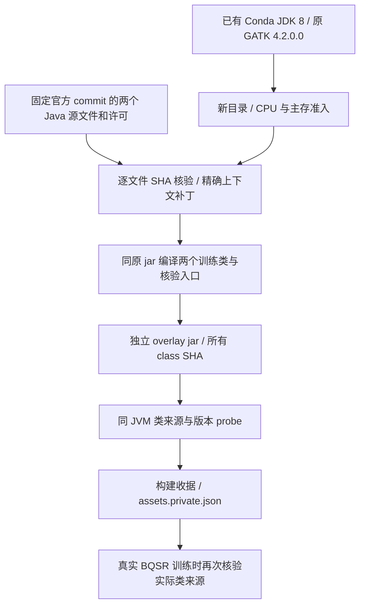

# 构建原 GATK BQSR 训练源码补丁

`build_preprocessing_gatk_sourcepatch` 使用已有 Conda 环境中的 JDK 8 和 GATK 4.2.0.0，在新目录编译两个原 BQSR 训练类的最小补丁，生成独立 overlay jar 和可核验的资产。安装在环境中的原 GATK jar 保持原字节。构建过程不读取测序数据，也不运行 BQSR、变异检测或 GPU 计算。

本接口自 v0.13.0 提供。单样本输入输出和三种源码资产的接入方式见[主流程第 5.2 节](single_subj_preprocessing.md#source-optimizations)；同输入验收和组件结果分别见[第 9.3 节](single_subj_preprocessing.md#validation-scope)与[第 9.4 节](single_subj_preprocessing.md#94-小组件结果与未采用方案)。已发布 v0.12.0 不包含这一独立构建接口。



## 1. 优化内容与适用范围

补丁固定作用于原 `BaseRecalibrationEngine` 和 `ReadRecalibrationInfo`：在每个原引擎内复用无状态的读段转换组合；实际事件轴只有替换错误时，不再分配两个不会使用的 indel 小数误差数组。原六参数公开构造函数及启用 indel 的分支保留，访问未构建的 indel 事件会明确拒绝。SNP/indel 检测、BAQ、替换误差计算、协变量、统计表更新、归并和最终 finalize 仍使用原数字路径。

资产传入 `single_subj_preprocessing(..., gatk_source_patch_assets=...)` 后，只影响 BQSR **训练**。`bqsr_mode="original"` 在原 BaseRecalibrator JVM 中加载补丁；已有 parallel/auto 路径则在各自独立的原引擎 worker 中加载同一补丁。ApplyBQSR、HaplotypeCaller 和 QC 不加载这个训练 overlay。并行 BQSR 本身属于已有实现，不能计为本补丁新增加的优化。Java 对象序列化不在已验证范围内。

## 2. 安装前提与 Python 调用

先按[主文档的环境安装步骤](single_subj_preprocessing.md#2-安装与固定软件)准备项目和固定的预处理 Conda 环境。本函数不安装、升级或修改环境。环境必须包含 `conda-meta`、可执行的 `bin/java`、`bin/javac`、`bin/jar`、`bin/python`，以及 `share/*/gatk-package-4.2.0.0-local.jar` 中唯一的一份原 jar；Java 与 javac 必须为 JDK 8。构建还需至少 256 MiB 可用磁盘。

```python
import os
from pathlib import Path
from fudan_wgs_toolkit.build_preprocessing_gatk_sourcepatch import (
    build_preprocessing_gatk_sourcepatch,
    verify_gatk_source_patch_assets,
)

preprocessing_conda_prefix = "/opt/conda/envs/wgs-preprocess"
gatk_patch_build_directory = "/work/build/gatk-bqsr-sourcepatch"  # 必须尚不存在。
build_cpu_ids = sorted(os.sched_getaffinity(0))[:1]  # 本进程实际获准的 CPU。

gatk_source_patch_assets = build_preprocessing_gatk_sourcepatch(
    conda_prefix=preprocessing_conda_prefix,
    build_dir=gatk_patch_build_directory,
    upstream_source_dir=None,          # 从固定官方 commit 获取并校验源码。
    cpu_affinity=build_cpu_ids,
    host_memory_limit_gib=4,           # 整个构建进程树的采样 PSS 预算。
    host_memory_reserve_gib=10,        # 共享主存实时预留，按所在节点设置。
)

verified_gatk_source_patch_assets = verify_gatk_source_patch_assets(
    Path(gatk_patch_build_directory) / "assets.private.json",
    conda_prefix=preprocessing_conda_prefix,
    gatk_jar=gatk_source_patch_assets["gatkJar"],
)
print(verified_gatk_source_patch_assets["status"])
print(verified_gatk_source_patch_assets["sourcePatchJar"])
```

### 每个构建参数

| 参数 | 默认值、类型和格式 | 输入意义与约束 |
| --- | --- | --- |
| `conda_prefix` | 必填；路径字符串或 `Path` | 已有预处理 Conda 环境。工具和原 jar 从该环境绑定；原 jar 必须位于 prefix 内。 |
| `build_dir` | 必填；路径字符串或 `Path` | 新的私有构建目录，不能覆盖已有目录，不能在 Conda prefix 或包内，也不能包含整个 prefix。构建后保留源码、日志和资产。 |
| `upstream_source_dir` | `None`；可选目录路径 | `None` 下载固定官方 commit 的两个源文件及许可；离线目录必须提供完全相同的原字节，不能传入已打补丁的源码。 |
| `cpu_affinity` | `None`；CPU 整数编号序列 | 默认取当前获准亲和性中的第一个 CPU。显式指定 1–4 个不同编号，不能超过当前允许集合和所有有限祖先 CPU 配额；不接受布尔值。 |
| `host_memory_limit_gib` | `4`；有限数值，至少 1 GiB | 共享构建进程树的 PSS 采样预算。不是每个 javac/Java 进程各获一份预算，也不是节点 cgroup 硬配额。 |
| `host_memory_reserve_gib` | `4`；有限数值，至少 1 GiB | 准入与运行期间检查的可用主存预留。准入同时要求物理可用量和有限祖先约束下的可准入量可容纳预算加预留。 |

离线目录结构为：

```text
fixed-gatk-source/
├── LICENSE.TXT
└── src/main/java/org/broadinstitute/hellbender/utils/recalibration/
    ├── BaseRecalibrationEngine.java
    └── ReadRecalibrationInfo.java
```

`verify_gatk_source_patch_assets(assets, *, conda_prefix=None, gatk_jar=None)` 接受返回的完整字典或资产 JSON 路径；两个可选参数用于进一步限定将要使用的环境和原 jar。核验失败会抛错，不返回部分资产。

### 输出资产及其意义

返回值为字典，同时最后原子提交到 `build_dir/assets.private.json`：

| 产物或字段 | 含义 |
| --- | --- |
| `sourcePatchJar` | 独立的 `fudan-gatk-bqsr-sourcepatch.jar`；含允许的补丁类、核验入口及原 Apache 许可。它依赖同时使用的原 GATK jar。 |
| `gatkJar`、`java`、`javac`、`jar`、`python` | 本次实际使用的原 jar 和环境工具绝对路径，连同文件身份及 SHA 固定。 |
| `classBinding` | `class_binding.private.json`；列出实际生成的类及 SHA，并绑定原 GATK Main。 |
| `classProbe` | `class_probe.private.json`；同一 JVM 的实际 CodeSource 和 class 字节核验结果。probe 不进行 BQSR 训练。 |
| `sha256`、`identities` | 上述八项资产的 SHA-256 和文件身份；不能用同名文件替换后继续使用旧清单。 |
| `buildReceipt`、`build_receipt_sha256` | 构建收据及其 SHA；包含各阶段真实退出、绑定信息和资源证据。 |
| `scientific_validation_completed` | 构建成功时仍为 `False`。编译和类加载通过不等于真实数据的精度、速度或内存验收。 |
| `source/`、`classes/`、`stages/` | 固定原源码、精确修改后的源码、编译 class、原始许可、最小补丁与逐阶段日志。用于追溯构建，不是分析结果。 |

成功状态为 `compiled_class_binding_probe_passed_not_scientific_validation`。资产包含私有绝对路径和环境身份，不能直接提交到公开仓库，也不能移动构建目录后只修改 JSON 路径。失败会保存失败收据及现场，不提交可用的最终资产；重试使用新目录。此构建器没有 `resume` 参数。

## 3. 接入单样本流程

下面仅启用这一个源码补丁；读段、参考和三个 known-sites 仍按主流程检查。输入 FASTQ 为有序配对文件，参考需配套 `.fai`、`.dict` 和 BWA 索引，三个 VCF 需与参考匹配并有 `.tbi`。示例路径是占位格式，应替换为自己的文件。

```python
from fudan_wgs_toolkit.single_preprocessing import single_subj_preprocessing

pipeline_cpu_ids = sorted(os.sched_getaffinity(0))[:8]
single_sample_result = single_subj_preprocessing(
    read1="/data/reads/sample_R1.fastq.gz",
    read2="/data/reads/sample_R2.fastq.gz",
    reference_fasta="/data/reference/reference.fa",
    known_sites=[
        "/data/reference/known_indels_a.vcf.gz",
        "/data/reference/known_indels_b.vcf.gz",
        "/data/reference/known_snps.vcf.gz",
    ],
    output_dir="/results/sample-bqsr-sourcepatch",
    sample_id="sample_example",
    conda_prefix=preprocessing_conda_prefix,
    cpu_threads=len(pipeline_cpu_ids),
    cpu_affinity=pipeline_cpu_ids,
    fastp_threads=1,
    host_memory_limit_gib=28,
    host_memory_reserve_gib=10,
    pairhmm_backend="cpu",
    intervals=None,
    bqsr_mode="original",              # 单独查看原训练路径加载补丁的行为。
    haplotypecaller_workers=1,           # 本例不同时启用 HC 并行。
    gatk_source_patch_assets=verified_gatk_source_patch_assets,
    resume=False,
)
print(single_sample_result["status"], single_sample_result["gvcf"])
```

真实训练时产生的 `bqsr_sourcepatch.private.json` 核验该次训练 JVM 实际加载的类来源。它需与训练阶段的真实退出和提交输出共同解释，不能单独当作完整流程成功。

## 4. 命令行与原 Java 构建调用

公开构建 CLI 使用模块入口：

```bash
python -m fudan_wgs_toolkit.build_preprocessing_gatk_sourcepatch \
  --conda-prefix /opt/conda/envs/wgs-preprocess \
  --build-dir /work/build/gatk-bqsr-sourcepatch-cli \
  --cpu-affinity 0,1 \
  --upstream-source-dir /data/source-cache/fixed-gatk-source
```

用户参数是 `--conda-prefix`、`--build-dir`、可选 `--upstream-source-dir` 和逗号分隔的 `--cpu-affinity`。不传源码目录时使用固定官方下载；不传 CPU 时默认一个获准 CPU。**该 CLI 当前没有主存参数**，使用 Python 默认的 4 GiB 预算加 4 GiB 预留；需要另设预留时使用 Python 接口。`--worker-download` 和 `--worker-patch` 是构建器内部子阶段入口，不是单样本科学参数。

以下命令展示构建器的核心 Java 编译方式；实际运行应使用上述 API，使工具、源文件、许可、资源和类来源一并核验：

```bash
# 原 jar 的目录由环境决定；实际路径取返回资产的 gatkJar。
original_gatk_jar=/opt/conda/envs/wgs-preprocess/share/gatk4/gatk-package-4.2.0.0-local.jar
derived_source_directory=/work/build/gatk-bqsr-sourcepatch/source/derived
launcher_source_file=/work/build/gatk-bqsr-sourcepatch/source/package/assets/SourcePatchedBqsrMain.java
compiled_class_directory=/work/build/gatk-bqsr-sourcepatch/classes
overlay_jar=/work/build/gatk-bqsr-sourcepatch/fudan-gatk-bqsr-sourcepatch.jar

/opt/conda/envs/wgs-preprocess/bin/javac -J-Xmx512m -proc:none -encoding UTF-8 \
  -source 8 -target 8 -implicit:none -cp "$original_gatk_jar" \
  -sourcepath "$derived_source_directory" -d "$compiled_class_directory" \
  "$derived_source_directory/src/main/java/org/broadinstitute/hellbender/utils/recalibration/BaseRecalibrationEngine.java" \
  "$derived_source_directory/src/main/java/org/broadinstitute/hellbender/utils/recalibration/ReadRecalibrationInfo.java" \
  "$launcher_source_file"
/opt/conda/envs/wgs-preprocess/bin/jar cf "$overlay_jar" -C "$compiled_class_directory" .
```

原科学训练命令仍对应原 `BaseRecalibrator`，例如：

```bash
/opt/conda/envs/wgs-preprocess/bin/gatk --java-options "-Xmx4g" BaseRecalibrator \
  -R /data/reference/reference.fa -I /data/alignment/marked.cram \
  --known-sites /data/reference/known_indels_a.vcf.gz \
  --known-sites /data/reference/known_indels_b.vcf.gz \
  --known-sites /data/reference/known_snps.vcf.gz \
  -O /results/recalibration.table
```

补丁入口把两个训练类的 overlay 放在原 jar 前，并在**同一训练 JVM**验证所有 class 后转发给原 BaseRecalibrator 或已有并行适配器。它不使用另一个 GATK 版本，也不使用外部 Java 环境注入的科学参数；工具环境会清除 `JAVA_TOOL_OPTIONS`、`_JAVA_OPTIONS`、`JDK_JAVA_OPTIONS` 和 `CLASSPATH`。

## 5. 已有真实验证与范围

| 范围 | 实际证据 | 能得出的结论 |
| --- | --- | --- |
| 独立公开构建 | 原 JDK/GATK 的编译、版本和实际 class 来源 probe 已执行，资产及真实退出已绑定。 | 证明可构建和加载固定补丁，不代替数值或性能测试。 |
| 100k 条真实历史 BAM 记录、4 CPU，四臂训练与 Apply | 原训练 7.173 s；原训练加补丁 6.397 s；已有并行 7.244 s；已有并行加补丁 8.125 s。Apply 各 6.952–7.815 s；八阶段实际退出 0。全部五类 BQSR 表格单元，以及全部 100k 条 BAM 的核心字段、QUAL、带类型 AUX 和顺序一致。 | 输入 fixture 仅把无效平台值修正为 `ILLUMINA`；未覆盖本轮 FASTQ 上游或 CRAM 解码。单次小工作集不支持稳定加速结论。 |
| 四例各 10M 对真实原始前缀、完整参考流程 | 四例每例87组完整比较一致；原工具到组合实现的批次 body 为12701.57→8480.26 s。分阶段表、精度及资源记录见[主流程验收](single_subj_preprocessing.md#validation-scope)；完整冷准备成本仍未统一核验。 | 组合流程收益不等于这个 BQSR 补丁的独立收益；内存缺口和非平台结论保留。 |

既有优化冻结对照已经包含 BQSR、fastp、BWA 三个源码补丁和参考核验复用，也包含更早的并行 BQSR、共享 QC 与退出等待修复；新版完整 contig 实现相对该对照只新增 HC 调度和资源生命周期变更。相应比较层次和完整字段验收见[第 9.3 节](single_subj_preprocessing.md#validation-scope)。预处理比较使用输出全字段、序列、顺序和完整文件回读，不使用关联分析的 `-log10P` 阈值。当前新测试使用 H100 节点上的 CPU 原工具，未运行本补丁的 GPU 路径。

## 6. 最近更改

- **v0.13.0：**新增固定两个原 BQSR 类的最小对象复用补丁、公开构建器和同 JVM class 来源核验；保留原训练数字路径。
- **v0.13.0：**构建资产绑定原源码、补丁、环境、许可、实际生成类与真实阶段收据；公开 builder 成功与科学验收分开。
- 已发布 v0.12 的并行 BQSR 和完整流程历史证据见[主文档第 9.5 节](single_subj_preprocessing.md#historical-validation)，不是此补丁的独立增量对照。

## 7. 官方源码、许可与参考文献

原版本固定为 GATK 4.2.0.0，commit `1f7fade2afbd706539eb983087907a0cb11ee734`。两个源文件、原许可、精确上下文补丁和最终文件 SHA 见[包内来源清单](../fudan_wgs_toolkit/_preprocessing_gatk_sourcepatch/SOURCES.md)与[机器清单](../fudan_wgs_toolkit/_preprocessing_gatk_sourcepatch/source_manifest.json)。

- [原 BaseRecalibrationEngine.java](https://github.com/broadinstitute/gatk/blob/1f7fade2afbd706539eb983087907a0cb11ee734/src/main/java/org/broadinstitute/hellbender/utils/recalibration/BaseRecalibrationEngine.java)。
- [原 ReadRecalibrationInfo.java](https://github.com/broadinstitute/gatk/blob/1f7fade2afbd706539eb983087907a0cb11ee734/src/main/java/org/broadinstitute/hellbender/utils/recalibration/ReadRecalibrationInfo.java)。
- [原 LICENSE.TXT：Apache-2.0](https://github.com/broadinstitute/gatk/blob/1f7fade2afbd706539eb983087907a0cb11ee734/LICENSE.TXT)。修改后的两个上游类保留原许可和修改说明；生成 overlay 含原许可。项目 launcher 和 builder 遵循项目 GPL-3.0-only，原 jar 依赖各保留其许可。公开包只提供最小补丁、适配入口、许可和清单，不重分发完整原软件、原数据或私有运行产物。
- DePristo MA et al. *A framework for variation discovery and genotyping using next-generation DNA sequencing data*. Nature Genetics, 2011. [doi:10.1038/ng.806](https://doi.org/10.1038/ng.806)。
