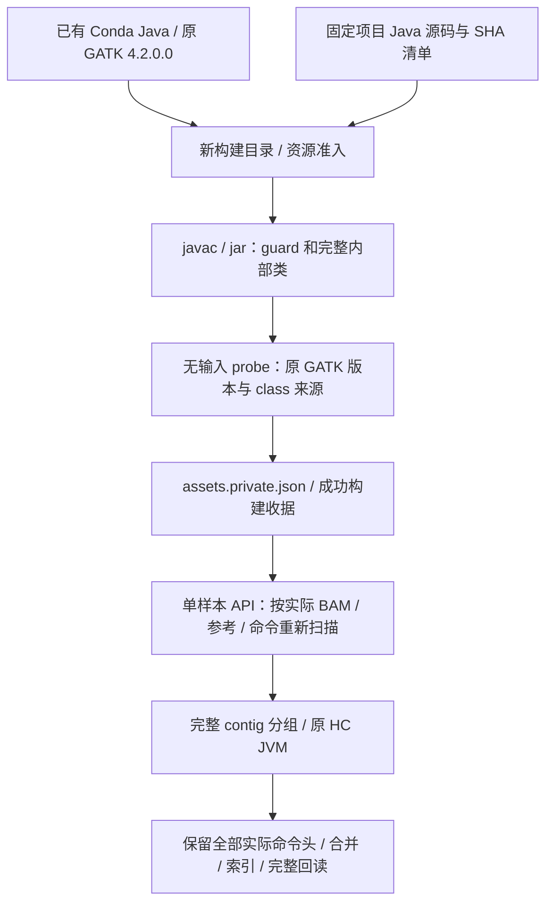

# 构建完整 contig HaplotypeCaller 的输入 guard

`build_preprocessing_hc_guard` 使用已有 Conda 环境中的 Java 工具和原 GATK 4.2.0.0，编译项目自有的输入遍历 guard 和一个无输入 probe，生成可核验的独立 jar。构建器不读取 BAM/CRAM/FASTA，不运行 HaplotypeCaller（HC），不改写原 GATK jar，也不构建新的变异检测算法。

本接口自 v0.13.0 提供。完整 contig 调度的适用范围和行为见[主流程第 5.3 节](single_subj_preprocessing.md#hc-whole-contig)；同输入验收和真实组件范围分别见[第 9.3 节](single_subj_preprocessing.md#validation-scope)和[第 9.4 节](single_subj_preprocessing.md#94-小组件结果与未采用方案)。



## 1. guard 与原 HC 的分工

guard 使用原 HTSJDK 完整扫描实际重校正 BAM，核对输入 SHA、CRC/EOF、参考字典和固定原 HC 命令条件，并统计所有 mapped 读段在每个比对起点的原始数量。任一原始起点数量超过默认 50 的 contig 属于可能触发下采样的风险组；风险 contig 保持原字典顺序，在同一 JVM 中处理，避免直接拆散其随机序列。其他完整 contig 可分配给少量原 HC JVM。不会跳过空 contig、低深度 contig 或读段，也不会把染色体切成小窗口。扫描证明上述下采样上界，不能单独证明所有随机调用均不存在；最终等价仍由完整输出对照验收。

guard 只是调度的输入核验器。实际组装、PairHMM、过滤、打分和 GVCF reference-block 仍使用同一个原 GATK jar 和原科学参数。适用路径限定为固定默认的单 BAM、CPU、完整参考 GVCF；自定义注释、过滤、显式小区间或 CUDA 不在这条并行路径的范围内。无法满足适用条件或预算时记录原因，保留原串行路径；源码、工具或已提交输出绑定损坏则拒绝，不能以串行回退掩盖。

构建资产可以复用，但每个实际 BAM、输出目录和 HC 命令均需重新生成输入扫描凭据。其他输入或输出目录的旧扫描证书不能代替这一步。

## 2. 安装前提与 Python 调用

先按[主文档环境安装步骤](single_subj_preprocessing.md#2-安装与固定软件)安装项目和固定预处理 Conda 环境。构建器要求已有 `conda-meta`、可执行的 `bin/java`、`bin/javac`、`bin/jar`，以及唯一的 `share/*/gatk-package-4.2.0.0-local.jar`。使用固定 JDK 8；它不安装或升级任何工具。构建需至少 256 MiB 可用磁盘。

```python
import os
from pathlib import Path
from fudan_wgs_toolkit.build_preprocessing_hc_guard import (
    build_preprocessing_hc_guard,
    verify_hc_guard_assets,
)

preprocessing_conda_prefix = "/opt/conda/envs/wgs-preprocess"
hc_guard_build_directory = "/work/build/hc-contig-guard"  # 必须尚不存在。
build_cpu_ids = sorted(os.sched_getaffinity(0))[:1]

hc_guard_assets = build_preprocessing_hc_guard(
    conda_prefix=preprocessing_conda_prefix,
    build_dir=hc_guard_build_directory,
    cpu_affinity=build_cpu_ids,
    host_memory_limit_gib=4,           # 构建进程树的共享采样 PSS 预算。
    host_memory_reserve_gib=10,        # 共享节点实时预留。
)

verified_hc_guard_assets = verify_hc_guard_assets(
    Path(hc_guard_build_directory) / "assets.private.json",
    conda_prefix=preprocessing_conda_prefix,
    gatk_jar=hc_guard_assets["gatkJar"],
)
print(verified_hc_guard_assets["status"])
print(verified_hc_guard_assets["adapterJar"])
```

### 每个构建参数

| 参数 | 默认值、类型和格式 | 输入意义与约束 |
| --- | --- | --- |
| `conda_prefix` | 必填；路径字符串或 `Path` | 已有预处理 Conda 环境，从中选择 Java 工具和唯一原 GATK 4.2.0.0 jar。 |
| `build_dir` | 必填；路径字符串或 `Path` | 新私有构建目录。不能覆盖已有目录，不能在 Conda prefix 或包内，也不能包含整个 prefix。 |
| `cpu_affinity` | `None`；CPU 整数编号序列 | 默认从当前获准 CPU 中选择不超过 3 个、且不超过实际 CPU 配额的编号。显式指定 1–3 个不同的获准编号，不能超出任何有限祖先 CPU 配额；不接受布尔值。 |
| `host_memory_limit_gib` | `4`；有限数值，1–32 GiB | 整个构建进程树的 PSS 采样预算，不是每个子进程的独立硬配额。 |
| `host_memory_reserve_gib` | `4`；有限数值，至少 1 GiB | 共享主存实时预留。准入同时检查物理可用量和有限祖先约束下的可准入量能否容纳预算加预留。 |

这些是**构建**参数，不设置科学 HC 的 worker 数、BAM、参考或调用区间。`verify_hc_guard_assets(assets, *, conda_prefix=None, gatk_jar=None)` 接受完整资产字典或 JSON 路径；可选 prefix 和原 jar 用于限定实际接入的工具环境。没有 `resume`、`variant` 或上游源码下载参数。

### 输出资产及其意义

| 产物或字段 | 含义 |
| --- | --- |
| `adapterJar` | `fudan-hc-guard.jar`，只包含 guard、其内部统计类和独立 probe；不含修改后的 HC 实现。 |
| `gatkJar`、`java` | 实际使用的原 GATK jar 和 Java 工具路径。 |
| `classpath`、`entrypoint` | 固定为 guard jar 加原 jar，以及 `HCMappedStartGuard`。科学 HC 仍使用原科学入口。 |
| `probe` | `probe.private.json`，核对原 GATK 4.2.0.0 版本、原 jar SHA 和实际类来源。probe 不读测序数据。 |
| `class_sha256` | 四个 class 的完整集合及 SHA：`HCMappedStartGuard`、其 `Counts` 和 `CountedSHA` 内部类、`HcGuardProbe`。缺失或新增类均拒绝。 |
| `sha256`、`identities` | guard jar、原 jar、Java、probe 的完整身份和 SHA；原源码与 builder 另由源码清单及 builder SHA 绑定。 |
| `buildReceipt`、`build_receipt_sha256` | 含真实 javac、jar、probe 三阶段退出及工具绑定的构建收据和 SHA。 |
| `scientific_validation_completed`、`GPU_work_started` | 构建成功后均为 `False`，不能把可加载 guard 当作完成科学运行或 GPU 加速。 |
| `source/`、`classes/`、`stages/` | 固定 Java 源码、所有生成类和各阶段日志，便于复查构建。 |

Python 返回完整资产字典；最终提交文件为 `build_dir/assets.private.json`，成功状态是 `compiled_guard_probe_passed_not_science`。失败保留失败收据且不提交可用的最终资产，使用新目录重试。资产包含私有绝对路径和文件身份，应保留在原构建位置，不能公开或手改路径迁移。

## 3. 接入完整单样本处理

此例从完整配对 FASTQ 开始，使用原 CPU HC；参考需有 `.fai`、`.dict`、BWA 索引，三个 known-sites VCF 均需匹配参考并有 `.tbi`。输入资产只省去重复编译 guard，不能省去实际重校正 BAM 的完整扫描。

```python
from fudan_wgs_toolkit.single_preprocessing import single_subj_preprocessing

pipeline_cpu_ids = sorted(os.sched_getaffinity(0))[:8]
single_sample_result = single_subj_preprocessing(
    read1="/data/reads/sample_R1.fastq.gz",
    read2="/data/reads/sample_R2.fastq.gz",
    reference_fasta="/data/reference/reference.fa",
    known_sites=[
        "/data/reference/known_indels_a.vcf.gz",
        "/data/reference/known_indels_b.vcf.gz",
        "/data/reference/known_snps.vcf.gz",
    ],
    output_dir="/results/sample-whole-contig",
    sample_id="sample_example",
    conda_prefix=preprocessing_conda_prefix,
    cpu_threads=len(pipeline_cpu_ids),
    cpu_affinity=pipeline_cpu_ids,
    fastp_threads=1,
    host_memory_limit_gib=28,           # 整例共享预算，不是每 JVM 28 GiB。
    host_memory_reserve_gib=10,
    pairhmm_backend="cpu",
    intervals=None,                    # 完整参考，不限制成若干小窗口。
    haplotypecaller_workers=None,       # 在适用条件及共享预算内自动规划。
    haplotypecaller_guard_assets=verified_hc_guard_assets,
    resume=False,
)
print(single_sample_result["status"], single_sample_result["gvcf"])
```

原 HC 每 JVM heap 为 8 GiB；计划还计每 JVM 2 GiB 非堆和控制器 1 GiB。两个 JVM 的计划为 21 GiB，三个为 31 GiB。在 CPU 数和实际准入足够时，28 GiB 单例预算自动选择最多两个，32 GiB 才可选择三个；实际分组仍可能降级。构建器的 4 GiB 预算与随后 HC 预算是不同阶段，不能以构建成功作为三个 HC JVM 的准入。

并行输出按原参考字典顺序有界合并。每个实际 shard 的 `GATKCommandLine` 原样保留并逐条核验，其他头和全部 body 都需检查，不捏造一次未执行的串行命令。原 bgzip/tabix 生成压缩和索引后，完整顺序回读和全参考索引查询均计入验收。aggregate 阶段与各子 JVM 时钟相互重叠，不能相加成总耗时。

## 4. 真实 CLI 与原 Java 调用

模块入口和安装后的控制台入口等价：

```bash
python -m fudan_wgs_toolkit.build_preprocessing_hc_guard \
  --conda-prefix /opt/conda/envs/wgs-preprocess \
  --build-dir /work/build/hc-contig-guard-cli \
  --cpu-affinity 0 1 \
  --host-memory-limit-gib 4 \
  --host-memory-reserve-gib 10

# 安装后的另一个入口；使用时另选一个尚不存在的目录。
build-preprocessing-hc-guard \
  --conda-prefix /opt/conda/envs/wgs-preprocess \
  --build-dir /work/build/hc-contig-guard-console
```

CLI 的 CPU 编号是**空格分隔**的整数列表。参数与 Python 五个参数对应；不传 CPU 和内存参数时使用上表默认值。CLI 只打印构建状态及 `scientific_validation_completed=false`，完整资产保存在构建目录。主流程 CLI 继续使用[主文档完整 JSON 配置](single_subj_preprocessing.md#6-命令行调用)中的 `haplotypecaller_guard_assets` 和 `haplotypecaller_workers`。

以下是构建器实际核心 Java 命令的等价展示；推荐用 builder 完成所有资源、来源和收据核验：

```bash
# 原 jar 的目录由环境决定；实际路径取返回资产的 gatkJar。
original_gatk_jar=/opt/conda/envs/wgs-preprocess/share/gatk4/gatk-package-4.2.0.0-local.jar
guard_source_directory=/work/build/hc-contig-guard/source
compiled_class_directory=/work/build/hc-contig-guard/classes
guard_adapter_jar=/work/build/hc-contig-guard/fudan-hc-guard.jar

/opt/conda/envs/wgs-preprocess/bin/javac -J-Xmx512m -proc:none -source 8 -target 8 \
  -cp "$original_gatk_jar" -d "$compiled_class_directory" \
  "$guard_source_directory/HCMappedStartGuard.java" \
  "$guard_source_directory/HcGuardProbe.java"
/opt/conda/envs/wgs-preprocess/bin/jar cf "$guard_adapter_jar" -C "$compiled_class_directory" .
```

科学运行仍对应原命令，例如：

```bash
/opt/conda/envs/wgs-preprocess/bin/gatk --java-options "-Xmx8g" HaplotypeCaller \
  -R /data/reference/reference.fa -I /data/alignment/recalibrated.bam \
  -O /results/sample.g.vcf.gz --emit-ref-confidence GVCF \
  --native-pair-hmm-threads 1
```

完整 contig 并行时，各原 JVM 仅使用分配的 CPU、独立输出和临时目录，以及自己的 `-L whole_contigs.interval_list`。文件保留完整原 `.dict` 头，每个 contig 记录为 `1..length`；冒号、星号等合法名称按字段传递，不解析成小区间表达式。PairHMM、打分、过滤和 reference-block 参数按原完整命令保留。构建和工具运行环境清除外部 `JAVA_TOOL_OPTIONS`、`_JAVA_OPTIONS`、`JDK_JAVA_OPTIONS` 和 `CLASSPATH`，只使用显式配置。

## 5. 已有真实验证与范围

| 范围 | 当前证据 | 结论范围 |
| --- | --- | --- |
| guard 构建与无输入 probe | 实际 javac、jar、probe 退出、完整内部类集合、原 GATK 版本及 class 来源已核验。 | 证明固定 guard 可构建、可加载；不证明某个 BAM 已扫描，更不证明完整 HC 等价或加速。 |
| 完整 contig 的真实组件探索 | 已按同一真实 BAM 和原参数执行过完整 contig 组件；扫描、合并、压缩、索引与完整回读必须按各自实际收据解释。 | 不能把只计 HC JVM 或预热扫描的时钟当作一次冷运行总成本，也不能用失败后分段收尾拼成新的干净端到端结果。 |
| 四例各 10M 对真实原始前缀、完整参考流程 | 四例每例87组完整比较一致；相对既有优化对照，HC inclusive 中位数8142.95→4639.10 s，批次 body 11811.63→8480.26 s。完整原工具对照、精度和资源见[主流程验收](single_subj_preprocessing.md#validation-scope)。 | 四例单例预算为 28 GiB、自动最多两个 HC JVM；不能套用独立 32 GiB、最多三个 JVM 组件的速度。 |

完整验收涵盖所有 GVCF 头和 body、等位基因、GT/FORMAT/INFO/QUAL/FILTER、reference-block 边界、样本与参考轴、记录顺序，以及后续原 GenotypeGVCFs、规范化 VCF 和 PLINK。仅逐条核验实际命令中已批准的输出/tmp/完整 contig 角色差异，其余科学字段保持严格。方法及资源覆盖见[第 9.3 节](single_subj_preprocessing.md#validation-scope)，有限组件及未采用方案见[第 9.4 节](single_subj_preprocessing.md#94-小组件结果与未采用方案)。不以 `-log10P` 检验预处理等价。

本版使用 H100 节点的 CPU 原工具，未把 HC 转为 GPU。已有 fastp/BWA/BQSR 三个源码补丁、参考核验复用以及更早的并行 BQSR、共享 QC 和退出等待修复已包含在既有优化冻结对照中；这里的增量为受 guard 约束的 HC 调度及相应资源生命周期，不重复归因已有收益。

## 6. 最近更改

- **v0.13.0：**增加独立 guard 构建器与无输入 probe，显式绑定原 GATK jar、Java、全部内部类和实际构建收据。
- **v0.13.0：**完整 contig 使用原字典头的 interval-list 字段表示，保留实际 shard 命令头；全参考顺序与索引回读共同验收。
- **v0.13.0：**在整例共享 CPU/PSS/主存预留内规划 2–3 个原 JVM；四例完整参考结果已完成；内存为有限窗口采样，尚未证明长期平台。历史 v0.12 范围见[原验证追溯](single_subj_preprocessing.md#historical-validation)。

## 7. 原实现、许可与参考文献

项目 Java guard 和 probe 的固定来源及逐文件 SHA 见[包内来源说明](../fudan_wgs_toolkit/_preprocessing_hc_guard/SOURCES.md)与[机器清单](../fudan_wgs_toolkit/_preprocessing_hc_guard/source_manifest.json)。它们使用原 GATK/HTSJDK API，没有复制或重写原 HC 实现；项目文件遵循 GPL-3.0-only。原 GATK 4.2.0.0 为 Apache-2.0，原 jar 的其他依赖保留各自许可；构建不重新分发原 jar 或真实数据。

- [GATK 固定 commit `1f7fade2afbd706539eb983087907a0cb11ee734`](https://github.com/broadinstitute/gatk/tree/1f7fade2afbd706539eb983087907a0cb11ee734)。
- [原 HaplotypeCaller](https://github.com/broadinstitute/gatk/blob/1f7fade2afbd706539eb983087907a0cb11ee734/src/main/java/org/broadinstitute/hellbender/tools/walkers/haplotypecaller/HaplotypeCaller.java)。
- [原 HaplotypeCallerEngine](https://github.com/broadinstitute/gatk/blob/1f7fade2afbd706539eb983087907a0cb11ee734/src/main/java/org/broadinstitute/hellbender/tools/walkers/haplotypecaller/HaplotypeCallerEngine.java)。
- [GATK 原许可](https://github.com/broadinstitute/gatk/blob/1f7fade2afbd706539eb983087907a0cb11ee734/LICENSE.TXT)；[VCF/SAM 官方格式规范](https://samtools.github.io/hts-specs/)。
- DePristo MA et al. *A framework for variation discovery and genotyping using next-generation DNA sequencing data*. Nature Genetics, 2011. [doi:10.1038/ng.806](https://doi.org/10.1038/ng.806)。
