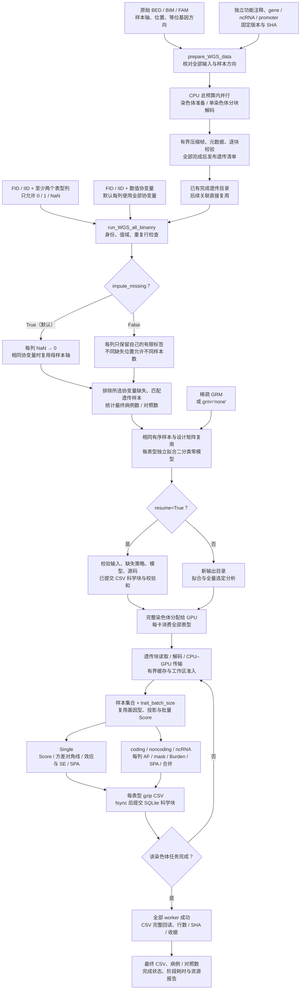
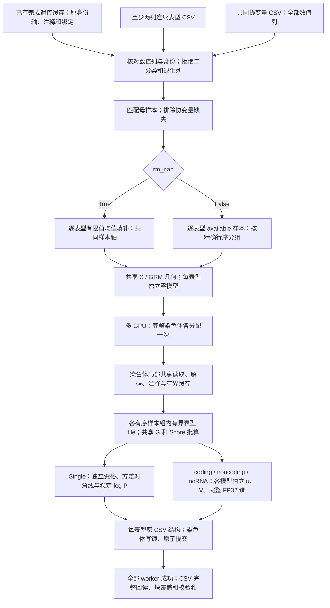

# 多表型 WGS 使用说明

## 1. 功能与流程

`run_WGS_all_binanry` 一次分析表型 CSV 中的全部二值列：每列分别拟合零模型、执行 Single、coding、noncoding 和 ncRNA，输出自己的结果 CSV。函数名称中的 `binanry` 按公开接口保留该拼写。至少需要两个表型列，每列只接受 `0`（对照）、`1`（病例）和缺失值；其他数值、文本标签、连续表型或只有一个表型的输入会报错。

`prepare_WGS_data` 从原始 PLINK BED/BIM/FAM 与独立下载的功能注释准备遗传数据，只需要运行一次。已有完成目录时直接调用关联函数，不再次转换。两种完成清单均可复用：`dataset.json` 保存完整 FID/IID，`cache_dataset.json` 保留已有数字身份轴。

默认 `impute_missing=True` 把 CSV 中缺失的表型标签设为 `0`。这表示在本次分析中将缺失标签纳入对照，原始 `1` 的病例标签不变。`impute_missing=False` 分别排除每列的缺失表型，不取所有表型的共同完整样本交集。两种模式均只纳入身份可匹配且所选协变量有效的人；协变量缺失不填补，不存在于表型 CSV 的遗传样本不自动补入。病例数、对照数按最终分析样本统计。

默认全部表型使用协变量 CSV 中的同一套列。可用 `phenotype_covariates` 为部分表型选列，其余表型仍使用全部协变量。每列至少需要一个病例和一个对照，并满足零模型拟合所需的有效样本量。共享协变量与遗传数据不等于共享回归系数、残差或检验协方差。

多 GPU 一律按完整染色体分工，一条染色体的四类分析和全部表型由同一 worker 完成。GPU 数量多于选定染色体数时，额外设备可以空闲。一个 worker 内按精确的样本行序分组，再用有界表型批次复用数据整理与张量运算。



Single 的位置分区只控制读取批次和输出，不进行固定窗口或滑动窗口关联检验。二分类 gene-based 使用 Burden 与二分类尾概率路线；本入口不接受连续表型或 SKAT 谱方法参数。

## 2. 安装与环境

```bash
git clone https://github.com/weikanggong1/Fudan-WGS-Toolkit.git
cd Fudan-WGS-Toolkit
conda env create -f environment.yml
conda activate fudan-wgs-toolkit
```

关联分析需要支持 TF32 的 NVIDIA GPU 和兼容 CUDA 驱动。零模型使用成熟 FP64 拟合；关联主计算采用原生 TF32/FP32，Burden 使用 IEEE FP32 矩阵乘法，显著结果的稳定 SPA 保留 FP64。不会用多次 TF32 分量乘法重建 FP64 矩阵乘法。

`memory_limit_gib=None` 自动取得各 GPU 物理显存上限，工作区分配另检查实时余量，默认预留 1 GiB。`host_memory_limit_gib=None` 取物理主存和所有有限 cgroup 祖先限制的较小值；显式主存预算由节点全部 worker 共同使用。工作区准入和有界缓存是资源调度策略，不是 RSS 系统硬限制。CPU 线程受亲和性与实际共享配额约束，参数不表示独占核心数。

数据准备默认总预算 8 个 CPU worker，不使用 GPU。Parquet 注释额外安装 `python -m pip install -e '.[parquet]'`；参考资源一次性导出依赖使用 `python -m pip install -e '.[annotations]'`。CSV/TSV 注释本身不需要这些可选依赖。

## 3. 输入数据

### 3.1 原始遗传文件

一个染色体对应同名的 `chromosome21.bed`、`chromosome21.bim`、`chromosome21.fam`。BIM 单独不包含基因型，三个文件必须同时提供。

| 文件 | 格式与字段 | 用途 |
| --- | --- | --- |
| BED | 二进制，前三字节 `6c 1b 01`，按变异存储的 PLINK 1 二位编码 | 唯一的基因型来源；支持完整二倍体调用和完全缺失 |
| BIM | 无表头、空白分隔六列：CHR、变异标识、遗传距离、BP、A1、A2 | 确定原始变异顺序、染色体、1-based 位置和两个等位基因 |
| FAM | 无表头、空白分隔六列：FID、IID、父本 ID、母本 ID、sex、phenotype | 确定 BED 样本顺序；分析表型来自另外的 CSV |

不能把 A1 或 A2 自动当作 REF。默认以独立注释的 REF/ALT 匹配等位基因；原始 BIM 标识确实为 `CHR:POS:REF:ALT` 时，可在清单声明 `reference_allele_source: "bim_variant_id"`。转换会核对全部 BIM 行的标识、位置和等位基因，再按声明方向精确匹配独立注释；不会仅凭前缀或首批位点推断。BIM 必须按染色体位置非降序排列，每行两个等位基因明确且不同。BED 无法恢复单个等位基因缺失的半调用；转换记录会明确说明这一限制。

### 3.2 独立功能注释

注释目录包含 `annotations.json`、原始功能注释文件以及独立基因和 promoter 数据。**注释输入必须是原始下载的文件，不能用已准备缓存中的注释替代。** 当前原始注释清单格式为 `raw-wgs-annotations-v1`。

功能注释支持 CSV、TSV、gzip CSV/TSV、含 CSV/TSV 的 `tar.gz`，或 Parquet。压缩包会流式读取，不需要先展开整条染色体。输入文件按染色体位置排列，多个分片按位置顺序写入清单。一个原始 BIM 位点必须有唯一、精确的 CHR/POS/REF/ALT 对应记录；额外的公共库位点不进入遗传数据。默认情况下，缺失位点、重复对应关系或缺少必需字段会报错，不丢弃原始变异，也不把未知权重改成零。

公共注释可能不覆盖输入中的全部 indel/MNV。只有显式声明并验证 `reference_allele_source: "bim_variant_id"`、明确 QC 策略后，才可另声明 `allow_missing_non_snv: true`：保留这些变异的原始基因型，标记 `annotation_available=False`、分类为空和权重为 NaN。SNV 缺注释仍报错。这种数据可做全部变异的 Single 和已覆盖 SNV 的 gene-based；不能做 Indel 或全部变异的 gene-based。要做后两者，需要完整的独立注释。默认不启用该策略。

建议从 [FAVOR Essential 官方数据集](https://doi.org/10.7910/DVN/1VGTJI) 下载对应染色体文件，并核对官方校验值。其原始表包含以下字段。`column_mapping` 明确把原始列映射到包内的语义路径；包内路径是注释键名，不表示外部软件文件中的节点。

| 语义 | 原始 FAVOR 列 | 意义 |
| --- | --- | --- |
| chromosome / position | `chromosome` / `position` | GRCh38 染色体和 1-based 位置 |
| reference / alternate | `ref_vcf` / `alt_vcf` | 包含锚定碱基的原始 REF 与单个 ALT |
| GENCODE.Category | `genecode_comprehensive_category` | exonic、splicing、UTR、upstream、ncRNA 等区域分类 |
| GENCODE.Info | `genecode_comprehensive_info` | 基因归属字符串；保留原始语法 |
| GENCODE.EXONIC.Category | `genecode_comprehensive_exonic_category` | missense、synonymous、stopgain、frameshift 等编码影响 |
| MetaSVM | `metasvm_pred` | disruptive missense 的分类依据 |
| GeneHancer | `genehancer` | enhancer 与目标基因的关联 |
| CAGE / DHS | `cage_tc` / `rdhs` | promoter、enhancer mask 的调控区标记 |
| CADD / LINSIGHT / FATHMM.XF | `cadd_phred` / `linsight` / `fathmm_xf` | 三类功能权重 |
| aPC.EpigeneticActive / Repressed / Transcription | `apc_epigenetics_active` / `apc_epigenetics_repressed` / `apc_epigenetics_transcription` | 三类表观遗传注释主成分 |
| aPC.Conservation | `apc_conservation_v2` | 所选版本的保守性注释主成分 |
| aPC.LocalDiversity | `apc_local_nucleotide_diversity_v3` | 所选版本的局部多样性主成分 |
| aPC.Mappability / TF / Protein | `apc_mappability` / `apc_transcription_factor` / `apc_protein_function_v3` | 可比对性、转录因子和蛋白功能主成分 |

本版使用官方教程链接的 FAVOR Essential GRCh38 原始下载集（DOI `10.7910/DVN/1VGTJI`），没有改用另外一代注释。官方教程先选择原始 CSV 列，再把 Conservation v2、LocalDiversity v3、Protein v3 重命名为分析列；上表直接映射同一批原始列，省去中间文件转换。固定教程提交为 `5340326e0506945e35bc9d4d3cb85d5e8d65cd92`，对应 [官方列选择](https://github.com/li-lab-genetics/STAARpipeline-Tutorial/blob/5340326e0506945e35bc9d4d3cb85d5e8d65cd92/FAVORannotator_csv/Annotate.R) 与 [官方列重命名](https://github.com/li-lab-genetics/STAARpipeline-Tutorial/blob/5340326e0506945e35bc9d4d3cb85d5e8d65cd92/FAVORannotator_csv/gds2agds.R)。

本次 chr21 官方压缩包大小为 5,528,780,471 字节，MD5 为 `dccf132a9ed61f18f08ceac69b5c2cab`；下载后已核对官方校验值。准备流程另记录使用的原始文件 SHA-256。公共数据库不保证覆盖任意研究的所有 indel/MNV；同一官方文件的覆盖缺口也不能通过其他版本的权重或旧缓存补齐。

注释版本属于分析输入。更换 aPC 版本可能改变权重和 P 值，不能把这种输入变化解释为 TF32 数值误差。QC 不是公共功能注释：必须映射原始 QC 列，或者在清单中明确声明输入遗传文件已经通过项目 QC，例如 `default_qc: "PASS"`。后者不能替代实际的质量控制。

基因输入可使用独立 CSV。编码基因表的字段为 `hgnc_symbol,chromosome_name,start_position,end_position`；ncRNA 名单为 `chr,ncRNA`；promoter TSV 为 `chromosome,start,end,strand,gene_id`。位置均为 1-based、闭区间。精确复现需要固定这些文件的版本和 promoter 定义，不在运行中重新猜测转录本或启动子长度。

编码基因表和 ncRNA 名单固定为 [原始方法提交 ed3e26f7](https://github.com/li-lab-genetics/STAARpipeline/tree/ed3e26f7fb4c5d70a765840d089e5863896ec081) 的原始参考表，独立转换为上述 CSV。本次 promoter 则读取 [官方 TxDb.Hsapiens.UCSC.hg38.knownGene 3.22.0](https://bioconductor.org/packages/release/data/annotation/html/TxDb.Hsapiens.UCSC.hg38.knownGene.html) 的 SQLite 数据：同一基因的同染色体、同链转录本合并范围，多染色体或多链基因按原规则排除；正链取 `gene_start−3000 ... gene_start+2999`，负链取 `gene_end−2999 ... gene_end+3000`，不裁剪坐标。固定下载包 SHA-256 为 `feb61126a6d874949423703c90e92e6073d22fecf2db18c44aa9859a43d53f4e`。这些参考文件与参与者及基因型无关，不从已经准备的遗传缓存提取。

完整清单生成示例见 [write_annotation_manifest.py](../examples/write_annotation_manifest.py)。其中的目录、文件名和列映射需要与实际下载文件对应。

### 从官方原始参考文件生成三个输入表

先在已安装的 Conda 环境中安装一次性的 Python 参考读取依赖：

```bash
conda activate fudan-wgs-toolkit
python -m pip install -e '.[annotations]'
```

独立下载 [固定官方基因参考资源](https://raw.githubusercontent.com/li-lab-genetics/STAARpipeline/ed3e26f7fb4c5d70a765840d089e5863896ec081/R/sysdata.rda) 与 [官方 TxDb 3.22.0 源包](https://bioconductor.org/packages/3.23/data/annotation/src/contrib/TxDb.Hsapiens.UCSC.hg38.knownGene_3.22.0.tar.gz)。前者 SHA-256 为 `4bfa7ab5fe2c25f8aaf6e4319e683c3e29b97f62e687b01036501cffd32b484f`；后者为 `feb61126a6d874949423703c90e92e6073d22fecf2db18c44aa9859a43d53f4e`。下载文件保持在项目外，不放入本仓库。基因参考资源是外部序列化数据，由 Python 读取，不安装或调用原语言解释器。

把下载文件分别保存为本例的 `gene_reference.archive` 与 `promoter_reference.tar.gz` 后，从仓库根目录运行：

```bash
python examples/export_annotation_references.py \
  --gene-reference-archive /data/downloads/gene_reference.archive \
  --promoter-database /data/downloads/promoter_reference.tar.gz \
  --output-directory /data/raw_annotation_references

# 只有输入遗传文件确已完成项目 QC 时，才声明下面的 PASS。
python examples/write_annotation_manifest.py \
  --output-directory /data/original_annotations \
  --chromosome 21 \
  --variant-archive /data/downloads/chromosome21.tar.gz \
  --gene-csv /data/raw_annotation_references/genes.csv \
  --ncrna-csv /data/raw_annotation_references/ncrna.csv \
  --promoter-tsv /data/raw_annotation_references/promoter_intervals.tsv \
  --default-qc PASS
```

随后把 `/data/original_annotations` 传入 `prepare_WGS_data(annotation_directory=...)`。如果项目有逐位点 QC 列，应映射它而不声明固定 PASS；若原始非 SNV 存在注释覆盖缺口，仍须遵循上文的显式覆盖策略，示例不会自动容许缺注释。

| 导出参数 | 意义 |
| --- | --- |
| --gene-reference-archive | 独立下载的原始基因参考资源；内含 genes_info 与 ncRNA_gene 两个表，保持原始行顺序 |
| --promoter-database | 原始 TxDb 源包 tar.gz，或从同一原始包独立提取的 SQLite 数据库；不是遗传缓存 |
| --output-directory | 不存在的新目录；生成 genes.csv、ncrna.csv、promoter_intervals.tsv 和 reference_export.private.json |
| --gene-source-sha256 | 基因参考资源的预期 SHA-256；默认锁定上述固定官方资源 |
| --promoter-source-sha256 | promoter 原始输入的预期 SHA-256；默认按 tar 或 SQLite 锁定 3.22.0 资源；独立 SQLite 默认 SHA 为 7fab4f12a779f3917f84f19e6fe10b66fd5564ad015da55163d5c17e6c86f573 |
| --promoter-package-version | 预期 promoter 包版本，默认 3.22.0；tar 包 DESCRIPTION 必须一致；使用其他合法版本时须显式提供版本与预期校验和 |

脚本不会下载数据、运行外部解释器、从缓存提取注释或重新分发原始资源。promoter 通过同染色体、同链转录本范围构造，排除多范围基因，保留官方闭区间及可能的越界坐标，不截到 1。准备阶段再筛选目标常染色体并校验坐标。输出私有证明记录源 SHA、转换规则、各文件 SHA 与条数，不应上传为分析数据。

本版脚本使用真实官方下载输入验证：gene CSV 18,445 行、ncRNA CSV 21,104 行、promoter TSV 35,356 行。分别用原始 tar 和 SQLite 导出时，三个文件均与固定参考的 SHA-256 完全一致；这是参考资源转换检查，不能替代关联分析的精度或耗时 benchmark。

### 3.3 二值表型与协变量 CSV

两个文件使用 UTF-8、逗号分隔、表头，前两列为字符串 `FID,IID`。原始行序可以不同，按完整身份双列匹配。下面是格式示例，不是 benchmark 数据。

```text
FID,IID,disease_a,disease_b
0,person_001,1,NaN
0,person_002,0,1
family_b,person_003,NaN,0
```

```text
FID,IID,age,sex,PC1,PC2
0,person_001,51,0,0.01,-0.02
0,person_002,63,1,0.03,0.01
family_b,person_003,47,1,-0.01,0.02
```

| 输入 | 意义与要求 |
| --- | --- |
| FID / IID | 完整匹配原始 FAM 的身份双列，保留前导零、下划线和 FID `0`；相同 IID 但 FID 不同是不同样本；重复身份报错 |
| 表型列 | 至少两列；每列是病例 / 对照标签，仅允许 0、1、缺失；2、−1、连续值和文本均报错，不能被填为 0 |
| 表型缺失 | 空白、NaN、NA、null 等识别为缺失；默认 True 将缺失标签设为 0；False 每列只用其有值样本 |
| 协变量列 | 数值列，默认每个表型用全部列；可显式选取子集；所选协变量缺失时排除该人，不填补 |
| 空协变量选择 | `phenotype_covariates={"disease_a": []}` 对该列只保留截距；未指定表型仍用全部协变量 |
| 有效样本与计数 | 由身份匹配、表型缺失策略、所选协变量有效性确定；报告最终病例数、对照数、样本数，须同时存在两类 |
| 无穷值 | 表型和协变量的正负无穷报错，不按缺失处理 |

协变量在每列表型有效样本中添加截距、标准化并去除常数或共线列，保留固定效应空间，记录中心、尺度和保留 / 去除列。默认使用同一套列时，不填补模式仍可因不同 NaN 位置形成不同样本与设计矩阵。

兼容 `cache_dataset.json` 要求 FID 为字符串 `0`，IID 为已有数字身份的规范正十进制文本，不带前导零。现代 `dataset.json` 使用完整 FID/IID 字符串。两种清单均采用上述二分类语义，不消费清单里的历史连续表型 profile。

### 3.4 稀疏 GRM 与普通 logistic 模型

默认 `grm="sparse"` 使用输入稀疏亲缘关系矩阵和二分类混合零模型。显式 `grm_file` 优先，否则读取遗传清单的 `phewas.kinship_npz`；均无则报错。遗传准备不估计 GRM。`grm="none"` 使用普通 logistic 零模型；此时禁止传 `grm_file`，不消费清单内的 GRM。

GRM 是无 pickle 的 NPZ：

| 数组 | 形状与意义 |
| --- | --- |
| sample_ids | `[n]` 唯一身份字符串，覆盖全部实际分析样本；按身份重排，允许与遗传目录行序不同 |
| diagonal | `[n]` 有限非负对角线元素 |
| edge_rows / edge_cols | `[e]` 零基整数非对角索引，取值 `[0,n)` |
| edge_values | `[e]` 有限关系值；单侧三角形或数值一致的对称双侧项 |

现代身份是完整双列的 canonical JSON 键，如 `'["family_a","participant_a"]'`；用 `fudan_wgs_toolkit.identity.sample_keys(sample_pairs)` 从 `[n,2]` 字符串双列生成。数字缓存用原数字身份的十进制文本。清单可选 `phewas.cohort_rows` 是唯一零基缓存逻辑行或布尔 mask，限定母样本，不是原 BED 物理行号。

## 4. Python 调用与全部参数

### 4.1 首次准备后运行

```python
from pathlib import Path
from fudan_wgs_toolkit import prepare_WGS_data, run_WGS_all_binanry

original_plink_directory = Path("/data/original_plink")
original_annotation_directory = Path("/data/original_annotations")
prepared_genetic_directory = Path("/data/prepared_genetics")
phenotype_csv = Path("/data/binary_phenotypes.csv")
covariate_csv = Path("/data/covariates.csv")
association_output_directory = Path("/data/binary_results")

if __name__ == "__main__":
    # 只准备一次；后续重复使用这个完成目录。
    preparation_report = prepare_WGS_data(
        source_directory=original_plink_directory,
        annotation_directory=original_annotation_directory,
        output_directory=prepared_genetic_directory,
        chromosomes=[21],
        cpu_threads=8,              # 准备阶段总 CPU 预算
        memory_limit_gib=8,         # 准备阶段主机工作区估算预算
        chunk_size=256,
    )
    if not preparation_report["completed"]:
        raise RuntimeError("遗传数据尚未准备完成")

    association_report = run_WGS_all_binanry(
        phenotype_csv=phenotype_csv,
        covariate_csv=covariate_csv,
        prepared_directory=prepared_genetic_directory,
        output_directory=association_output_directory,
        chromosomes=[21],           # "all" 运行全部已有常染色体
        analyses=("individual", "coding", "noncoding", "ncrna"),
        device=["cuda:0"],         # device=2 使用前两张可见 GPU
        cpu_threads=8,              # 每个 GPU worker 的 CPU 预算
        memory_limit_gib=None,      # 自动显存上限，另预留 1 GiB
        host_memory_limit_gib=None, # 节点全部 worker 共享主存预算
        phenotype_covariates=None, # 每个表型用全部协变量
        impute_missing=True,       # NaN 标签纳入对照
        trait_batch_size=32,        # 计算批次，不限制总表型数
        gene_variant_type="SNV",
        grm="sparse",
        grm_file="/data/sparse_grm.npz",
        resume=False,
    )
    print(association_report["completed"])
```

### 4.2 已完成缓存、多 GPU 与不填补

有完成遗传清单时跳过 prepare。用新输出目录保存不填补结果，不恢复默认填补的旧模型或块：

```python
from fudan_wgs_toolkit import run_WGS_all_binanry

if __name__ == "__main__":
    association_report = run_WGS_all_binanry(
        phenotype_csv="/data/binary_phenotypes.csv",
        covariate_csv="/data/covariates.csv",
        prepared_directory="/data/completed_genetics",
        output_directory="/data/binary_available_results",
        chromosomes=[1, 2, 21],
        device=["cuda:0", "cuda:1"], # 两个 GPU 按整染色体分工
        impute_missing=False,       # 每列分别排除缺失标签
        phenotype_covariates={
            "disease_a": ["age", "sex", "PC1", "PC2"],
            "disease_b": ["sex", "PC1", "PC2"],
        },                         # 其他列仍用全部协变量
        cpu_threads=8,
        memory_limit_gib=20,
        host_memory_limit_gib=64,   # 全节点共享，不能乘 GPU 数
        grm="none",               # 普通 logistic 模型
    )
    print(association_report["completed"])
```

多进程脚本保留 `if __name__ == "__main__":`，避免子进程重复执行。可运行参数示例见 [run_binary_wgs.py](../examples/run_binary_wgs.py)。

### 4.3 prepare_WGS_data 的每个参数

| 参数 | 默认值 | 含义 |
| --- | --- | --- |
| source_directory | None | 原始 BED/BIM/FAM 的目录；自动发现每条染色体的一组同名文件 |
| output_directory | None，必填 | 新准备目录，不能覆盖已完成数据 |
| prefixes | None | Python 字典 `{染色体: 文件前缀}`；目录有多组同染色体文件时明确指定 |
| chromosomes | None | 要准备的染色体列表；None 为发现的全部常染色体；仅支持 1–22，其他染色体名称报错 |
| annotation_directory | None，必填 | 原始注释目录、annotations.json 路径，或同结构字典 |
| sample_pairs | None | 可选 FID/IID CSV 或 `[n,2]` 字符串数组，选择并确定样本顺序；None 保留完整 FAM |
| variant_indices | None | 可选递增、唯一的零基 BIM 行号；字典可为各染色体分别指定；明确标记为局部验证数据 |
| memory_limit_gib | 8 | 主机工作区估算的调度预算，单位 GiB；据此减少并发进程，不是总 RAM/RSS 硬上限 |
| cpu_threads | 8 | 准备阶段的总 CPU worker 预算，正整数；默认并行染色体准备，单染色体并行解码；1 为串行 |
| hardlink_annotations | True | 同文件系统尽量硬链接准备后的注释，失败后复制；不链接原始基因型 |
| resume | False | 恢复完全相同输入、样本和变异选择的未完成转换；校验绑定后继续 |
| max_frames | None | 分块检查点限制；达到后返回 completed=False，不发布 dataset.json |
| chunk_size | 256 | 每个压缩帧的变异数，1–1024；减小它可降低解码峰值内存 |

转换的 `completed=True` 才表示选择的全部染色体和变异完成。每块保留状态计数、校验和和往返校验结果。source_bytes 使用真实 BED 字节数；大文件压缩容器有 10% 存储上限，小型接口测试有最小容器开销额度。不要把检查点、PID 或准备中的临时目录当作完成数据。

准备阶段的主机内存预算采用工作区估计。高非零比例基因型的 CSR 校验临时数组、较长的注释字符串及 Python 进程开销可能超出估计；调度报告中的估算值不等于实测峰值 RSS。减少 `chunk_size`、`cpu_threads` 可降低这些开销。恢复未完成转换时，会重新核对根样本双列、身份键和已完成染色体的数据流校验和，再发布整体完成标记。

### 4.4 run_WGS_all_binanry 的每个参数

| 参数 | 默认值 | 意义 |
| --- | --- | --- |
| phenotype_csv | 必填 | UTF-8 CSV，FID/IID 双列后至少两个只含 0、1、缺失的表型列；全部列独立分析 |
| covariate_csv | 必填 | FID/IID 双列与数值协变量；可仅有身份列，对应只用截距 |
| prepared_directory | 必填 | 已完成遗传根目录，含 dataset.json 或 cache_dataset.json；不重新转存 |
| output_directory | 必填 | 结果目录；首次调用需要新目录，恢复使用同一目录 |
| chromosomes | all | `"all"` 运行目录内全部常染色体；如 `[1,2,21]` 选定编号列表；仅支持 1–22 |
| analyses | 四类全部 | individual、coding、noncoding、ncrna 非空组合；individual 为逐变异检验 |
| device | ("cuda:0",) | CUDA 设备列表或正整数 n（前 n 张可见卡）；多卡一律整染色体分工 |
| cpu_threads | 8 | 每个 GPU worker 的 CPU 操作 / 解码线程预算；受节点共享配额和亲和性限制 |
| memory_limit_gib | None | 每卡显存上限，GiB；None 自动检测物理容量；实际分配另检查实时余量 |
| memory_reserve_gib | 1.0 | 每卡额外预留的 GiB，非负 |
| host_memory_limit_gib | None | 节点全部 worker 共用主存准入预算，GiB；None 自动检测物理 / cgroup 上限 |
| phenotype_covariates | None | `{表型列名:[协变量列名,...]}`；默认和未列出表型用全部列；空列表只用截距 |
| impute_missing | True | True 仅将缺失标签改为 0；False 使用每列有限标签样本；协变量缺失均排除；恢复绑定此策略 |
| gene_variant_type | SNV | gene-based 的 SNV、Indel 或 variant；Single 扫描全部变异；gene-based 须有相应独立注释 |
| covariance_block_size | 4096 | 内部变异工作区分块大小，降低可减少临时内存 |
| seed | 1729 | 非负随机种子，绑定运行计划以固定使用到随机步骤时的状态 |
| single_mac_cutoff | 20 | Single 保留的最小 minor allele count |
| single_group_variants | 5000 | Single 读取 / 输出作业的变异分组大小 |
| single_region_size | 10000000 | Single 输出位置分区宽度，bp；不是窗口检验 |
| individual_effective_block_size | 1024 | Single 内部有效变异批次大小 |
| device_cache_bytes | 536870912 | 设备共享缓存字节上限；0 不保留缓存 |
| compact_cache_bytes | 67108864 | CPU 紧凑遗传状态缓存字节上限；0 不保留缓存 |
| metadata_cache_bytes | 268435456 | CPU 注释元数据缓存字节上限，正整数 |
| resume | False | False 新目录全量执行；True 校验完成科学块后补算未完成块 |
| trait_batch_size | 32 | 每遗传工作区的最大表型批次，可按实时余量缩小，不限制总列数 |
| grm | sparse | sparse 为稀疏 GRM 二分类混合零模型；none 为普通 logistic 零模型 |
| grm_file | None | sparse 显式 NPZ 优先，否则读取清单侧文件；none 禁止传此参数 |

本入口没有自动模型族、连续变换或谱近似参数，非法二分类数值直接报错。零模型固定成熟 FP64 拟合，不提供切换低精度拟合的公开参数。改变缺失策略、协变量、GRM、身份或科学设置时使用新的结果目录。

### 4.5 连续多表型独立入口 run_WGS_continuous


表型 CSV 的身份双列之后只放连续数值表型，例如 `trait_a`、`trait_b`，所有列均运行。协变量 CSV 的身份双列之后只放共同使用的数值协变量，例如 age、sex 和主成分。sex 等 0/1 协变量允许使用；0/1 表型列拒绝。遗传目录与三输入绑定规则沿用第 3 节，已有完整缓存不再执行 prepare。

```python
from pathlib import Path
from fudan_wgs_toolkit import run_WGS_continuous

phenotype_csv = Path("/data/continuous_phenotypes.csv")
covariate_csv = Path("/data/shared_covariates.csv")
prepared_genetic_directory = Path("/data/completed_cache")
association_output_directory = Path("/data/continuous_results")

if __name__ == "__main__":
    continuous_association_report = run_WGS_continuous(
        phenotype_csv=phenotype_csv,
        covariate_csv=covariate_csv,
        prepared_directory=prepared_genetic_directory,
        output_directory=association_output_directory,
        chromosomes="all",                       # 或 [1, 2, 21]
        analyses=("individual", "coding", "noncoding", "ncrna"),
        device=["cuda:0", "cuda:1"],              # 按完整染色体分配给两张卡
        cpu_threads=8,                            # 每 worker 上限，受节点共享配额约束
        memory_limit_gib=None,                    # 自动显存准入
        memory_reserve_gib=1.0,
        host_memory_limit_gib=None,               # 全节点任务共用的主存预算
        rm_nan=True,                              # 默认逐列均值填补；False 为 available
        trait_batch_size=32,                      # 每个遗传块的有界表型 tile
        continuous_transform="none",              # 连续专用入口默认使用原始表型值
        gene_variant_type="SNV",
        grm="sparse",                             # 无 GRM 时明确设为 "none"
        grm_file=None,                             # 或传入身份绑定的稀疏 GRM NPZ
        long_mask_method="full",                  # 各实际权重独立完整 FP32 谱
        resume=False,                            # 新目录；True 只补算已验证运行的缺块
    )
    print(continuous_association_report["completed"])
```

`rm_nan=True` 先按遗传身份、表型 CSV、协变量 CSV 和可选 cohort 范围匹配母样本，再排除任何共同协变量缺失的样本。每个表型仅以该母样本中的有限值计算自己的均值并填补，随后执行连续变换。没有表型 CSV 行的缓存参与者不会加入分析；不会填补协变量。此时各表型可以共享有序样本轴和设计矩阵 X，回归系数、残差、方差参数和检验矩阵 P 各自独立。

`rm_nan=False` 再排除各表型自己的缺失值，保留各自 available 样本及原顺序。样本行序完全相同的表型才组成共同计算组；不同 NaN 模式不会被取交集或强制填补。共同协变量使用同样的列，但各样本组按自身样本计算中心、尺度、GRM 子集和设计几何。遗传频率、MAC、方向、遗传缺失填补及筛选也按各自分析样本确定。改变缺失模式须使用新输出目录和相应零模型；恢复不能跨模式复用。

两种模式均按染色体并行，而非把不同表型分给不同 GPU。每个 worker 保留该染色体的 reader、注释局部性和有界模型 LRU，按 `trait_batch_size` 使用已实现的遗传块共享、同样本组 Score 批算及共同设计缓存。一个染色体只归一个 worker；染色体少于 GPU 时多余 worker 明确空闲，染色体大小不同也可能产生尾部等待。缓存、表型 tile 与工作区受实时显存及节点共享主存准入约束，不将全部表型基因型同时驻留设备，不共享不同模型的 P 或 V。



| 连续专用参数 | 默认值 | 含义 |
| --- | --- | --- |
| phenotype_csv | 必填 | 对应遗传清单身份双列加至少两个连续数值表型；全部列独立分析，二分类列拒绝 |
| covariate_csv | 必填 | 对应身份双列加共同数值协变量；所有表型使用全部协变量，缺失协变量样本排除 |
| prepared_directory | 必填 | 已完成的 `dataset.json` 或 `cache_dataset.json` 遗传根目录，不再次转换 |
| output_directory | 必填 | 每表型独立 CSV、模型、计划、检查点与报告的运行目录；新运行须新目录 |
| chromosomes | `"all"` | 全部已准备常染色体，或不重复的编号列表；多 GPU 分配完整染色体 |
| analyses | 四类全部 | individual、coding、noncoding、ncrna 的非空组合，保留合法 mask |
| device | `("cuda:0",)` | 设备列表指定单／多卡；正整数 n 选择前 n 张可见卡；多卡均按染色体并行 |
| rm_nan | True | 逐列母样本均值填补；False 保留各自 available 样本。协变量均不填补 |
| cpu_threads | 8 | 每 worker 读取、解码和 CPU 操作预算；实际算力由亲和性及节点共享 cgroup 配额约束 |
| memory_limit_gib / memory_reserve_gib | None / 1.0 | GPU 物理与实时可用余量准入；显式上限及安全预留约束所有选中 GPU 的工作区 |
| host_memory_limit_gib | None | 全部 worker 共用的节点主存准入预算，自动取物理容量与有限 cgroup 祖先限制；不按卡数相乘 |
| trait_batch_size | 32 | 每个遗传块的有界表型 tile 大小，不是总表型数量；available 模式在精确样本组内分 tile |
| continuous_transform | `"none"` | 默认直接使用原始表型数值；可显式 none、paper 或 rint，均在缺失处理后执行。paper 为共同协变量 OLS 残差、RINT 和原始标准差恢复 |
| null_fit_mode | `"fp64"` | 使用成熟 FP64 零模型拟合；tf32 拟合选项明确报错，关联矩阵仍为 TF32/FP32 |
| gene_variant_type | `"SNV"` | gene-based 类型 SNV、Indel 或 variant；Single 保留原全部变异资格规则 |
| grm / grm_file | `"sparse"` / None | 使用绑定身份的稀疏 GRM；none 为无 GRM 连续零模型，不能同时传 grm_file |
| covariance_block_size | 4096 | 协方差变异 panel 大小，降低可缩小中间工作区 |
| long_mask_method | `"full"` | 各实际权重独立完整 FP32 谱；显式 fastskat 或 liu 才选择原近似分支 |
| long_mask_threshold / long_mask_rank / seed | 5000 / 512 / 1729 | 显式近似分支的切换、秩与种子；默认 full 不以阈值切换谱或跳过 mask |
| single_mac_cutoff | 20 | Single 独立样本组的最小 MAC |
| single_group_variants / single_region_size | 5000 / 10000000 | Single 组装大小和结果位置分区宽度；不构成区域关联检验 |
| individual_effective_block_size | 1024 | Single 内部有效变异批大小 |
| device_cache_bytes / compact_cache_bytes / metadata_cache_bytes | 536870912 / 67108864 / 268435456 | 设备共享状态、CPU 紧凑状态与注释缓存的有界字节容量；前两项 0 禁用留存 |
| resume | False | True 验证本次运行的输入、模型、样本、设置、源码和 CSV 已提交范围后只补缺块 |
| gpu_ids | None | 旧设备编号列表的兼容参数；推荐使用 device，不同时给出冲突设备选择 |

返回报告包含 `completed`、各类结果行数、worker 报告、输出目录和端到端墙时。每个表型均保存 Single 结果；CSV 字段与排序见第 6 节。连续入口保留共同协变量和独立模型的契约，不接受二值表型。

## 5. 命令行调用

```bash
prepare-WGS-data \
  --source-directory /data/original_plink \
  --annotation-directory /data/original_annotations \
  --output-directory /data/prepared_genetics \
  --chromosomes 21 --cpu-threads 8 --chunk-size 256

run-WGS-all-binanry /data/binary_phenotypes.csv /data/covariates.csv /data/prepared_genetics \
  --output-directory /data/binary_results \
  --chromosomes 1 2 21 --device cuda:0 cuda:1 --cpu-threads 8 \
  --grm sparse --grm-file /data/sparse_grm.npz
```

已有完成遗传目录时只运行关联命令。`python -m fudan_wgs_toolkit` 与 `fudan-wgs` 使用同一二分类入口。CLI 参数使用短横线，如 `--trait-batch-size`；`--device 2` 选择前两张可见卡；`--device cuda:0 cuda:1` 指定设备；`--chromosomes all` 为全部已有常染色体。

默认填补缺失标签，`--impute-missing` 显式选择默认模式；`--no-impute-missing` 使用每列实际有值样本。`--phenotype-covariates` 接受映射 JSON 文件路径，如 `{"disease_a":["age","sex","PC1"],"disease_b":["sex","PC1"]}`；未指定表型使用全部协变量。

```bash
run-WGS-all-binanry /data/binary_phenotypes.csv /data/covariates.csv /data/completed_genetics \
  --output-directory /data/binary_available_results \
  --chromosomes all --device 2 --trait-batch-size 32 \
  --no-impute-missing --phenotype-covariates /data/covariate_selection.json \
  --grm none --host-memory-limit-gib 64
```

`--memory-limit-gib 20 --memory-reserve-gib 1` 设置显存预算与预留；省略时自动检测。`--host-memory-limit-gib 64` 是全节点共享预算。恢复用 `--resume`，科学输入、缺失策略和协变量选择必须与首次一致。

连续入口的命令行示例：

```bash
run-WGS-continuous /data/continuous_phenotypes.csv /data/shared_covariates.csv /data/completed_cache \
  --output-directory /data/continuous_results \
  --chromosomes all --device cuda:0 cuda:1 --cpu-threads 8 \
  --trait-batch-size 32 --grm sparse --long-mask-method full
```

`python -m fudan_wgs_toolkit.continuous_run` 与该入口等价。默认逐列均值填补；新的输出目录使用 `--no-rm-nan` 保留各列 available 样本。连续入口全部表型共享所有协变量，其他参数采用参数表对应的短横线拼写。

## 6. 输出、方法与恢复

### 6.1 文件结构

```text
prepared_genetics/
  dataset.json                         # 全部选择完成后的现代清单
  sample_pairs.npy                     # 原始 FID/IID 字符串双列
  sample_ids.npy                       # 完整双列的无歧义内部键
  chr21/                               # 压缩遗传帧、注释、逐块校验
  catalogs/                            # 独立 gene / ncRNA / promoter 任务
  # 或已有 cache_dataset.json 的完成目录

binary_results/
  csv/
    chromosomes/chr21/traits/trait_0000/<分析>/chr21/<字段签名>/results.csv.gz
    chromosomes/chr21/.trait_checkpoints/ # 每条染色体的科学块提交、锁与恢复证据
    worker_<编号>.complete.private.json # 完整 CSV 回读与完成摘要
  models/                              # 每表型普通关联 / SPA 零模型状态
  trait_index.private.csv              # trait_index、原列名、family
  phenotype_sample_counts.csv           # 每表型实际病例 / 对照和填补计数
  inputs/                              # 匹配轴、输入绑定（视清单路线）
  plan.private.json
  status.private.json                  # 当前 attempt_id 状态
  report.private.json                  # 全部完成后的本次报告
```

每个表型独立输出 gzip 文本 CSV，通过私有索引还原原列名；路径以本次 worker 的 `output["receipts"]` 中 `csv_file` 为准，相对于 output_directory/csv。`trait_index` 为输入表型列的零基编号。结果不包含原语言序列化文件，模型使用 Python 状态与数组。

| 输出 | 字段与意义 |
| --- | --- |
| Single | CHR、POS、REF、ALT、ALT_AF、MAF、N、pvalue、pvalue_log10、Score、Score_se、Est、Est_se |
| pvalue_log10 | `−log10(P)`，极小概率下保留可验证的对数尾概率 |
| Score / Score_se | score 与标准误；Est / Est_se 为基于 score 的效应估计及标准误 |
| coding / noncoding / ncRNA | gene / mask 身份、变异数、累计 MAC；两套 Beta 权重的 Burden 及注释权重合并概率 |
| phenotype_sample_counts.csv | trait_index、phenotype、samples、cases、controls、available_cases、available_controls、imputed_controls |
| 完成报告 | completed、各分析行数、worker 收据、end_to_end_seconds 与阶段 / 资源诊断；全部 worker 成功后发布 |

返回字典的 `phenotype_counts` 与样本 CSV 使用相同字段。`available_cases` 和 `available_controls` 是身份匹配、所选协变量有效且在指定母样本范围内的原始有限 0/1 标签数；`cases`、`controls` 和 `samples` 是本次策略的最终分析计数。默认模式中 `controls=available_controls+imputed_controls`；不填补时 `imputed_controls=0`。输入整张表的病例总数不一定等于最终分析病例数。

空 mask 也有零行提交块或表头；不因 M 超过 5,000 自动省略合法 mask。coding 基础类别为 pLoF、pLoF 加 disruptive missense、missense、disruptive missense、synonymous；完成目录 catalog 决定实际类别，兼容计划可另含 PTV 及其组合。noncoding 包括 upstream、downstream、UTR、promoter CAGE/DHS、enhancer CAGE/DHS；ncRNA 独立分析。

### 6.2 计算与资源利用

每列计算自己的 `u=Gᵀr` 与模型投影。Single 只求方差对角线。二分类 Burden 将所有权重组成 `W`，先计算 `Z=GW`，再求 score 与小协方差，保留成熟的 SPA 和稳定 Cauchy 合并，不构造 SKAT 完整谱。共享读取不改变每列 AF、MAF、MAC、遗传缺失填补和 mask 筛选。

| 缺失策略 | 复用步骤 | 独立步骤 |
| --- | --- | --- |
| 默认填补 | 相同身份与协变量选择共用母样本轴、索引、X、亲缘结构准备和遗传整理；有界 tile 合并 Score | 模型参数、残差、二分类权重、检验投影和 SPA |
| 不填补 | 原始遗传帧、metadata 和 CPU–GPU 传输共用；精确相同有序样本和协变量进一步合批 | 不同 NaN 模式的样本筛选、频率、X 标准化和模型；不取共同交集替代每列有效样本 |

CPU 负责索引、遗传帧读取 / 解码和 CSV 压缩；GPU 执行基因型整理、矩阵运算和检验。分配前估算尚未分配的工作区，压力时缩小批次或释放未使用缓存。主机与 CUDA 的实际占用、缓存和峰值分别记录；reserved 增长不能单独判定泄漏。普通和 SPA 状态按真实存储字节纳入有界模型缓存，作业 / 批次结束后释放临时数组。

兼容输入路线的设计矩阵复用使用 128 MiB 有界 LRU；现代输入对齐使用 256 MiB 有界缓存。同样本行序和协变量设计只整理一次 X 与身份轴，各表型依然独立拟合和计算。输出使用稳定的染色体命名空间，一个 worker 完成一条染色体后关闭该染色体 writer，避免为所有染色体同时保留全部表型锁。二分类现代输入在零模型拟合开始和结束各完整核对一次输入 SHA-256，逐表型拟合期间以文件身份和修改状态检查替代重复扫描整个输入；遗传帧的逐块校验和与模型绑定仍保持检查。

CSV 读取使用两遍解析：先统计有效行、字段和身份字符宽度，再预分配数值与 FID/IID 数组，逐行写入；不保留整张表的 Python 行对象。两遍均绑定同一文件身份，分配前检查节点共享主存余量。已拟合二分类源的相同有序 IDs 用 dtype、shape 和 SHA 索引，并在命中时逐元素核对，只共享不可逆只读的 bytes-backed 数组。弱引用池只保留仍被源或派生模型引用的轴，最后一个引用释放后自动移除，不共享不同样本顺序。此处减少的是 CSV 暂存和重复身份轴，主存准入仍不是 RSS 系统硬限制。

完整染色体按任务量平衡分给 GPU，各卡均消费全部表型，只读取自己的染色体。不同样本模式仍需独立模型投影，不能因共用协变量列就共用 V。具体提速幅度以两种缺失策略的真实端到端实测为准。

### 6.3 同一运行恢复

`resume=True` 使用首次输出目录，校验遗传清单、CSV、身份、协变量、缺失策略、GRM、模型、统计参数与源码。CSV 科学块检查压缩范围 SHA、gzip CRC、字段和行数，只补算未完成块。所有范围写入并 fsync 后才提交 SQLite 事务；未提交尾部保留证据后恢复；已提交结果损坏会报错。

```python
from fudan_wgs_toolkit import run_WGS_all_binanry

if __name__ == "__main__":
    association_report = run_WGS_all_binanry(
        phenotype_csv="/data/binary_phenotypes.csv",
        covariate_csv="/data/covariates.csv",
        prepared_directory="/data/completed_genetics",
        output_directory="/data/binary_available_results",
        chromosomes="all",
        device=["cuda:0", "cuda:1"],
        impute_missing=False,       # 保留首次缺失策略
        phenotype_covariates=None, # 保留首次选列
        grm="none",
        resume=True,
    )
    print(association_report["completed"])
```

每次调用产生新 attempt_id，旧完成报告归档为 report.previous.<attempt_id>.private.json。判断本次完成必须核对当前 status 与 worker 收据；历史报告、模型、PID 或部分 CSV 不是完成证据。跨源码模型导入须有独立兼容证明，不由 resume 自动执行。

### 6.4 分批读取已完成 Single

```python
from pathlib import Path
import pandas as pd

association_result_directory = Path(association_report["output_directory"])
for worker_report in association_report["workers"]:
    for completed_csv_receipt in worker_report["output"]["receipts"]:
        if completed_csv_receipt["kind"] != "individual":
            continue
        single_result_csv = (
            association_result_directory / "csv" / completed_csv_receipt["csv_file"]
        )
        for single_result_batch in pd.read_csv(single_result_csv, chunksize=100_000):
            # trait_index 对应私有表型索引；不一次加载全基因组。
            print(len(single_result_batch))
```

## 7. 验证与更新记录

### 7.1 本次二分类接口迁移

本次改为二分类专用公开入口、严格值域、可选缺失标签填补、病例 / 对照计数及完整染色体多 GPU。真实二值验收使用 4 个表型、两个 GPU 和 chr21/22 的有限遗传任务；Single、coding、noncoding、ncRNA 均有真实结果。每种缺失策略独立拟合模型并与逐表型调用比较；此范围不代表完整染色体或上千表型的耗时。本次使用两个 A100 GPU，每 worker 4 个 CPU 线程、12 GiB 显存上限，无 GRM 的普通 logistic 零模型，复用原有遗传缓存。最终发布源码已重新拟合模型、重新生成输出并完成同范围验证，保留连续入口与输出锁保护。源码指纹为 `f738315e2d880fb822d7911c569eeb566bccbdb82d23547a806ff9f8f78f9fe2`；公开记录仅保存匿名汇总。

| 验证层次 | 本版状态 |
| --- | --- |
| 输入、参数、恢复与调度回归 | Python 3.10 合并后全套回归：2,438 passed、204 个 subtests；160 项 CUDA 或可选后端检查跳过；主存预算补修后另有 79 项针对性检查通过 |
| 真实 CSV 读取组件 | 两个 343,034 行 CSV、4 个二值表型和 15 个协变量；新旧数组与身份精确一致 |
| 填补 / 不填补真实二分类结果 | 两种模式均完成真实双 GPU 有限任务；样本、CSV 顺序和 SPA 状态与独立逐表型调用一致 |
| 与官方流程的精度 | 本版未重新执行官方完整对照 |
| 多 GPU 全染色体速度与持续内存 | 尚无本版完成指标，以实际完成收据为准 |

本次真实 CSV 读取组件对照在独立进程中执行原版和新版的精确读取代码，均为单线程 CPU；两个输入文件各有 343,034 行，共 4 个真实二值表型和 15 个协变量。新旧数值、NaN 位置、FID/IID、列名及数组 SHA 完全一致。

| CSV 读取指标 | 原版 | 两遍预分配版 |
| --- | --- | --- |
| 读取两个文件的时间 | 10.708 s | 6.688 s |
| 独立进程峰值 RSS | 435.07 MiB | 145.17 MiB |

读取组件提速 1.60 倍，峰值 RSS 降低 66.63%。这次测量未初始化 GPU、未准备遗传缓存、未拟合模型，不包含关联计算；它不能代表全染色体或上千表型的端到端耗时及内存降幅。

真实二值有限任务验证使用两个 GPU，各 GPU 处理一条染色体、同时覆盖全部 4 个表型。每条染色体选一个 coding、noncoding、ncRNA 作业和一个 1 kb Single 区间；选择用原 metadata / mask 规则，不改变计算公式和最终逐表型过滤。基因任务入选上限仅是本次验收范围，不是公开入口的跳过阈值。

| 二值缺失策略 | 每列表型样本数 | 公开入口墙时 | 与独立逐表型调用的最大 −log10(P) 误差 |
| --- | --- | --- | --- |
| 默认 NaN→0 | 均为 343,034 | 178.773 s | 7.374×10⁻⁷ |
| 不填补、各列 available | 280,534–284,138 | 154.734 s | 0 |

上述公开入口墙时含读取、输入整理、四个零模型拟合、worker 启动、真实关联与最终 CSV 校验；最终发布源码复用已认证的有限任务配置，不再扫描任务范围；首次筛选耗时 209.002 s，不计入该墙时。填补 / 不填补分别比较 2,092 / 2,006 个有限概率值，`P<0.05` 显著并集最大误差均为 0；另核对概率 NaN / 下溢模式、位点 / mask 行序和 SPA 状态。对照复用同一批拟合模型，以逐个表型独立调用成熟 Python 计算路线运行；没有把这次验证当作官方软件完整对照。部分 SPA 仍按既有分支报告 Newton 迭代上限，两路状态一致。

精度指标为相同样本、模型、遗传方向、注释、mask 和缺失策略下的 `|Δ−log10(P)|`，目标 0.001；`P<0.05` 显著并集另行报告。Single 优先使用保存的对数概率，不对无法验证的下溢零 P 任意截断。两种缺失策略的样本数和病例比例不同，其结果差异不是浮点精度误差。

### 7.2 历史记录

[历史验证记录](../validation/README.md) 保留此前版本的真实输入范围、PLINK 往返、共享 / 独立对照与 FP64 控制。它们对应旧通用入口和当时的样本定义，不是新二分类接口的端到端证明。历史页只公开汇总，不发布参与者、真实表型、身份字段或具体位点 / gene 表。

| 版本 / 变更 | 范围 |
| --- | --- |
| 0.10.0 二分类入口 | 删除通用入口；至少两个严格 0/1/NaN 列；默认 NaN→0、可选 available；共享协变量；整染色体多卡；病例 / 对照报告 |
| 0.10.0 CPU 输入整理 | 两遍 CSV 预分配、共享设计矩阵缓存、拟合起止完整输入 SHA 与中间身份核对、活跃不可变 IDs 弱引用去重；CSV 组件见上表 |
| 本次连续入口合并 | 保留 `run_WGS_continuous`、连续表型契约、输出运行锁和 spawn CPU 保护；补齐 CSV 读取的显式主存预算；两种公开入口均按染色体分卡 |
| 0.9.0 共享计算与恢复 | 完成遗传目录、逐表型样本、自动资源预算、科学块恢复；历史包含连续与二分类 |
| 0.8.0 原始遗传准备 | BED/BIM/FAM、独立官方注释、默认多 CPU、FID/IID 和直接 CSV |

### 7.3 原软件调用对应

本包只运行 Python。官方对照独立执行，先按相同策略准备二分类标签、协变量、GRM 和样本，再用官方 `fit_nullmodel(..., family="binomial")` 及四类关联入口：

| 本包 analyses | 官方对应入口 | 对照内容 |
| --- | --- | --- |
| individual | [Individual_Analysis_PheWAS](https://github.com/li-lab-genetics/STAARpipelinePheWAS/blob/main/R/Individual_Analysis_PheWAS.R) | 逐位点 P、score、效应 / SE、方向与样本数 |
| coding | [Gene_Centric_Coding_PheWAS](https://github.com/li-lab-genetics/STAARpipelinePheWAS/blob/main/R/Gene_Centric_Coding_PheWAS.R) | 编码类别、变异数、cMAC 与 Burden 概率 |
| noncoding | [Gene_Centric_Noncoding_PheWAS](https://github.com/li-lab-genetics/STAARpipelinePheWAS/blob/main/R/Gene_Centric_Noncoding_PheWAS.R) | 非编码类别与 Burden 概率 |
| ncrna | [ncRNA_PheWAS](https://github.com/li-lab-genetics/STAARpipelinePheWAS/blob/main/R/ncRNA_PheWAS.R) | ncRNA mask 与 Burden 概率 |

参数签名以固定官方版本为准；正式对照记录源码、输入摘要与每阶段耗时。不用不同样本或标签定义的 CSV 比较声明数值一致。

以下为外部官方对照的调用形式。`reference_samples_by_trait` 已按本次缺失策略逐列匹配样本和协变量，含对应表型及 `sample_id`；`reference_genetic_object` 是官方接口已打开的遗传对象，`reference_kinship` 与身份匹配，无 GRM 对照设为 `NULL`。注释名称和目录映射需与独立输入一致，不从本包结果反推。二分类 Burden / SPA 对照的零模型显式使用 `use_SPA=TRUE`。[官方零模型](https://github.com/li-lab-genetics/STAARpipeline/blob/main/R/fit_nullmodel.R)

```r
reference_null_models <- lapply(names(reference_samples_by_trait), function(trait_name) {
    reference_formula <- reformulate(covariate_names, response = trait_name)
    STAARpipeline::fit_nullmodel(
        fixed = reference_formula,
        data = reference_samples_by_trait[[trait_name]],
        kins = reference_kinship, id = "sample_id",
        family = "binomial", use_SPA = TRUE
    )
})
single_reference <- STAARpipelinePheWAS::Individual_Analysis_PheWAS(
    chr = chromosome, start_loc = region_start, end_loc = region_end,
    genofile = reference_genetic_object, obj_nullmodel_list = reference_null_models,
    mac_cutoff = 20, SPA_p_filter = TRUE, p_filter_cutoff = 0.05
)
coding_reference <- STAARpipelinePheWAS::Gene_Centric_Coding_PheWAS(
    chr = chromosome, gene_name = coding_gene_name, category = "all_categories",
    genofile = reference_genetic_object, obj_nullmodel_list = reference_null_models,
    Annotation_name_catalog = annotation_name_catalog,
    Annotation_name = annotation_names, Use_annotation_weights = TRUE
)
noncoding_reference <- STAARpipelinePheWAS::Gene_Centric_Noncoding_PheWAS(
    chr = chromosome, gene_name = coding_gene_name, category = "all_categories",
    genofile = reference_genetic_object, obj_nullmodel_list = reference_null_models,
    Annotation_name_catalog = annotation_name_catalog,
    Annotation_name = annotation_names, Use_annotation_weights = TRUE
)
ncrna_reference <- STAARpipelinePheWAS::ncRNA_PheWAS(
    chr = chromosome, gene_name = ncrna_gene_name,
    genofile = reference_genetic_object, obj_nullmodel_list = reference_null_models,
    Annotation_name_catalog = annotation_name_catalog,
    Annotation_name = annotation_names, Use_annotation_weights = TRUE
)
```

上述外部对照不会由本包执行，也不写入发行源码；使用某列表型自定义协变量时，官方参考的 formula 同样按列调整。

## 8. 原实现与参考文献

- [官方关联 pipeline](https://github.com/li-lab-genetics/STAARpipeline)：Single、coding、noncoding、ncRNA。
- [官方多表型 pipeline](https://github.com/li-lab-genetics/STAARpipelinePheWAS)：二分类 Burden、混合模型和 SPA。
- [官方关联检验](https://github.com/li-lab-genetics/STAAR)：score、注释权重、稳定尾概率和 Cauchy 合并。
- [FAVOR Essential GRCh38](https://doi.org/10.7910/DVN/1VGTJI)：独立原始功能注释。
- [Li 等，Nature Genetics 2020](https://doi.org/10.1038/s41588-020-0676-4)：动态功能注释的稀有变异关联。
- [Li 等，Nature Methods 2022](https://doi.org/10.1038/s41592-022-01640-x)：大规模多表型稀有变异分析。
- [Chen 等，American Journal of Human Genetics 2016](https://doi.org/10.1016/j.ajhg.2016.02.012)：二分类 logistic 混合模型的结构与亲缘校正。
