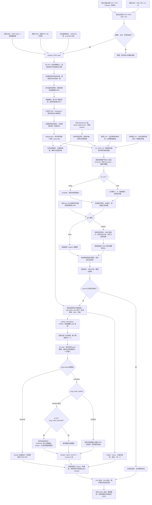

# Fudan WGS Toolkit 使用说明

本工具尚在开发验证阶段，未达到原软件精度，切不可作为真实分析使用的标准化工具。

## 1. 功能与流程

`prepare_WGS_data` 从原始 PLINK BED/BIM/FAM 和独立下载的功能注释构建可校验的遗传数据。`run_WGS_all` 消费表型 CSV、协变量 CSV 和已完成遗传目录，完成单变异、coding、noncoding 和 ncRNA 关联分析。传入多个表型列时，它们共享遗传数据读取、CPU 缓存、注释索引和 CPU–GPU 传输；各表型仍按所选缺失处理和协变量独立确定样本、拟合零模型、计算频率和检验结果。

正常流程为 `prepare_WGS_data → run_WGS_all`。准备只执行一次；目录已有完成清单时，直接运行关联步骤，不重复准备遗传数据、注释或样本轴。两种目录使用同一个三输入接口：`dataset.json` 保留完整 FID/IID，`cache_dataset.json` 保留原数字身份轴。模型由 `grm` 选择：默认 `sparse` 读取显式文件或清单侧文件中的稀疏 GRM，`none` 使用不含 GRM 的普通零模型。设备、模型族、协变量与恢复参数的调用方式一致。

遗传缓存复用与关联恢复分别处理。`resume=False` 默认在新输出目录执行本次全量关联；`resume=True` 先核对同一运行的输入、模型、参数和源码绑定，再验证各分析类型的结果块与 CSV 校验和，只补算未完成块。中途写入的 partial 输出不作为完成块。跨运行的已拟合模型复用须有拟合源码兼容证明，或仅授权读取既有拟合状态的消费范围收据；两者均要求完整模型导入清单及原拟合成功收据，不能仅凭模型目录存在跳过拟合。消费范围收据不授权重新拟合，也不证明新旧拟合器等价。输入意义见第 3 节，结果分块与恢复规则见第 6 节。

遗传矩阵计算使用原生 TF32/FP32 运算，不通过拆分乘法重建 FP64。零模型拟合、部分谱校正和稳定尾概率仍保留 FP64，以控制数值误差；Burden 矩阵乘法使用 IEEE FP32。同输入数值复现与已有官方结果的一致性比较分别报告，具体口径见第 7 节。



不执行固定窗口或滑动窗口关联分析。Single 的位置分区仅决定输出文件与读取批次，不把邻近变异合并成窗口检验。

## 2. 安装与运行环境

```bash
git clone https://github.com/weikanggong1/Fudan-WGS-Toolkit.git
cd Fudan-WGS-Toolkit
conda env create -f environment.yml
conda activate fudan-wgs-toolkit
```

运行关联分析需要支持 TF32 的 NVIDIA GPU、兼容的驱动以及安装环境中的 CUDA 运行库。关联默认使用一张 GPU 和每个 worker 8 个 CPU 线程；`device=["cuda:0", "cuda:1"]` 指定设备，`device=2` 选择本机前两张可见 CUDA 设备。`memory_limit_gib=None` 按设备物理显存上限和实时可用空间准入，默认额外预留 1 GiB；显式正数可收紧上限。`host_memory_limit_gib=None` 读取物理主存和所有有限 cgroup 祖先限制；显式正数设置整个节点任务的共享主存预算。CPU 分配受亲和性与可见 cgroup 配额共同约束，多 GPU 可共享节点配额，不将每 worker 的线程预算称为独占 CPU。数据准备默认使用 8 个 CPU worker 预算，不占用 GPU；并发染色体数同时受可用任务和 `memory_limit_gib` 的主机工作区估算预算限制。Parquet 注释为可选输入，使用时安装 `python -m pip install -e '.[parquet]'`；CSV/TSV 和压缩包不需要这个额外依赖。

## 3. 输入数据的意义和格式

### 3.1 原始遗传文件

一个染色体对应同名的 `chromosome21.bed`、`chromosome21.bim`、`chromosome21.fam`。BIM 单独不包含基因型，三个文件必须同时提供。

| 文件 | 格式与字段 | 用途 |
| --- | --- | --- |
| BED | 二进制，前三字节 `6c 1b 01`，按变异存储的 PLINK 1 二位编码 | 唯一的基因型来源；支持完整二倍体调用和完全缺失 |
| BIM | 无表头、空白分隔六列：CHR、变异标识、遗传距离、BP、A1、A2 | 确定原始变异顺序、染色体、1-based 位置和两个等位基因 |
| FAM | 无表头、空白分隔六列：FID、IID、父本 ID、母本 ID、sex、phenotype | 确定 BED 样本顺序；分析表型来自另外的 CSV |

不能把 A1 或 A2 自动当作 REF。默认以独立注释的 REF/ALT 匹配等位基因；原始 BIM 标识确实为 `CHR:POS:REF:ALT` 时，可在清单声明 `reference_allele_source: "bim_variant_id"`。转换会核对全部 BIM 行的标识、位置和等位基因，再按声明方向精确匹配独立注释；不会仅凭前缀或首批位点推断。BIM 必须按染色体位置非降序排列，每行两个等位基因明确且不同。BED 无法恢复单个等位基因缺失的半调用；转换记录会明确说明这一限制。

### 3.2 独立功能注释

注释目录包含 `annotations.json`、原始功能注释文件以及独立基因和 promoter 数据。**注释输入必须是原始下载的文件，不能用已准备缓存中的注释替代。** 当前原始注释清单格式为 `raw-wgs-annotations-v1`。

功能注释支持 CSV、TSV、gzip CSV/TSV、含 CSV/TSV 的 `tar.gz`，或 Parquet。压缩包会流式读取，不需要先展开整条染色体。输入文件按染色体位置排列，多个分片按位置顺序写入清单。一个原始 BIM 位点必须有唯一、精确的 CHR/POS/REF/ALT 对应记录；额外的公共库位点不进入遗传数据。默认情况下，缺失位点、重复对应关系或缺少必需字段会报错，不丢弃原始变异，也不把未知权重改成零。

公共注释可能不覆盖输入中的全部 indel/MNV。只有显式声明并验证 `reference_allele_source: "bim_variant_id"`、明确 QC 策略后，才可另声明 `allow_missing_non_snv: true`：保留这些变异的原始基因型，标记 `annotation_available=False`、分类为空和权重为 NaN。SNV 缺注释仍报错。这种数据可做全部变异的 Single 和已覆盖 SNV 的 gene-based；不能做 Indel 或全部变异的 gene-based。要做后两者，需要完整的独立注释。默认不启用该策略。

建议从 [FAVOR Essential 官方数据集](https://doi.org/10.7910/DVN/1VGTJI) 下载对应染色体文件，并核对官方校验值。其原始表包含以下字段。`column_mapping` 明确把原始列映射到包内的语义路径；包内路径是注释键名，不表示外部软件文件中的节点。

| 语义 | 原始 FAVOR 列 | 意义 |
| --- | --- | --- |
| chromosome / position | `chromosome` / `position` | GRCh38 染色体和 1-based 位置 |
| reference / alternate | `ref_vcf` / `alt_vcf` | 包含锚定碱基的原始 REF 与单个 ALT |
| GENCODE.Category | `genecode_comprehensive_category` | exonic、splicing、UTR、upstream、ncRNA 等区域分类 |
| GENCODE.Info | `genecode_comprehensive_info` | 基因归属字符串；保留原始语法 |
| GENCODE.EXONIC.Category | `genecode_comprehensive_exonic_category` | missense、synonymous、stopgain、frameshift 等编码影响 |
| MetaSVM | `metasvm_pred` | disruptive missense 的分类依据 |
| GeneHancer | `genehancer` | enhancer 与目标基因的关联 |
| CAGE / DHS | `cage_tc` / `rdhs` | promoter、enhancer mask 的调控区标记 |
| CADD / LINSIGHT / FATHMM.XF | `cadd_phred` / `linsight` / `fathmm_xf` | 三类功能权重 |
| aPC.EpigeneticActive / Repressed / Transcription | `apc_epigenetics_active` / `apc_epigenetics_repressed` / `apc_epigenetics_transcription` | 三类表观遗传注释主成分 |
| aPC.Conservation | `apc_conservation_v2` | 所选版本的保守性注释主成分 |
| aPC.LocalDiversity | `apc_local_nucleotide_diversity_v3` | 所选版本的局部多样性主成分 |
| aPC.Mappability / TF / Protein | `apc_mappability` / `apc_transcription_factor` / `apc_protein_function_v3` | 可比对性、转录因子和蛋白功能主成分 |

本版使用官方教程链接的 FAVOR Essential GRCh38 原始下载集（DOI `10.7910/DVN/1VGTJI`），没有改用另外一代注释。官方教程先选择原始 CSV 列，再把 Conservation v2、LocalDiversity v3、Protein v3 重命名为分析列；上表直接映射同一批原始列，省去中间文件转换。固定教程提交为 `5340326e0506945e35bc9d4d3cb85d5e8d65cd92`，对应 [官方列选择](https://github.com/li-lab-genetics/STAARpipeline-Tutorial/blob/5340326e0506945e35bc9d4d3cb85d5e8d65cd92/FAVORannotator_csv/Annotate.R) 与 [官方列重命名](https://github.com/li-lab-genetics/STAARpipeline-Tutorial/blob/5340326e0506945e35bc9d4d3cb85d5e8d65cd92/FAVORannotator_csv/gds2agds.R)。

本次 chr21 官方压缩包大小为 5,528,780,471 字节，MD5 为 `dccf132a9ed61f18f08ceac69b5c2cab`；下载后已核对官方校验值。准备流程另记录使用的原始文件 SHA-256。公共数据库不保证覆盖任意研究的所有 indel/MNV；同一官方文件的覆盖缺口也不能通过其他版本的权重或旧缓存补齐。

注释版本属于分析输入。更换 aPC 版本可能改变权重和 P 值，不能把这种输入变化解释为 TF32 数值误差。QC 不是公共功能注释：必须映射原始 QC 列，或者在清单中明确声明输入遗传文件已经通过项目 QC，例如 `default_qc: "PASS"`。后者不能替代实际的质量控制。

基因输入可使用独立 CSV。编码基因表的字段为 `hgnc_symbol,chromosome_name,start_position,end_position`；ncRNA 名单为 `chr,ncRNA`；promoter TSV 为 `chromosome,start,end,strand,gene_id`。位置均为 1-based、闭区间。精确复现需要固定这些文件的版本和 promoter 定义，不在运行中重新猜测转录本或启动子长度。

编码基因表和 ncRNA 名单固定为 [原始方法提交 ed3e26f7](https://github.com/li-lab-genetics/STAARpipeline/tree/ed3e26f7fb4c5d70a765840d089e5863896ec081) 的原始参考表，独立转换为上述 CSV。本次 promoter 则读取 [官方 TxDb.Hsapiens.UCSC.hg38.knownGene 3.22.0](https://bioconductor.org/packages/release/data/annotation/html/TxDb.Hsapiens.UCSC.hg38.knownGene.html) 的 SQLite 数据：同一基因的同染色体、同链转录本合并范围，多染色体或多链基因按原规则排除；正链取 `gene_start−3000 ... gene_start+2999`，负链取 `gene_end−2999 ... gene_end+3000`，不裁剪坐标。固定下载包 SHA-256 为 `feb61126a6d874949423703c90e92e6073d22fecf2db18c44aa9859a43d53f4e`。这些参考文件与参与者及基因型无关，不从已经准备的遗传缓存提取。

完整清单生成示例见 [write_annotation_manifest.py](../examples/write_annotation_manifest.py)。其中的目录、文件名和列映射需要与实际下载文件对应。

### 从官方原始参考文件生成三个输入表

先在已安装的 Conda 环境中安装一次性的 Python 参考读取依赖：

```bash
conda activate fudan-wgs-toolkit
python -m pip install -e '.[annotations]'
```

独立下载 [固定官方基因参考资源](https://raw.githubusercontent.com/li-lab-genetics/STAARpipeline/ed3e26f7fb4c5d70a765840d089e5863896ec081/R/sysdata.rda) 与 [官方 TxDb 3.22.0 源包](https://bioconductor.org/packages/3.23/data/annotation/src/contrib/TxDb.Hsapiens.UCSC.hg38.knownGene_3.22.0.tar.gz)。前者 SHA-256 为 `4bfa7ab5fe2c25f8aaf6e4319e683c3e29b97f62e687b01036501cffd32b484f`；后者为 `feb61126a6d874949423703c90e92e6073d22fecf2db18c44aa9859a43d53f4e`。下载文件保持在项目外，不放入本仓库。基因参考资源是外部序列化数据，由 Python 读取，不安装或调用原语言解释器。

把下载文件分别保存为本例的 `gene_reference.archive` 与 `promoter_reference.tar.gz` 后，从仓库根目录运行：

```bash
python examples/export_annotation_references.py \
  --gene-reference-archive /data/downloads/gene_reference.archive \
  --promoter-database /data/downloads/promoter_reference.tar.gz \
  --output-directory /data/raw_annotation_references

# 只有输入遗传文件确已完成项目 QC 时，才声明下面的 PASS。
python examples/write_annotation_manifest.py \
  --output-directory /data/original_annotations \
  --chromosome 21 \
  --variant-archive /data/downloads/chromosome21.tar.gz \
  --gene-csv /data/raw_annotation_references/genes.csv \
  --ncrna-csv /data/raw_annotation_references/ncrna.csv \
  --promoter-tsv /data/raw_annotation_references/promoter_intervals.tsv \
  --default-qc PASS
```

随后把 `/data/original_annotations` 传入 `prepare_WGS_data(annotation_directory=...)`。如果项目有逐位点 QC 列，应映射它而不声明固定 PASS；若原始非 SNV 存在注释覆盖缺口，仍须遵循上文的显式覆盖策略，示例不会自动容许缺注释。

| 导出参数 | 意义 |
| --- | --- |
| --gene-reference-archive | 独立下载的原始基因参考资源；内含 genes_info 与 ncRNA_gene 两个表，保持原始行顺序 |
| --promoter-database | 原始 TxDb 源包 tar.gz，或从同一原始包独立提取的 SQLite 数据库；不是遗传缓存 |
| --output-directory | 不存在的新目录；生成 genes.csv、ncrna.csv、promoter_intervals.tsv 和 reference_export.private.json |
| --gene-source-sha256 | 基因参考资源的预期 SHA-256；默认锁定上述固定官方资源 |
| --promoter-source-sha256 | promoter 原始输入的预期 SHA-256；默认按 tar 或 SQLite 锁定 3.22.0 资源；独立 SQLite 默认 SHA 为 7fab4f12a779f3917f84f19e6fe10b66fd5564ad015da55163d5c17e6c86f573 |
| --promoter-package-version | 预期 promoter 包版本，默认 3.22.0；tar 包 DESCRIPTION 必须一致；使用其他合法版本时须显式提供版本与预期校验和 |

脚本不会下载数据、运行外部解释器、从缓存提取注释或重新分发原始资源。promoter 通过同染色体、同链转录本范围构造，排除多范围基因，保留官方闭区间及可能的越界坐标，不截到 1。准备阶段再筛选目标常染色体并校验坐标。输出私有证明记录源 SHA、转换规则、各文件 SHA 与条数，不应上传为分析数据。

本版脚本使用真实官方下载输入验证：gene CSV 18,445 行、ncRNA CSV 21,104 行、promoter TSV 35,356 行。分别用原始 tar 和 SQLite 导出时，三个文件均与固定参考的 SHA-256 完全一致；这是参考资源转换检查，不能替代关联分析的精度或耗时 benchmark。

### 3.3 表型与协变量 CSV

两个文件均使用 UTF-8、逗号分隔和表头。`dataset.json` 要求前两列为字符串 `FID,IID`，后续列必须是数值。下面仅展示格式，不是 benchmark 数据。

```text
FID,IID,trait_a,trait_b
0,person_001,2.8,NaN
0,person_002,NaN,4.1
family_b,person_003,3.6,5.2
```

```text
FID,IID,age,sex,PC1,PC2
0,person_001,51,0,0.01,-0.02
0,person_002,63,1,0.03,0.01
family_b,person_003,47,1,-0.01,0.02
```

| 输入 | 含义及要求 |
| --- | --- |
| FID / IID | 与原始 FAM 完整匹配的身份双列；保留前导零、下划线和 FID `0`；相同 IID 属于不同 FID 时是不同样本 |
| 表型数值列 | 一列对应一次独立关联分析；CSV 分片用 trait_index，实际列名保存于私有表型索引 |
| 协变量数值列 | 默认各表型使用全部协变量；`phenotype_covariates` 可为每个表型选择不同列；确定该表型分析样本后添加截距、标准化并去除常数或共线列，保留相同固定效应空间 |
| 缺失值 | 空白、NaN、NA、null 等转成缺失；`rm_nan=True` 默认填补表型，`False` 使用 available 完整样本；两种模式均排除所选协变量缺失，协变量不填补；无穷值报错 |
| 模型族 | `phenotype_families="auto"` 为默认；对表型 CSV 整列的有限值判断：非空且全部属于 `{0,1}` 时识别为 `binomial`，其他数值列识别为 `gaussian`；可用 `{表型名: 模型族}` 覆盖，未列出的列继续自动识别 |
| 二分类值 | auto 根据原始有限值是否仅 0/1 识别；显式 `binomial` 且 `rm_nan=True` 时仅 1 为病例，其余数值和缺失为对照；`False` 时须只有 0/1 和缺失。分析样本须同时存在两类；0/1 作为连续量时显式指定 `gaussian` |

重复 FID/IID 对、无穷大数值、非数值协变量和不足以拟合模型的分析样本会报错。各表型分别记录保留及去除的协变量、中心和尺度；例如该表型样本中的 sex 恒定时，它与截距重复，保留截距即可。`grm="none"` 使用普通回归零模型，不推断亲缘结构；连续为线性模型，二分类为 logistic 零模型。`grm="sparse"` 使用输入稀疏 GRM 的混合零模型。模型族自动识别使用数值内容，不根据列名猜测。

`cache_dataset.json` 使用以下格式，保留缓存已有的数字身份轴：

| 输入 | 格式与意义 |
| --- | --- |
| 表型 CSV | 前两列为 `FID,IID`；FID 必须为字符串 `0`，IID 必须等于缓存现有数字 ID 的规范正十进制文本，不带前导零；后续每列为一个数值表型 |
| 协变量 CSV | 同样以 `FID,IID` 双列开始，采用相同身份约束；后续为数值协变量，两份 CSV 的原始行序可以不同 |
| 遗传目录 | 完成的 `cache_dataset.json`、样本轴、各染色体基因型和 metadata；默认从 `phewas.kinship_npz` 读取绑定身份的稀疏 GRM，也可显式传 `grm_file` 或选择 `grm="none"` |
| 模型设置 | 公开入口默认自动识别模型族、各表型使用全部协变量；通过 `phenotype_families`、`phenotype_covariates` 映射覆盖。缓存的旧 profile 不隐式覆盖这些参数；可选 `phewas.cohort_rows` 限定缓存逻辑行子集 |

两种遗传清单均使用各表型按 `rm_nan` 和所选协变量确定的分析样本。`continuous_transform=None` 按来源保留默认处理：现代 `dataset.json` 使用 `none`，按原始表型值拟合；兼容 `cache_dataset.json` 使用 `paper`，先求协变量 OLS 残差，再 RINT，并恢复原始表型标准差。显式 `none`、`paper`、`rint` 对两种格式都生效；`rint` 直接变换原始表型。稀疏 GRM 模式的二分类执行混合模型和显著结果的 FP64 SPA。数字遗传轴保持原值；公共双列输入只接受明确的 FID `0` 与原数字 IID，不推断其他家庭身份。缓存人数也不等于各表型的分析人数。

两种路线都按每个表型的分析样本处理基因型频率和遗传缺失填补；表型缺失由 `rm_nan` 控制，协变量缺失始终排除。


### 3.4 稀疏 GRM 与无 GRM 模式

默认 `grm="sparse"` 使用稀疏遗传关系矩阵：显式 `grm_file` 优先，省略时读取遗传清单绑定的 `phewas.kinship_npz` 侧文件；两者都没有时明确报错。准备遗传压缩缓存本身不生成或估计 GRM。`grm="none"` 使用无亲缘结构的普通零模型，仍使用原始样本身份、各表型独立分析样本和同一输出结构；此时不能同时传 `grm_file`。清单内已有 GRM 时也不会在 none 模式消费它。

GRM 为无 pickle 的 NPZ，必须包含：

| 数组 | 形状与含义 |
| --- | --- |
| `sample_ids` | `[n]` 唯一身份字符串，与遗传目录及表型匹配；GRM 必须覆盖全部实际分析样本 |
| `diagonal` | `[n]` 有限、非负的对角线元素 |
| `edge_rows`, `edge_cols` | `[e]` 零基整数非对角行、列索引，在 `[0,n)` 范围内 |
| `edge_values` | `[e]` 有限的非对角 GRM 值；可存一侧三角形，或值一致的成对对称项 |

数字缓存的 `sample_ids` 使用对应数字身份的十进制字符串。现代 `dataset.json` 的身份是完整 FID/IID canonical JSON 键，例如 `'["family_a","participant_a"]'`；可用 `fudan_wgs_toolkit.identity.sample_keys(sample_pairs)` 从 `[n,2]` 字符串双列生成，不能只用 IID，不能删除前导零。

GRM 行序可以与遗传目录不同，但身份必须唯一且覆盖各表型的全部实际分析样本；按身份重排，不按文件行号猜测对应关系。遗传清单可通过 `phewas.kinship_npz` 声明相对于遗传根目录的 GRM 路径。可选 `phewas.cohort_rows` 是唯一零基缓存逻辑行向量或等长布尔 mask，用于限定既有缓存的人群范围；它不是原 BED 文件的物理行号，也不会改变保存的遗传轴。

## 4. Python 调用

```python
from pathlib import Path
from fudan_wgs_toolkit import prepare_WGS_data, run_WGS_all

original_plink_directory = Path("/data/original_plink")
original_annotation_directory = Path("/data/original_annotations")
prepared_genetic_directory = Path("/data/prepared_genetics")
phenotype_csv = Path("/data/phenotypes.csv")
covariate_csv = Path("/data/covariates.csv")
association_output_directory = Path("/data/results")

if __name__ == "__main__":
    # 准备遗传文件一次，后续单表型和多表型复用同一数据。
    preparation_report = prepare_WGS_data(
        source_directory=original_plink_directory,
        annotation_directory=original_annotation_directory,
        output_directory=prepared_genetic_directory,
        chromosomes=["21"],
        cpu_threads=8,
        memory_limit_gib=8,
        chunk_size=256,
    )

    # 表型 CSV 的每个数值列独立分析，样本集合允许不同。
    association_report = run_WGS_all(
        phenotype_csv=phenotype_csv,
        covariate_csv=covariate_csv,
        prepared_directory=prepared_genetic_directory,
        output_directory=association_output_directory,
        chromosomes=[21],                         # "all" 为全部已有常染色体
        analyses=("individual", "coding", "noncoding", "ncrna"),
        device=["cuda:0"],                        # 或 device=2 使用本机前两张卡
        cpu_threads=8,
        memory_limit_gib=None,                    # 自动显存上限；可显式设置如 20 GiB
        host_memory_limit_gib=None,               # 所有 GPU worker 共用的节点主存预算
        memory_reserve_gib=1.0,
        phenotype_families={"trait_a": "gaussian", "trait_b": "gaussian"},
        # 未列出的表型默认用全部协变量；每列只检查自己的协变量缺失。
        phenotype_covariates={"trait_a": ["age", "sex", "PC1", "PC2"],
                              "trait_b": ["sex", "PC1", "PC2"]},
        rm_nan=True,                              # 二分类非 1→0，连续缺失→均值
        gene_variant_type="SNV",
        grm="sparse",
        grm_file="/data/sparse_grm.npz",            # 或使用遗传清单绑定的 GRM
        continuous_transform=None,                 # 新缓存用原值；兼容缓存保留 paper
        resume=False,                            # True 校验完成块后只补算剩余块
    )
    print(association_report["completed"])
```

### 已有完成缓存：省略 prepare

已有 `dataset.json` 或 `cache_dataset.json` 都省略前面的 prepare 调用，直接使用同一个 `run_WGS_all`。以下缓存已绑定稀疏 GRM；没有侧文件时可传 `grm_file`，选择无 GRM 模型则设 `grm="none"`。

```python
from fudan_wgs_toolkit import run_WGS_all

if __name__ == "__main__":
    association_report = run_WGS_all(
        phenotype_csv="/data/phenotypes.csv",
        covariate_csv="/data/covariates.csv",
        prepared_directory="/data/completed_cache",
        output_directory="/data/results",
        chromosomes="all",                        # 或 [1, 2, 21]
        analyses=("individual", "coding", "noncoding", "ncrna"),
        device=2,                                 # 前两张可见 CUDA 卡
        cpu_threads=8,
        memory_limit_gib=None,
        host_memory_limit_gib=None,              # 全任务共享主存预算，不按 GPU 数相乘
        memory_reserve_gib=1.0,
        phenotype_families="auto",
        phenotype_covariates=None,
        rm_nan=True,                              # False 使用 available 完整样本
        gene_variant_type="SNV",
        grm="sparse",
        continuous_transform=None,                 # 按缓存格式保留原默认处理
        resume=False,
    )
    print(association_report["completed"])
```

各数值表型列都在同一次调用中提交；`trait_batch_size=16` 控制缓存路线中每个遗传块的计算批次，不是总表型数。`device=["cuda:0"]` 为单卡；指定设备列表可以选非连续 GPU，整数 `n` 选择前 `n` 张可见卡。字符串 `"cuda:0"` 与旧 `gpu_ids` 参数继续兼容，推荐新调用统一使用 `device`。多 GPU 入口启动独立 Python 进程，脚本保留 `__main__` 保护。

统一入口默认采用 `cohort_tiles` 调度。先按精确的样本行序汇集表型，再按全局固定 `trait_batch_size` 切成批次，根据模型存储字节和实际显存预算分配给各卡。每个表型只归一个 worker，完成全部选定染色体与分析类型；worker 内共享遗传读取。tile 的全局表型编号、样本行序和边界与科学计划绑定，不随 GPU 数变化。恢复时可重新分配 tile 的 GPU 所有权，继续复用校验通过的结果块。表型数或 tile 数少于 GPU 数时，部分 worker 可以空闲，报告记录真实使用情况。

`completed_genetic_job_groups` 表示全局唯一遗传作业数；`completed_worker_genetic_job_visits` 表示各卡实际扫描这些作业的次数。各卡各自扫描遗传计划时，后者可能为前者的活跃 worker 数倍数。私有调度收据绑定源计划、全部模型、样本行序摘要、固定 tile 边界及每卡的全局表型编号。内部批运行仍可显式选择按遗传作业或完整样本集合分配；统一入口使用固定 tile，保证恢复时科学块的稳定性。

### prepare_WGS_data 的每个参数

| 参数 | 默认值 | 含义 |
| --- | --- | --- |
| source_directory | None | 原始 BED/BIM/FAM 的目录；自动发现每条染色体的一组同名文件 |
| output_directory | None，必填 | 新准备目录，不能覆盖已完成数据 |
| prefixes | None | Python 字典 `{染色体: 文件前缀}`；目录有多组同染色体文件时明确指定 |
| chromosomes | None | 要准备的染色体列表；None 为发现的全部常染色体；仅支持 1–22，其他染色体名称报错 |
| annotation_directory | None，必填 | 原始注释目录、annotations.json 路径，或同结构字典 |
| sample_pairs | None | 可选 FID/IID CSV 或 `[n,2]` 字符串数组，选择并确定样本顺序；None 保留完整 FAM |
| variant_indices | None | 可选递增、唯一的零基 BIM 行号；字典可为各染色体分别指定；明确标记为局部验证数据 |
| memory_limit_gib | 8 | 主机工作区估算的调度预算，单位 GiB；据此减少并发进程，不是总 RAM/RSS 硬上限 |
| cpu_threads | 8 | 准备阶段的总 CPU worker 预算，正整数；默认并行染色体准备，单染色体并行解码；1 为串行 |
| hardlink_annotations | True | 同文件系统尽量硬链接准备后的注释，失败后复制；不链接原始基因型 |
| resume | False | 恢复完全相同输入、样本和变异选择的未完成转换；校验绑定后继续 |
| max_frames | None | 分块检查点限制；达到后返回 completed=False，不发布 dataset.json |
| chunk_size | 256 | 每个压缩帧的变异数，1–1024；减小它可降低解码峰值内存 |

转换的 `completed=True` 才表示选择的全部染色体和变异完成。每块保留状态计数、校验和和往返校验结果。source_bytes 使用真实 BED 字节数；大文件压缩容器有 10% 存储上限，小型接口测试有最小容器开销额度。不要把检查点、PID 或准备中的临时目录当作完成数据。

准备阶段的主机内存预算采用工作区估计。高非零比例基因型的 CSR 校验临时数组、较长的注释字符串及 Python 进程开销可能超出估计；调度报告中的估算值不等于实测峰值 RSS。减少 `chunk_size`、`cpu_threads` 可降低这些开销。恢复未完成转换时，会重新核对根样本双列、身份键和已完成染色体的数据流校验和，再发布整体完成标记。

### run_WGS_all 的每个参数

| 参数 | 默认值 | 含义 |
| --- | --- | --- |
| phenotype_csv | 必填 | UTF-8 CSV，FID/IID 双列加一个或多个数值表型；兼容数字缓存要求 FID 为 0、IID 为原规范数字 ID |
| covariate_csv | 必填 | FID/IID 双列加数值协变量，可仅有身份双列；身份规则与表型一致，各表型默认使用全部协变量 |
| prepared_directory | 必填 | 已完成遗传根目录；dataset.json 使用 FID/IID，cache_dataset.json 保留数字身份；均不重新准备遗传数据 |
| output_directory | 必填 | 本次结果目录；每个表型独立目录，按分析类型、染色体和字段输出 gzip CSV；trait_index 映射到私有表型索引 |
| chromosomes | all | "all" 为准备目录中的全部常染色体；[1, 2, 21] 为指定编号列表，兼容字符串编号；None 兼容旧的全部选择 |
| analyses | 四类全部 | individual、coding、noncoding、ncrna 的非空组合，两种清单均可选择子集 |
| device | ("cuda:0",) | ["cuda:0"] 为单卡，列表选择不同 CUDA 设备；正整数 n 选择前 n 张可见卡；兼容单个设备字符串 |
| cpu_threads | 8 | 每个 GPU worker 的读取、解码和 CPU 操作线程预算，正整数；节点实际算力仍受共享 CPU 配额限制 |
| memory_limit_gib | None | 自动使用每个设备的物理显存上限并检查实时可用空间；正数为显式 GiB 上限，可超过 20；另扣除 reserve |
| memory_reserve_gib | 1.0 | 设备工作区预留空间，GiB，非负；与 memory_limit_gib 在所有选定 GPU 上共同生效 |
| host_memory_limit_gib | None | 同一节点全部 GPU worker 共用的主存预算，GiB；None 按物理容量与所有有限 cgroup 祖先限制取较小值，显式值须有限且大于零；不按 worker 数相乘 |
| phenotype_families | auto | 非缺失值仅为 0/1 时识别 binomial，否则 gaussian；可用 `{表型列名: gaussian/binomial}` 覆盖，未声明列继续自动识别 |
| rm_nan | True | True 填补表型：二分类非 1（含缺失）为 0；连续缺失用该表型有限值且所选协变量有效的母样本均值填补。False 保留 available 样本；协变量始终不填补。改变此参数需新零模型，resume 不允许跨模式复用 |
| phenotype_covariates | None | `{表型列名: [协变量列名, ...]}`；默认所有表型共用文件全部协变量；未声明列仍用全部协变量，空列表为仅截距；列名必须存在且不重复 |
| gene_variant_type | SNV | 两种清单统一的 gene-based SNV、Indel 或 variant 选择；Single 始终扫描全部变异；SNV 模式使用功能注释权重，其他模式遵循原规则关闭这些权重 |
| grm | sparse | sparse 使用输入稀疏 GRM 的混合零模型，找不到 GRM 报错；none 使用无亲缘结构的普通零模型 |
| grm_file | None | 稀疏 GRM NPZ 文件；sparse 模式显式文件优先，其次清单侧文件，均无则报错；none 模式禁止传此参数 |
| transform | none | 旧参数兼容别名；none 不覆盖 continuous_transform，rint 可覆盖未指定的连续变换；与显式不同变换冲突时报错。仅作用于连续表型 |
| null_fit_mode | fp64 | 统一成熟零模型使用 FP64 拟合；旧 tf32 拟合覆盖在该入口明确报错，关联矩阵计算仍为 TF32/FP32 |
| covariance_block_size | 4096 | 缓存协方差计算的变异块大小；降低可减少中间工作区 |
| long_mask_method | `"full"` | 默认对所有 M 使用原生完整 FP32 加权谱；可显式选择 `"fastskat"` 或 `"liu"` 沿用原近似分支 |
| long_mask_threshold | 5000 | 显式近似模式的谱切换阈值；也保留原有大 mask 准备路径选择作用，不跳过 mask；默认 full 不按此值切换谱方法 |
| long_mask_rank | 512 | 显式 FastSKAT 的随机低秩目标秩；这是近似谱，不是完整谱等价声明 |
| seed | 1729 | 显式 FastSKAT 的随机种子，非负整数 |
| single_mac_cutoff | 20 | Single 保留的最小 minor allele count |
| single_group_variants | 5000 | Single 的结果分组大小，影响读取与组装 |
| single_region_size | 10000000 | Single 输出的位置分区宽度，单位 bp；不是区域关联检验 |
| individual_effective_block_size | 1024 | Single 内部有效变异批大小 |
| device_cache_bytes | 536870912 | 设备共享缓存容量，单位字节；0 禁用留存 |
| compact_cache_bytes | 67108864 | CPU 紧凑状态缓存容量，单位字节；0 禁用留存 |
| metadata_cache_bytes | 268435456 | CPU 注释元数据缓存容量，单位字节，正整数 |
| resume | False | False 在新输出目录执行全量关联，已有运行不自动覆盖；True 核对输入、模型、设置、源码和已提交 CSV 范围后，只补算未完成块；保留未提交尾部，已提交结果损坏则报错 |
| gpu_ids | None | 旧设备编号列表的兼容参数；新调用用 device 设备列表或卡数，避免同时给出冲突选择 |
| trait_batch_size | 16 | 每个遗传块的表型批次大小，正整数；不限制总表型数 |
| continuous_transform | None | 按缓存来源保留默认：dataset.json 用 none、cache_dataset.json 用 paper；显式 none/paper/rint 统一生效。paper 为协变量 OLS 残差、RINT 和原标准差恢复，rint 为直接 RINT；二分类保持 0/1 |

设备、显存、模型族、协变量、连续变换、分析选择、变异类型和恢复参数在两种遗传清单中使用上述统一语义。连续变换使用 continuous_transform；旧 transform 参数仅作兼容别名。零模型拟合固定使用成熟的 FP64 路径；`null_fit_mode="tf32"` 会明确报错。关联矩阵仍按原生 TF32/FP32 计算，统计参数纳入计划及恢复绑定。

连续均值在该表型实际 cohort、CSV 身份匹配且所选协变量有效的母样本中，仅用有限表型值计算；填补发生在所选 `continuous_transform` 之前。不存在于表型 CSV 的缓存参与者不会凭空进入分析。未选用的协变量缺失不影响该表型，空协变量列表只添加截距。原先 available 分支对应 `rm_nan=False`；已有模型和结果不能换成 True 后继续恢复。

共享主存准入使用同一输出目录下的节点账本，只预留尚未分配的工作区。默认保留实际可用容量上限的 10%，最多 20 GiB；显式主存预算仍受实际 cgroup 和系统可用空间限制。模型、已初始化数组、共享文件映射已经计入实时压力，不把它们的 RSS 再次作为新增分配预留。RSS/PSS、匿名内存和映射页的遥测是采样端点；PSS 不等于独占使用或峰值。资源压力时释放可回收缓存并缩小工作集，保持原有分析和结果顺序。主存预算是共享准入策略，不是进程 RSS 的硬限制。

显存预算约束包管理的工作区；CUDA 上下文、其他用户进程及文件系统缓存不在包内显存计数中。运行报告记录实际分配和保留峰值，而不是把参数值当成实测峰值。

混合路线的 Burden 矩阵乘法继承调用方预算和安全余量，子函数不再附加独立的 20 GiB 默认限制。二分类模型的 FP64 源状态、FP32 normal 状态及 FP64 SPA 状态在分配前估算工作区，已有源张量不重复计为新增分配；原生检验及时释放不再使用的乘积和稀有变异协方差。预算检查和生命周期修复保持原有 TF32/IEEE FP32 算式、模型拟合参数及结果顺序。

多染色体准备使用独立 Python 进程；在独立脚本中，把调用放进 `if __name__ == "__main__":`，避免进程启动时重复执行顶层代码。命令行入口已经包含此保护。`max_frames` 为显式检查点调试参数，转换阶段采用串行调度来保持全局精确帧上限；普通完整准备默认并行。转换先完成所有输入、样本轴和注释的检查，再写基因型；主进程只在全部染色体完成后提交数据集完成标记。

命令行默认填补表型；加 `--no-rm-nan` 选择 available 样本，`--rm-nan` 显式选择填补。两种模式分别使用自己的输出目录和零模型。

## 5. 命令行调用

```bash
prepare-WGS-data \
  --source-directory /data/original_plink \
  --annotation-directory /data/original_annotations \
  --output-directory /data/prepared_genetics \
  --chromosomes 21 --cpu-threads 8 --chunk-size 256

run-WGS-all /data/phenotypes.csv /data/covariates.csv /data/prepared_genetics \
  --output-directory /data/results \
  --chromosomes 21 --device cuda:0 --cpu-threads 8 \
  --grm sparse --grm-file /data/sparse_grm.npz
```

`python -m fudan_wgs_toolkit` 与 `run-WGS-all` 等价。准备 CLI 可用 `--sample-pairs`、`--max-frames`、`--resume`、`--copy-annotations`；指定精确 prefixes 和 variant_indices 使用 Python 接口。其余关联参数的 CLI 名称采用短横线，例如 `--long-mask-rank`。`--phenotype-families` 和 `--phenotype-covariates` 接受相应映射字典的 JSON 文件路径；`--gene-variant-type` 对应 gene-based 变异类型。

已有完成目录时直接运行以下命令，不再调用 `prepare-WGS-data`。这里缓存已绑定稀疏 GRM；`--grm none` 可明确选无 GRM：

```bash
run-WGS-all /data/phenotypes.csv /data/covariates.csv /data/completed_cache \
  --output-directory /data/results \
  --chromosomes all --device cuda:0 cuda:1 --trait-batch-size 16 \
  --grm sparse --continuous-transform paper
```

Python 用 `device=2` 选择前两张卡，CLI 用 `--device 2`；`--device cuda:0 cuda:1` 显式选卡。省略显存参数自动设置上限及 1 GiB 预留；`--memory-limit-gib 20 --memory-reserve-gib 1` 可显式收紧显存；`--host-memory-limit-gib 64` 设定同一节点全部 GPU worker 共用的 64 GiB 主存预算，省略时自动检测。`--resume` 恢复验证通过的完成块。CPU worker 预算不等于独占核心数，实际 CPU cgroup 配额可能共享。已有部署计划可显式指定经审核的 worker 分配与模型复用绑定。一般调用使用上面的统一 CLI，模型来源与复用边界见第 6 节。

省略 `--continuous-transform` 时，按缓存来源保留默认处理；`--continuous-transform none` 可明确使用原始连续表型，`--continuous-transform paper` 选择残差、RINT 与标准差恢复。`--phenotype-families auto` 为默认；需要覆盖时给 JSON 文件，例如 `{"trait_a": "gaussian", "trait_b": "binomial"}`。协变量 JSON 可为 `{"trait_a": ["age", "sex", "PC1"], "trait_b": ["sex", "PC1"]}`；`trait_b` 不会因未选的 age 缺失而被排除。

## 6. 输出与分析方法

```text
prepared_genetics/
  dataset.json                 # 现代清单：完成数据集及来源绑定
  sample_pairs.npy             # n×2 原始 FID/IID 字符串
  sample_ids.npy               # 完整双列的无歧义内部键
  chr21/                       # 压缩基因型、索引、元数据和完成标记
  catalogs/                    # 独立基因 jobs 与 promoter 区间
  # 或已完成的 cache_dataset.json，保留其原数字样本轴和目录

results/
  csv/
    traits/trait_0000/<类型>/chr21/<字段签名>/results.csv.gz
                                 # 每个表型独立，按分析类型、染色体和字段组织
    .trait_checkpoints/ranges.sqlite     # 原子提交的科学块与压缩范围，包含零行块
    .trait_checkpoints/uncommitted/      # 恢复前保留的未提交尾部及收据
    worker_<编号>.complete.private.json # 完整回读后的文件与块清单摘要
  models/                      # 各表型零模型和普通/SPA 状态
  trait_index.private.csv      # 现代路线：trait_index、表型原列名、模型族
  inputs/                      # 兼容路线：私有表型索引、匹配样本和输入绑定
  plan.private.json
  status.private.json          # 本次 attempt_id 的运行状态
  report.private.json          # 本次完成报告
  report.previous.<attempt_id>.private.json  # 恢复前已有报告的归档
```

两种遗传清单均写入每个表型独立的 CSV 目录。连续的科学块以完整 gzip member 追加到同一表型、分析类型、染色体与字段对应的文件；不会为每个 mask 新建文件，也不再复制整套结果做后续拆分。实际路径以 worker 报告的 `output["receipts"]` 中的 `csv_file` 为准，相对 `output_directory/csv`。`.csv.gz` 是压缩文本 CSV，可直接用 `pandas.read_csv` 读取。每行 `trait_index` 对应私有表型索引，另保留位点或 gene/mask、概率和数值诊断。连续 gene-based 汇总使用 STAAR-O，二分类使用 STAAR-Burden；稀疏 GRM 二分类模式保留显著结果的 FP64 SPA。

科学块的提交同时绑定所有涉及表型的压缩范围、SHA、行数、字段与 Single 有效变异序号。所有范围写入并 fsync 后才提交 SQLite 事务；同一表型由一个 worker 持有写锁。恢复逐范围检查 SHA、gzip CRC、字段和计数，只补算缺少提交记录的块，并先保留及移除未提交尾部。已提交前缀遭截断或损坏时明确报错并保留原文件，不能当作有效完成块。结束前逐文件完整回读，给出文件 SHA、行数与块清单摘要；未提交 partial 或历史收据不参与本次汇总。

输出为结果 CSV、Python 模型状态和 JSON，通过私有 `trait_index` 映射表型。标量格式沿用关联写出约定，可回读原浮点值，不人为截断有效位数。零行块也有提交记录。返回字典包含 `completed`、各分析类型的行数、worker 报告和 `end_to_end_seconds`。

| 输出 | 主要列与含义 |
| --- | --- |
| Single | CHR、POS、REF、ALT、ALT_AF、MAF、N、pvalue、pvalue_log10、Score、Score_se、Est、Est_se |
| pvalue_log10 | 正值 `−log10(P)`，不是 log10(P)；极小 P 下可在 pvalue 下溢时仍保留对数结果 |
| Score / Score_se | score 及其标准误；Est / Est_se 为由 score 检验得到的效应估计及标准误 |
| 连续 gene-based | Gene name、Chr、Category、#SNV、cMAC；两组 Beta 权重下的 SKAT、Burden、ACAT-V、注释权重及 Cauchy 汇总结果 |
| 二分类 gene-based | 相同 gene/mask 身份与计数；采用 Burden 汇总及所选模型的二分类概率，字段签名与连续模型分别成片 |
| STAAR-S / B / A | 分别汇总 SKAT、Burden、ACAT-V 的注释加权检验；不是新定义的统计公式 |
| STAAR-O / ACAT-O | 对相应检验 P 值做 Cauchy 合并的总体结果；名称已统一到当前接口 |

coding 的基础五类为 pLoF、pLoF 加 disruptive missense、missense、disruptive missense、synonymous。现代 `dataset.json` 尊重 gene catalog 的类别声明，prepare 默认使用这五类；兼容 `cache_dataset.json` 的成熟 PheWAS 计划使用七类，另含 PTV 和 PTV 加 disruptive missense。noncoding 包括 upstream、downstream、UTR、promoter CAGE/DHS、enhancer CAGE/DHS；ncRNA 单独运行。每个表型使用自己的 MAF、MAC 和有效 mask，不因为共享读取而使用多个表型样本的交集。

gene-based 默认按严格 `0 < MAF < 0.01` 及各 mask 的最小变异数筛选，具体设置与结果记录在计划和完成绑定中。按当前表型样本的等位基因频率填补遗传缺失；表型缺失由 `rm_nan` 选择填补或 available 筛选，所选协变量缺失均排除。这些筛选和填补规则在共享与独立单表型运行中相同。

Score 和协方差分别为 `u = Gᵀr`、`V = GᵀPG`。Single 只求需要的方差对角线。Burden 把全部权重列合并计算，ACAT-V 复用单变异统计量并保留极罕见变异合并规则。局部重叠 mask 共享基因型和协方差；不同零模型的 V 不直接共用。SKAT 默认以每个实际权重的完整 FP32 特征值进入成熟的稳定尾概率分支；只有显式近似模式才按阈值使用原近似方法。统计小值通过稳定对数尾概率和 Cauchy 小 P 分支处理，不能简单把 P、效应或 SE 乘一个系数再检验。

普通连续表型的样本精度为相同的正数 `s` 时，gene-based 协方差先使用归一化的精度 `1`、精度加权协变量矩阵 `A/s` 和固定效应协方差 `C*s`，最后把协方差乘回 `s`。这里 `A=Σ⁻¹X`、`C=(XᵀΣ⁻¹X)⁻¹` 均来自已有拟合状态。这与原公式相同，避免把同一常量精度预乘基因型后再作 TF32 输入舍入，不增加矩阵乘法；Score 保持原计算。恢复原单位后才进入特征值阈值和尾概率检验。非恒定精度、二分类、带亲缘旋转块的模型和 FP64 对照保留原路径；归一化状态计入设备预算，并在模型张量改变时失效。

### 6.1 读取结果分片

完整输出以本次 worker 完成收据为准，每个 `.csv.gz` 是可独立读取的文本 CSV。不同分析或模型族的字段可能不同，因此按收据中的 `kind` 选择需要的分析，不用目录通配符混入历史文件。`trait_index` 是本次输入表型列的零基索引，通过私有字典恢复原列名。以下示例逐批读取已提交 Single 分片，不把全基因组结果一次放进内存：

```python
from pathlib import Path
import pandas as pd

association_result_directory = Path(association_report["output_directory"])
for worker_report in association_report["workers"]:
    for completed_block_receipt in worker_report["output"]["receipts"]:
        if completed_block_receipt["kind"] != "individual":
            continue
        single_result_csv = (
            association_result_directory / "csv" / completed_block_receipt["csv_file"]
        )
        for single_result_batch in pd.read_csv(single_result_csv, chunksize=100_000):
            # trait_index 指向私有表型字典；其余列是该批 Single 结果。
            print(len(single_result_batch))
```

两种缓存的字典均为根目录 `trait_index.private.csv`，列为 `trait_index,phenotype,family`。兼容缓存另保留 `inputs/traits.private.json` 的输入元数据。字典依据已验证的列顺序与模型族原子写出；恢复时补齐缺失或损坏的字典，并将损坏版本保留为私有诊断。计划和最终报告记录字典 SHA-256，完成前再次核对。发行仓库不包含真实字典、模型或结果。

### 6.2 同一运行恢复与模型来源

遗传目录复用不会重新运行 `prepare_WGS_data`。结果恢复则在原输出目录调用 `run_WGS_all(..., resume=True)`，保留相同的输入文件、染色体、分析类型、样本和协变量选择、模型族、`rm_nan`、GRM、连续变换、统计设置及源码。完成块还须通过压缩范围 SHA、gzip CRC、字段、行数、表型分配和块绑定检查。缺少提交记录的块重新计算；未提交尾部先私有保存，已提交范围损坏则阻止恢复并保留证据。

恢复还核对每个染色体的三个压缩基因型数据流：设备与文件身份、大小、修改时间和状态变更时间必须与首次绑定一致，替换文件或改变链接目标也会被检测。该检查与清单及逐帧校验和共同约束遗传数据来源，不在每次恢复时重新读取整条染色体做全文件哈希。

```python
from fudan_wgs_toolkit import run_WGS_all

if __name__ == "__main__":
    resumed_association_report = run_WGS_all(
        phenotype_csv="/data/phenotypes.csv",       # 与首次运行完全相同
        covariate_csv="/data/covariates.csv",
        prepared_directory="/data/completed_cache",
        output_directory="/data/results",          # 首次运行的同一目录
        chromosomes="all",
        device=["cuda:0"],
        phenotype_families="auto",                # 保留首次调用的模型族；自定义映射也须相同
        phenotype_covariates=None,                 # 保留首次调用的协变量映射
        rm_nan=True,                              # 与上面的缓存示例一致；available 运行须 False
        grm="sparse",                              # 保留原 GRM 模式和文件
        grm_file=None,                             # 首次显式传入 GRM 文件时保留该文件
        continuous_transform=None,
        resume=True,
    )
    print(resumed_association_report["completed"])
```

默认 `resume=False` 执行新全量关联，需要新输出目录；不会静默采用或删除旧结果。模型文件损坏或科学输入绑定变化会报错，不能借恢复操作悄悄换模型。`completed=True` 表示本次所有 worker 和选定分析完成；PID、已生成模型或部分 CSV 不代表全流程完成。

每次调用生成新的 `attempt_id`。恢复开始时，已有的 `report.private.json` 移入 `report.previous.<attempt_id>.private.json`；旧报告留作记录。判断本次完成时，读取当前 `status.private.json` 和 `report.private.json`，核对它们的 `attempt_id` 及本次 worker 收据；状态为 `complete` 后才采用对应结果。运行中或失败的恢复不能沿用归档报告的完成状态。

跨运行或跨源码导入模型属于另一个操作，须绑定原拟合源码、当前消费源码、准备清单、有序样本、GRM、连续变换、完整模型导入清单，以及所有原拟合进程退出为零的收据。模型元数据、数组 SHA 与文件身份、dtype、shape、样本轴及全部表型覆盖必须通过校验。导入不修改原模型，也不重新拟合；统一入口的 `resume` 只恢复同一运行，模型验证完成也不能替代关联输出完成。

模型兼容收据保留两种范围。`schema_version=1` 沿用原零模型数学兼容证明。新增的 `schema_version=2`、`kind="immutable_fitted_model_consumption"` 只认证已保存状态的消费：核对当前源码中加载器、序列化模型字段及声明消费接口的指纹，并检查完整普通模型与 FP64 SPA 的 JSON 状态、NPY 头和字段几何。该收据明确记录 `compatible_null_fit_math=False`、`fitting_implementation_equivalence_verified=False`、`models_refitted=0`，且关闭新拟合、输入准备及从稀疏 GRM 构造新谱的入口。原拟合来源与当前消费来源分别保存；这项收据不认证当前拟合器与原拟合器等价，也不能把新拟合状态标成旧来源。

使用已审核的部署计划分开拟合和关联时，内部 worker 入口支持 `python -m fudan_wgs_toolkit.phewas_run --plan /data/plan.private.json --worker-id 0 --worker-count 1 --device cuda:0 --fit-only`，再用同一命令的 `--association-only` 执行关联。关联阶段先校验全部拟合完成收据、源代码与输入摘要、样本行序、GRM、模型族及普通/SPA 状态元数据，随后直接读取已有模型，保留拟合收据。两个阶段选项互斥。通常直接调用 `run_WGS_all`，无需自行编写部署计划。

### 6.3 主机准入、共享读取与张量生命周期

主机准入账本的 schema 2 记录 `future_bytes`：本进程接下来还要分配的字节。实际占用从全部可见 cgroup 及物理主存取得；跨 worker 的 RSS 可重复包含共享映射，因此仅用于诊断，不再与完整工作区重复相加。预留在准备步骤中随已初始化的自有数组更新，每个 cohort/mask 结束后归零。`np.empty` 尚未初始化的空间不能用作抵扣依据。旧 schema 账本保留在旧运行目录，新运行使用新的账本。

当前集合首次因主存压力推迟时，先释放临时数组和非固定 metadata LRU 缓存，并在该集合的重试期间暂停 LRU 写入，防止相同读取重新占满空间；成功或异常退出后恢复缓存。固定结构字段、样本轴与已经准备的注释索引保留。缓存释放量仅作估计诊断，下一次分配仍以真实主存占用重新准入。

关联按实际相同的有序样本集合分组。一个集合完成后提交其结果；后续集合遇到暂时资源压力只重试当前集合，避免整 gene 的已有表型重算。只读样本行索引允许认证共享，主机与设备索引均有容量及活跃读取视图保护。一个遗传作业内可以复用原始六状态块，按表型自己的样本计算 AF、筛选与模型关联；不同表型的统计量和模型不共享。索引的弱校验证明有界保存，避免主机缓存淘汰后重复扫描完整样本集合。

Single 在每个 trait tile 和物理批次结束时释放临时状态、pipeline 与模型引用。长 mask 的 panel 上传不再无条件清空 CUDA allocator；只有真实空间不足时才回收已无引用的缓存。监控分别记录当前 allocated、reserved 和有界缓存。模型 bank 预热或 reserved 增长并不能单独证明显存泄漏，需要在固定输入重复运行后检查仍被引用的张量。

已拟合二分类模型可设置 `binary_normal_cache="stored_native"`，复用原来保存且经过哈希认证的 FP32 普通关联状态；显著结果仍按需读取同次拟合的原 FP64 来源并执行 SPA。默认 `derived_fp64` 保留按 FP64 来源派生普通状态的路径。选择前应比较同一模型的保存状态、关联结果与 SPA；模型拟合和样本选择不变。

默认全部表型使用协变量文件的同一套列。填补表型后，只要身份匹配和协变量有效行相同，就使用同一母样本轴；显式逐表型协变量映射仍可形成不同集合。模型库按经过认证的完整字节、形状、dtype 和设备复用相同 X 张量；各表型的回归系数、残差、二分类权重与检验投影独立。共享协变量不代表共享关联协方差。

普通模型与按需读取的 FP64 SPA 来源使用同一个 LRU。容量按唯一底层存储去重计量，并结合设备实时空闲空间、allocator 可复用空间、模型库已持有的字节及安全余量计算；当前活跃模型在工作区准入期间保持引用，其他条目可淘汰。已持有字节只用于恢复容量计算的基准，不能当作尚未释放的显存重新使用。报告分别给出普通/SPA 读取、命中、容量淘汰、文件描述符淘汰、常驻字节以及关闭仓库后的 allocated/reserved。

gene-based 的较小 mask 可直接在 CUDA 上将六状态块整理为列优先 FP32 基因型，并保持同一有序样本集合的均值填补、REF/ALT 翻转和 mask 筛选。超过当前工作区预算的 mask 保留有界主机与 panel 路线；谱方法由 `long_mask_method` 决定。Single 的状态块复用原有行序；CSV 写出按批次转移结果矩阵，避免逐个概率字段的设备同步。

长 mask 的主机 panel 路线在当前 mask 内复用已整理的 FP32 panel、当前模型的亲缘旋转和协变量投影。缓存按真实 CUDA 存储字节计量，上限取 8 GiB 与扣除必要工作区后实时余量的 15% 中较小者；正在参与乘法的 panel 保持引用，压力时只驱逐未使用条目。完整协方差的原 TF32 分块、双向乘积及表型自己的精度矩阵均保留。缓存不会跨模型共用 V；mask 正常或异常结束后关闭缓存，释放临时 G、投影、协方差和结果持有者。

显式选择 FastSKAT 时，在已准入的工作区内最多同时准备两个独立加权矩阵，用两个固定 CUDA stream 执行原 LOBPCG。随机初值按原权重顺序生成，原迭代、正交化、收敛检查、FP64 谱细化与尾概率不变；每个权重的矩阵和初值独立。每个关联 worker 只拥有一个惰性线程池，只有首次符合条件的长 mask 才创建两个控制线程和 stream，后续 mask 复用。额外加权矩阵、初值、求解和细化峰值在分配前计入未来新增工作区；预算不足时回到原顺序计算，不提高上限或跳过分析。此优化针对 Conda 环境指定的 PyTorch 2.5.1；其他版本、CPU 或不支持的形状保留原路径。

结束报告包含 panel 缓存命中／驱逐／持有字节、线程池创建次数、活跃求解与工作区数以及关闭状态。CUDA 分配器和原生求解库可能继续保留工作区，因此 allocated、reserved、实际持有者及设备空闲量分别记录。异常回溯保留错误类型和链条，同时清理不再运行的数值帧；不依靠每个 mask 调用 GC 或清空 CUDA 分配器。

原生 TF32 GEMM 的行、列和内层地址偏移改用 64 位整数，避免大型非连续视图的地址乘积溢出。计算仍使用相同的 TF32 MMA、FP32 累加和输出，未增加 FP64 矩阵乘法。

共享同一个 G 时，单表型 Score 保留独立分析的原生 FP32 向量乘法；多表型 Score 使用有界残差 tile 的原生 IEEE FP32 矩阵乘法。残差副本和输出工作区在分配前准入，不构造 `N × variant × trait` 张量；额外残差 tile 无法准入时仍可使用原始逐表型向量路径。宽 TF32 Score 矩阵乘法在填补分支的真实对照中产生超过 0.001 的概率误差，因此没有采用；方差、协变量投影与协方差继续使用成熟的 TF32/FP32 分支，二分类 SPA 保持原流程。

FP32 矩阵与向量乘法的求和顺序仍可能不同。Single 正常尾概率或连续 gene 检验达到 `−log10(P) > 100` 时，敏感表型重新使用原始整列 Score 向量路径，再进行正式尾概率与 SPA；保留原始 G 的形状及长 mask 的 panel 边界，不能只挑选显著变异后改变归约。报告分别记录批量 Score、敏感回退、控制信息取回和最终结果传输。极小 P 使用有限的原生对数概率比较，不人为加概率下限。

分布式计划可配置 `device_cache_bytes`（设备六状态 CSR 缓存字节）、`compact_cache_bytes`（主机解码缓存字节）、`metadata_cache_bytes`（metadata 缓存字节）及 `memory_reserve_bytes`（CUDA 安全余量字节）。`sample_axis_host_cache_bytes` 与 `sample_axis_cache_bytes` 分别控制主机和 CUDA 样本索引缓存；`job_state_cache_bytes` 控制作业内原始六状态块的 CUDA 缓存。`device_cache_live_fraction` 和 `job_state_cache_live_fraction` 限制缓存可使用的实际可用显存比例。缓存仍受运行时工作区准入控制；提高容量不会绕过设备空闲内存或主机 cgroup 限额。每个 worker 的线程亲和性和共享 CPU quota 分别约束，不能将每卡最多使用 8 CPU 解读为每卡独占 8 核。

加权谱诊断以直方图保留各批次大小的累计次数，最近批次列表最多 64 项；长时间运行不再逐个保存无限增长的批次列表。

零模型拟合的结构缓存每 worker 最多保留 128 MiB、16 个条目，按实际持有字节计量。只有有序样本、GRM 全部输入、原协变量值、设计算法及 dtype／设备绑定完全相同时才复用设计、GRM 子集或谱。活跃租约不能驱逐，无法入缓存的对象临时使用后释放，不为它清掉热谱。模型转换使用独立谱容器，缓存修改检测防止后续拟合误用状态；拟合结束或异常退出关闭缓存。回归系数、残差、权重、方差分量、投影及收敛状态仍各表型独立。

亲缘谱按同尺寸家系块分组，在 64 MiB 显式工作区目标及实时显存准入下调用批量 `eigh`；二分类混合模型相同尺寸的家系块批量重建、Cholesky、求逆和 apply。原始块顺序、PSD 检查、逐模型 IRLS／AI／Brent 优化及失败分支保留，不建立全样本的稠密方阵。这是家系块的执行批次，不是共用不同表型的权重或检验矩阵。

染色体类别索引在相同 metadata、catalog 和选项下只构建一次，按只读数组共享给后续表型集合。UTF-8 metadata 解码对 offsets/valid 使用零拷贝只读 ndarray 视图，保留原字符串解码、缺失值、顺序和 checksum 校验，减少逐元素 memmap 子类访问。

## 7. 原始方法与验证记录

算法来源、许可证和固定参考提交见 [NOTICE.md](../NOTICE.md)。原始方法的调用参数与输入格式见 [原始 pipeline 教程](https://github.com/li-lab-genetics/STAARpipeline-Tutorial)、[原始多表型实现](https://github.com/li-lab-genetics/STAARpipelinePheWAS)。这些链接用于解释来源，本包不安装、包装或运行这些项目。

| 原方法的调用示例 | 本包对应分析 |
| --- | --- |
| [单变异官方调用](https://github.com/li-lab-genetics/STAARpipeline-Tutorial/blob/5340326e0506945e35bc9d4d3cb85d5e8d65cd92/STAARpipeline_Individual_Analysis.r) | `analyses=("individual",)`；保持相同 MAC、样本集合和零模型 |
| [coding 官方调用](https://github.com/li-lab-genetics/STAARpipeline-Tutorial/blob/5340326e0506945e35bc9d4d3cb85d5e8d65cd92/STAARpipeline_Gene_Centric_Coding.r) | `analyses=("coding",)`；现代 catalog 默认五类，兼容 PheWAS 计划含七类；对照时逐项固定类别集合 |
| [noncoding 官方调用](https://github.com/li-lab-genetics/STAARpipeline-Tutorial/blob/5340326e0506945e35bc9d4d3cb85d5e8d65cd92/STAARpipeline_Gene_Centric_Noncoding.r) | `analyses=("noncoding",)`；相同 promoter、调控区、UTR、上下游定义 |
| [ncRNA 官方调用](https://github.com/li-lab-genetics/STAARpipeline-Tutorial/blob/5340326e0506945e35bc9d4d3cb85d5e8d65cd92/STAARpipeline_Gene_Centric_ncRNA.r) | `analyses=("ncrna",)`；使用同一独立 ncRNA 名单 |

原方法示例的模型、变异类型、QC、频率阈值和注释列均属于对照条件。不同样本或亲缘结构的旧结果不作为同输入精度对照；大 mask 的随机谱路径也需单独标明。公开仓库保留原调用链接，本包的可执行入口全部为 Python。

同输入精度对照必须固定参与者、表型处理、协变量、REF 方向、缺失处理、注释版本和每个 mask 的位点集合。历史数值复现检查以 `|Δ(−log10(P))| < 0.001` 为目标，报告显著并集及全部有限 P 值的误差；此目标不用于不同人群或不同处理的已有官方结果。源格式解码一致、CSV 无舍入损失与统计方法一致分别核验。

多表型与已下载官方 gene-based 结果比较时，按表型、gene 和 mask 匹配，连续 STAAR-O 与二分类 STAAR-B 分开报告：`P < 1e-5` 的显著重叠、仅本次显著、仅官方显著，以及有限 `−log10(P)` 的 Pearson/Spearman 相关性。已有官方结果未发布 Single 时，Single 的官方覆盖记为 0。`P=0` 且没有有限对数结果的项单独记录，不人为加概率下限。不同样本和处理条件下的结果用于描述性一致性分析。

2026-10-11 的资源预算与张量生命周期修复通过 201 项针对性测试，另复用 4 个真实既有模型（2 连续、2 二分类）完成四类局部分析：Single 412 行、coding 24 行、noncoding 4 行、ncRNA 4 行，合计 444 行，CSV 全量回读通过、SPA 失败 0。该局部运行墙时为 215.12 秒，未重建遗传缓存或重新拟合模型；此记录单列关联复核范围，完整全基因组耗时与官方比较在完整输出回读后报告。

同日的进一步读取与内存修复合并统一公开接口后通过 623 项针对性测试，零失败、零跳过。复用上述 4 个既有模型和相同局部作业连续运行 3 轮，每轮仍为 444 行；逐行身份、字段和 CSV checksum 回读通过。每轮 969 个有效概率字段对旧实现的最大 Δ−log10(P) 为 0，非概率字段一致，`P < 1e-5` 判定一致，SPA 失败 0。模型文件保持不变，没有重新准备遗传数据、拟合模型或运行官方参考分析。

| 相同局部四类作业 | 第 1 轮墙时 | 第 2 轮墙时 | 第 3 轮墙时 |
| --- | ---: | ---: | ---: |
| 修复前 | 186.85 s | 168.59 s | 未运行 |
| 读取与内存修复后 | 118.43 s | 112.11 s | 115.32 s |

修复后的首轮各类执行墙时为 coding 17.69 s、noncoding 78.05 s、ncRNA 3.25 s、Single 8.63 s；整轮还包含读取器初始化、资源准入和输出回读。三轮结束时进程内 allocated 均为 254.33 MiB，关闭模型仓库后从该值回到启动时的 8.13 MiB，固定输入范围内没有观察到逐轮累积。reserved 是 allocator 保留空间，不能作为未释放张量量。以上为共享资源上的单卡局部观察；全量多表型吞吐、长期显存趋势及官方 gene-based 相关性在完整运行后另行核验。

后续 GPU 数据整理、模型缓存与分片调度修复首先通过 1,043 项针对性测试，最终公开入口与逐表型原子写出版本通过 1,082 项测试，零失败、零跳过。首轮真实复核复用 16 个既有模型（8 连续、8 二分类），在两条染色体的局部作业中输出 Single 3,364 行、coding 94 行、noncoding 16 行、ncRNA 16 行，共 3,490 行；91 次实际 SPA 无失败，CSV 全量回读通过。与同模型、同样本和同配置的冻结参考逐字段比较，6,265 个有效概率字段的最大 Δ−log10(P) 为 0，`P < 0.05` 显著并集的 367 个字段最大差异也为 0，非概率字段一致。该记录采用原 available 样本模型（`rm_nan=False`），没有重新拟合、准备遗传缓存或运行官方 R；不能据此推断填补分支或全量多表型已经完成验证。

数据整理候选在同一真实 available 工作集上完成参考 10 轮、候选 11 轮，分别持续 2,296.48 秒和 2,120.78 秒。每轮包含上面的四类 3,490 行及 CSV 回读；第一轮初始化当前进程，后续轮保留模型缓存，操作系统页缓存没有人为清空。暖轮中位墙时从 215.55 秒降到 191.59 秒，缩短约 11.1%；另一个包含 4 个真实长 mask 的工作集从 475.63 秒降到 384.56 秒。共享节点上的计时包含同时运行任务的资源竞争，不作为独占吞吐，也不能外推为全部表型全基因组耗时。

| available 工作集实测 | 冻结参考 | 数据整理候选 |
| --- | ---: | ---: |
| 四类工作集首轮墙时 | 233.73 秒 | 215.41 秒 |
| 四类工作集暖轮中位墙时 | 215.55 秒 | 191.59 秒 |
| 暖轮端点 GPU allocated | 790.71 MiB，保持不变 | 788.33 MiB，保持不变 |
| 暖轮端点 GPU reserved | 2,240 MiB，保持不变 | 2,270 MiB，保持不变 |
| 全循环最高 GPU allocated | 1,767.08 MiB | 1,765.61 MiB |
| 独立长 mask 工作集墙时 | 475.63 秒 | 384.56 秒 |

参考和候选各轮及同配置逐表型独立输出共完成 21 轮对照，全部有限概率、`P < 0.05` 显著并集、有效样本数、AF/MAC、字段与顺序一致。独立验证包装器在完成 CSV 和回读后遇到清理变量错误；原退出失败记录保留，另一次只读全量回读认证已完成的分析，不将该退出改写为成功。填补分支的不同样本处理与新零模型分别验证，不能用这些 available 结果代替。

单独的实际 Single CSV 格式复核包含 3,364 行；字段结构 memo 的组件中位墙时从 0.06282 秒降到 0.04746 秒，约快 1.3282 倍，结果字节一致。逐表型原子 checkpoint 写出另有数据库、fsync 和完整回读开销：8 个 CPU 进程的相同 3,364 行组件中位墙时为 0.508 秒，旧分片写出与 SHA 为 0.027 秒。两者承担的恢复语义不同，此记录不作为写出加速声明。

全部旧模型的缓存稳定性复核持续 2,048.04 秒，完成普通状态 2,684 次、SPA 来源 1,888 次读取；普通与 SPA 共同容量约 38.86 GiB。第二遍后段 GPU allocated 为 39.56–39.93 GiB，reserved 为 48.11–48.45 GiB，主机 RSS 端点为 16.93–17.01 GiB。缓存关闭后的固定 8.125 MiB allocated 已通过独立框架诊断确认是 cuBLAS 工作区；reserved 与实际仍被引用的缓存分开报告。该记录仅覆盖模型库与旧模型来源，PSS 因权限不可读，填补后完整关联的内存稳定性另行验收。

最终计算源码 `0af6d2a8` 通过 113 个测试文件的 2,411 项回归测试，包含 204 项子测试，零失败、零错误、零跳过；测试墙时 132.34 秒。测试包含首次设备工作区不足时进入有界主机路径、临时持有者释放、future 预留归零、填补接口及极小概率的原始 Score 回退。组件测试与下面的真实数据验证分别报告。

共同样本填补的宽 Single 组件使用 343,034 人、15 列协变量的两份真实模型（连续和二分类各一份），每份重复 16 次形成 32 列，扫描一个 106 变异物理请求，独立 MAC/QC 保留 7 个变异。两轮各输出 224 行，与两份独立模型的完整 CSV 对照共 672 个有限对数概率字段；最大 Δ−log10(P) 为 7.39×10⁻⁸，样本统计、AF、SE、失败标记及逐表型顺序一致。两轮均实际使用一次原生 FP32 矩阵 Score 和一次最终结果取回，控制信息各取回 32 字节。此组件没有触发选择性 SPA 或极端尾部回退，也不是 32 个不同表型或整条染色体验证。

上述宽 Single 组件的计算墙时为 0.347 和 0.323 秒，完整控制、计算与写出墙时为 1.073 和 0.370 秒；包含初始化及完整 CSV 回读的总墙时为 11.46 秒。GPU allocated 峰值 142.42 MiB，reserved 峰值 210 MiB；两轮端点 allocated 均为 100.42 MiB，关闭自有模型及缓存后为已归因的 8.125 MiB 框架工作区。这是共享设备上的组件观察，不将其外推为全基因组吞吐。

同一最终计算源码另复核 8 个真实填补模型的四类输出。模型覆盖 3 个有序样本轴，样本数为 343,034、344,663 和 345,756，协变量数为 13、14 和 15；此工作集用于检查不同样本与协变量的兼容性，不表示全部模型都使用共同 15 列。对照同输入的独立表型 CSV，按分析类型、表型、染色体和完整表头匹配，保留各表内原始行序。

| 填补工作集 | 实际输出行数 | 有限 P／稳定 log P 对照数 | 最大 Δ−log10(P) | 任一路径 P<0.05 的对照数 |
| --- | ---: | ---: | ---: | ---: |
| Single | 2,112 | 3,168 | 1.85×10⁻⁶ | 162 |
| coding | 48 | 488 | 4.20×10⁻⁵ | 22 |
| noncoding | 8 | 76 | 3.41×10⁻⁷ | 0 |
| ncRNA | 16 | 152 | 3.47×10⁻⁵ | 5 |

合计 2,184 行、3,884 个有限对数概率字段，全部误差低于 0.001；显著并集的 189 个字段最大差异为 1.85×10⁻⁶。实际选择性 SPA 59 次、失败 0；样本数、资格过滤、AF/MAC、字段、逐表行序和失败标记一致，Single 方差与 SE 一致，Score 和估计值存在 FP32 求和顺序造成的小差异。没有 P=0 且缺少有限 log P 的未验证项。

该轮计算与写出墙时 526.60 秒，包含原包装器的完整 CSV 回读为 532.64 秒；独立只读认证回读为 0.33 秒。GPU allocated 峰值 10,015.27 MiB，reserved 峰值 13,274 MiB。阶段计时中 gene 读取、解码和样本准备的主机墙时为 94.81 秒，共享 Score 为 3.92 秒，谱与尾概率为 164.46 秒；这是跨四类合并指标，包含嵌套和重叠阶段，不能相加当作端到端耗时或解释为纯 GPU kernel 时间。原私有比较器曾将不同 coding 表头跨 mask 展平，包装器因此退出失败；该记录保留，修正后的独立只读认证核验真实完整 CSV，未改动分析输出或将原退出改写为成功。本轮不代表完整全量分析或长期内存验收。

共同 15 列协变量的另一次正式对照使用 343,034 人的连续与二分类模型各一个，二分类只有 36 个病例。四类联合输出为 Single 528 行、coding 12 行、noncoding 2 行、ncRNA 4 行；额外真实 M=9,950 的 ncRNA 长 mask 输出 2 行。合计 990 个有限 P／log P 字段、26 个显著并集字段，最大 Δ−log10(P) 为 1.01×10⁻⁶，长 mask 的 19 个字段差异为 0，SPA 失败 0。SE、样本数、AF/MAC、mask 大小、累计 MAC、字段与原始行序均通过回读；Score 最大绝对差异 1.60×10⁻⁴，估计值最大差异 8.51×10⁻⁷。

此对照复用已经认证同输入的连续模型局部参考；新的低病例数独立对照与两个长 mask 独立对照使用最终源码重新计算，没有重新拟合测试模型。联合四类墙时 195.22 秒；长 mask 的两个独立调用分别为 139.36 和 82.28 秒，联合调用为 146.28 秒。顺序为独立连续、独立二分类、联合，操作系统页缓存未清空；这些共享资源上的局部观察不能解释为全流程固定加速比。五阶段与完整回读总墙时 756.22 秒，关闭后自有模型、工作区及 future 租约均为 0；固定框架 allocated 为 8.125 MiB。所有真实 CSV 都重新校验 gzip CRC、表头、行数、概率与 SHA。

只读回查上述真实 CSV 的绝对概率范围：8 模型 Single 概率字段最小正 P 为 9.75×10⁻⁹，共同 15 列对照的 Single 概率字段最小为 8.32×10⁻⁵¹，最大有限 −log10(P) 为 50.08。两组分别比较 4,224 和 1,056 个原生对数字段。实际输出没有 P=0，因此这些真实任务没有覆盖概率下溢为 0 的情形；极端下溢回退另有组件测试，不将其当作真实数据 benchmark。

资源等待恢复复核使用两个真实表型和长 mask：受控新增预留触发一次 `HostMemoryDeferred`，释放后继续原块，对照 19 个有限概率字段的差异为 0，成功提交无重复，结束时 future 与临时持有者均归零。另一个显式过小预算测试返回 `HostMemoryRequestTooLarge` 并保留未完成块；它与实际物理 OOM 分别记录。上述恢复测试总墙时为 364.45 秒，持续内存平台检查另列。

填补后真实关联的持续稳定性测试完成四轮，实际工作持续 2,024.04 秒（33.73 分钟），进程墙时为 2,029.81 秒，退出码为 0；持续时长不包含排队或前述资源恢复测试。每轮覆盖两条染色体的四类分析、2,184 行 CSV，以及从真实输出核验的 M=9,950–9,983 长 mask。四轮完整回读合计 15,536 次有限概率比较、756 次显著并集比较，最大 Δ−log10(P) 为 4.20×10⁻⁵；重复工作集的次数不作为不同表型的覆盖数。

各轮结束时，自有模型与 SPA 缓存的实际存储均为 370,142,308 字节，临时工作区与 future 租约归零；GPU allocated 端点均为 368.125 MiB，峰值约 10,015.27 MiB，reserved 峰值四轮均为 13,274 MiB。模型仓库关闭后，自有 CUDA 存储、样本轴映射和工作区均为 0，allocated 回到独立诊断确认的 8.125 MiB 框架工作区。后三轮主进程 RSS 端点为 5.23–5.97 GiB，采样 RSS 峰值为 24.89 GiB，端点没有逐轮上升；RSS 包含分配器和文件映射，PSS 不可读，不能将其当作唯一物理用量。共享 cgroup 的两个只读事件端点未见计数增加，测试初始事件覆盖缺失，v1 failcnt 不作为项目 OOM kill 数。该测试验证此固定真实工作集的持续运行、切换、回读和释放；全量多卡的资源趋势继续按生产运行核验。

上一轮零模型优化评估的谱批算候选 `bb96bfcf` 在实际 CUDA 环境完成 118 个测试文件、2,477 项测试，零失败、零错误、零跳过，墙时 120.47 秒。真实四类工作集的参考与候选各运行三轮，暖轮均值分别为 261.97 和 262.36 秒；跨表型完整谱与两权重 QR／Ritz 没有带来净收益，已从最终实现撤回。保留实测有暖轮收益的零模型结构复用、同尺寸家系求解及异常持有者清理；不同模型的参数与检验矩阵始终独立。

最终保留源码 `70188d75` 重新完成 117 个测试文件、2,464 项 CUDA 回归，零失败、零错误、零跳过，墙时 119.22 秒。保留的原生加权谱计算主体与参考一致；新增 `finally` 清理输入、完整加权矩阵和中间谱的持有者，6 项生命周期测试覆盖容量拒绝、求解失败、部分成功后失败、形状错误、并发锁拒绝及正常返回。上述六条已测路径中，即使调用者保存异常 traceback，也不会因此保留这些临时张量。另有 7 项家系谱／精度矩阵生命周期测试，覆盖首次和后续准入拒绝、部分家系已完成后的求解失败、非正定拒绝及正常返回；失败构造器释放输入与部分输出，成功对象保留原几何。加权谱更下层叶函数的异常覆盖仍单独记录。

同输入的新零模型拟合对照使用一份连续和一份二分类真实输入，每份 343,034 人、含截距的 16 列设计矩阵；冻结参考和候选各拟合两轮，共八次新拟合。每份模型的全部数组 SHA、有限值、优化边界和迭代次数通过核验；FP64 模型字段的最大相对差异分别为 3.57×10⁻⁹ 和 3.01×10⁻¹²。这是结构复用候选的拟合状态和耗时对照，不是概率精度验收。最终版本补充异常释放逻辑，成功拟合的计算步骤保持一致；最终源码的精度和稳定性另按真实运行核验。

| 同输入零模型拟合墙时 | 冻结参考 | 结构复用候选 |
| --- | ---: | ---: |
| 连续首轮 | 1.601 s | 1.329 s |
| 连续暖轮 | 0.920 s | 0.636 s |
| 二分类首轮 | 1.189 s | 1.379 s |
| 二分类暖轮 | 1.169 s | 0.957 s |

上述暖轮均复用同一进程的结构缓存；文件系统缓存没有人为清空，设备与 CPU 为共享资源。候选保留 74.59 MiB 结构缓存，无活跃租约残留，GPU allocated／reserved 峰值分别为 435.62／538 MiB。二分类首轮没有加速；两个表型的局部暖轮收益不能外推为千表型全流程加速，更不会影响直接复用已有模型的关联阶段。

源码 `70188d75` 的零模型持续检查在四次预热拟合后，实际运行 1,800.36 秒，完成 746 轮、1,492 次重复拟合。31 个实际采样点中，结构缓存始终为三个条目、74.59 MiB，无活跃租约；全部 13,428 个预热后拟合字段的哈希与对应预热结果一致。GPU allocated／reserved 端点分别固定为 10.75／538 MiB。主进程 RSS 从预热后到末端增加 0.17 MiB，PSS 为 1.147–1.222 GiB，包含共享页分摊变化；没有以多个 worker 的 RSS 相加代替 cgroup 用量。关闭缓存后条目、持有字节和租约均为零，allocated 降到 8.125 MiB 框架工作区，reserved 仍为 538 MiB。子进程及监督进程均退出 0，最终输入与源码哈希不变；这是两份真实输入的重复拟合稳定性，不是千表型关联吞吐测试。

源码 `70188d75` 与官方同配置单表型流程的真实局部对照使用一份连续和一份二分类输入，各完成 coding、noncoding、ncRNA 三个完整小 mask。共同有序样本、设计矩阵、稀疏 GRM、表型变换、变异方向、均值填补、频率筛选及注释均按导出 SHA 绑定。官方 STAAR／STAARpipeline／GMMAT 重新拟合两份零模型，候选也独立重新拟合，没有借用官方的投影或拟合状态。候选在最终异常释放修复后重新拟合、计算并比较；官方刚完成的同输入结果按完整收据复用，没有重复运行 R。

| 官方同配置单表型精度对照 | 表型数 | 完整 mask 数 | 全部 P 字段数 | 最大 \|Δ−log10(P)\| |
| --- | ---: | ---: | ---: | ---: |
| 连续 | 1 | 3 | 42 | 0.0000680933 |
| 二分类 | 1 | 3 | 15 | 0.0001900320 |

全部 57 个匹配字段严格小于 0.001，字段覆盖完整，原生 TF32／FP32 关联与成熟 FP64 SPA 保留。该对照只覆盖这六个小 mask，不包含 Single、长 mask 或二分类显著极端尾部，不能扩展为全基因组官方验收。官方参考只用于此开发验证，生产流程仍全部使用 Python。

源码 `70188d75` 另完成四个既有模型的联合关联工作集，包括两个连续和两个二分类模型、两条染色体、四类分析及真实长 mask。完整 CSV 回读共 1,092 行：Single 1,056 行、coding 24 行、noncoding 4 行、ncRNA 8 行；样本集合、资格过滤、字段、排序和失败标记均通过核验。与冻结关联参考的概率差异为 0；与已完成并认证同输入的四个独立单表型调用相比，四类最大 |Δ−log10(P)| 分别为 2.25×10⁻⁶、7.14×10⁻⁷、1.67×10⁻⁷ 和 1.78×10⁻⁶，均低于 0.001。这是实现间局部对照，与上面的官方小 mask 对照分别报告。

源码 `70188d75` 的首轮包含 CSV 回读墙时为 265.06 秒，冻结参考为 265.64 秒，未显示有意义的关联端到端收益。这是上一轮零模型结构复用及资源释放版本的结果；本轮关联 panel 与固定 stream 的验证另列，不由零模型测试推断关联加速。

源码 `70188d75` 的关联稳定性测试在预热后继续实际运行 1,851.97 秒（30.87 分钟），连同预热共 8 轮、2,124.13 秒。每轮上述 1,092 行均完整写出并回读，重复结果与冻结参考及已认证的独立单表型结果继续满足 0.001 精度目标，无新增 SPA 失败。各轮结束时模型及 SPA 的实际存储固定为 208,575,088 字节，模型加载次数为 4／2，临时工作区租约均归零；GPU allocated 端点均为 211.12 MiB，reserved 均为 11.52 GiB，allocated 阶段峰值为 9.59 GiB。仓库关闭后 allocated 降为 8.125 MiB，而 reserved 仍为 11.52 GiB；子进程和监督进程退出 0。这里分别记录分配器保留、实际持有者和阶段峰值，不把 reserved 的保留当作未释放模型。该结果限定四个真实既有模型和固定工作集，不等于千表型全量吞吐或全基因组验收。

预热后各轮 job_released 采样 RSS 为 9.15–9.18 GiB，末端比首个暖轮增加 20.2 MiB，中间有回落；进程 RSS 高水位为 23.04 GiB。补充身份绑定的轮内 PSS 为 6.38–8.31 GiB，与轮末 RSS 分列，不作为完整峰值。共享 cgroup 实际用量另行采样，包含其他任务，不将 worker RSS 简单相加解释为节点物理占用。长测结束后另做一次同源码四个真实模型的短关闭审计：先真实持有四个普通模型、两个 SPA 来源及资源租约，再退出上下文并关闭仓库；自有存储、缓存条目、设计矩阵、样本轴映射、pins 和工作区计数均归零。短审计观测 allocated 为 8.22 MiB、reserved 为 464 MiB，与长测关闭端点分别报告；没有把短审计的直接持有者计数冒充长测中未记录的字段。

当前版本的迁移验证及历史端到端结果见 [验证记录](../validation/README.md)。记录明确区分真实数据、接口测试、局部验证和整条染色体完成的运行；不使用人工输入的单测耗时代替真实 benchmark。

0.9.0 的统一入口通过 1,774 项测试和 204 项子测试。真实局部验证直接使用已有 341,101 人、1,536 SNV 缓存，三个表型独立匹配不同样本，完成四类分析；共享调用与重新拟合的三个独立调用对照 2,684 个有效概率值，最大 Δ−log10(P) 为 0。完整恢复零补算，缺失或损坏一个 Single 块时仅补算该块，CSV 内容与原块完全一致，模型不重新拟合。首次共享调用 125.26 秒，三个独立调用合计 207.19 秒；这是单卡、无 GRM 的局部验证，完整范围与计时口径见上面的验证记录。

### 7.1 已发布的关联 panel 与谱求解优化

本轮科学源码 `0071b370` 以已发布的 `70188d75` 关联实现为参考，保留长 mask 的 panel 整理／旋转／投影复用，以及原 LOBPCG 的两路独立 stream 求解。零模型、原随机低秩近似、FP64 谱细化和尾概率仍沿用原分支；实现和资源生命周期见 6.3。开发测试直接消费已认证的遗传缓存与既有模型，没有重新准备遗传数据、建立样本子集缓存或重新拟合模型。

最终源码重新计算一份连续和一份二分类模型的 coding、noncoding、ncRNA 小 mask，与已认证的官方同配置参考比较。官方零模型由原软件独立拟合，候选消费其自身已保存的模型；两者的有序样本、设计矩阵、GRM、表型变换、基因型剂量、方向、填补、筛选和注释按摘要绑定。本轮复用完整官方输出，没有重新运行 R。全部 57 个 P 字段的 `|Δ−log10(P)|` 严格小于 0.001，连续最大差异为 0.0000680933，二分类为 0.0001900320。此记录覆盖六个完整小 mask，不包含 Single、长 mask 或二分类极端显著尾部。

同一最终源码完成两组各 16 个真实既有模型的联合分析，每组均为 8 连续、8 二分类，包含两条染色体的局部 Single 及 coding、noncoding、ncRNA 小 mask。共同样本组和 available 组分别测试，不能把重复工作集次数算作不同表型数。

| 最终多表型实现间对照 | CSV 行数 | 与冻结参考最大 \|Δ−log10(P)\| | 与认证独立单表型最大 \|Δ−log10(P)\| |
| --- | ---: | ---: | ---: |
| 共同样本，16 表型 | 4,352 | 0 | 3.13×10⁻⁵ |
| available，16 表型，16 种有序样本集合与 4 套协变量绑定 | 3,034 | 0 | 0 |

两组均完整回读 CSV，核验样本数、资格筛选、非概率字段、顺序和失败标记；全部有限概率及原生 log P 检查通过，`P<0.05` 的显著并集误差也低于 0.001。独立参考复用此前完成且认证同输入、同模型的单表型输出，其消费者包含单独评估过的 Single 方差候选；本轮最终版本保留原 Single 方差，因此该参考不作为“相同源码逐位一致”的证明。这两组不含长 mask，长 mask 的四模型联合对照与持续资源检查分别记录。

Single 的正式原生 log P 与二分类 normal 辅助 log P 分开核验，没有使用概率 floor。本次真实工作集未出现正式概率下溢级的极小 P，极端尾部的组件压力测试另列，不能由此声称真实极端尾已覆盖。gene CSV 没有原生 log P 字段，其现有有限 P 逐字段比较通过。

性能对照在同一张 GPU 上依次执行参考／候选，共三组配对，每组真实消费两个连续、两个二分类既有模型，包含四类分析、两条染色体及一个长 mask。每轮均完整写出并回读 1,092 行 CSV；概率与冻结参考一致，与认证独立单表型参考的最大差异为 2.25×10⁻⁶。两套模型仓库在配对进程中驻留，文件系统缓存未清空；GPU 与 CPU 为共享资源，不称为独占 benchmark。

| 四模型、四类分析同卡配对 | 冻结参考墙时 | 最终候选墙时 |
| --- | ---: | ---: |
| 首轮 | 267.264 s | 236.165 s |
| 暖轮 1 | 262.883 s | 231.323 s |
| 暖轮 2 | 259.840 s | 233.893 s |
| 两个暖轮均值 | 261.361 s | 232.608 s |

墙时包括分析、CSV 写出及完整回读，排除两条配对进程互相等待的 token 时间。两个暖轮的端到端墙时降低 11.00%，为 1.124 倍观察加速；这项局部联合结果不外推为全基因组或千表型加速。单因素源码 `d601dbd4` 的独立真实长 mask 求解组件另比较原 LOBPCG 与固定 stream 路径，两个暖轮均值为 80.363／62.118 秒，1.294 倍；八个概率比较差异为 0。该组件验证原求解、细化和尾概率数学，最终源码另增加 worker owner、准入、生命周期及 panel 因素；组件收益与最终源码含输出回读的联合墙时分别报告。

同一配对的阶段采样如下。host wall 与 CUDA event 时间分别记录，CUDA 时间在对应边界同步；阶段可能嵌套或与 CPU 工作重叠，不相加解释端到端墙时。参考实现没有单独的协方差 timer，因此该项参考列保留“未单独记录”，没有用零代替。

| 两个暖轮阶段均值 | 冻结参考 | 最终候选 | 计时口径 |
| --- | ---: | ---: | --- |
| gene 读取、解码与样本准备 | 33.650 s | 32.835 s | 聚合 host wall |
| gene Score | 1.389 s | 1.307 s | 聚合 host wall |
| gene 协方差 | 未单独记录 | 36.949 s | 聚合 host wall；候选 CUDA event 为 38.746 s |
| gene 谱与 tail | 82.369 s | 65.718 s | 聚合 host wall |
| Single 完成作业 | 3.916 s | 3.902 s | finished-job wall，保留原 Single 方差实现 |
| coding 完成作业 | 6.316 s | 6.160 s | finished-job wall |
| noncoding 完成作业 | 65.660 s | 65.860 s | finished-job wall |
| ncRNA 完成作业 | 169.413 s | 139.297 s | finished-job wall，包含本工作集长 mask |

候选的 panel 内部 CUDA event 为：H2D 16.406 秒、旋转 0.843 秒、协变量投影 0.401 秒、协方差乘积 19.906 秒，均为上述协方差阶段的嵌套采样。每个暖轮 panel 准备 250 次、命中 170 次，投影准备 40 次、命中 380 次；最大缓存持有 7.85 GiB，低于该路径 8 GiB 上限，mask 结束存储和 pins 归零。CSV 写出、完整回读已纳入端到端墙时，本次没有分别计时，不能给出其独立占比。

最终源码的持续检查在新进程中使用一个完整 worker 生命周期的 pool，预热后实际运行 1,849.22 秒；连同预热共九轮、2,086.86 秒。每轮上述四类 1,092 行 CSV 均完整回读，重复结果对冻结参考及认证独立单表型结果继续通过 0.001 检查，无新增 SPA 失败。四个普通模型和两个 SPA 来源实际存储固定为 208,575,088 字节，加载次数为 4／2；八个暖轮末 allocated 均为 227.37 MiB，reserved 均为 18.05 GiB。allocated 阶段峰值为 15.49 GiB，临时 future、工作区租约、mask panel 存储及 pins 在边界归零。

整个 worker 只创建一次 pool、两条 CUDA stream 和两条控制线程；最终退出后 owner、stream、线程、工作区租约计数均为零。仓库与 owner 关闭后 allocated 为 24.375 MiB，包含 8.125 MiB 框架工作区及 16.25 MiB 安装版 PyTorch 原生句柄缓存；reserved 仍为 18.05 GiB。这两类保留与已释放的模型和临时张量分别报告，没有把线程关闭写成全部 CUDA 分配归零。长测及最终精度检查均真实退出 0；该平台证据限定四个真实模型与固定工作集，千表型全量的缓存驱逐和内存曲线另行验收。

每个暖轮最后一次 job_released 采样 RSS 为 9.148–9.178 GiB，末端相对首个暖轮增加 8.34 MiB，范围内有回落。额外身份绑定的轮内 PSS 采样为 6.65–21.91 GiB，包含阶段工作区及共享页分摊，是采样范围而非峰值或轮末数值；cgroup 用量与进程 RSS／PSS 分列，没有累计多个 worker 的 RSS 作为唯一主存证据。长测结束后另做一次 1.74 秒的短关闭审计，真实持有四个普通模型、两个 SPA 来源后释放并关闭：模型、SPA、缓存、共享 X、pins、样本轴 mmap、存储 owner、工作区和策略均为零，fresh 进程 allocated 为 8.22 MiB。该短审计的直接持有者计数与长测平台分别记录。

候选 Single 对角方差在 64 个真实既有模型的混合表型工作集上的计算阶段收益约 0.38%，整体启动与回读时间的变化不算作其计算收益；跨表型 Gaussian 协方差及精确 Burden 候选也未带来净收益。设备端尾迭代的局部节省不足以改变联合墙时，设备整理候选未通过全部非概率字段一致性且显著提高峰值。这些候选均未纳入最终源码，原成熟路径保留。

候选按真实精度与净收益取舍。不同模型仍分别构造 V，没有合入跨表型 Gaussian 协方差或 Single 方差批算；新的精确 Burden 列并集、SPA 设备活动集合、FastSKAT 设备端尾迭代、预取／专属 writer 和按成本动态队列也未作为本轮已实现功能。此前的共享 Score、normal Burden、物理帧共享和零模型几何复用分别保留，不计作这些方向的新实现。

### 7.2 Single 输出、标签与 SPA 迭代优化

本轮以已发布的 `0071b370` 为参考，增加三项关联阶段优化：

- Single 写出直接把原始标量按字段顺序交给同步 CSV writer，减少逐行字典复制和重复查找。每行仍检查绑定表型与完整字段顺序；只持有当前行，没有输出队列。字段变化仍分别写入对应 schema，gzip、fsync、SQLite 原子提交和有效变异序号保持原规则。
- 同一物理 Single 块只读取一次染色体和 REF/ALT 标签，后续表型 tile 复用。标签同时绑定 reader 身份与不可改写的有序变异索引；不同 reader 使用各自的原读取路径。该状态随物理块释放，不保存模型或 GPU 张量。
- FP64 SPA Newton 在同一迭代点复用指数项、一阶导数和曲率。活动列保留原公式、非有限值的分别回退、收敛与迭代计数；二分回退和正式 P／log P 路径继续使用原实现。

SPA 专项捕获实际 Single 选择性校正中的一个合法输入，保留原选择阈值、投影、模型和基因型。原实现与候选的两个 Newton 尾部在根、迭代次数、正式 P／log P 和全部失败／回退标记上完全一致。预热后六组交换顺序的配对，各重复 20 次；Newton 重放墙时的配对中位降低 14.24%，每次双尾指数调用由 18 次降至 8 次。该计时只包括已捕获输入上的 Newton 求根，不包含投影、二分回退、结果写出或完整关联；既有官方少数小 mask 没有触发选择性 SPA，不作为这项性能测试的来源。

writer 专项直接读取一份已完成且认证的四模型输出：两个连续、两个二分类模型，两条染色体，共 1,056 条独立真实 Single 记录，字段数为 17 或 26。按原字段类型恢复整数、布尔和双精度标量，并要求每个值重新写出的 token 与原 CSV 完全一致。每种实现每次计时显式重复这些记录 512 次，输出 540,672 行；两组按“参考／候选”和“候选／参考”交换顺序。重复数只扩大写出工作量，不增加独立模型或位点覆盖。

| writer 专项中位墙时，两组配对 | 原实现 | 本轮实现 |
| --- | ---: | ---: |
| 写入：gzip、fsync 与 SQLite 提交 | 20.464640 s | 18.119067 s |
| 完成：SHA 与全部 gzip CRC、schema、范围回读 | 2.047341 s | 2.064962 s |
| 总计：writer 初始化、写入与完成 | 22.579002 s | 20.258467 s |

写入墙时降低 11.46%，含完成回读的总墙时降低 10.28%。四次输出均为 49,741,816 字节，完整 gzip 文件清单与 SHA 一致。计时在共享 CPU 上执行，绑定八个 CPU 核、PyTorch 单线程，不使用 GPU；进程 RSS 高水位为 335.43 MiB。该测量只覆盖已有结果的输出，不包含遗传读取、Score／方差、SPA 或零模型拟合。

恢复检查另使用上述 1,056 条真实记录各一次。先提交一个科学块，再让进程在第二块的 gzip 写入并 fsync 后、SQLite 提交前退出。重新打开 writer 后，保留四个未提交尾部证据文件，认证并复用第一个块，只补写第二个块。恢复后的行数、全部字段及顺序、原生数值、完整 gzip 文件 SHA 均与原实现及无中断候选一致；重复行数为 0，有效变异序号端点通过认证。这项检查覆盖实际写出与提交恢复，不重新计算关联统计量。

| 本轮最终验收 | 状态 |
| --- | --- |
| 最终公开源码 CUDA 回归 | 2,604 项通过，失败、错误、跳过均为 0 |
| 四模型四类关联及一个真实长 mask | 每轮 1,092 行，1056 Single／24 coding／4 noncoding／8 ncRNA；与已发布实现最大 −log10P 差异 0，与同输入独立单表型实现最大差异 0.00000225；字段、行序及失败标记检查通过 |
| 两组 16 模型局部关联 | 每组 8 连续＋8 二分类；共同样本轴共 4,352 行、不同 available 样本和协变量共 3,034 行；与独立单表型实现最大差异分别为 0.00003123 和 0；对照和当前模型均复用已认证状态 |
| 同配置既有官方对照 | 1 连续＋1 二分类、三类少数小 mask 的 57 个 P 字段全部匹配，最大 −log10P 差异 0.00019004；不重新运行官方实现，不覆盖 Single、长 mask 或全部表型 |
| 最终源码持续资源检查 | 9 轮真实四类工作集；预热后 1,885.77 s，全部输出完整回读、概率和原生 log 检查通过；轮末 GPU allocated 固定 238,410,752 字节、reserved 固定 19,377,684,480 字节，allocated 峰值 16,633,656,320 字节 |
| 缓存及临时持有者 | 模型状态存储固定 208,575,088 字节；panel 峰值 8,431,648,768 字节，低于 8 GiB；panel 结束持有字节与 pin 均为 0；主存 NEW future 账本租约及字节归零；显式关闭后普通／SPA 模型、设计矩阵、样本映射、stream、线程与工作区持有者均归零 |
| 主存观察范围 | 预热后任务释放端点 RSS 为 9.811–9.849 GB，首末变化约 4.74 MB；同身份运行中 PSS 快照为 6.30–22.42 GB，属于不同阶段端点，不是峰值；cgroup 与整卡占用含共享背景，不能把 worker RSS 相加当独占物理占用 |
| 已保存模型的消费范围收据 | schema 2 的消费范围与字段见 6.2；22 个实际运行时消费组件分别匹配原拟合来源；完整模型几何隔离复核另行绑定发布字节，不声称新拟合器等价 |

四模型整组另用相同 worker 生命周期、线程与两路 CUDA stream 做三组配对，包含遗传读取、关联、CSV 写出及回读。冷轮为 234.188→234.481 s，两次暖轮中位为 228.652→231.921 s（增加 1.43%），未测到整组净加速。以上输出专项的收益不扩展为关联整体或全基因组的速度结论；这一小工作集主要时间仍在长 mask 的协方差与谱计算。

新增二分类设备索引／最终概率打包候选在三组相同生命周期配对中均慢于参考，未纳入。谱精化 current-stream event 候选的正确性测试通过，但精化只占上述工作集约 0.16%，暖轮未显示整组收益，亦保持原成熟实现。已有 panel／投影复用与两路独立 LOBPCG 保留；没有新增加权 panel 常驻缓存、专属 writer 或按成本动态队列。本轮不以扩大常驻内存换取局部速度。

以上精度按全部有限 P、任一路径 P<0.05 的并集及实际原生 log 字段分别检查，阈值为严格差异 <0.001，不使用概率 floor。重复工作集增加稳定性时间，不增加独立表型、mask 或官方对照覆盖；全量完成和最终 CSV／官方结果验收应由正式运行凭据另行确认。

### 7.3 原生 FP32 完整谱与连续表型端到端对照

本轮科学源码摘要为 `6f60ac67`，性能参考为冻结的 `72c90b8f`。默认 `long_mask_method="full"` 对每个实际权重独立构造 FP32 的 `H=DCD`，按 `UPLO="U"` 顺序计算完整谱，再使用成熟的 STAAR Saddle／矩匹配尾概率和 ACAT 聚合。TF32 基因型、旋转和协方差路径保留；完整谱不因 M 超过 5,000 自动切换近似，不新增性能型 mask 跳过。显式 `fastskat`、`liu` 保留原分支。GPU 准入计入谱结果、矩阵及求解工作区，逐权重释放临时持有者；预算不足时明确报告未完成工作，不静默修改方法或精度。

真实数据对照只使用两个连续表型的既有模型，没有加载或计算二分类模型。两条染色体的局部 Single、coding、noncoding、ncRNA 工作集包括一个 M=9,950 的完整长 mask；每轮完整输出及回读 546 行 CSV（528 Single、12 coding、2 noncoding、4 ncRNA）。参考和候选各运行一冷一暖共四轮，全部实际退出 0。没有重新准备遗传缓存、建立样本子集缓存或重新拟合模型。

| 连续表型、四类分析同卡配对 | 冻结参考 | 本轮完整谱 |
| --- | ---: | ---: |
| 首轮端到端墙时 | 229.837 s | 174.864 s |
| 暖轮端到端墙时 | 230.000 s | 171.007 s |
| 暖轮谱与尾概率，host wall | 64.844 s | 7.106 s |
| 暖轮协方差，host wall | 36.555 s | 36.651 s |
| 暖轮读取、解码与样本整理，host wall | 35.884 s | 32.855 s |

暖轮含 CSV 写出及完整回读的墙时降低 **25.65%**，观察加速为 **1.345 倍**。配对轮次交换执行顺序，互相等待的 token 时间不计入各轮墙时；GPU、文件系统缓存及 CPU 为共享资源。阶段采样包含嵌套和重叠，不能相加当端到端时间。这里只有一个暖轮配对，不给出统计置信区间，也不外推为四卡全基因组加速比例。

全部有限概率、任一路径 P<0.05 的显著并集、正式 Single log P、样本与资格、非概率字段、行数、顺序和失败标记均通过严格 `<0.001` 检查。与本次重新计算的冻结参考及已认证的公开实现输出相比，最大 `|Δ−log10P|` 为 0.0000219467；与绑定相同输入／模型的独立单表型参考相比为 0.0000210141。每轮显著并集比较有 47 个概率字段；本工作集没有 P=0，不以概率 floor 扩展极端尾覆盖。独立单表型对照复用既有已认证输出，本轮没有重跑官方 R；以上是实现间局部验收，不是全基因组官方验收。

另从真实 SNV 注释设置捕获两个连续模型的完整矩阵、实际权重、Score 和原概率：M 为 628 和 149，每组均为 26 个权重，共 104 个概率。使用同一最终公开完整谱路径，预热后重复三次，全部实际退出与摘要回读通过；全部有限正概率的最大差异为 0.000000798742。该 SNV 控制没有 P<0.05 的显著并集，显著并集误差未覆盖。捕获的模型、样本轴、配置、矩阵与每个权重逐项绑定；该 SNV 设置与上述两权重生产设置不同，只作为多注释谱／尾概率验证，捕获时间不计作端到端 benchmark。

两轮候选结束时 GPU allocated 均为 83,508,736 字节，reserved 均为 18,264,096,768 字节；本轮 allocated 峰值 15.264 GiB，参考为 15.363 GiB。关闭仓库后候选 allocated 为 8,519,680 字节，reserved 仍由分配器保留。该短检查没有观察到轮末累积，不能替代长时间、多模型驱逐的内存平台验收。CPU cgroup、文件页缓存和共享背景分别保存；本轮 PSS 未核验，不把整节点用量称为项目独占内存。原生 ATen 密集乘法审计没有观察到隐藏 FP64 乘法或 FastSKAT FP64 重建；此审计不覆盖厂商求解器内部实现。

新的 Top-K／残余矩候选在真实长 mask 上未通过新鲜残差验收，回退后也未提供独立净收益，未进入公开实现。本轮收益来自实测的原生 FP32 完整特征分解，不宣称免特征分解。现有诊断中的比例谱复用常量属于显式旧分支；本轮完整谱按每个实际权重独立计算，以实际完整谱与后端调用计数核验。源码回归分别执行 281 项与 282 项（含 7／17 项 CUDA 检查），各自失败、错误、跳过均为零；两组不是去重测试总数。检查点恢复及 CSV 生命周期覆盖另列，不把组件测试算作真实精度覆盖。

## 8. 最近版本

| 版本 | 更新 |
| --- | --- |
| 0.9.0 原生 FP32 完整谱 | 默认全 M 完整谱、逐实际权重顺序求解与全工作区准入；真实两个连续模型暖轮端到端墙时降低 25.65%，最大实现间 −log10P 差异 0.0000219467；26 注释权重的真实 SNV 谱／尾概率控制通过，范围见 7.3 |
| 0.9.0 Single 输出与 SPA 迭代 | 同步原标量 CSV 写出、物理块标签复用、FP64 Newton 导数复用；1,056 条真实记录的 writer 重放与实际中断恢复通过；2,604 项 CUDA 回归及真实四模型、两组 16 模型精度检查通过；预热后 31.43 分钟内存平台与关闭检查通过，范围见 7.2 |
| 0.9.0 关联 panel 与谱求解 | 单模型／mask 内有界 panel 整理、旋转和投影复用；worker 生命周期两路固定 CUDA stream 执行原 LOBPCG；TF32 int64 地址偏移；2,530 项 CUDA 回归与两组 16 模型四类局部对照通过；同卡四模型暖轮含 CSV 回读墙时降低 11.00% |
| 0.9.0 零模型结构复用 | 有界共享零模型几何；同尺寸家系 eigh／Cholesky；原生加权谱和家系构造器异常持有者清理；2,464 项 CUDA 回归通过；无收益的跨表型谱候选未纳入 |
| 0.9.0 填补与批量 Score 修复 | 默认 rm_nan=True，连续均值填补、二分类非 1 为 0；共享相同 X，各表型模型独立；有界原生 FP32 Score tile、极小概率回退、首次工作区不足的主机路径；完整 2,411 项回归及真实 32 列 Single 组件复核 |
| 0.9.0 数据整理与调度修复 | 小 mask 直接 CUDA 整理；普通/SPA 模型统一存储 LRU；按字节选择遗传作业、完整样本集合或固定表型 tile 分片；关联阶段显式校验后复用模型并保留拟合收据；新增 rm_nan 表型填补策略及节点共享主存预算；1,043 项测试和 16 真实既有模型的首轮局部对照 |
| 0.9.0 资源与读取修复 | 主机 future 准入与单 cohort 重试；共享只读样本轴及染色体类别索引；UTF-8 offsets/valid 零拷贝访问；压力时释放可选 metadata 缓存；Single 和模型临时引用按生命周期释放 |
| 0.9.0 统一公开接口 | 已完成的两种遗传目录都用 run_WGS_all，不再次转存；全部/编号染色体、设备列表/卡数、自动显存与预留、自动模型族、每表型协变量、验证结果块恢复、sparse/none GRM；连续默认处理按缓存来源保留，标准 CSV 使用 FID/IID；恢复检查遗传数据流身份，本次状态与归档报告分别记录 |
| 0.8.0 工作区修复 | Burden 继承调用方显存预算和 reserve；二分类状态派生分配前计量；及时释放原生检验中间张量；资源配置变化的模型兼容证明；201 项测试及真实四类 444 行局部复核 |
| 0.8.0 | 改为 Fudan WGS Toolkit；prepare_WGS_data 原始 PLINK + 独立注释入口，默认多 CPU 并行；run_WGS_all 单/多表型统一入口；常量精度的原生 TF32 协方差归一化；严格 FID/IID；直接 CSV；删除退休读取器、非 Python 实现、旧导出和旧文档 |
| 0.8.0 后续更新 | 增加已完成数字身份缓存的混合 PheWAS 入口、已有模型来源验证和 GPU Single 批处理；修正二分类混合模型边界与恢复路径；真实局部验证见验证记录 |
| 0.7.0 | 整合共享多表型与完整 mask 路径；CPU 预算 8；大 mask 使用 FastSKAT；该版输入和导出接口已经被 0.8.0 替代 |

## 9. 参考文献与数据格式

- Li X et al. Dynamic incorporation of multiple in silico functional annotations empowers rare variant association analysis of large whole-genome sequencing studies. *Nature Genetics* (2020). [DOI](https://doi.org/10.1038/s41588-020-0676-4).
- Li Z et al. A framework for detecting noncoding rare-variant associations of large-scale whole-genome sequencing studies. *Nature Methods* (2022). [DOI](https://doi.org/10.1038/s41592-022-01640-x).
- Zhou H et al. FAVOR: functional annotation of variants online resource and annotator for variation across the human genome. *Nucleic Acids Research* (2023). [DOI](https://doi.org/10.1093/nar/gkac966).
- Liu Y, Xie J. Cauchy combination test: a powerful test with analytic p-value calculation under arbitrary dependency structures. *JASA* (2020). [DOI](https://doi.org/10.1080/01621459.2018.1554485).
- [PLINK BED/BIM/FAM 官方格式](https://www.cog-genomics.org/plink/1.9/formats)、[FAVOR Essential 独立注释](https://doi.org/10.7910/DVN/1VGTJI)。外部资源保持独立版本、许可与校验，不打包进发行文件。
