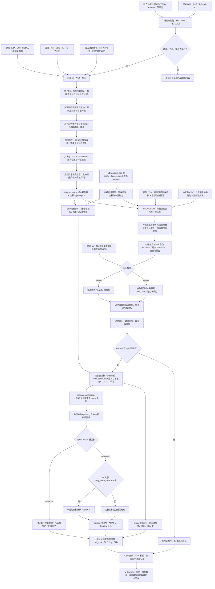

# Fudan WGS Toolkit 使用说明

本工具尚在开发验证阶段，未达到原软件精度，切不可作为真实分析使用的标准化工具。

## 1. 功能与流程

`prepare_WGS_data` 从原始 PLINK BED/BIM/FAM 和独立下载的功能注释构建可校验的遗传数据。`run_WGS_all` 消费表型 CSV、协变量 CSV 和已完成遗传目录，完成单变异、coding、noncoding 和 ncRNA 关联分析。传入多个表型列时，它们共享遗传数据读取、CPU 缓存、注释索引和 CPU–GPU 传输；各表型仍独立筛选完整样本、拟合零模型、计算频率和检验结果。

正常流程为 `prepare_WGS_data → run_WGS_all`。准备只执行一次；目录已有完成清单时，直接运行关联步骤，不重复准备遗传数据、注释或样本轴。两种目录使用同一个三输入接口：`dataset.json` 保留完整 FID/IID，`cache_dataset.json` 保留原数字身份轴。模型由 `grm` 选择：默认 `sparse` 读取显式文件或清单侧文件中的稀疏 GRM，`none` 使用不含 GRM 的普通零模型。设备、模型族、协变量与恢复参数的调用方式一致。

遗传缓存复用与关联恢复分别处理。`resume=False` 默认在新输出目录执行本次全量关联；`resume=True` 先核对同一运行的输入、模型、参数和源码绑定，再验证各分析类型的结果块与 CSV 校验和，只补算未完成块。中途写入的 partial 输出不作为完成块。跨运行的已拟合模型复用仍需拟合源码兼容证明、完整模型导入清单及原拟合成功收据，不能仅凭模型目录存在跳过拟合。输入意义见第 3 节，结果分块与恢复规则见第 6 节。

遗传矩阵计算使用原生 TF32/FP32 运算，不通过拆分乘法重建 FP64。零模型拟合、部分谱校正和稳定尾概率仍保留 FP64，以控制数值误差；Burden 矩阵乘法使用 IEEE FP32。同输入数值复现与已有官方结果的一致性比较分别报告，具体口径见第 7 节。



不执行固定窗口或滑动窗口关联分析。Single 的位置分区仅决定输出文件与读取批次，不把邻近变异合并成窗口检验。

## 2. 安装与运行环境

```bash
git clone https://github.com/weikanggong1/Fudan-WGS-Toolkit.git
cd Fudan-WGS-Toolkit
conda env create -f environment.yml
conda activate fudan-wgs-toolkit
```

运行关联分析需要支持 TF32 的 NVIDIA GPU、兼容的驱动以及安装环境中的 CUDA 运行库。关联默认使用一张 GPU 和每个 worker 8 个 CPU 线程；`device=["cuda:0", "cuda:1"]` 指定设备，`device=2` 选择本机前两张可见 CUDA 设备。`memory_limit_gib=None` 按设备物理显存上限和实时可用空间准入，默认额外预留 1 GiB；显式正数可收紧上限。CPU 分配受亲和性与可见 cgroup 配额共同约束，多 GPU 可共享节点配额，不将每 worker 的线程预算称为独占 CPU。数据准备默认使用 8 个 CPU worker 预算，不占用 GPU；并发染色体数同时受可用任务和 `memory_limit_gib` 的主机工作区估算预算限制。Parquet 注释为可选输入，使用时安装 `python -m pip install -e '.[parquet]'`；CSV/TSV 和压缩包不需要这个额外依赖。

## 3. 输入数据的意义和格式

### 3.1 原始遗传文件

一个染色体对应同名的 `chromosome21.bed`、`chromosome21.bim`、`chromosome21.fam`。BIM 单独不包含基因型，三个文件必须同时提供。

| 文件 | 格式与字段 | 用途 |
| --- | --- | --- |
| BED | 二进制，前三字节 `6c 1b 01`，按变异存储的 PLINK 1 二位编码 | 唯一的基因型来源；支持完整二倍体调用和完全缺失 |
| BIM | 无表头、空白分隔六列：CHR、变异标识、遗传距离、BP、A1、A2 | 确定原始变异顺序、染色体、1-based 位置和两个等位基因 |
| FAM | 无表头、空白分隔六列：FID、IID、父本 ID、母本 ID、sex、phenotype | 确定 BED 样本顺序；分析表型来自另外的 CSV |

不能把 A1 或 A2 自动当作 REF。默认以独立注释的 REF/ALT 匹配等位基因；原始 BIM 标识确实为 `CHR:POS:REF:ALT` 时，可在清单声明 `reference_allele_source: "bim_variant_id"`。转换会核对全部 BIM 行的标识、位置和等位基因，再按声明方向精确匹配独立注释；不会仅凭前缀或首批位点推断。BIM 必须按染色体位置非降序排列，每行两个等位基因明确且不同。BED 无法恢复单个等位基因缺失的半调用；转换记录会明确说明这一限制。

### 3.2 独立功能注释

注释目录包含 `annotations.json`、原始功能注释文件以及独立基因和 promoter 数据。**注释输入必须是原始下载的文件，不能用已准备缓存中的注释替代。** 当前原始注释清单格式为 `raw-wgs-annotations-v1`。

功能注释支持 CSV、TSV、gzip CSV/TSV、含 CSV/TSV 的 `tar.gz`，或 Parquet。压缩包会流式读取，不需要先展开整条染色体。输入文件按染色体位置排列，多个分片按位置顺序写入清单。一个原始 BIM 位点必须有唯一、精确的 CHR/POS/REF/ALT 对应记录；额外的公共库位点不进入遗传数据。默认情况下，缺失位点、重复对应关系或缺少必需字段会报错，不丢弃原始变异，也不把未知权重改成零。

公共注释可能不覆盖输入中的全部 indel/MNV。只有显式声明并验证 `reference_allele_source: "bim_variant_id"`、明确 QC 策略后，才可另声明 `allow_missing_non_snv: true`：保留这些变异的原始基因型，标记 `annotation_available=False`、分类为空和权重为 NaN。SNV 缺注释仍报错。这种数据可做全部变异的 Single 和已覆盖 SNV 的 gene-based；不能做 Indel 或全部变异的 gene-based。要做后两者，需要完整的独立注释。默认不启用该策略。

建议从 [FAVOR Essential 官方数据集](https://doi.org/10.7910/DVN/1VGTJI) 下载对应染色体文件，并核对官方校验值。其原始表包含以下字段。`column_mapping` 明确把原始列映射到包内的语义路径；包内路径是注释键名，不表示外部软件文件中的节点。

| 语义 | 原始 FAVOR 列 | 意义 |
| --- | --- | --- |
| chromosome / position | `chromosome` / `position` | GRCh38 染色体和 1-based 位置 |
| reference / alternate | `ref_vcf` / `alt_vcf` | 包含锚定碱基的原始 REF 与单个 ALT |
| GENCODE.Category | `genecode_comprehensive_category` | exonic、splicing、UTR、upstream、ncRNA 等区域分类 |
| GENCODE.Info | `genecode_comprehensive_info` | 基因归属字符串；保留原始语法 |
| GENCODE.EXONIC.Category | `genecode_comprehensive_exonic_category` | missense、synonymous、stopgain、frameshift 等编码影响 |
| MetaSVM | `metasvm_pred` | disruptive missense 的分类依据 |
| GeneHancer | `genehancer` | enhancer 与目标基因的关联 |
| CAGE / DHS | `cage_tc` / `rdhs` | promoter、enhancer mask 的调控区标记 |
| CADD / LINSIGHT / FATHMM.XF | `cadd_phred` / `linsight` / `fathmm_xf` | 三类功能权重 |
| aPC.EpigeneticActive / Repressed / Transcription | `apc_epigenetics_active` / `apc_epigenetics_repressed` / `apc_epigenetics_transcription` | 三类表观遗传注释主成分 |
| aPC.Conservation | `apc_conservation_v2` | 所选版本的保守性注释主成分 |
| aPC.LocalDiversity | `apc_local_nucleotide_diversity_v3` | 所选版本的局部多样性主成分 |
| aPC.Mappability / TF / Protein | `apc_mappability` / `apc_transcription_factor` / `apc_protein_function_v3` | 可比对性、转录因子和蛋白功能主成分 |

本版使用官方教程链接的 FAVOR Essential GRCh38 原始下载集（DOI `10.7910/DVN/1VGTJI`），没有改用另外一代注释。官方教程先选择原始 CSV 列，再把 Conservation v2、LocalDiversity v3、Protein v3 重命名为分析列；上表直接映射同一批原始列，省去中间文件转换。固定教程提交为 `5340326e0506945e35bc9d4d3cb85d5e8d65cd92`，对应 [官方列选择](https://github.com/li-lab-genetics/STAARpipeline-Tutorial/blob/5340326e0506945e35bc9d4d3cb85d5e8d65cd92/FAVORannotator_csv/Annotate.R) 与 [官方列重命名](https://github.com/li-lab-genetics/STAARpipeline-Tutorial/blob/5340326e0506945e35bc9d4d3cb85d5e8d65cd92/FAVORannotator_csv/gds2agds.R)。

本次 chr21 官方压缩包大小为 5,528,780,471 字节，MD5 为 `dccf132a9ed61f18f08ceac69b5c2cab`；下载后已核对官方校验值。准备流程另记录使用的原始文件 SHA-256。公共数据库不保证覆盖任意研究的所有 indel/MNV；同一官方文件的覆盖缺口也不能通过其他版本的权重或旧缓存补齐。

注释版本属于分析输入。更换 aPC 版本可能改变权重和 P 值，不能把这种输入变化解释为 TF32 数值误差。QC 不是公共功能注释：必须映射原始 QC 列，或者在清单中明确声明输入遗传文件已经通过项目 QC，例如 `default_qc: "PASS"`。后者不能替代实际的质量控制。

基因输入可使用独立 CSV。编码基因表的字段为 `hgnc_symbol,chromosome_name,start_position,end_position`；ncRNA 名单为 `chr,ncRNA`；promoter TSV 为 `chromosome,start,end,strand,gene_id`。位置均为 1-based、闭区间。精确复现需要固定这些文件的版本和 promoter 定义，不在运行中重新猜测转录本或启动子长度。

编码基因表和 ncRNA 名单固定为 [原始方法提交 ed3e26f7](https://github.com/li-lab-genetics/STAARpipeline/tree/ed3e26f7fb4c5d70a765840d089e5863896ec081) 的原始参考表，独立转换为上述 CSV。本次 promoter 则读取 [官方 TxDb.Hsapiens.UCSC.hg38.knownGene 3.22.0](https://bioconductor.org/packages/release/data/annotation/html/TxDb.Hsapiens.UCSC.hg38.knownGene.html) 的 SQLite 数据：同一基因的同染色体、同链转录本合并范围，多染色体或多链基因按原规则排除；正链取 `gene_start−3000 ... gene_start+2999`，负链取 `gene_end−2999 ... gene_end+3000`，不裁剪坐标。固定下载包 SHA-256 为 `feb61126a6d874949423703c90e92e6073d22fecf2db18c44aa9859a43d53f4e`。这些参考文件与参与者及基因型无关，不从已经准备的遗传缓存提取。

完整清单生成示例见 [write_annotation_manifest.py](../examples/write_annotation_manifest.py)。其中的目录、文件名和列映射需要与实际下载文件对应。

### 从官方原始参考文件生成三个输入表

先在已安装的 Conda 环境中安装一次性的 Python 参考读取依赖：

```bash
conda activate fudan-wgs-toolkit
python -m pip install -e '.[annotations]'
```

独立下载 [固定官方基因参考资源](https://raw.githubusercontent.com/li-lab-genetics/STAARpipeline/ed3e26f7fb4c5d70a765840d089e5863896ec081/R/sysdata.rda) 与 [官方 TxDb 3.22.0 源包](https://bioconductor.org/packages/3.23/data/annotation/src/contrib/TxDb.Hsapiens.UCSC.hg38.knownGene_3.22.0.tar.gz)。前者 SHA-256 为 `4bfa7ab5fe2c25f8aaf6e4319e683c3e29b97f62e687b01036501cffd32b484f`；后者为 `feb61126a6d874949423703c90e92e6073d22fecf2db18c44aa9859a43d53f4e`。下载文件保持在项目外，不放入本仓库。基因参考资源是外部序列化数据，由 Python 读取，不安装或调用原语言解释器。

把下载文件分别保存为本例的 `gene_reference.archive` 与 `promoter_reference.tar.gz` 后，从仓库根目录运行：

```bash
python examples/export_annotation_references.py \
  --gene-reference-archive /data/downloads/gene_reference.archive \
  --promoter-database /data/downloads/promoter_reference.tar.gz \
  --output-directory /data/raw_annotation_references

# 只有输入遗传文件确已完成项目 QC 时，才声明下面的 PASS。
python examples/write_annotation_manifest.py \
  --output-directory /data/original_annotations \
  --chromosome 21 \
  --variant-archive /data/downloads/chromosome21.tar.gz \
  --gene-csv /data/raw_annotation_references/genes.csv \
  --ncrna-csv /data/raw_annotation_references/ncrna.csv \
  --promoter-tsv /data/raw_annotation_references/promoter_intervals.tsv \
  --default-qc PASS
```

随后把 `/data/original_annotations` 传入 `prepare_WGS_data(annotation_directory=...)`。如果项目有逐位点 QC 列，应映射它而不声明固定 PASS；若原始非 SNV 存在注释覆盖缺口，仍须遵循上文的显式覆盖策略，示例不会自动容许缺注释。

| 导出参数 | 意义 |
| --- | --- |
| --gene-reference-archive | 独立下载的原始基因参考资源；内含 genes_info 与 ncRNA_gene 两个表，保持原始行顺序 |
| --promoter-database | 原始 TxDb 源包 tar.gz，或从同一原始包独立提取的 SQLite 数据库；不是遗传缓存 |
| --output-directory | 不存在的新目录；生成 genes.csv、ncrna.csv、promoter_intervals.tsv 和 reference_export.private.json |
| --gene-source-sha256 | 基因参考资源的预期 SHA-256；默认锁定上述固定官方资源 |
| --promoter-source-sha256 | promoter 原始输入的预期 SHA-256；默认按 tar 或 SQLite 锁定 3.22.0 资源；独立 SQLite 默认 SHA 为 7fab4f12a779f3917f84f19e6fe10b66fd5564ad015da55163d5c17e6c86f573 |
| --promoter-package-version | 预期 promoter 包版本，默认 3.22.0；tar 包 DESCRIPTION 必须一致；使用其他合法版本时须显式提供版本与预期校验和 |

脚本不会下载数据、运行外部解释器、从缓存提取注释或重新分发原始资源。promoter 通过同染色体、同链转录本范围构造，排除多范围基因，保留官方闭区间及可能的越界坐标，不截到 1。准备阶段再筛选目标常染色体并校验坐标。输出私有证明记录源 SHA、转换规则、各文件 SHA 与条数，不应上传为分析数据。

本版脚本使用真实官方下载输入验证：gene CSV 18,445 行、ncRNA CSV 21,104 行、promoter TSV 35,356 行。分别用原始 tar 和 SQLite 导出时，三个文件均与固定参考的 SHA-256 完全一致；这是参考资源转换检查，不能替代关联分析的精度或耗时 benchmark。

### 3.3 表型与协变量 CSV

两个文件均使用 UTF-8、逗号分隔和表头。`dataset.json` 要求前两列为字符串 `FID,IID`，后续列必须是数值。下面仅展示格式，不是 benchmark 数据。

```text
FID,IID,trait_a,trait_b
0,person_001,2.8,NaN
0,person_002,NaN,4.1
family_b,person_003,3.6,5.2
```

```text
FID,IID,age,sex,PC1,PC2
0,person_001,51,0,0.01,-0.02
0,person_002,63,1,0.03,0.01
family_b,person_003,47,1,-0.01,0.02
```

| 输入 | 含义及要求 |
| --- | --- |
| FID / IID | 与原始 FAM 完整匹配的身份双列；保留前导零、下划线和 FID `0`；相同 IID 属于不同 FID 时是不同样本 |
| 表型数值列 | 一列对应一次独立关联分析；CSV 分片用 trait_index，实际列名保存于私有表型索引 |
| 协变量数值列 | 默认各表型使用全部协变量；`phenotype_covariates` 可为每个表型选择不同列；完整案例筛选后添加截距、标准化并去除常数或共线列，保留相同固定效应空间 |
| 缺失值 | 空白、NaN、NA、null 等转成缺失；每个表型独立排除该表型或它所选协变量缺失的样本；不填补表型 NaN |
| 模型族 | `phenotype_families="auto"` 为默认；对表型 CSV 整列的有限值判断：非空且全部属于 `{0,1}` 时识别为 `binomial`，其他数值列识别为 `gaussian`；可用 `{表型名: 模型族}` 覆盖，未列出的列继续自动识别 |
| 二分类值 | 明确或自动识别为 `binomial` 的列须只有 0/1 和缺失，分析样本中须同时存在两类；若将 0/1 指标作为连续量，显式指定 `gaussian` |

重复 FID/IID 对、无穷大数值、非数值协变量和不足以拟合模型的完整案例会报错。各表型分别记录保留及去除的协变量、中心和尺度；例如该表型样本中的 sex 恒定时，它与截距重复，保留截距即可。`grm="none"` 使用普通回归零模型，不推断亲缘结构；连续为线性模型，二分类为 logistic 零模型。`grm="sparse"` 使用输入稀疏 GRM 的混合零模型。模型族自动识别使用数值内容，不根据列名猜测。

`cache_dataset.json` 使用以下格式，保留缓存已有的数字身份轴：

| 输入 | 格式与意义 |
| --- | --- |
| 表型 CSV | 前两列为 `FID,IID`；FID 必须为字符串 `0`，IID 必须等于缓存现有数字 ID 的规范正十进制文本，不带前导零；后续每列为一个数值表型 |
| 协变量 CSV | 同样以 `FID,IID` 双列开始，采用相同身份约束；后续为数值协变量，两份 CSV 的原始行序可以不同 |
| 遗传目录 | 完成的 `cache_dataset.json`、样本轴、各染色体基因型和 metadata；默认从 `phewas.kinship_npz` 读取绑定身份的稀疏 GRM，也可显式传 `grm_file` 或选择 `grm="none"` |
| 模型设置 | 公开入口默认自动识别模型族、各表型使用全部协变量；通过 `phenotype_families`、`phenotype_covariates` 映射覆盖。缓存的旧 profile 不隐式覆盖这些参数；可选 `phewas.cohort_rows` 限定缓存逻辑行子集 |

两种遗传清单均使用各表型自己的完整案例样本。`continuous_transform=None` 按来源保留默认处理：现代 `dataset.json` 使用 `none`，按原始表型值拟合；兼容 `cache_dataset.json` 使用 `paper`，先求协变量 OLS 残差，再 RINT，并恢复原始表型标准差。显式 `none`、`paper`、`rint` 对两种格式都生效；`rint` 直接变换原始表型。稀疏 GRM 模式的二分类执行混合模型和显著结果的 FP64 SPA。数字遗传轴保持原值；公共双列输入只接受明确的 FID `0` 与原数字 IID，不推断其他家庭身份。缓存人数也不等于各表型的分析人数。

两种路线都按每个表型的分析样本处理基因型频率和缺失填补；表型 NaN 按完整案例排除，不插值。


### 3.4 稀疏 GRM 与无 GRM 模式

默认 `grm="sparse"` 使用稀疏遗传关系矩阵：显式 `grm_file` 优先，省略时读取遗传清单绑定的 `phewas.kinship_npz` 侧文件；两者都没有时明确报错。准备遗传压缩缓存本身不生成或估计 GRM。`grm="none"` 使用无亲缘结构的普通零模型，仍使用原始样本身份、各表型完整案例和同一输出结构；此时不能同时传 `grm_file`。清单内已有 GRM 时也不会在 none 模式消费它。

GRM 为无 pickle 的 NPZ，必须包含：

| 数组 | 形状与含义 |
| --- | --- |
| `sample_ids` | `[n]` 唯一身份字符串，与遗传目录及表型匹配；GRM 必须覆盖全部实际分析样本 |
| `diagonal` | `[n]` 有限、非负的对角线元素 |
| `edge_rows`, `edge_cols` | `[e]` 零基整数非对角行、列索引，在 `[0,n)` 范围内 |
| `edge_values` | `[e]` 有限的非对角 GRM 值；可存一侧三角形，或值一致的成对对称项 |

数字缓存的 `sample_ids` 使用对应数字身份的十进制字符串。现代 `dataset.json` 的身份是完整 FID/IID canonical JSON 键，例如 `'["family_a","participant_a"]'`；可用 `fudan_wgs_toolkit.identity.sample_keys(sample_pairs)` 从 `[n,2]` 字符串双列生成，不能只用 IID，不能删除前导零。

GRM 行序可以与遗传目录不同，但身份必须唯一且覆盖各表型的全部实际分析样本；按身份重排，不按文件行号猜测对应关系。遗传清单可通过 `phewas.kinship_npz` 声明相对于遗传根目录的 GRM 路径。可选 `phewas.cohort_rows` 是唯一零基缓存逻辑行向量或等长布尔 mask，用于限定既有缓存的人群范围；它不是原 BED 文件的物理行号，也不会改变保存的遗传轴。

## 4. Python 调用

```python
from pathlib import Path
from fudan_wgs_toolkit import prepare_WGS_data, run_WGS_all

original_plink_directory = Path("/data/original_plink")
original_annotation_directory = Path("/data/original_annotations")
prepared_genetic_directory = Path("/data/prepared_genetics")
phenotype_csv = Path("/data/phenotypes.csv")
covariate_csv = Path("/data/covariates.csv")
association_output_directory = Path("/data/results")

if __name__ == "__main__":
    # 准备遗传文件一次，后续单表型和多表型复用同一数据。
    preparation_report = prepare_WGS_data(
        source_directory=original_plink_directory,
        annotation_directory=original_annotation_directory,
        output_directory=prepared_genetic_directory,
        chromosomes=["21"],
        cpu_threads=8,
        memory_limit_gib=8,
        chunk_size=256,
    )

    # 表型 CSV 的每个数值列独立分析，样本集合允许不同。
    association_report = run_WGS_all(
        phenotype_csv=phenotype_csv,
        covariate_csv=covariate_csv,
        prepared_directory=prepared_genetic_directory,
        output_directory=association_output_directory,
        chromosomes=[21],                         # "all" 为全部已有常染色体
        analyses=("individual", "coding", "noncoding", "ncrna"),
        device=["cuda:0"],                        # 或 device=2 使用本机前两张卡
        cpu_threads=8,
        memory_limit_gib=None,                    # 自动上限；可显式设置如 20 GiB
        memory_reserve_gib=1.0,
        phenotype_families={"trait_a": "gaussian", "trait_b": "gaussian"},
        # 未列出的表型默认用全部协变量；每列只检查自己的协变量缺失。
        phenotype_covariates={"trait_a": ["age", "sex", "PC1", "PC2"],
                              "trait_b": ["sex", "PC1", "PC2"]},
        gene_variant_type="SNV",
        grm="sparse",
        grm_file="/data/sparse_grm.npz",            # 或使用遗传清单绑定的 GRM
        continuous_transform=None,                 # 新缓存用原值；兼容缓存保留 paper
        resume=False,                            # True 校验完成块后只补算剩余块
    )
    print(association_report["completed"])
```

### 已有完成缓存：省略 prepare

已有 `dataset.json` 或 `cache_dataset.json` 都省略前面的 prepare 调用，直接使用同一个 `run_WGS_all`。以下缓存已绑定稀疏 GRM；没有侧文件时可传 `grm_file`，选择无 GRM 模型则设 `grm="none"`。

```python
from fudan_wgs_toolkit import run_WGS_all

if __name__ == "__main__":
    association_report = run_WGS_all(
        phenotype_csv="/data/phenotypes.csv",
        covariate_csv="/data/covariates.csv",
        prepared_directory="/data/completed_cache",
        output_directory="/data/results",
        chromosomes="all",                        # 或 [1, 2, 21]
        analyses=("individual", "coding", "noncoding", "ncrna"),
        device=2,                                 # 前两张可见 CUDA 卡
        cpu_threads=8,
        memory_limit_gib=None,
        memory_reserve_gib=1.0,
        phenotype_families="auto",
        phenotype_covariates=None,
        gene_variant_type="SNV",
        grm="sparse",
        continuous_transform=None,                 # 按缓存格式保留原默认处理
        resume=False,
    )
    print(association_report["completed"])
```

各数值表型列都在同一次调用中提交；`trait_batch_size=16` 控制缓存路线中每个遗传块的计算批次，不是总表型数。`device=["cuda:0"]` 为单卡；指定设备列表可以选非连续 GPU，整数 `n` 选择前 `n` 张可见卡。字符串 `"cuda:0"` 与旧 `gpu_ids` 参数继续兼容，推荐新调用统一使用 `device`。多 GPU 入口启动独立 Python 进程，脚本保留 `__main__` 保护。

### prepare_WGS_data 的每个参数

| 参数 | 默认值 | 含义 |
| --- | --- | --- |
| source_directory | None | 原始 BED/BIM/FAM 的目录；自动发现每条染色体的一组同名文件 |
| output_directory | None，必填 | 新准备目录，不能覆盖已完成数据 |
| prefixes | None | Python 字典 `{染色体: 文件前缀}`；目录有多组同染色体文件时明确指定 |
| chromosomes | None | 要准备的染色体列表；None 为发现的全部常染色体；仅支持 1–22，其他染色体名称报错 |
| annotation_directory | None，必填 | 原始注释目录、annotations.json 路径，或同结构字典 |
| sample_pairs | None | 可选 FID/IID CSV 或 `[n,2]` 字符串数组，选择并确定样本顺序；None 保留完整 FAM |
| variant_indices | None | 可选递增、唯一的零基 BIM 行号；字典可为各染色体分别指定；明确标记为局部验证数据 |
| memory_limit_gib | 8 | 主机工作区估算的调度预算，单位 GiB；据此减少并发进程，不是总 RAM/RSS 硬上限 |
| cpu_threads | 8 | 准备阶段的总 CPU worker 预算，正整数；默认并行染色体准备，单染色体并行解码；1 为串行 |
| hardlink_annotations | True | 同文件系统尽量硬链接准备后的注释，失败后复制；不链接原始基因型 |
| resume | False | 恢复完全相同输入、样本和变异选择的未完成转换；校验绑定后继续 |
| max_frames | None | 分块检查点限制；达到后返回 completed=False，不发布 dataset.json |
| chunk_size | 256 | 每个压缩帧的变异数，1–1024；减小它可降低解码峰值内存 |

转换的 `completed=True` 才表示选择的全部染色体和变异完成。每块保留状态计数、校验和和往返校验结果。source_bytes 使用真实 BED 字节数；大文件压缩容器有 10% 存储上限，小型接口测试有最小容器开销额度。不要把检查点、PID 或准备中的临时目录当作完成数据。

准备阶段的主机内存预算采用工作区估计。高非零比例基因型的 CSR 校验临时数组、较长的注释字符串及 Python 进程开销可能超出估计；调度报告中的估算值不等于实测峰值 RSS。减少 `chunk_size`、`cpu_threads` 可降低这些开销。恢复未完成转换时，会重新核对根样本双列、身份键和已完成染色体的数据流校验和，再发布整体完成标记。

### run_WGS_all 的每个参数

| 参数 | 默认值 | 含义 |
| --- | --- | --- |
| phenotype_csv | 必填 | UTF-8 CSV，FID/IID 双列加一个或多个数值表型；兼容数字缓存要求 FID 为 0、IID 为原规范数字 ID |
| covariate_csv | 必填 | FID/IID 双列加数值协变量，可仅有身份双列；身份规则与表型一致，各表型默认使用全部协变量 |
| prepared_directory | 必填 | 已完成遗传根目录；dataset.json 使用 FID/IID，cache_dataset.json 保留数字身份；均不重新准备遗传数据 |
| output_directory | 必填 | 本次结果目录；统一按分析类型和字段签名输出 gzip CSV 分片，trait_index 映射到私有表型索引 |
| chromosomes | all | "all" 为准备目录中的全部常染色体；[1, 2, 21] 为指定编号列表，兼容字符串编号；None 兼容旧的全部选择 |
| analyses | 四类全部 | individual、coding、noncoding、ncrna 的非空组合，两种清单均可选择子集 |
| device | ("cuda:0",) | ["cuda:0"] 为单卡，列表选择不同 CUDA 设备；正整数 n 选择前 n 张可见卡；兼容单个设备字符串 |
| cpu_threads | 8 | 每个 GPU worker 的读取、解码和 CPU 操作线程预算，正整数；节点实际算力仍受共享 CPU 配额限制 |
| memory_limit_gib | None | 自动使用每个设备的物理显存上限并检查实时可用空间；正数为显式 GiB 上限，可超过 20；另扣除 reserve |
| memory_reserve_gib | 1.0 | 设备工作区预留空间，GiB，非负；与 memory_limit_gib 在所有选定 GPU 上共同生效 |
| phenotype_families | auto | 非缺失值仅为 0/1 时识别 binomial，否则 gaussian；可用 `{表型列名: gaussian/binomial}` 覆盖，未声明列继续自动识别 |
| phenotype_covariates | None | `{表型列名: [协变量列名, ...]}`；未声明列用全部协变量，空列表为仅截距；列名必须存在且不重复 |
| gene_variant_type | SNV | 两种清单统一的 gene-based SNV、Indel 或 variant 选择；Single 始终扫描全部变异；SNV 模式使用功能注释权重，其他模式遵循原规则关闭这些权重 |
| grm | sparse | sparse 使用输入稀疏 GRM 的混合零模型，找不到 GRM 报错；none 使用无亲缘结构的普通零模型 |
| grm_file | None | 稀疏 GRM NPZ 文件；sparse 模式显式文件优先，其次清单侧文件，均无则报错；none 模式禁止传此参数 |
| transform | none | 旧参数兼容别名；none 不覆盖 continuous_transform，rint 可覆盖未指定的连续变换；与显式不同变换冲突时报错。仅作用于连续表型 |
| null_fit_mode | fp64 | 统一成熟零模型使用 FP64 拟合；旧 tf32 拟合覆盖在该入口明确报错，关联矩阵计算仍为 TF32/FP32 |
| covariance_block_size | 4096 | 缓存协方差计算的变异块大小；降低可减少中间工作区 |
| long_mask_threshold | 5000 | 超过此 M 的 mask 使用 FastSKAT；不会跳过该 mask |
| long_mask_rank | 512 | FastSKAT 随机低秩的目标秩；这是近似谱，不是完整谱等价声明 |
| seed | 1729 | FastSKAT 随机种子，非负整数 |
| single_mac_cutoff | 20 | Single 保留的最小 minor allele count |
| single_group_variants | 5000 | Single 的结果分组大小，影响读取与组装 |
| single_region_size | 10000000 | Single 输出的位置分区宽度，单位 bp；不是区域关联检验 |
| individual_effective_block_size | 1024 | Single 内部有效变异批大小 |
| device_cache_bytes | 536870912 | 设备共享缓存容量，单位字节；0 禁用留存 |
| compact_cache_bytes | 67108864 | CPU 紧凑状态缓存容量，单位字节；0 禁用留存 |
| metadata_cache_bytes | 268435456 | CPU 注释元数据缓存容量，单位字节，正整数 |
| resume | False | False 在新输出目录执行全量关联，已有运行不自动覆盖；True 核对输入、模型、设置、源码和完成块 CSV 校验和后，只补算未完成或损坏块；partial 不计完成 |
| gpu_ids | None | 旧设备编号列表的兼容参数；新调用用 device 设备列表或卡数，避免同时给出冲突选择 |
| trait_batch_size | 16 | 每个遗传块的表型批次大小，正整数；不限制总表型数 |
| continuous_transform | None | 按缓存来源保留默认：dataset.json 用 none、cache_dataset.json 用 paper；显式 none/paper/rint 统一生效。paper 为协变量 OLS 残差、RINT 和原标准差恢复，rint 为直接 RINT；二分类保持 0/1 |

设备、显存、模型族、协变量、连续变换、分析选择、变异类型和恢复参数在两种遗传清单中使用上述统一语义。连续变换使用 continuous_transform；旧 transform 参数仅作兼容别名。零模型拟合固定使用成熟的 FP64 路径；`null_fit_mode="tf32"` 会明确报错。关联矩阵仍按原生 TF32/FP32 计算，统计参数纳入计划及恢复绑定。

显存预算约束包管理的工作区；CUDA 上下文、其他用户进程及文件系统缓存不在包内显存计数中。运行报告记录实际分配和保留峰值，而不是把参数值当成实测峰值。

混合路线的 Burden 矩阵乘法继承调用方预算和安全余量，子函数不再附加独立的 20 GiB 默认限制。二分类模型的 FP64 源状态、FP32 normal 状态及 FP64 SPA 状态在分配前估算工作区，已有源张量不重复计为新增分配；原生检验及时释放不再使用的乘积和稀有变异协方差。预算检查和生命周期修复保持原有 TF32/IEEE FP32 算式、模型拟合参数及结果顺序。

多染色体准备使用独立 Python 进程；在独立脚本中，把调用放进 `if __name__ == "__main__":`，避免进程启动时重复执行顶层代码。命令行入口已经包含此保护。`max_frames` 为显式检查点调试参数，转换阶段采用串行调度来保持全局精确帧上限；普通完整准备默认并行。转换先完成所有输入、样本轴和注释的检查，再写基因型；主进程只在全部染色体完成后提交数据集完成标记。

## 5. 命令行调用

```bash
prepare-WGS-data \
  --source-directory /data/original_plink \
  --annotation-directory /data/original_annotations \
  --output-directory /data/prepared_genetics \
  --chromosomes 21 --cpu-threads 8 --chunk-size 256

run-WGS-all /data/phenotypes.csv /data/covariates.csv /data/prepared_genetics \
  --output-directory /data/results \
  --chromosomes 21 --device cuda:0 --cpu-threads 8 \
  --grm sparse --grm-file /data/sparse_grm.npz
```

`python -m fudan_wgs_toolkit` 与 `run-WGS-all` 等价。准备 CLI 可用 `--sample-pairs`、`--max-frames`、`--resume`、`--copy-annotations`；指定精确 prefixes 和 variant_indices 使用 Python 接口。其余关联参数的 CLI 名称采用短横线，例如 `--long-mask-rank`。`--phenotype-families` 和 `--phenotype-covariates` 接受相应映射字典的 JSON 文件路径；`--gene-variant-type` 对应 gene-based 变异类型。

已有完成目录时直接运行以下命令，不再调用 `prepare-WGS-data`。这里缓存已绑定稀疏 GRM；`--grm none` 可明确选无 GRM：

```bash
run-WGS-all /data/phenotypes.csv /data/covariates.csv /data/completed_cache \
  --output-directory /data/results \
  --chromosomes all --device cuda:0 cuda:1 --trait-batch-size 16 \
  --grm sparse --continuous-transform paper
```

Python 用 `device=2` 选择前两张卡，CLI 用 `--device 2`；`--device cuda:0 cuda:1` 显式选卡。省略显存参数自动设置上限及 1 GiB 预留；`--memory-limit-gib 20 --memory-reserve-gib 1` 可显式收紧，`--resume` 恢复验证通过的完成块。CPU worker 预算不等于独占核心数，实际 CPU cgroup 配额可能共享。已有部署计划可显式指定经审核的 worker 分配与模型复用绑定。一般调用使用上面的统一 CLI，模型来源与复用边界见第 6 节。

省略 `--continuous-transform` 时，按缓存来源保留默认处理；`--continuous-transform none` 可明确使用原始连续表型，`--continuous-transform paper` 选择残差、RINT 与标准差恢复。`--phenotype-families auto` 为默认；需要覆盖时给 JSON 文件，例如 `{"trait_a": "gaussian", "trait_b": "binomial"}`。协变量 JSON 可为 `{"trait_a": ["age", "sex", "PC1"], "trait_b": ["sex", "PC1"]}`；`trait_b` 不会因未选的 age 缺失而被排除。

## 6. 输出与分析方法

```text
prepared_genetics/
  dataset.json                 # 现代清单：完成数据集及来源绑定
  sample_pairs.npy             # n×2 原始 FID/IID 字符串
  sample_ids.npy               # 完整双列的无歧义内部键
  chr21/                       # 压缩基因型、索引、元数据和完成标记
  catalogs/                    # 独立基因 jobs 与 promoter 区间
  # 或已完成的 cache_dataset.json，保留其原数字样本轴和目录

results/
  csv/
    .checkpoints/blocks/<分片键>/*.csv.gz  # 验证完成的文本 CSV 分片
    .checkpoints/invalid/                 # 损坏或未提交旧块的保留证据
    worker_<编号>.complete.private.json   # 本次调度使用的完成分片与行数
  models/                      # 各表型零模型和普通/SPA 状态
  trait_index.private.csv      # 现代路线：trait_index、表型原列名、模型族
  inputs/                      # 兼容路线：私有表型索引、匹配样本和输入绑定
  plan.private.json
  status.private.json          # 本次 attempt_id 的运行状态
  report.private.json          # 本次完成报告
  report.previous.<attempt_id>.private.json  # 恢复前已有报告的归档
```

两种清单均使用验证完成的 gzip CSV 分片和 worker 收据；模型和输入证明保留各自布局。每行 `trait_index` 对应私有表型索引，另保留位点或 gene/mask、概率和数值诊断。`.csv.gz` 是压缩文本 CSV，可直接用 `pandas.read_csv` 读取；实际路径以 worker 报告的 `output["receipts"]` 中的 `csv_file` 为准，相对 `output_directory/csv`。每项完成收据记录分析类型、染色体、块、表型、字段、行数和文件 SHA；汇总时读取本次完成收据中的分片，不把 invalid 目录或未提交 partial 文件计入结果。连续 gene-based 汇总使用 STAAR-O，二分类使用 STAAR-Burden；稀疏 GRM 二分类模式保留显著结果的 FP64 SPA。返回字典包含 `completed`、各分析类型的行数、worker 报告和 `end_to_end_seconds`。

只写结果 CSV、Python 模型状态和 JSON，不生成外部语言专用对象。CSV 不添加队列表型 field ID、Phenotype 或 Phenotypic category 列，通过私有 `trait_index` 映射表型。浮点数以 17 位有效数字保存，避免导出阶段引入额外舍入；零行的已提交块仍保留字段与完成记录。`resume=True` 逐块核验完成记录与 CSV SHA，不把残留 partial 当作完成。

| 输出 | 主要列与含义 |
| --- | --- |
| Single | CHR、POS、REF、ALT、ALT_AF、MAF、N、pvalue、pvalue_log10、Score、Score_se、Est、Est_se |
| pvalue_log10 | 正值 `−log10(P)`，不是 log10(P)；极小 P 下可在 pvalue 下溢时仍保留对数结果 |
| Score / Score_se | score 及其标准误；Est / Est_se 为由 score 检验得到的效应估计及标准误 |
| 连续 gene-based | Gene name、Chr、Category、#SNV、cMAC；两组 Beta 权重下的 SKAT、Burden、ACAT-V、注释权重及 Cauchy 汇总结果 |
| 二分类 gene-based | 相同 gene/mask 身份与计数；采用 Burden 汇总及所选模型的二分类概率，字段签名与连续模型分别成片 |
| WGS-S / B / A | 分别汇总 SKAT、Burden、ACAT-V 的注释加权检验；不是新定义的统计公式 |
| WGS-O / ACAT-O | 对相应检验 P 值做 Cauchy 合并的总体结果；名称已统一到当前接口 |

coding 的基础五类为 pLoF、pLoF 加 disruptive missense、missense、disruptive missense、synonymous。现代 `dataset.json` 尊重 gene catalog 的类别声明，prepare 默认使用这五类；兼容 `cache_dataset.json` 的成熟 PheWAS 计划使用七类，另含 PTV 和 PTV 加 disruptive missense。noncoding 包括 upstream、downstream、UTR、promoter CAGE/DHS、enhancer CAGE/DHS；ncRNA 单独运行。每个表型使用自己的 MAF、MAC 和有效 mask，不因为共享读取而使用多个表型样本的交集。

gene-based 默认按严格 `0 < MAF < 0.01` 及各 mask 的最小变异数筛选，具体设置与结果记录在计划和完成绑定中。按当前表型样本的等位基因频率作均值填补；表型和协变量的 NaN 仍按完整案例规则排除。这些筛选和填补规则在共享与独立单表型运行中相同。

Score 和协方差分别为 `u = Gᵀr`、`V = GᵀPG`。Single 只求需要的方差对角线。Burden 把全部权重列合并计算，ACAT-V 复用单变异统计量并保留极罕见变异合并规则。局部重叠 mask 共享基因型和协方差；不同零模型的 V 不直接共用。SKAT 使用加权协方差的特征值和稳定尾概率分支，大 mask 使用声明的随机近似。统计小值通过稳定对数尾概率和 Cauchy 小 P 分支处理，不能简单把 P、效应或 SE 乘一个系数再检验。

普通连续表型的样本精度为相同的正数 `s` 时，gene-based 协方差先使用归一化的精度 `1`、精度加权协变量矩阵 `A/s` 和固定效应协方差 `C*s`，最后把协方差乘回 `s`。这里 `A=Σ⁻¹X`、`C=(XᵀΣ⁻¹X)⁻¹` 均来自已有拟合状态。这与原公式相同，避免把同一常量精度预乘基因型后再作 TF32 输入舍入，不增加矩阵乘法；Score 保持原计算。恢复原单位后才进入特征值阈值和尾概率检验。非恒定精度、二分类、带亲缘旋转块的模型和 FP64 对照保留原路径；归一化状态计入设备预算，并在模型张量改变时失效。

### 6.1 读取结果分片

完整输出以本次 worker 完成收据为准，每个 `.csv.gz` 是可独立读取的文本 CSV。不同分析或模型族的字段可能不同，因此按收据中的 `kind` 选择需要的分析，不用目录通配符混入历史文件。`trait_index` 是本次输入表型列的零基索引，通过私有字典恢复原列名。以下示例逐批读取已提交 Single 分片，不把全基因组结果一次放进内存：

```python
from pathlib import Path
import pandas as pd

association_result_directory = Path(association_report["output_directory"])
for worker_report in association_report["workers"]:
    for completed_block_receipt in worker_report["output"]["receipts"]:
        if completed_block_receipt["kind"] != "individual":
            continue
        single_result_csv = (
            association_result_directory / "csv" / completed_block_receipt["csv_file"]
        )
        for single_result_batch in pd.read_csv(single_result_csv, chunksize=100_000):
            # trait_index 指向私有表型字典；其余列是该批 Single 结果。
            print(len(single_result_batch))
```

两种缓存的字典均为根目录 `trait_index.private.csv`，列为 `trait_index,phenotype,family`。兼容缓存另保留 `inputs/traits.private.json` 的输入元数据。字典依据已验证的列顺序与模型族原子写出；恢复时补齐缺失或损坏的字典，并将损坏版本保留为私有诊断。计划和最终报告记录字典 SHA-256，完成前再次核对。发行仓库不包含真实字典、模型或结果。

### 6.2 同一运行恢复与模型来源

遗传目录复用不会重新运行 `prepare_WGS_data`。结果恢复则在原输出目录调用 `run_WGS_all(..., resume=True)`，保留相同的输入文件、染色体、分析类型、样本和协变量选择、模型族、GRM、连续变换、统计设置及源码。完成块还须通过 CSV SHA、字段、行数、表型分配和块绑定检查；损坏或缺少完成记录的块会被保留为诊断证据并重新计算。

恢复还核对每个染色体的三个压缩基因型数据流：设备与文件身份、大小、修改时间和状态变更时间必须与首次绑定一致，替换文件或改变链接目标也会被检测。该检查与清单及逐帧校验和共同约束遗传数据来源，不在每次恢复时重新读取整条染色体做全文件哈希。

```python
from fudan_wgs_toolkit import run_WGS_all

if __name__ == "__main__":
    resumed_association_report = run_WGS_all(
        phenotype_csv="/data/phenotypes.csv",       # 与首次运行完全相同
        covariate_csv="/data/covariates.csv",
        prepared_directory="/data/completed_cache",
        output_directory="/data/results",          # 首次运行的同一目录
        chromosomes="all",
        device=["cuda:0"],
        grm="sparse",                              # 保留原 GRM 模式和文件
        continuous_transform=None,
        resume=True,
    )
    print(resumed_association_report["completed"])
```

默认 `resume=False` 执行新全量关联，需要新输出目录；不会静默采用或删除旧结果。模型文件损坏或科学输入绑定变化会报错，不能借恢复操作悄悄换模型。`completed=True` 表示本次所有 worker 和选定分析完成；PID、已生成模型或部分 CSV 不代表全流程完成。

每次调用生成新的 `attempt_id`。恢复开始时，已有的 `report.private.json` 移入 `report.previous.<attempt_id>.private.json`；旧报告留作记录。判断本次完成时，读取当前 `status.private.json` 和 `report.private.json`，核对它们的 `attempt_id` 及本次 worker 收据；状态为 `complete` 后才采用对应结果。运行中或失败的恢复不能沿用归档报告的完成状态。

跨运行或跨源码导入模型属于另一个操作，须提供原拟合源码与当前消费源码的绑定、数学兼容证明、完整模型导入清单，以及所有原拟合进程退出为零的收据。模型数组的 SHA、dtype、shape、样本轴及全部表型覆盖必须通过校验；导入不修改原模型，也不重新拟合。统一入口的 `resume` 只恢复同一运行，不能用来绕过这些跨运行证明。模型验证完成也不能替代关联输出完成。

## 7. 原始方法与验证记录

算法来源、许可证和固定参考提交见 [NOTICE.md](../NOTICE.md)。原始方法的调用参数与输入格式见 [原始 pipeline 教程](https://github.com/li-lab-genetics/STAARpipeline-Tutorial)、[原始多表型实现](https://github.com/li-lab-genetics/STAARpipelinePheWAS)。这些链接用于解释来源，本包不安装、包装或运行这些项目。

| 原方法的调用示例 | 本包对应分析 |
| --- | --- |
| [单变异官方调用](https://github.com/li-lab-genetics/STAARpipeline-Tutorial/blob/5340326e0506945e35bc9d4d3cb85d5e8d65cd92/STAARpipeline_Individual_Analysis.r) | `analyses=("individual",)`；保持相同 MAC、样本集合和零模型 |
| [coding 官方调用](https://github.com/li-lab-genetics/STAARpipeline-Tutorial/blob/5340326e0506945e35bc9d4d3cb85d5e8d65cd92/STAARpipeline_Gene_Centric_Coding.r) | `analyses=("coding",)`；现代 catalog 默认五类，兼容 PheWAS 计划含七类；对照时逐项固定类别集合 |
| [noncoding 官方调用](https://github.com/li-lab-genetics/STAARpipeline-Tutorial/blob/5340326e0506945e35bc9d4d3cb85d5e8d65cd92/STAARpipeline_Gene_Centric_Noncoding.r) | `analyses=("noncoding",)`；相同 promoter、调控区、UTR、上下游定义 |
| [ncRNA 官方调用](https://github.com/li-lab-genetics/STAARpipeline-Tutorial/blob/5340326e0506945e35bc9d4d3cb85d5e8d65cd92/STAARpipeline_Gene_Centric_ncRNA.r) | `analyses=("ncrna",)`；使用同一独立 ncRNA 名单 |

原方法示例的模型、变异类型、QC、频率阈值和注释列均属于对照条件。不同样本或亲缘结构的旧结果不作为同输入精度对照；大 mask 的随机谱路径也需单独标明。公开仓库保留原调用链接，本包的可执行入口全部为 Python。

同输入精度对照必须固定参与者、表型处理、协变量、REF 方向、缺失处理、注释版本和每个 mask 的位点集合。历史数值复现检查以 `|Δ(−log10(P))| < 0.001` 为目标，报告显著并集及全部有限 P 值的误差；此目标不用于不同人群或不同处理的已有官方结果。源格式解码一致、CSV 无舍入损失与统计方法一致分别核验。

多表型与已下载官方 gene-based 结果比较时，按表型、gene 和 mask 匹配，连续 STAAR-O 与二分类 STAAR-B 分开报告：`P < 1e-5` 的显著重叠、仅本次显著、仅官方显著，以及有限 `−log10(P)` 的 Pearson/Spearman 相关性。已有官方结果未发布 Single 时，Single 的官方覆盖记为 0。`P=0` 且没有有限对数结果的项单独记录，不人为加概率下限。不同样本和处理条件下的结果用于描述性一致性分析。

2026-10-11 的资源预算与张量生命周期修复通过 201 项针对性测试，另复用 4 个真实既有模型（2 连续、2 二分类）完成四类局部分析：Single 412 行、coding 24 行、noncoding 4 行、ncRNA 4 行，合计 444 行，CSV 全量回读通过、SPA 失败 0。该局部运行墙时为 215.12 秒，未重建遗传缓存或重新拟合模型；此记录单列关联复核范围，完整全基因组耗时与官方比较在完整输出回读后报告。

当前版本的迁移验证及历史端到端结果见 [验证记录](../validation/README.md)。记录明确区分真实数据、接口测试、局部验证和整条染色体完成的运行；不使用人工输入的单测耗时代替真实 benchmark。

0.9.0 的统一入口通过 1,774 项测试和 204 项子测试。真实局部验证直接使用已有 341,101 人、1,536 SNV 缓存，三个表型独立匹配不同样本，完成四类分析；共享调用与重新拟合的三个独立调用对照 2,684 个有效概率值，最大 Δ−log10(P) 为 0。完整恢复零补算，缺失或损坏一个 Single 块时仅补算该块，CSV 内容与原块完全一致，模型不重新拟合。首次共享调用 125.26 秒，三个独立调用合计 207.19 秒；这是单卡、无 GRM 的局部验证，完整范围与计时口径见上面的验证记录。

## 8. 最近版本

| 版本 | 更新 |
| --- | --- |
| 0.9.0 统一公开接口 | 已完成的两种遗传目录都用 run_WGS_all，不再次转存；全部/编号染色体、设备列表/卡数、自动显存与预留、自动模型族、每表型协变量、验证结果块恢复、sparse/none GRM；连续默认处理按缓存来源保留，标准 CSV 使用 FID/IID；恢复检查遗传数据流身份，本次状态与归档报告分别记录 |
| 0.8.0 工作区修复 | Burden 继承调用方显存预算和 reserve；二分类状态派生分配前计量；及时释放原生检验中间张量；资源配置变化的模型兼容证明；201 项测试及真实四类 444 行局部复核 |
| 0.8.0 | 改为 Fudan WGS Toolkit；prepare_WGS_data 原始 PLINK + 独立注释入口，默认多 CPU 并行；run_WGS_all 单/多表型统一入口；常量精度的原生 TF32 协方差归一化；严格 FID/IID；直接 CSV；删除退休读取器、非 Python 实现、旧导出和旧文档 |
| 0.8.0 后续更新 | 增加已完成数字身份缓存的混合 PheWAS 入口、已有模型来源验证和 GPU Single 批处理；修正二分类混合模型边界与恢复路径；真实局部验证见验证记录 |
| 0.7.0 | 整合共享多表型与完整 mask 路径；CPU 预算 8；大 mask 使用 FastSKAT；该版输入和导出接口已经被 0.8.0 替代 |

## 9. 参考文献与数据格式

- Li X et al. Dynamic incorporation of multiple in silico functional annotations empowers rare variant association analysis of large whole-genome sequencing studies. *Nature Genetics* (2020). [DOI](https://doi.org/10.1038/s41588-020-0676-4).
- Li Z et al. A framework for detecting noncoding rare-variant associations of large-scale whole-genome sequencing studies. *Nature Methods* (2022). [DOI](https://doi.org/10.1038/s41592-022-01640-x).
- Zhou H et al. FAVOR: functional annotation of variants online resource and annotator for variation across the human genome. *Nucleic Acids Research* (2023). [DOI](https://doi.org/10.1093/nar/gkac966).
- Liu Y, Xie J. Cauchy combination test: a powerful test with analytic p-value calculation under arbitrary dependency structures. *JASA* (2020). [DOI](https://doi.org/10.1080/01621459.2018.1554485).
- [PLINK BED/BIM/FAM 官方格式](https://www.cog-genomics.org/plink/1.9/formats)、[FAVOR Essential 独立注释](https://doi.org/10.7910/DVN/1VGTJI)。外部资源保持独立版本、许可与校验，不打包进发行文件。
