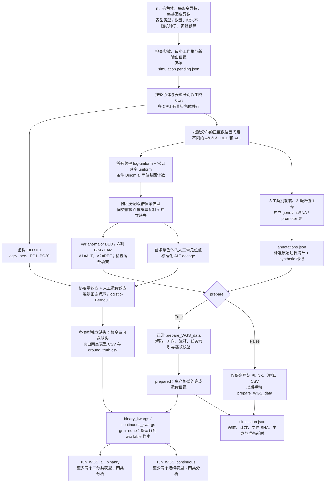

# 合成 WGS 测试数据

## 1. 功能与流程

`generate_simulated_data` 生成完全虚构的二分类或连续表型、共同协变量、PLINK BED/BIM/FAM 及独立功能注释，默认再调用成熟的 `prepare_WGS_data`。返回的 `binary_kwargs` 和 `continuous_kwargs` 可直接传入 `run_WGS_all_binanry` 与 `run_WGS_continuous`，用于不接触真实队列的解码、读取、传输、矩阵计算、输出和恢复优化。

样本数由 `n` 控制，每条染色体的变异数由 `variants_per_chromosome` 控制，局部基因窗口大小由 `variants_per_gene` 控制。生成器保留现有输入格式及 mask 分类语义，所有样本身份、坐标、等位基因、基因名称、注释值和生成系数均为人工数据，不读取真实遗传缓存、参考基因组或外部功能数据库，也不访问网络。



本工具是软件测试输入生成器。它可以固定同一合成输入比较优化前后输出与耗时；关于真实数据的精度、病例不平衡、群体结构和全基因组速度结论，仍由[二分类](wgs_binary.md)及[连续分析](wgs_continuous.md)的真实验证记录支持。生成器不提供预先知道的 P 值。

## 2. Python 调用

使用主页的 Conda 环境即可，无新增依赖。生成和准备只使用 CPU；关联分析要求可用 CUDA。下面一次生成两种表型，每种两列，并分别运行全部四类分析：

```python
from pathlib import Path
from fudan_wgs_toolkit import (
    generate_simulated_data,
    run_WGS_all_binanry,
    run_WGS_continuous,
)


def main():
    # 必须使用尚不存在的新目录；所有输出都位于这个目录内。
    simulated_data_directory = Path("work/simulated_example")
    simulation_report = generate_simulated_data(
        output_directory=simulated_data_directory,
        n=1000,                         # 人工样本数。
        chromosomes=[21],
        variants_per_chromosome=1024,   # 每条染色体生成的变异数，亦为默认值。
        variants_per_gene=256,          # 每个人工基因的变异窗口大小。
        phenotype_type="both",
        n_binary_traits=2,
        n_continuous_traits=2,
        phenotype_missing_rate=0.02,    # 每个表型独立生成缺失位置。
        covariate_missing_rate=0.0,
        genotype_missing_rate=1e-5,
        rare_fraction=0.999,             # 目标稀有分量；仍保留常见Single校准位点。
        seed=1729,
        cpu_threads=8,                  # 染色体生成 worker 上限及准备调度预算。
        memory_limit_gib=8,             # 生成 / 准备阶段主存工作区估算。
        prepare=True,
    )
    print(simulation_report["completed"])
    print(simulation_report["prepared_directory"])

    # 返回参数含 phenotype_csv、covariate_csv、prepared_directory、
    # output_directory、chromosomes、analyses、cpu_threads 和 grm="none"。
    # 二分类默认在此示例中保留各列 available 样本。
    binary_analysis_arguments = dict(simulation_report["binary_kwargs"])
    binary_analysis_arguments.update(
        device=["cuda:0"],
        memory_limit_gib=20,             # 关联阶段每张 GPU 的准入预算。
        host_memory_limit_gib=8,         # 关联阶段整个节点任务的主存预算。
        resume=False,
    )
    binary_association_report = run_WGS_all_binanry(**binary_analysis_arguments)
    print(binary_association_report["completed"])

    # 连续入口独立运行；两次关联共用同一份 prepared，不重新准备。
    continuous_analysis_arguments = dict(simulation_report["continuous_kwargs"])
    continuous_analysis_arguments.update(
        device=["cuda:0"],
        memory_limit_gib=20,
        host_memory_limit_gib=8,
        resume=False,
    )
    continuous_association_report = run_WGS_continuous(**continuous_analysis_arguments)
    print(continuous_association_report["completed"])


if __name__ == "__main__":
    main()
```

`cpu_threads` 控制生成 worker 和准备阶段的调度，不限制 NumPy 已初始化的原生 BLAS 线程。将上例保存为 `run_simulated_example.py` 后，可在启动 Python **之前**设置线程环境，例如：

```bash
OMP_NUM_THREADS=2 MKL_NUM_THREADS=2 OPENBLAS_NUM_THREADS=2 \
  python run_simulated_example.py
```

这样设定每个原生线程池的上限；多个 worker 与线程池仍可能重叠，不等于操作系统的总 CPU 硬配额。修改已导入 NumPy 的 Python 进程环境不保证重设已初始化线程池；不额外依赖线程池管理包。

`completed=True` 在生成报告中表示生成及所请求的准备完成，不表示两次关联已运行。关联是否完成须分别检查返回报告、worker 退出、块提交和最终 CSV。

关联入口同时检查文件描述符容量。系统硬上限足够当前表型规模时可提高软上限，并在资源回执中记录；不足以完成当前规模时仍明确拒绝运行。

返回的二分类参数使用 `impute_missing=False`；连续参数使用 `rm_nan=False`，因此可以测试不同 NaN 模式下的样本子集处理。测试共同样本轴时，可把 `phenotype_missing_rate=0`，或在新的关联输出目录中分别改为 `impute_missing=True`、`rm_nan=True`。协变量缺失始终由关联入口剔除，不填补。

### 多染色体和不同规模的 mask

```python
from fudan_wgs_toolkit import generate_simulated_data, run_WGS_all_binanry

if __name__ == "__main__":
    simulation_report = generate_simulated_data(
        output_directory="work/simulated_multi_chromosome",
        n=10000,
        chromosomes=[20, 21, 22],
        variants_per_chromosome={20: 4096, 21: 2048, 22: 8192},
        variants_per_gene=2048,
        phenotype_type="binary",
        n_binary_traits=16,
        cpu_threads=8,
        memory_limit_gib=8,
        seed=1730,
    )
    binary_analysis_arguments = dict(simulation_report["binary_kwargs"])
    binary_analysis_arguments.update(device=["cuda:0", "cuda:1"])
    binary_association_report = run_WGS_all_binanry(**binary_analysis_arguments)
```

多 GPU 仍按完整染色体分配。一条染色体的数据不会因为指定多张 GPU 而自动拆开。`variants_per_gene` 是基因范围内的总变异数，经过类别和 MAF 筛选后的实际 mask 长度 M 更小；应读取运行报告中的实际 M，不能把这个参数直接当作 mask 长度。需要研究长 mask 时同时增加每条染色体变异数和每基因窗口，并记录实际 M 分层。

增加样本数时，建议每条染色体至少保留默认1024个变异，例如：

```python
from fudan_wgs_toolkit import generate_simulated_data

if __name__ == "__main__":
    large_simulation_report = generate_simulated_data(
        output_directory="work/simulated_large_input",
        n=100000,
        chromosomes=[21],
        variants_per_chromosome=1024,
        rare_fraction=0.999,
        phenotype_type="binary",
        n_binary_traits=2,
        cpu_threads=2,
        memory_limit_gib=8,
        prepare=True,
    )
    print(large_simulation_report["completed"])
```

默认采用1024个变异和0.999的目标稀有分量，减少常见变异的编码占用，为样本轴和正常压缩容器留出空间。准备器沿用其相对原始BED大小的容量检查；大样本配很少变异、较多常见变异或较高缺失时，样本轴与遗传payload仍可能超过该上限，即使工作内存不大也会拒绝完成。显式减小 `variants_per_chromosome` 适合小样本格式测试；大样本测试先核对变异数及分布，不修改准备器的容量限制。只需原始输入时可用 `prepare=False`。

## 3. 输入参数与生成分布

### 全部参数

| 参数 | 默认值 | 意义与格式 |
| --- | --- | --- |
| `output_directory` | 必填 | 新输出根目录，接受字符串或 `Path`。已有目录报错，不覆盖或恢复。 |
| `n` | `1000` | 样本数，整数且至少 128；所有染色体共用同一有序 FID/IID 双列。 |
| `variants_per_chromosome` | `1024` | 每条染色体变异数，整数且至少 32；Python 也接受 `{染色体: 数量}` 字典，键须与所选染色体完全一致。大样本配很少变异时，正常准备的容量检查可能不通过。 |
| `chromosomes` | `("21",)` | 常染色体 1–22 的唯一列表，可用数字、数字字符串或 `chr` 前缀；`"all"` 为全部 22 条。 |
| `phenotype_type` | `"both"` | `"binary"`、`"continuous"` 或 `"both"`。两种表型写入不同 CSV。 |
| `n_binary_traits` | `2` | 选择二分类时生成的列数，整数且至少 2；未选择该类型时忽略。 |
| `n_continuous_traits` | `2` | 选择连续时生成的列数，整数且至少 2；未选择该类型时忽略。 |
| `seed` | `1729` | 非负整数随机种子；按染色体和表型派生独立随机流。 |
| `phenotype_missing_rate` | `0.02` | 每个表型独立的缺失概率，`[0,1)`；CSV 使用空单元格。 |
| `covariate_missing_rate` | `0.0` | 每个协变量单元格独立的缺失概率，`[0,1)`；不填补。22 列共同使用时，完整样本比例约为 `(1-rate)^22`。 |
| `genotype_missing_rate` | `1e-5` | 每个位点每个样本的完整缺失概率，`[0,1)`；BED 保存标准缺失状态。 |
| `case_fraction` | `0.2` | Logistic 概率的目标平均值，严格位于 `(0,1)`；实际病例数由 Bernoulli 采样及缺失决定，不是固定数量。 |
| `causal_effect` | `0.35` | 标准化人工 ALT dosage 的生成系数，有限实数；各表型交替使用正负号。0 为不设置该遗传效应。 |
| `rare_fraction` | `0.999` | 目标稀有变异比例，`[0,1]`。常见分量目标数量为 `max(2, round(m × (1−rare_fraction)))`，在候选位置随机分配；首轮 mask 保留稀有代表的约束可能限制实际数量，实际比例见报告。 |
| `ld_strength` | `0.2` | 复制此前同稀有 / 常见类别位点基因型的概率，`[0,1]`；不等于目标相关系数或目标 LD r²。 |
| `variants_per_gene` | `256` | 每个人工基因窗口的总变异数，整数且至少 32；尾部基因可以不足这个数量。 |
| `chunk_size` | `256` | 每个准备帧的变异数，整数 1–1024；生成器也据预算限制实际生成块。 |
| `cpu_threads` | `8` | 染色体生成 worker 总上限，并传给 `prepare_WGS_data` 的调度预算。一条染色体生成阶段使用一个 worker；NumPy 原生 BLAS 线程另外在启动前用环境变量限制，不是总 CPU 硬上限。 |
| `memory_limit_gib` | `8` | 生成及准备阶段的主机工作区估算，正有限数；1 GiB=`2**30` 字节，不是 RSS 硬配额，也不是关联 GPU 上限。 |
| `prepare` | `True` | True 自动调用正常数据准备并返回可运行参数；False 只写原始 PLINK、注释与 CSV，`prepared_directory` 和两类 kwargs 为 None。 |

参数校验在创建目录前完成；生成中如出现不可用表型、协变量完整样本不足或准备失败，会保留当前目录及 `simulation.pending.json`，不会发布 `simulation.json` 的完成状态。应保留现场，调整参数后选用新目录。

### 遗传值、位置和注释

所有变异为双等位 SNV。位置从一个人工正坐标起点开始，后续间距为 `1 + floor(Exponential(mean=80))` bp，因此递增且不重复。这些坐标没有参考基因组含义；不用它们查询真实基因、注释或区域资源。

每条染色体先按 `rare_fraction` 计算常见分量数量，在保留首轮稀有 mask 代表的候选位置随机分配，至少保留两个常见位点。分量归属不逐位点做独立 Bernoulli 采样，最终数量由报告记录。稀有分量的目标频率服从 `log-uniform(min(0.002, 1/n), 0.008)`，常见分量服从 `uniform(0.05, 0.45)`。ALT 等位基因总数先按 `Binomial(2n, frequency)` 采样，再限制至少两个 ALT；稀有分量另限制 ALT 数除以 `2n` 不超过 0.009。随机选择携带 ALT 的单倍型后合成每人的 0、1、2 dosage，再叠加缺失。这个条件采样有意增加可用于小规模 mask 的变异，不等同无条件的群体等位基因频谱；缺失后的实际 MAC 与 MAF由各入口重新计算。

局部相关性用前一同类位点的完整调用向量复制实现，然后在当前位点独立加入缺失。它能产生相关及重复的基因型列，适合检验矩阵谱和内存路径；不生成相位、真实重组史、亲缘结构或群体 LD。需要稀疏 GRM 的方法测试应另提供一致的合成模型和身份绑定，目前生成器固定输出 `grm="none"`。

每个基因窗口轮转 stopgain、stoploss、splicing、两类 missense、synonymous、upstream、downstream、UTR3、UTR5、CAGE / DHS promoter、CAGE / DHS enhancer 及 ncRNA exonic / splicing 类别，每类连续两个位置。独立基因、ncRNA 和 promoter 参考与这些人工归属一致，使生产 catalog 走正常筛选路径。小规模 mask 是否产生非空结果仍由实际 M、MAF、QC 及最小变异数规则决定，不修改这些规则以制造通过。

默认准备目录沿用现有5种 coding、7种 noncoding和1种 ncRNA 类别；人工分类还支持选择器的可选 `ptv`、`ptv_ds`。测试中的15类覆盖包含这两种可选类别，不能与默认关联运行的13类输出混为一谈。

三类数值权重为 `CADD`、`aPC.LocalDiversity`、`aPC.Epigenetics`，数值独立来自 `uniform(0.5, 35)`；这些名称用于已有权重接口，数值没有数据库注释含义。人工变异全部声明 `qc="PASS"`，不表示执行了真实遗传 QC。原始注释清单和报告均标记 `synthetic=true`。

### 表型与协变量

身份使用有前缀的字符串双列 `FID,IID`；两份表型 CSV 和协变量 CSV 与所有 FAM 采用相同样本行序。协变量 `age` 服从 `uniform(40,80)`，`sex` 为 0/1，`PC1`–`PC20` 为独立标准正态随机数；这些 PC 是测试变量，不是由遗传数据计算的主成分。FAM sex 按 PLINK 1/2 编码，FAM phenotype 固定为 -9，关联表型从独立 CSV 读取。

设第一条染色体选定人工常见位点的 ALT dosage 标准化为 z，生成线性项为：

\[
\eta=0.015(age-60)+0.15(sex-0.5)+0.08PC1+\beta z.
\]

连续表型为 `η + Normal(0,1)`；二分类先求使平均 Logistic 概率接近 `case_fraction` 的截距，再独立 Bernoulli 采样。每列使用独立噪声、标签和缺失随机流。`ground_truth.csv` 保存生成 β、dosage 均值 / 标准差、截距及协变量系数。它描述生成模型，不是估计效应或 P 值的数值答案；有限样本、随机噪声、缺失、基因型处理及检验定义都会影响拟合结果。

## 4. 输出目录、格式与返回值

```text
simulated_example/
  raw/
    chr21.bed / chr21.bim / chr21.fam
    chr21.causal.npy
  annotations/
    annotations.json
    chr21.csv
    chr21.genes.csv
    chr21.ncrna.csv
    chr21.promoters.tsv
  inputs/
    binary_phenotypes.csv
    continuous_phenotypes.csv
    covariates.csv
    ground_truth.csv
  prepared/                     # 仅 prepare=True 时创建。
  simulation.json               # 成功后发布；生成报告和配置。
  results_binary/               # 调用二分类入口后才产生。
  results_continuous/           # 调用连续入口后才产生。
```

| 输出 | 格式与意义 |
| --- | --- |
| `raw/chr*.bed` | PLINK variant-major 二位编码；A1=ALT，A2=REF，0/1/2 ALT dosage 分别编码为 `11/10/00`，缺失为 `01`，不足四人的尾部填充位为零。 |
| `raw/chr*.bim` | 无表头六列，CHR、`CHR:POS:REF:ALT` 人工变异 ID、遗传距离0、1-based人工位置、A1=ALT、A2=REF。 |
| `raw/chr*.fam` | 无表头六列 FID、IID、父本0、母本0、sex、phenotype -9。BED 精确大小为每条染色体 `3 + ceil(n/4) × m` 字节。 |
| `raw/chr*.causal.npy` | 生成表型使用的人工位点 dosage 浮点数组；缺失用当前位点平均 ALT dosage，仅供生成溯源，关联入口不读取。 |
| `annotations/chr*.csv` | 带表头的独立人工功能表。包含 CHR/POS/REF/ALT、QC、三类数值注释、类别及归属、`synthetic`、目标 MAF、实际 ALT 数 / 调用数和被复制源行号。复制源为零基位点行号，不是样本索引。 |
| `annotations/chr*.genes.csv` | 人工基因闭区间，`hgnc_symbol,chromosome_name,start_position,end_position`。 |
| `annotations/chr*.ncrna.csv` | 人工 ncRNA 归属参考，`chr,ncRNA`。 |
| `annotations/chr*.promoters.tsv` | 人工 promoter 闭区间，`chromosome,start,end`；直接覆盖相应人工类别位点。 |
| `annotations/annotations.json` | 标准 `raw-wgs-annotations-v1` 清单，包含列映射、数值权重名称、各染色体参考路径、生成种子和合成来源声明。 |
| `inputs/*_phenotypes.csv` | UTF-8 CSV：`FID,IID` 与至少两列 `sim_binary_*` 或 `sim_continuous_*`。二分类有限值仅0/1，连续值为有限实数，缺失为空单元格。 |
| `inputs/covariates.csv` | UTF-8 CSV：`FID,IID,age,sex,PC1,...,PC20`，与分析所用身份轴一致。 |
| `inputs/ground_truth.csv` | 人工生成系数和尺度，含每列的 family、人工位点、`effect_per_dosage_sd`、dosage尺度、截距及三个非零协变量系数。关联入口不读取。 |
| `prepared/` | 正常 `prepare_WGS_data` 的压缩遗传目录、metadata、catalog、完成清单与校验值；与从普通 PLINK 准备的格式相同，不手工拼接缓存。具体结构见[数据准备](wgs_data_preparation.md)。 |
| `simulation.json` | 可 JSON 读取的最终报告；记录配置、实现参数、样本 / 表型计数、每条染色体摘要、原始文件尺寸 / SHA-256、阶段耗时及调用参数。 |

报告的重要字段：

| 字段 | 意义 |
| --- | --- |
| `completed`, `synthetic`, `schema_version` | 生成是否完成、合成标记、报告结构版本。 |
| `n_samples`, `seed`, `configuration` | 请求样本数、随机种子与完整生成配置。 |
| `source_directory`, `annotation_directory` | 原始 PLINK 与独立注释目录，可手动传给 `prepare_WGS_data`。 |
| `binary_phenotype_csv`, `continuous_phenotype_csv`, `covariate_csv`, `ground_truth_csv` | 各 CSV 的路径；未选择的表型类型为 None。 |
| `prepared_directory` | 已准备完成目录；`prepare=False` 时为 None。 |
| `binary_kwargs`, `continuous_kwargs` | 可直接用 `**kwargs` 调用相应公开入口；未生成该类或未 prepare 时为 None。已经包含独立关联输出目录。 |
| `chromosome_reports`, `trait_reports` | 实际变异 / 人工基因 / 稀有分量 / 相关复制计数。`observed` / `missing` 为原表型有限值 / 缺失数；`available_for_analysis` 为该列有限值与完整共同协变量的交集，`cases` / `controls` 为此交集中的病例 / 对照数。 |
| `complete_covariate_samples` | 全部22个协变量均有限的样本数，不等于每列表型最终分析人数。 |
| `preparation`, `generation_seconds`, `total_seconds` | 正常准备报告、原始生成耗时、完整生成加准备耗时；不含关联。 |
| `resource_plan` | 实际生成 worker、生成块大小、主存估算预算、全局向量 / worker固定工作集 / 生成峰值估算字节数及原始 BED 字节数。 |
| `ground_truth_definition` | 以原始 age / sex 数值和保存的截距重建生成线性项的公式；`ground_truth.csv` 截距已吸收 age / sex 的中心化常数。 |
| `files` | 原始 PLINK、注释及 CSV 的相对路径、字节数、SHA-256；完成遗传目录另有正常准备清单负责校验。 |

`results_binary` 和 `results_continuous` 由关联入口建立，各人工表型一个文件夹，保存与当前入口完全相同的最终 CSV 及非 R 的块存储 / 检查点。生成器不修改统计公式、结果字段、排序、缺失策略或 mask 筛选。

## 5. 命令行调用

```bash
# 在启动任何 Python / 入口命令之前设定；同样适用于下面的原始生成例子。
export OMP_NUM_THREADS=2
export MKL_NUM_THREADS=2
export OPENBLAS_NUM_THREADS=2

generate_simulated_data \
  --output-directory work/simulated_cli \
  --n 1000 --chromosomes 21 \
  --variants-per-chromosome 1024 --variants-per-gene 256 \
  --phenotype-type both --n-binary-traits 2 --n-continuous-traits 2 \
  --phenotype-missing-rate 0.02 --covariate-missing-rate 0 \
  --genotype-missing-rate 0.00001 \
  --case-fraction 0.2 --causal-effect 0.35 \
  --rare-fraction 0.999 --ld-strength 0.2 \
  --seed 1729 --chunk-size 256 --cpu-threads 8 --memory-limit-gib 8

# 两类入口复用上一命令准备的同一个目录；输出位置分别指定。
run-WGS-all-binanry \
  work/simulated_cli/inputs/binary_phenotypes.csv \
  work/simulated_cli/inputs/covariates.csv \
  work/simulated_cli/prepared \
  --output-directory work/simulated_cli/results_binary \
  --chromosomes 21 --device cuda:0 --cpu-threads 8 \
  --analyses individual coding noncoding ncrna --no-impute-missing --grm none

run-WGS-continuous \
  work/simulated_cli/inputs/continuous_phenotypes.csv \
  work/simulated_cli/inputs/covariates.csv \
  work/simulated_cli/prepared \
  --output-directory work/simulated_cli/results_continuous \
  --chromosomes 21 --device cuda:0 --cpu-threads 8 \
  --analyses individual coding noncoding ncrna --no-rm-nan --grm none
```

所有生成参数均有与 Python 名对应的 `--连字符` 选项；`--output-directory` 必填。CLI 的 `--variants-per-chromosome` 仅接受一个整数，不接受 Python 字典；不同染色体数量使用 Python。`--chromosomes all` 选择22条，`--chromosomes 20 21 22` 选择三条。`--raw-only` 对应 `prepare=False`；不加则自动 prepare。同一生成器也可用 `python -m fudan_wgs_toolkit.simulate` 调用，最终报告写到文件并打印至标准输出。

仅生成原始数据、以后再准备：

```bash
generate_simulated_data \
  --output-directory work/simulated_raw \
  --n 1000 --chromosomes 21 --variants-per-chromosome 1024 \
  --phenotype-type binary --n-binary-traits 4 --raw-only

prepare-WGS-data \
  --source-directory work/simulated_raw/raw \
  --annotation-directory work/simulated_raw/annotations \
  --output-directory work/simulated_raw/prepared \
  --chromosomes 21 --cpu-threads 8 --memory-limit-gib 8
```

## 6. 原软件对应与可比较的范围

本功能不复刻某个现成的队列模拟器。PLINK 1.9 的 [`--dummy`](https://www.cog-genomics.org/plink/1.9/input#dummy)可用于独立检查随机 PLINK 文件的格式：

```bash
plink --dummy 1000 1024 --make-bed --out simulated_plink_format_check

# 如已安装 PLINK，可另外只读加载本生成器的三文件进行格式检查。
plink --bfile work/simulated_cli/raw/chr21 --freq --missing \
  --out work/simulated_cli/plink_format_check
```

`--dummy` 不生成本工具的独立功能注释、完整人工 mask 归属、共同协变量或双类型表型输入；它的随机模型及默认分布也不同，不要求两个生成器的随机字节或 P 值一致。包运行时不依赖或调用 PLINK 可执行程序。

检查优化精度应固定同一组生成产物、输入 SHA、表型缺失处理、样本轴、协变量、零模型、权重与 mask，再比较两个关联实现的 `−log10(P)`，目标为 `0.001` 以内。尤其检查任一路径 `P<0.05` 的并集。生成系数为零不能保证每个有限样本 P 值不显著；生成系数非零也不能预先指定某个 P 值。

## 7. 验证与 benchmark

本节只记录合成输入与软件接口验证；真实数据结果仍保留在各关联功能文档。记录端到端时分别计生成、正常准备和关联，不能把小规模合成耗时外推成真实全基因组耗时。

2026-10-16，本版选定的生成器、数据准备、连续输入及调度资源回归 **149 项全部通过，pytest耗时98.08秒，测试进程墙钟98.70秒**。测试耗时不是关联运行速度。安装后的 `generate_simulated_data` 控制台入口另以 **n=131、单条染色体1024个变异、rare_fraction=0.999、raw-only** 实际运行成功。配置、源码SHA和汇总保存在[匿名验证记录](../validation/simulated_data_20261016.anonymous.json)。

| 项目 | 数据范围与判据 | 当前证据 |
| --- | --- | --- |
| 原始格式和身份 | n=131、67个变异，故意使用非4倍数样本和非整帧大小，含完整缺失 | 独立二位BED解码与正常准备回读逐值相同；FID/IID、REF/ALT方向、尺寸及尾部填充检查通过。 |
| 正常数据准备 | 从原始 PLINK + 独立人工注释调用 `prepare_WGS_data`；另测 raw-only 后手动准备 | 完成清单和生产reader可读；原始与准备后全部调用状态一致。 |
| 二分类完整入口 | 3列，分别运行available与缺失填0，全四类分析 | 两次均完成；默认13类mask齐全、最终CSV与Single人数核对通过，见下表。 |
| 连续完整入口 | 3列，分别运行available与均值填补，全四类分析 | 两次均完成；默认13类mask齐全、最终CSV与Single人数核对通过，见下表。 |
| 缺失模式和生成重复性 | 每类3个表型；独立NaN、协变量缺失、不同CPU数和生成块大小 | available身份交集与计数通过；同种子的raw / inputs / annotations文件SHA完全相同，改变种子后遗传及协变量改变。 |
| mask及权重输入 | n=1000，双染色体256 / 64变异，3个二分类及3个连续表型 | 7种coding（含2种可选PTV）、7种noncoding和ncRNA均保留至少2个合格稀有变异；至少2个常见位点符合Single的MAC资格，3类数值权重均有限。 |
| 参数和资源边界 | 非法参数、不可容纳的估算内存、已存在目录 | 在不创建输出或不改动原文件的前提下明确拒绝；公开导入和两类调用参数契约通过。 |
| 精度边界 | 同输入优化前后 log P 可比较；没有 oracle P 或真实参考实现结论 | 生成模型及输入契约已明确；不能记为官方精度通过。 |

以下完整GPU入口的四次运行采用同一人工数据：n=1024、两条染色体各256个变异、每基因128个变异、每类3个表型，表型缺失率0.04、协变量单元格缺失率0.002。保留现有默认TF32关联路径；配置2CPU、每卡GPU准入12GiB及节点任务主存8GiB。设备为共享GPU，结果用于本规模兼容性和耗时记录，不代表独占设备速度。

小规模数据原始生成 **0.180秒**，正常准备 **4.919秒**，生成加准备完整调用 **5.146秒**。下表是各关联调用的墙钟，包含正常公开入口执行，不包含前面的生成、准备或调用后独立核查；四次顺序运行使用同一份已准备数据，未清理共享文件缓存，不用于计算填补策略的独立速度倍率。

| 完整公开入口 | 缺失策略 | 关联调用端到端 | PyTorch峰值allocated | 输出与回读 |
| --- | --- | --- | --- | --- |
| `run_WGS_all_binanry` | 各列 available | 23.550秒 | 35.93MiB | 完成，30份gzip CSV校验通过。 |
| `run_WGS_all_binanry` | 缺失标签填0 | 10.482秒 | 35.76MiB | 完成，30份gzip CSV校验通过。 |
| `run_WGS_continuous` | 各列 available | 36.683秒 | 33.04MiB | 完成，30份gzip CSV校验通过。 |
| `run_WGS_continuous` | 各列均值填补 | 20.933秒 | 32.91MiB | 完成，30份gzip CSV校验通过。 |

每次覆盖 **3表型 × 2染色体 × 4分析类型=24个组合**，合计保存Single 12行、coding 60行、noncoding 84行、ncRNA 12行。30份gzip CSV的SHA、CRC及完整回读行数一致；默认5种coding、7种noncoding及ncRNA类别全部出现，Single各列表型人数与零模型样本一致。所有概率字段均有限，Single原生log P字段均有限；这些检查证明输入兼容和输出完整，没有执行与官方软件的同输入P值对照。

四次调用均使用一个GPU worker，PyTorch峰值reserved均为56MiB。allocated / reserved仅统计PyTorch分配器，不包含GPU上下文、其他任务或板卡总占用，也不能作为大样本内存峰值预测。生成及准备配置的主存工作区估算为4GiB，关联主存预算为8GiB；本汇总未报告实测CPU PSS峰值。

大样本另完成 **n=100000、单条染色体1024个变异（1022个稀有分量、2个常见分量）** 的正常生成及准备：原始生成 **6.042秒**、准备 **6.842秒**、完整调用 **13.008秒**。这项检查只验证大样本输入可正常制作，未对10万人运行关联；不将它记为大样本GPU端到端分析。阶段计时边界不同，生成加准备完整调用还包含清单和校验等开销，不要求两个阶段相加等于完整调用。

公开仓库只包含生成代码、测试、文档和匿名汇总，不发布生成的位点 / 基因结果表。大规模压测应把生成产物放在仓库外，并记录实际磁盘、CPU PSS、GPU allocated / reserved / 峰值。生成阶段不初始化 CUDA；总样本数和变异数增大时首先评估 `n × m`、原始 BED 尺寸以及准备器正常压缩限制。提高常见分量、缺失率或 LD 复制比例会改变压缩率和谱结构，应分别报告。

## 8. 更新记录

| 日期 | 更新与验证范围 |
| --- | --- |
| 2026-10-16 | 新增 `generate_simulated_data`，生成独立原始PLINK、人工注释、两类表型、22列共同协变量和生成系数；默认1024变异、0.999目标稀有比例及正常prepare；149项回归、双入口四种缺失策略GPU运行、10万人输入生成及准备通过。 |

## 9. 参考与源码

- [生成器 Python 源码](https://github.com/weikanggong1/Fudan-WGS-Toolkit/blob/main/fudan_wgs_toolkit/simulate.py)。
- [数据准备源码](https://github.com/weikanggong1/Fudan-WGS-Toolkit/blob/main/fudan_wgs_toolkit/prepare.py)、[二分类入口](https://github.com/weikanggong1/Fudan-WGS-Toolkit/blob/main/fudan_wgs_toolkit/run.py)、[连续入口](https://github.com/weikanggong1/Fudan-WGS-Toolkit/blob/main/fudan_wgs_toolkit/continuous_run.py)。
- [PLINK 1.9 BED/BIM/FAM 文件格式](https://www.cog-genomics.org/plink/1.9/formats#bed)与[随机数据选项](https://www.cog-genomics.org/plink/1.9/input#dummy)。
- Chang CC, et al. Second-generation PLINK: rising to the challenge of larger and richer datasets. *GigaScience*. 2015;4:7. [doi:10.1186/s13742-015-0047-8](https://doi.org/10.1186/s13742-015-0047-8)。
