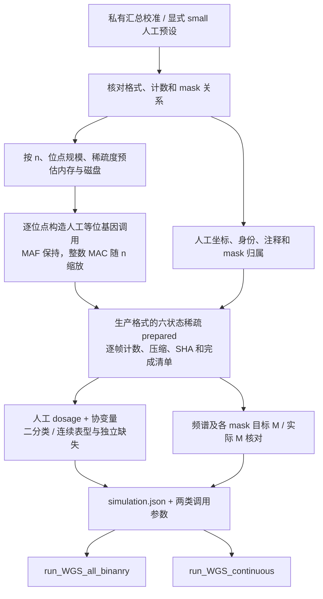

# 合成 WGS 测试数据

## 1. 功能与流程

`generate_simulated_data` 直接生成可供 `run_WGS_all_binanry` 和 `run_WGS_continuous` 读取的 **prepared 遗传目录、表型 CSV 和协变量 CSV**。它用于不接触真实个体数据的速度优化、内存测试及同一合成输入上的数值回归。生成阶段只用 CPU，不创建 PLINK、GDS 或 aGDS 中间文件，也不启动关联分析。

默认 `preset="reference"`、`chromosomes="all"`、`variant_scale=1`。参考模式从私有校准文件读取各染色体的物理位点数、MAF / 缺失分布和匿名 mask M。当前已提取的完整参考规模为 **22 条常染色体、1,023,836,503 个物理位点、345,967 个样本**；每条染色体采用自己的计数，不按染色体长度或染色体数平均分配。345,967 是遗传数据的完整样本轴，不是某个表型剔除缺失后的拟合人数。

参考 mask 固定取一份官方 STAAR PheWAS 表型结果的 15 类 gene 文件，按染色体及匿名基因组提取 M；不会把多个表型的结果行重复相加。这里的 M 是该 mask 的合格变异数，已发布 mask 数是官方结果中有记录的基因与类别组合数；两者均不等于物理位点总数、表型数、遗传帧数或关联 CSV 行数。

真实的逐染色体计数、频谱、匿名 M 表及来源绑定留在私有环境。公共仓库提供生成方法、校准格式和完全人工的 `preset="small"`，没有参考文件时明确报错，不使用人工小规模作为参考默认值。



## 2. Python 调用

主页 Conda 环境已包含所需依赖。下面的人工小规模例子生成两条染色体、每条 1,024 个位点及两类表型，随后分别运行四类分析。`preset="small"` 必须显式指定；它的频谱和 mask 数没有真实队列含义。

```python
from pathlib import Path
from fudan_wgs_toolkit import (
    generate_simulated_data,
    run_WGS_all_binanry,
    run_WGS_continuous,
)


def main():
    # 必须是新目录；产物放在公共仓库外。
    simulated_data_directory = Path("work/simulated_small")
    simulation_report = generate_simulated_data(
        output_directory=simulated_data_directory,
        preset="small",                 # 完全人工的格式与接口测试预设。
        n=1000,                         # 样本数；改变 n 时保持目标 MAF。
        chromosomes=[21, 22],
        variant_scale=1.0,               # small 中每条 1,024 个位点。
        phenotype_type="both",
        n_binary_traits=2,
        n_continuous_traits=2,
        phenotype_missing_rate=0.02,     # 各表型独立生成缺失。
        covariate_missing_rate=0.0,
        seed=1729,
        chunk_size=256,
        cpu_threads=2,
        memory_limit_gib=8,              # 生成阶段主存估算预算。
    )
    print(simulation_report["prepared_directory"])
    print(simulation_report["mask_counts_exact"])

    # 返回参数已经包含表型、协变量、prepared、四类分析和独立输出目录。
    binary_analysis_arguments = dict(simulation_report["binary_kwargs"])
    binary_analysis_arguments.update(
        device=["cuda:0"],
        memory_limit_gib=20,             # 关联阶段每卡的准入预算。
        host_memory_limit_gib=8,         # 关联阶段任务的节点主存预算。
        resume=False,
    )
    binary_association_report = run_WGS_all_binanry(**binary_analysis_arguments)
    print(binary_association_report["completed"])

    continuous_analysis_arguments = dict(simulation_report["continuous_kwargs"])
    continuous_analysis_arguments.update(
        device=["cuda:0"],
        memory_limit_gib=20,
        host_memory_limit_gib=8,
        resume=False,
    )
    continuous_association_report = run_WGS_continuous(**continuous_analysis_arguments)
    print(continuous_association_report["completed"])


if __name__ == "__main__":
    main()
```

两类返回参数均包含 `grm="none"`、`gene_variant_type="variant"` 和 `analyses=("individual", "coding", "noncoding", "ncrna")`。`variant` 保留人工 Indel，以覆盖 PTV；成熟关联内核在该模式下不使用数值功能注释权重。需要测试11个数值注释通道的加权计算时，将返回参数改为 `gene_variant_type="SNV"`，同时使用新的关联输出目录；SNV 筛选会改变 PTV 等 mask 的资格与 M。这两种负载应分别记录，不改变现有关联行为。多 GPU 按完整染色体分配，一条染色体不会自动拆给多张卡。

二分类返回 `impute_missing=False`，连续返回 `rm_nan=False`，分别保留每列表型的 available 样本。协变量缺失始终剔除。需要共同样本轴时可把 `phenotype_missing_rate=0`；需要测试其他标签策略时，在新的关联输出目录中分别设置 `impute_missing=True` 或 `rm_nan=True`。这些选择会影响关联阶段的 MAC、MAF 和 mask 资格。

### 参考规模生成

私有参考文件配置完成后，不需要再次访问原始个体数据。下面保留所有染色体的物理位点数和 mask 目标，只将样本数改为 10,000：

```python
from fudan_wgs_toolkit import generate_simulated_data

if __name__ == "__main__":
    reference_simulation_report = generate_simulated_data(
        output_directory="work/simulated_reference_n10000",
        calibration_profile="/private/calibration/simulation_profile.json",
        n=10000,
        phenotype_type="binary",
        n_binary_traits=16,
        cpu_threads=8,
        memory_limit_gib=8,
    )
    print(reference_simulation_report["frequency_counts_exact"])
    print(reference_simulation_report["mask_counts_exact"])
```

示例路径由使用者替换；参考文件不随包分发。省略 `n` 时使用文件中的 `reference_n`，省略 `chromosomes` 和 `variant_scale` 时保留完整参考位点规模。全规模输出可能需要很大磁盘与生成时间；函数先检查估算工作集和可用空间，不能容纳时在创建输出目录前拒绝，不自动缩减为小数据。`variant_scale=0.001` 等显式比例可用于缩小测试，同时按比例缩小位点数和 mask 目标；它不再是完整参考规模。

## 3. 参数与校准文件

### 全部参数

| 参数 | 默认值 | 意义与格式 |
| --- | --- | --- |
| `output_directory` | 必填 | 字符串或 `Path`，必须是不存在的新目录；不覆盖已有输入或恢复半成品。 |
| `n` | `None` | 整数且至少 128。None 使用校准文件的 `reference_n`；small 使用 1,000。 |
| `calibration_profile` | `None` | 私有校准 JSON 路径或 Python 字典。reference 模式可由环境变量或用户配置指定，small 不接受该参数。 |
| `preset` | `"reference"` | reference 使用私有汇总；small 为完全人工的 22 条染色体、每条 1,024 位点及 15 类 mask 测试预设。 |
| `chromosomes` | `"all"` | 校准文件中全部染色体，或不重复的 1–22 列表；接受整数、数字字符串及 `chr` 前缀。 |
| `variant_scale` | `1.0` | 正有限数。逐染色体位点数及 mask 目标按比例取整；1 保留校准规模。取整后的嵌套关系或 M<2 可以改变输出 mask 数，须查实际审计。 |
| `phenotype_type` | `"both"` | binary、continuous 或 both；两类表型分别写入 CSV。 |
| `n_binary_traits` | `2` | 选择二分类时的列数，整数且至少 2；未选择该类型时忽略。 |
| `n_continuous_traits` | `2` | 选择连续时的列数，整数且至少 2；未选择该类型时忽略。 |
| `seed` | `1729` | 非负整数；为染色体、位点、协变量和表型派生独立随机流。 |
| `phenotype_missing_rate` | `0.02` | 每个表型独立的缺失概率，范围 `[0,1)`；CSV 缺失为空单元格。 |
| `covariate_missing_rate` | `0.0` | 每个协变量单元格的缺失概率，范围 `[0,1)`；22 列共同完整的期望比例约 `(1-rate)^22`。 |
| `case_fraction` | `0.2` | 二分类 Logistic 概率的目标平均值，严格在 `(0,1)`；实际病例数由 Bernoulli 采样及缺失决定。 |
| `causal_effect` | `0.35` | 标准化人工 ALT dosage 的生成系数，有限实数；各表型交替使用正负号，0 表示该遗传项为零。 |
| `chunk_size` | `256` | 请求每个遗传帧的最大位点数，整数 1–1,024；根据主存预算可自动减小。 |
| `cpu_threads` | `8` | 染色体生成 worker 的上限，同时作为后续返回调用参数的 CPU 调度预算。 |
| `memory_limit_gib` | `8` | 生成阶段的主存估算预算，正有限数；1 GiB=`2**30` 字节。不代表 GPU 预算或操作系统 RSS 硬配额。 |
| `storage_limit_gib` | `None` | 可选正有限数，限定生成的 prepared 遗传存储预算；None 按估算及剩余磁盘决定。CSV 空间另行预留。低于估算或大于可用空间时拒绝。 |

`cpu_threads` 不会重设已经初始化的 BLAS 线程池。需要限制 NumPy 原生线程时，在启动 Python 前设置，例如：

```bash
OMP_NUM_THREADS=2 MKL_NUM_THREADS=2 OPENBLAS_NUM_THREADS=2 python run_simulated_example.py
```

内存估算覆盖样本向量、有限大小的 metadata 块、并发 worker 和紧凑遗传帧，不分配 `n × 整条染色体位点数` 的稠密矩阵。磁盘估算包含 genotype、metadata、catalog 和输入 CSV，不依赖理想压缩率。生产 prepared writer 对本生成器的合成数据使用明确字节预算；真实源数据的既有压缩容量约束保留原规则。

### 私有文件解析顺序

reference 模式依次使用：

1. 显式 `calibration_profile` 路径或字典。
2. 环境变量 `FUDAN_WGS_SIMULATION_PROFILE` 指定的 JSON。
3. `FUDAN_WGS_SIMULATION_CONFIG` 指定的用户配置，未指定时为 `~/.config/fudan-wgs-toolkit/simulation.json`。

用户配置只需一项：

```json
{"calibration_profile": "/private/calibration/simulation_profile.json"}
```

配置中的相对路径相对于该配置文件；文件路径由使用者决定。校准文件使用 `format="synthetic-wgs-calibration-v1"`：

| 字段 | 结构与意义 |
| --- | --- |
| `reference_n` | 原始遗传样本轴大小，整数且至少128。用于 MAF / MAC 的样本量缩放。 |
| `chromosomes` | 染色体对象列表，`name` 为唯一的 1–22，`variants` 为该染色体物理位点数。 |
| `frequency_bins` | 每条染色体的联合频谱列表；每项含整数 `count`、`maf∈[0,0.5]`、`missing_rate∈[0,1]`。count 合计必须等于 variants。 |
| `minor_ac_mean`, `called_alleles_mean` | frequency bin 中可选的参考 MAC / 已调用等位基因数均值，供参考 n 下恢复整数计数。 |
| `minor_ac_low`, `minor_ac_high` | 可选的参考 MAC 分箱边界，只保存汇总，不包含个体调用。 |
| `masks` | 每条染色体的匿名目标列表，每项含 `kind`、非负整数 `group`、规范 `category` 和整数 `m≥2`；kind/group/category 组合唯一。 |
| `position_span` | 可选的染色体坐标跨度汇总，不小于 variants；只限定人工位置范围，不保留原始坐标。省略时人工跨度为 `2×variants`。 |
| `analysis_reference_n` | 可选的原分析样本数说明，与完整遗传 reference_n 区分；不改变遗传样本轴。 |

该格式只需要汇总统计。原始样本标识、疾病名、字段编号、坐标、基因名和关联 P 值均不作为生成输入。参考文件及生成后的逐位点 / 逐 mask 审计文件应留在私有存储。

## 4. 遗传、mask 与表型的生成方式

### MAF 保持与 MAC 缩放

每条染色体保留频谱各 bin 的位点库存；缩放位点数时采用总数守恒的分配。每个位点从剩余库存随机取一个 bin，根据 MAF 与缺失率确定已调用等位基因数 AN 和 MAC，再随机分配到人工样本的单倍型。参考样本量下可采用 bin 的参考计数均值；改变 n 时约为 `AN≈2n×(1−missing_rate)`、`MAC≈AN×MAF`，均取合法整数。

频谱 bin 的位点库存可以精确相同，bin 内使用均值不能恢复每个原始位点。低 MAC 位点随 n 变小可能变成 MAC=0，MAF 和稀有资格也受整数化影响；不把这类位点强行变成 MAC≥2。完整缺失及单等位基因缺失都使用成熟的六状态格式保存，持久化整数计数在每帧回读时核对。

### 15 类 mask

| 分析类型 | 规范 category |
| --- | --- |
| coding：7 类 | `plof`、`plof_ds`、`missense`、`disruptive_missense`、`synonymous`、`ptv`、`ptv_ds` |
| noncoding：7 类 | `upstream`、`downstream`、`UTR`、`promoter_CAGE`、`promoter_DHS`、`enhancer_CAGE`、`enhancer_DHS` |
| ncRNA：1 类 | `ncRNA` |

coding 使用人工 stopgain、splice、missense、synonymous 及 frameshift Indel 注释构造交集。disruptive missense 可以与 splice 重叠，所以 `plof_ds` 是集合并集，M 为两类 M 之和减去交集，`ptv_ds` 同理；不能只把两个 M 相加。官方没有发布的类别记为未知，不能据此断定 M=0 或 M<2。生成器从已知边际 M 推断一组可行的人工交集与未知类别，无法满足时报告不兼容目标。

各 noncoding mask 由人工独立的注释原子构造。已发布 M 只能约束边际数量，不能恢复原始变异交集、同一变异属于多个基因的关系或 LD。其余物理位点作为人工背景保留，仍可进入 Single 的正常筛选。

prepared 保存11个数值注释通道：`CADD`、`aPC.LocalDiversity`、`aPC.Epigenetics`，以及8个明确人工命名的 `Synthetic.Score01`–`Synthetic.Score08`。通道数量与参考计算配置一致，数值由人工分布生成，不匹配真实注释值或注释分布，也不复制额外数据库字段。人工类别与 QC 使用生产 selector 读取；数值注释是否参与加权沿用上面的 variant / SNV 规则。QC="PASS" 是合成标记，不代表执行真实遗传 QC。

`mask_counts_exact` 只核对**已发布目标行**在生成样本轴上的稀有资格 M，`mask_audit` 逐项保存 `source_m`、`target_m`、`observed_rare_m` 及 `matched`。当前参考清单含233,589条已发布目标，目标匹配不表示全部运行时 mask 行数相同。推断出的未知类别可能有 M≥2，正常关联会另外输出；`inferred_mask_audit` 和 `additional_inferred_eligible_mask_rows` 单独记录这些类别。

关联入口还会根据该列表型的有效样本、变异类型和 QC 重新筛选，所以生成审计不等于每个关联结果最终 M。改变 n、variant_scale 或缺失策略后，mask 数与 M 的偏离均应直接读取实际报告。

位置在给定跨度内分层随机采样，一层一个互异正整数；样本和基因采用人工前缀标签，等位基因为人工 SNV 或必要的 Indel。坐标不映射真实参考基因组。当前模型不重建真实 LD、亲缘、相位、重组史、跨 mask 交集和群体结构。

### 表型与协变量

所有染色体与 CSV 共用相同的有序 `FID,IID` 双列。协变量为 `age~Uniform(40,80)`、`sex∈{0,1}` 和独立标准正态的 `PC1`–`PC20`；这些 PC 是人工测试变量。由某个人工非恒定位点取得 ALT dosage，按均值和标准差标准化为 z：

\[
\eta=0.015(age-60)+0.15(sex-0.5)+0.08PC1+\beta z.
\]

连续表型为 `η+Normal(0,1)`；二分类求使平均 Logistic 概率接近 `case_fraction` 的截距，再独立 Bernoulli 采样。各列使用独立噪声与缺失位置。`ground_truth.csv` 保存生成系数与 dosage 尺度，可复核生成模型；它不提供预先知道的关联 P 值或有限样本估计系数。

## 5. 输出格式与返回值

```text
simulated_small/
  prepared/
    dataset.json / COMPLETE
    sample_pairs.npy / sample_ids.npy
    chr21/                      # 标准稀疏容器、计数、索引和 metadata。
    chr22/
    catalogs/                   # 人工 gene 任务与 promoter 区间。
  inputs/
    binary_phenotypes.csv
    continuous_phenotypes.csv
    covariates.csv
    ground_truth.csv
    causal_chr21.npy             # 各染色体找到的人工生成 dosage；不作为关联输入。
  simulation.json               # 全部生成及核对成功后发布。
```

| 输出 | 格式与意义 |
| --- | --- |
| `prepared/` | schema version 2 的生产 prepared 格式，含六状态压缩容器、metadata、catalog、样本身份、SHA 和完成标志。两类关联入口直接读取，具体格式见[数据准备](wgs_data_preparation.md)。 |
| `inputs/*_phenotypes.csv` | UTF-8 CSV，前两列 FID/IID，随后至少两列 `sim_binary_*` 或 `sim_continuous_*`；二分类有限值为0/1，连续为有限实数，缺失为空。未选择的类型不生成。 |
| `inputs/covariates.csv` | UTF-8 CSV：`FID,IID,age,sex,PC1,...,PC20`，行序与 prepared 相同。 |
| `inputs/ground_truth.csv` | 人工表型的生成系数、人工因果位点、dosage 均值 / 标准差及截距；关联入口不读取。 |
| `inputs/causal_chr*.npy` | 人工 dosage 数组，用于表型生成与溯源，关联入口不读取。 |
| `simulation.json` | 最终 JSON 报告，含配置、校准 SHA、计数审计、资源估算、耗时、输入文件 SHA 和两类调用参数。 |

生成期间保留 `simulation.pending.json`；全部成功后以最终报告替换。生成失败时保留现场且不发布成功报告。参数和资源准入失败发生在建目录前；写出过程中失败的目录不能作为完成输入。

| 重要返回字段 | 含义 |
| --- | --- |
| `completed`, `synthetic`, `schema_version` | 生成完成、人工数据标记及报告版本；不表示关联已经运行。 |
| `configuration`, `n_samples`, `seed` | 实际生成参数、样本数和随机种子。 |
| `calibration` | reference / small 来源类型、是否有参考校准及校准文件 SHA-256；calibrated 不表示所有 mask M 都精确匹配。 |
| `prepared_directory`, 各 `*_csv` | 完成目录与 CSV 路径；未选择的表型 CSV 为 None。 |
| `binary_kwargs`, `continuous_kwargs` | 对应公开入口可直接接收的参数字典；未选择的类型为 None。 |
| `chromosome_reports`, `mask_audit` | 各染色体位点数、频谱库存、MAC / AN、mask 目标与实际计数、时间和存储量；详细文件留私有。 |
| `mask_counts_exact`, `frequency_counts_exact` | 已发布目标行的稀有资格 M 与频谱库存是否核对一致；mask 标志不覆盖未知类别的总行数。 |
| `preparation.mask_counts_exact_scope` | 明确记录 mask 完全匹配仅针对已发布目标行。 |
| `chromosome_reports[].inferred_mask_audit`, `preparation.additional_inferred_eligible_mask_rows` | 未发布类别的人工推断 M、实际稀有 M，以及额外可能输出的合格 mask 行数。 |
| `trait_reports`, `complete_covariate_samples` | 各列表型可用 / 缺失 / 病例 / 对照数，以及22列协变量均完整的人数。 |
| `resource_plan`, `preparation` | 内存 / 磁盘准入估算、实际 worker / 帧大小与 direct prepared 子报告。 |
| `generation_seconds`, `total_seconds` | 完整生成调用的时间，不含关联；不再有原始 PLINK 生成与转换两个阶段。 |
| `files` | inputs 文件的相对路径、大小及 SHA；prepared 使用自身逐帧与清单校验。 |

`results_binary/` 和 `results_continuous/` 仅在调用关联入口后创建。运行完成仍须检查各自返回报告、worker 退出、块提交及最终 CSV。

## 6. 命令行与原软件对应

所有生成参数使用对应的 `--连字符` 选项。可用安装后的 `generate_simulated_data` 或 `python -m fudan_wgs_toolkit.simulate`；报告同时保存到文件并打印到标准输出。

```bash
export OMP_NUM_THREADS=2
export MKL_NUM_THREADS=2
export OPENBLAS_NUM_THREADS=2

# 显式的小规模人工预设；生成完成即可直接进入关联。
generate_simulated_data \
  --output-directory work/simulated_cli \
  --preset small --n 1000 --chromosomes 21 22 \
  --phenotype-type both --n-binary-traits 2 --n-continuous-traits 2 \
  --phenotype-missing-rate 0.02 --covariate-missing-rate 0 \
  --case-fraction 0.2 --causal-effect 0.35 \
  --seed 1729 --chunk-size 256 --cpu-threads 2 --memory-limit-gib 8

run-WGS-all-binanry \
  work/simulated_cli/inputs/binary_phenotypes.csv \
  work/simulated_cli/inputs/covariates.csv \
  work/simulated_cli/prepared \
  --output-directory work/simulated_cli/results_binary \
  --chromosomes 21 22 --device cuda:0 --cpu-threads 2 \
  --analyses individual coding noncoding ncrna \
  --gene-variant-type variant --no-impute-missing --grm none

run-WGS-continuous \
  work/simulated_cli/inputs/continuous_phenotypes.csv \
  work/simulated_cli/inputs/covariates.csv \
  work/simulated_cli/prepared \
  --output-directory work/simulated_cli/results_continuous \
  --chromosomes 21 22 --device cuda:0 --cpu-threads 2 \
  --analyses individual coding noncoding ncrna \
  --gene-variant-type variant --no-rm-nan --grm none

# 完整参考规模：省略 n 使用 reference_n，省略 chromosomes 使用全部22条。
# 先由生成器执行资源准入；空间不足时不会启动缩小版替代。
generate_simulated_data \
  --output-directory work/simulated_reference \
  --calibration-profile /private/calibration/simulation_profile.json \
  --phenotype-type binary --n-binary-traits 16 \
  --cpu-threads 8 --memory-limit-gib 8
```

本生成器输出的是本包 prepared 格式，没有直接对应的官方模拟 prepared 命令。官方 STAAR 流程读取 GDS/aGDS，再调用 `Individual_Analysis_PheWAS`、`Gene_Centric_Coding_PheWAS`、`Gene_Centric_Noncoding_PheWAS` 和 `ncRNA_PheWAS`；相同输入的官方 R 调用见[二分类原软件调用](wgs_binary.md#原-staar-软件调用)。本功能不启动 R、PLINK 或官方程序。

同一合成输入可固定输入 SHA、样本处理、零模型、权重及 mask，比较优化前后的 `−log10(P)`；应同时核查全部有限值与任一路径显著的并集。校准到已发布 MAF / M 分布提供的是接近目标负载的人工输入，不能将跨队列官方结果当作这些人工数据的数值真值。

## 7. 验证与 benchmark

2026-10-16 的当前 direct prepared 修订完成 **267项CPU测试，全部通过，pytest计时24.83秒**。进程限定8个CPU的 affinity，原生BLAS线程数为2，CUDA设备不可见。测试覆盖紧凑六状态编码与计数回读、生产 metadata / 完成清单、成熟selector的15类mask、合成数据流式journal、显式存储预算、有界metadata复制、两类公开入口的输入参数契约及SHA缓存回归。测试耗时不是完整关联速度；[当前匿名记录](../validation/simulated_prepared_20261016.anonymous.json)保存相应范围和资源。

另从私有参考汇总构造8,192个位点、15条已知mask目标的有界输入。它检验参考频谱及mask构造，不代表整条参考染色体。生成后核对压缩流SHA，且没有写出原始PLINK：

| 样本数 | 生成耗时 | 已知目标M匹配 | 频谱bin位点库存 | 按位点数加权平均绝对MAF误差 | bin最大绝对MAF误差 |
| --- | --- | --- | --- | --- | --- |
| 345,967，参考n | 35.912秒 | 15/15 | 精确相同 | 2.657×10⁻⁸ | 7.644×10⁻⁷ |
| 4,096，缩放n | 1.567秒 | 0/15 | 精确相同 | 5.469×10⁻⁶ | 6.095×10⁻⁵ |

MAF误差比较生成bin的实际MAF与目标bin均值。样本缩小后，该有界输入中的低MAC变异按MAF保持规则取整为零，15条目标的稀有资格M随之改变。这是已报告的样本量缩放结果，没有提高MAC来制造相同M；不能将频谱bin库存一致解释为每个位点MAF完全相同。

完整参考的22条染色体、1,023,836,503个位点、233,589条已发布mask目标和18,308个coding组已做汇总核对；所有已知coding边际数量可用人工交集表达。官方缺失的类别仍是未知，额外推断的合格mask行单独记录，未声称运行时总mask行数完全一致。完整输出的保守磁盘估算为14,517,782,875,204字节，约13.2TiB；预检时可用310,284,124,160字节，约289GiB。实际调用在创建输出目录前以OSError拒绝，**未生成全参考规模数据**。

当前修订的GPU关联验证为 **`not_assessed`**：执行时共享GPU利用率约92%–95%，自动批准审核拒绝启动本次验证。当前修订没有复用历史版本的四次GPU调用作为完成证据，也没有执行官方同输入P值对照。

本轮复用成熟的 portable metadata 校验时发现一个已有问题：部分共享文件系统的ctime粒度较粗，同大小文件在同一时间刻度改写并恢复mtime后，旧SHA缓存可能误命中。修复为对mtime / ctime尚未稳定2秒的文件重新计算内容SHA；稳定的不可变文件保留缓存快路径，prepared格式与关联公式保持原行为。该修复的回归包含在上述267项测试中。

历史原始PLINK生成版的[匿名记录](../validation/simulated_data_20261016.anonymous.json)固定于提交 `9ae80ba3eafc9d24a9635f332170f398bbb6a7a7`，不作为本版direct prepared的通过记录或速度结果。

## 8. 更新记录

| 日期 | 更新与验证范围 |
| --- | --- |
| 2026-10-16 | 改为直接生成 prepared；默认使用私有参考位点数 / 频谱 / 官方15类mask校准，n 改变时保持 MAF、缩放 MAC；增加11个人工数值注释通道、已发布目标 / 未知推断类别与实际 M 审计、内存 / 磁盘准入；修复 metadata SHA 缓存的同时间刻度改写误命中；267项CPU测试与8,192位点有界校准通过，GPU关联为not_assessed。 |
| 2026-10-16，历史版 | 提交 `9ae80ba` 采用原始 PLINK + 独立人工注释再准备；149项回归、4次小规模GPU入口及10万人输入准备记录仅适用于该实现，已被当前生成路径替代。 |

## 9. 参考与源码

- [生成器入口](https://github.com/weikanggong1/Fudan-WGS-Toolkit/blob/main/fudan_wgs_toolkit/simulate.py)、[私有汇总格式与预设](https://github.com/weikanggong1/Fudan-WGS-Toolkit/blob/main/fudan_wgs_toolkit/simulation_profile.py)、[直接 prepared 构建](https://github.com/weikanggong1/Fudan-WGS-Toolkit/blob/main/fudan_wgs_toolkit/simulate_prepared.py)。
- [prepared 格式与生产数据准备](wgs_data_preparation.md)、[二分类入口](wgs_binary.md)、[连续入口](wgs_continuous.md)。
- [STAARpipelinePheWAS 官方实现](https://github.com/li-lab-genetics/STAARpipelinePheWAS)：对应四类分析及 mask 定义。
- Li et al. Dynamic incorporation of multiple in silico functional annotations empowers rare variant association analysis of large whole-genome sequencing studies at scale. *Nature Genetics* (2020). [DOI:10.1038/s41588-020-0676-4](https://doi.org/10.1038/s41588-020-0676-4)。
- Li et al. A framework for detecting noncoding rare-variant associations of large-scale whole-genome sequencing studies. *Nature Methods* (2022). [DOI:10.1038/s41592-022-01640-x](https://doi.org/10.1038/s41592-022-01640-x)。
