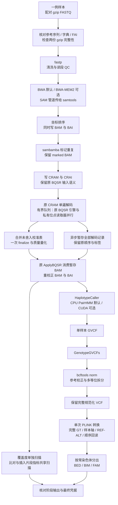

# 单样本 WGS：配对 FASTQ 到 VCF 与 PLINK

## 1. 功能与流程

`single_subj_preprocessing` 处理一个真实样本的一对 WGS FASTQ，依次完成读段清洗、比对、排序、重复标记、碱基质量重校正、变异检测、VCF 规范化和常染色体 PLINK 输出。默认使用 BWA 与原 GATK/GKL CPU PairHMM；分配至少 4 核时，BQSR 以多个独立原 GATK 引擎并行训练。BWA-MEM2 和项目 CUDA PairHMM 均需显式选择。

本入口保留 GVCF、规范化 VCF 和中间比对文件。PLINK 输出只编码常染色体的双等位 hard-call 基因型；完整 VCF 保存相位、质量、过滤和其他 FORMAT/INFO 信息。后续准备功能注释和关联分析请参见 [WGS 数据准备](wgs_data_preparation.md)、[二分类分析](wgs_binary.md)和[连续表型分析](wgs_continuous.md)。本入口不创建功能注释、表型、协变量或 GRM，也不执行关联检验。



fastp、比对、排序、重复标记、BQSR、QC、VCF 和 PLINK 转换目前均由 CPU 执行。默认使用一个 fastp 清洗 worker 固定输出顺序。各科学阶段按序提交，阶段内部使用整个调用的有效 CPU 预算；BQSR 的解码、多个训练 worker 与 BAM writer 同时工作。流程图中 HC 与 QC 的分支表示数据依赖，当前不同时启动这两个阶段。CPU 预算限定允许 CPU 集及可用算力，不是操作系统线程数的硬上限。可选 CUDA 仅替换 HaplotypeCaller 内部的 PairHMM 计算，不把整个 GATK 或全部预处理步骤变成 GPU 程序。PairHMM 使用 FP32；整数基因型、碱基和 CIGAR 不转为 TF32。当前真实稀疏小区间中，原 CPU 路径更快，因此仍是默认值。

## 2. 安装与固定软件

预处理环境与关联分析的 `environment.yml` 分开。Linux x86-64 使用固定包锁安装全部预处理工具；锁中含 CUDA 编译器，但默认 CPU 路径不使用 GPU。

```bash
git clone https://github.com/weikanggong1/Fudan-WGS-Toolkit.git
cd Fudan-WGS-Toolkit
conda create -n fudan-wgs-preprocessing \
  --file environments/preprocessing-linux-64.explicit.txt
conda activate fudan-wgs-preprocessing
python -m pip install --no-deps --no-build-isolation -e .
```

`environment-preprocessing.yml` 提供可求解的依赖描述；精确复现优先使用上述 explicit 锁，重新求解的环境不能直接承接原锁的版本与性能结论。预处理模块按需导入，安装时不把另一套关联环境拼入运行时。

已测试的科学工具为 fastp 0.20.0、BWA 0.7.17、samtools 1.10、HTSlib 1.16、sambamba 0.7.1、GATK 4.2.0.0、BCFtools 1.10.2 和 PLINK 2.0.0-a.6.9（2025-01-29）；GATK 内含 Picard 2.25.0。环境提供 OpenJDK 8、R 及绘图依赖；Picard 的插入片段 PDF 需要这些绘图组件。可选构建所需的 Conda C/C++、make、CMake/Ninja、CUDA 与 Java 工具也由同一环境提供。当前 CUDA 构建目标为 sm_80，实测设备为 A100；其他型号未完成本页所述验收。

BWA-MEM2 的可选自动构建器从官方固定归档下载源码并核对字节数与 SHA-256，编译到新的项目目录，不原地更新 Conda 环境。CUDA/JNI 也编译到独立项目目录；构建器以 4 GiB 任务 PSS 预算、另留 4 GiB 实时主存及 4 GiB 构建存储准入，CPU 不超过可见有限 quota。每步退出、进程树清理及全部测试通过后，才原子提交 assets；复用时核对成功构建收据与源码清单。不需要 Docker 或 Parabricks。

参考 FASTA 和 known-sites VCF 由用户独立提供，保留其来源、版本、许可和校验记录。基因组版本、contig 名称和序列必须一致；本函数不做 liftOver，也不把未知过滤状态改成 PASS。

## 3. 输入数据与格式

| 输入 | 文件或结构 | 含义与要求 |
| --- | --- | --- |
| `read1`、`read2` | 两个不同的 gzip FASTQ 文件 | 同一样本、同一测序文库及配对轴的 R1/R2，记录以四行存储名称、序列、分隔行和 Phred+33 质量；两路读段须按配对顺序对应。先执行完整 gzip 校验，再交给 fastp。同一文库的多 lane 数据可按项目规则组成一份配对输入并保留来源；不同文库不应混入这个固定 LB 的单输入。 |
| `reference_fasta` | 未压缩 FASTA，如 `/data/reference/reference.fa` | 本次比对和调用使用的完整参考；不接受 `.gz/.bgz` 参考。函数重新生成序列字典，核对 contig 顺序、长度和 MD5。 |
| FASTA 索引 | `reference.fa.fai` 与 `reference.dict` | FAI 与 FASTA 同名追加 `.fai`；字典由 FASTA 最后一个后缀替换为 `.dict`。例如 `reference.fasta` 对应 `reference.fasta.fai`、`reference.dict`。 |
| BWA 索引 | 同一前缀的 `.amb/.ann/.bwt/.pac/.sa` | 默认前缀为 `reference_fasta`。必须由同一参考生成；自备索引应有明确的参考绑定记录。 |
| BWA-MEM2 索引 | `.0123/.amb/.ann/.bwt.2bit.64/.pac` | 仅在选择 MEM2 时使用；不能把 BWA 索引当作 MEM2 索引。可用自动构建器创建新的独立索引。 |
| ALT contig sidecar | 如存在，为 `<reference>.alt` 与 `<index_prefix>.alt` | 两边必须同时存在且内容相同；文件进入输入绑定。它影响 ALT contig 比对策略，不可只换索引而漏掉该文件。 |
| `known_sites` | 长度恰为 3 的路径列表或 tuple | 三份与参考匹配的、BGZF 压缩且带 `.tbi` 的独立 VCF，供 BQSR 标识已知变异；不是本次样本的变异结果。常见组合为两个 indel 资源和一个 dbSNP 资源，具体版本以项目清单为准。 |
| `sample_id` | 非空字符串 | 真实样本 ID，允许英文字母、数字、下划线、点和连字符，不能为 `0`。用于 BAM read group 和 PLINK 的 FID/IID，不从文件名猜测身份。 |
| `output_dir` | 一个样本专用的私有输出目录 | 新目录以 0700 建立；现有目录必须由当前用户拥有且禁止组及其他用户访问。同一目录仅容许一个控制器；结果、命令、绑定及资源记录均保存在这里。 |

单样本 `GenotypeGVCFs` 输出是该样本的变异调用，不等于队列联合分型。多个样本应保留 GVCF，按项目规则联合 genotyping 后形成共同变异轴；不能把各样本 VCF 中未列出的位点直接填成 `0/0`。本入口不执行队列联合分型、VQSR 或队列层面的频率/缺失率筛选。

FASTQ 和已知变异资源的实际路径与身份只写入本地私有凭据。首次调用对输入记录文件身份，gzip 检查证明压缩流可完整读取；`input_content_SHA_assessed=False` 不等于已经对全部原始输入计算 SHA。输出及工具另有 SHA 绑定。

`intervals` 若提供，格式为字符串列表，每项为 `contig:start-end`，位置是 **1-based 闭区间**，contig 必须与 FASTA 相同。实际坐标放项目自己的私有 JSON 文件，例如由已核验的区域清单生成；本说明不包含真实样本或位点。`None` 表示完整参考调用。

## 4. 全部参数

```text
single_subj_preprocessing(
    read1, read2, reference_fasta, known_sites, output_dir, *,
    sample_id, conda_prefix=None, cpu_threads=None, cpu_affinity=None,
    fastp_threads=1,
    host_memory_limit_gib=None, host_memory_reserve_gib=4,
    aligner="bwa", aligner_executable=None, index_prefix=None,
    pairhmm_backend="cpu", gpu_uuid=None, gpu_memory_limit_gib=2,
    gpu_build_dir=None, intervals=None, qc_mode="shared",
    bqsr_input="cram", qc_exit_fix=True, runtime_build_dir=None,
    bqsr_mode="auto", bqsr_workers=None, bqsr_build_dir=None,
    resume=False,
)
```

| 参数 | 默认值 | 作用 |
| --- | --- | --- |
| `read1` | 必填 | R1 gzip FASTQ 路径。 |
| `read2` | 必填 | 同配对轴的 R2 gzip FASTQ 路径。 |
| `reference_fasta` | 必填 | 未压缩参考 FASTA；相应字典、FAI 和选定比对索引必须已存在。 |
| `known_sites` | 必填 | 三份独立 BQSR VCF 的路径列表，每份均需 `.tbi`。 |
| `output_dir` | 必填 | 当前样本的独立输出目录。 |
| `sample_id` | 必填、keyword-only | 真实样本 ID；设置 RG 中的 ID/SM/LB，平台为 ILLUMINA，FID/IID 均取该 ID。 |
| `conda_prefix` | `None` | 完整预处理环境路径；`None` 使用当前 `CONDA_PREFIX`。所有科学工具和运行库来自这一个环境。 |
| `cpu_threads` | `None` | 整个调用的 CPU 数预算，至少 2。默认取允许 CPU 集和可见有限祖先 CPU quota 中的较小值；不按物理机器的全部核心数申请。 |
| `cpu_affinity` | `None` | 可使用的 Linux CPU 编号列表，不重复且须在当前允许集合内。最终最多取 `cpu_threads` 和实际 quota 允许的数量，调用结束恢复调用线程原 affinity。 |
| `fastp_threads` | `1` | 默认单清洗 worker，固定 fastp 0.20.0 的成对读段输出顺序；读入和两路压缩写出仍由原软件处理。可显式设为不超过 CPU 预算的 1–16；`None` 使用至多 6 个 worker。并行模式的跨次输出顺序可能变化，后续 PL 也可能受影响。 |
| `host_memory_limit_gib` | `None` | 任务主存准入与进程树 PSS 监控预算。默认不超过 64 GiB，且扣除实时预留后能被当前主存准入；至少 12 GiB。MEM2 阶段要求至少 32 GiB 的 prospective 预算。 |
| `host_memory_reserve_gib` | `4` | 阶段启动时，在可见有限祖先 cgroup 和物理可用内存中保留的 GiB；不是独占主存或新建硬配额。 |
| `aligner` | `"bwa"` | `"bwa"` 或显式 `"bwa-mem2"`。比对科学参数固定保留 `-K 10000000 -M -Y`。 |
| `aligner_executable` | `None` | 默认使用环境中的对应程序；可给项目源码构建的 MEM2 可执行文件路径。二进制及可能的派发 companion 均绑定 SHA。 |
| `index_prefix` | `None` | 默认与参考路径相同；MEM2 可指向独立派生索引前缀。必须确证索引来自当前参考，并匹配 ALT sidecar。 |
| `pairhmm_backend` | `"cpu"` | `"cpu"` 保留原 GATK/GKL；`"cuda"` 显式使用项目 CUDA/JNI PairHMM。其余 GATK 阶段仍在 CPU。 |
| `gpu_uuid` | `None` | CUDA 模式必填一个经项目分配的完整物理 GPU UUID；不能只凭编号猜测任务归属。CPU 模式不启用 GPU。 |
| `gpu_memory_limit_gib` | `2` | CUDA PairHMM 自有设备缓冲区预算，上限为 18 GiB；不代表整卡占用，也不限制其他项目。 |
| `gpu_build_dir` | `None` | CUDA/JNI 构建目录，默认 `<output_dir>/gpu_build`。可复用同一 Conda prefix 的已绑定构建产物，重新核对各文件 SHA。 |
| `intervals` | `None` | 默认完整参考；显式列表只限制 HC、genotyping 和覆盖度 QC 的区间。FASTQ 清洗、比对、重复标记和 BQSR 仍处理所给读段。此时结果标为局部调用。 |
| `qc_mode` | `"shared"` | 共享一次 SAM 遍历计算 alignment summary 与 insert-size 两类指标；`"separate"` 分别调用原工具。覆盖度 `CollectWgsMetrics` 始终另算。 |
| `bqsr_input` | `"cram"` | 当前仅发布 CRAM 语义；`"bam"` 会明确拒绝。CRAM 会重新表示部分比对标签，不能直接换成 BAM 后称科学输入完全相同。 |
| `qc_exit_fix` | `True` | 通过同一 Conda Java 编译的项目入口运行原 Picard QC；原工具正常关闭并返回后，正常退出 JVM，消除 R 子进程管理线程的空闲等待。指标、直方图、绘图及错误退出保留。`False` 使用原 GATK 启动入口，供同配置对照。 |
| `runtime_build_dir` | `None` | QC 入口构建目录，默认 `<output_dir>/runtime_build`；可复用同一 Conda、项目源码与原 GATK jar 绑定的已提交构建。构建耗时计入端到端耗时，不修改 Conda 或原软件 jar。 |
| `bqsr_mode` | `"auto"` | `"original"` 使用原 BaseRecalibrator/ApplyBQSR；`"parallel"` 单遍解码并由独立原 GATK 引擎并行训练，合并未舍入内部表后只做一次全局 finalize 和量化，再由原 ApplyBQSR 应用。`"auto"` 在已分配 CPU 至少 4 核时选并行，否则选原路径。所有路径均先消费原 CRAM 解码语义。 |
| `bqsr_workers` | `None` | 并行训练 worker 数；默认最多 16，并给读入和写出留出 2 个 CPU 预算。每个 worker 使用自己的原引擎、参考与已知位点读取器、协变量缓存和 header；相邻 16 条合格记录送往同一 worker，减少重复查询与解析。仅用于实际选中的 parallel 模式；不能超过 `max(1, 实际有效 CPU 数 - 2)`，有效 CPU 数已结合请求、允许 CPU 集与有限 quota 裁剪。 |
| `bqsr_build_dir` | `None` | 并行 BQSR 入口的独立构建目录，默认 `<output_dir>/bqsr_build`；只用同一 Conda 的 Java/JAR，已提交构建可按源码、环境和 SHA 复用。 |
| `resume` | `False` | `True` 仅复用输入、工具、源码及选项一致且输出绑定通过的已提交阶段。未完成阶段保留原记录，不覆盖后重跑；需要新的输出目录。 |

CPU、主存和 GPU 预算含义分别记录；共享节点 quota、整卡占用不自动归属于本样本。每次采样遍历所有线程的子进程，优先读取 `smaps_rollup`，旧内核回退完整 `smaps`。回退先快速捕获完整原始字节，再严格检查每个内存映射及其计数；原始捕获上限为 32 MiB，超限或不完整均报告未知。解析工作区另有解码等临时开销，这个上限不是全部观察器内存上限。地址空间变化造成的不完整端点会整份丢弃，同次采样的重试共享 2 秒期限，并核对进程身份；持续未知仍中止。这个期限约束重试，同步读取本身不是可强制中断的 2 秒硬超时。失败凭据保留固定错误分类和重试记录，不用 RSS 或旧值代替 PSS。资源记录中的 PSS 是离散采样；不能据其推断精确瞬时峰或长期无泄漏。cgroup 的实际使用量与 inactive file 页的可回收估计分开保留；后者只参与主存准入估计，不代表已经释放，不抵扣任务 PSS。

## 5. Python 调用

### 5.1 默认 CPU 路径

以下路径与样本名仅说明格式，应替换为自己项目清单中的真实输入。示例不会创建模拟测序或伪表型。

```python
import os
from pathlib import Path
from fudan_wgs_toolkit import single_subj_preprocessing

conda_prefix = os.environ["CONDA_PREFIX"]
read1_path = Path("/data/project/subject_example_R1.fastq.gz")
read2_path = Path("/data/project/subject_example_R2.fastq.gz")
reference_fasta = Path("/data/reference/reference.fa")
known_site_vcfs = [
    "/data/reference/known_indels_a.vcf.gz",
    "/data/reference/known_indels_b.vcf.gz",
    "/data/reference/known_snps.vcf.gz",
]
output_directory = Path("/results/project/subject_example_cpu")
true_sample_id = "subject_example"  # 改为真实样本清单中的 ID。

# 从已分配给本任务的允许集合中选 9 核；共享节点应使用项目分配的集合。
allowed_cpu_ids = sorted(os.sched_getaffinity(0))
selected_cpu_ids = allowed_cpu_ids[:9]

result = single_subj_preprocessing(
    read1=read1_path,
    read2=read2_path,
    reference_fasta=reference_fasta,
    known_sites=known_site_vcfs,
    output_dir=output_directory,
    sample_id=true_sample_id,
    conda_prefix=conda_prefix,
    cpu_threads=len(selected_cpu_ids),
    cpu_affinity=selected_cpu_ids,
    host_memory_limit_gib=48,
    host_memory_reserve_gib=4,
    aligner="bwa",
    pairhmm_backend="cpu",
    intervals=None,               # 完整参考；不是只跑示例窗口。
    qc_mode="shared",
    bqsr_input="cram",
    qc_exit_fix=True,              # 原 QC 正常返回后退出，省去线程空闲超时。
    bqsr_mode="auto",              # >=4 核并行训练；较小 CPU 预算保留原路径。
    resume=False,
)
print(result["status"], result["scope"])
print(result["vcf"], result["plink_directory"])
```

正式调用至少需要两个实际可用 CPU。上述允许集的前九核只是单机示例，不能代替调度器的项目资源分配。

做明确的小规模调用时，保留相同参数，只将 `intervals` 改为自己私有区域清单中的列表，并使用新目录：

```python
import json

benchmark_intervals = json.loads(
    Path("/data/project/benchmark_intervals.json").read_text()
)
# 将上例的 intervals 设置为 benchmark_intervals，
# output_dir 设置为独立小规模目录；结果 scope 为 selected_intervals。
```

### 5.2 可选源码 BWA-MEM2

```python
from fudan_wgs_toolkit.build_preprocessing_aligner import build_preprocessing_aligner

# 显式请求官方源码编译与新的参考索引，不覆盖原 BWA 索引。
# 全参考索引需较多主存；构建器先检查实时可用量和预留。
aligner_assets = build_preprocessing_aligner(
    conda_prefix=conda_prefix,
    build_dir="/results/project/aligner_build",
    reference=reference_fasta,
    cpu_affinity=selected_cpu_ids[:1],
)

mem2_result = single_subj_preprocessing(
    read1=read1_path,
    read2=read2_path,
    reference_fasta=reference_fasta,
    known_sites=known_site_vcfs,
    output_dir="/results/project/subject_example_mem2",
    sample_id=true_sample_id,
    conda_prefix=conda_prefix,
    cpu_threads=len(selected_cpu_ids),
    cpu_affinity=selected_cpu_ids,
    host_memory_limit_gib=48,
    aligner="bwa-mem2",
    aligner_executable=aligner_assets["executable"],
    index_prefix=aligner_assets["index_prefix"],
    pairhmm_backend="cpu",
    bqsr_input="cram",
)
```

构建器固定官方 v2.3 的 commit `7aa5ff6c3330490e5629ab9b7327683d2dce02d6` 与 safestringlib 子模块 `245c4b8cff1d2e7338b7f3a82828fc8e72b29549`。该 commit 的 CLI 自身报告 `2.2.1`，凭据同时保留 tag、commit、真实版本文字和二进制 SHA。使用一核 Conda 编译器；参考索引按 **28 倍未压缩 FASTA 字节数加 50 GiB 实时预留**准入，另检查磁盘空间。只编译时可设 `reference=None`，但随后必须提供来源明确且与参考匹配的现成 MEM2 索引。

### 5.3 可选 CUDA PairHMM

```python
# PROJECT_GPU_UUID 应由本项目的资源分配记录提供完整 GPU UUID。
assigned_gpu_uuid = os.environ["PROJECT_GPU_UUID"]

cuda_result = single_subj_preprocessing(
    read1=read1_path,
    read2=read2_path,
    reference_fasta=reference_fasta,
    known_sites=known_site_vcfs,
    output_dir="/results/project/subject_example_cuda",
    sample_id=true_sample_id,
    conda_prefix=conda_prefix,
    cpu_threads=len(selected_cpu_ids),
    cpu_affinity=selected_cpu_ids,
    host_memory_limit_gib=48,
    aligner="bwa",
    pairhmm_backend="cuda",
    gpu_uuid=assigned_gpu_uuid,
    gpu_memory_limit_gib=2,
    gpu_build_dir="/results/project/pairhmm_build",
    intervals=benchmark_intervals,  # 明确的小规模区间调用。
    qc_mode="shared",
    bqsr_input="cram",
)
print(cuda_result["actual_GPU_work"])
```

首次调用自动用同一环境编译 C++/CUDA/JNI；可复用已绑定构建目录。完成凭据按实际 GPU 调用和 pair 计数记录是否执行科学计算，不能用加载库、初始化 CUDA 或存在进程代替。GPU 尝试与数值下溢后的原 GKL double 复核分别计数，后者不能当作纯 GPU 完成。CUDA 当前为可选功能，下面的真实小区间没有提速。

## 6. 命令行调用

将 Python 参数名原样写成 JSON；`Path` 改为字符串，布尔值采用 JSON 的 `true/false`。例如 `preprocessing.private.json`：

```json
{
  "read1": "/data/project/subject_example_R1.fastq.gz",
  "read2": "/data/project/subject_example_R2.fastq.gz",
  "reference_fasta": "/data/reference/reference.fa",
  "known_sites": [
    "/data/reference/known_indels_a.vcf.gz",
    "/data/reference/known_indels_b.vcf.gz",
    "/data/reference/known_snps.vcf.gz"
  ],
  "output_dir": "/results/project/subject_example_cpu",
  "sample_id": "subject_example",
  "conda_prefix": "/opt/conda/envs/fudan-wgs-preprocessing",
  "cpu_threads": 9,
  "cpu_affinity": [0, 1, 2, 3, 4, 5, 6, 7, 8],
  "host_memory_limit_gib": 48,
  "host_memory_reserve_gib": 4,
  "aligner": "bwa",
  "pairhmm_backend": "cpu",
  "intervals": null,
  "qc_mode": "shared",
  "bqsr_input": "cram",
  "qc_exit_fix": true,
  "bqsr_mode": "auto",
  "resume": false
}
```

CPU 编号需改为当前项目获分配的编号。这个 JSON 含真实运行路径与身份时应私有保存。

```bash
conda activate fudan-wgs-preprocessing
single_subj_preprocessing --config preprocessing.private.json

# 与上面的 console entry 等价。
python -m fudan_wgs_toolkit.single_preprocessing \
  --config preprocessing.private.json
```

## 7. 输出、完整性与恢复

```text
output_dir/
├── plan.private.json                 输入、源码、工具、选项与预算绑定
├── journal.private.jsonl             已提交阶段记录
├── stages/<stage>/                   命令、私有日志、退出与资源凭据
├── runtime_build/                    默认 QC 构建、源码与提交收据
├── bqsr_build/                       选择并行 BQSR 时的默认构建目录
├── bqsr_training.private.json        并行训练计数、队列和 worker 关闭凭据
├── files/
│   ├── clean_1.fq.gz / clean_2.fq.gz
│   ├── sorted.bam / sorted.bam.bai
│   ├── marked.bam
│   ├── marked.cram / marked.cram.crai
│   ├── recal.table
│   ├── canonical_bqsr.bam            并行路径保留的原 CRAM 解码工作文件
│   ├── recalibrated.bam / recalibrated.bam.bai
│   ├── sample.g.vcf.gz / sample.g.vcf.gz.tbi
│   ├── genotyped.vcf.gz / genotyped.vcf.gz.tbi
│   ├── normalized.vcf.gz / normalized.vcf.gz.tbi
│   ├── wgs_metrics.txt
│   ├── qc.*                          共享 QC 的表、插入片段与读长 PDF
│   └── autosomes.bed / .bim / .fam   单次转换的完整常染色体数据
├── finalization/attempt_<id>/
│   ├── vcf_oracle/                   VCF 独立 GT 与变异轴
│   └── plink/chr<chromosome>.*       逐染色体 BED/BIM/FAM
└── complete.private.json            全部核验通过后的完成凭据
```

`result` 是可 JSON 序列化的字典，主要字段如下。

| 字段 | 含义 |
| --- | --- |
| `status` | 所有要求阶段和最终回读完成后为 `complete_verified`；仅有输出文件或活进程不构成完成。 |
| `scope` | `complete_reference` 或显式小区间的 `selected_intervals`。 |
| `gvcf`、`vcf` | 保留的 GVCF 和规范化 VCF 路径。 |
| `plink_directory` | 本次成功收尾 attempt 下的逐染色体 PLINK 目录。只为实际含变异的常染色体生成文件。 |
| `scan` | 完整 VCF 样本轴检查、常染色体变异数、各染色体计数及排除的非常染色体记录。 |
| `PLINK` | 完整 hard-call、样本 FID/IID、ID、REF/ALT、顺序及 BED 填充位核验结果和输出绑定。 |
| `stages` | 已提交阶段的实际命令、退出、wall、采样 PSS 和 CPU 时间。`reaped_child_cpu_user_seconds/system_seconds` 为该阶段已 wait 工具及后代的 CPU，计算一次；`controller_cpu_user_seconds/system_seconds` 另列 Python 控制器的监控、提交与哈希成本。线程 CPU 不再重复加入工具总量。 |
| `bqsr_mode`、`bqsr_workers` | 实际选中的训练路径与 worker 数，区别于请求的 `auto` 选项。 |
| `total_wall_seconds` | 本次调用实际总耗时，包含校验、输出哈希和收尾工作；复用完成结果时返回原完成凭据中的值。 |
| `final_PLINK_readback_seconds` | 收尾中的独立 VCF 扫描、转换和完整 PLINK 回读耗时。 |
| `actual_GPU_work`、`GPU_evidence` | 按实际 CUDA PairHMM 调用计数与审计记录得到的执行覆盖；CPU 模式不声称 GPU 科学执行。 |
| `full_reference_calling_completed` | 是否完成完整参考调用；不能把 `selected_intervals` 结果说成全 WGS。 |

BED 使用 variant-major 格式：BIM 第一行对应第一个变异，FAM 第一行对应第一个样本。当前单样本每变异占一个字节，其高六位须为零填充。A1 固定为 VCF ALT、A2 固定为 VCF REF；ID 为 `CHR:POS:REF:ALT`，CHR 为未加 `chr` 的常染色体编号。完整缺失保留为 missing；半缺失、非二倍体或未拆分多等位 GT 明确报错，不静默填补。`.fam` 中 FID/IID 保留真实 `sample_id`，父母、性别和 phenotype 列是格式占位的未知值，不代表已生成关联表型。见 [PLINK BED 格式](https://www.cog-genomics.org/plink/1.9/formats#bed)。

`bcftools norm -m -any` 按实际工具默认规则拆分多等位。拆分后的双等位 hard-call 可逐项核对，但不能称原多等位 GT 或相位在 BED 中无损保存。双等位 `*` 或 symbolic ALT 的处理以实际 PLINK 转换与完整 allele/GT 回读为准；原 VCF 始终保留。若没有常染色体变异，`PLINK.status="no_autosomal_variants"`、`all_hard_calls_verified=None`，提供真实的空输出目录，不宣称有零变异 BED 完成了数值检验。

使用同一输入和选项设置 `resume=True` 时，先核对已提交阶段输出的完整绑定。未完成阶段和失败记录保留，不自动覆盖重跑。最终回读采用新的 attempt 目录，避免把旧部分输出误认为完成。PSS、输入、工具或源码核验失败会保留明确失败凭据；默认不停止其他项目进程。

## 8. 对应原软件命令

以下是原 CPU 工具路径的科学命令，对应 `bqsr_mode="original"`、`qc_exit_fix=False`；路径仅说明结构。Python 入口额外负责资源准入、gzip/参考核验、绑定、阶段提交和完整 PLINK 回读。完整软件版本与命令写入私有凭据；下列工具本身没有覆盖这些附加审计步骤。

```bash
set -euo pipefail
reference_fasta=/data/reference/reference.fa
read1_path=/data/project/subject_example_R1.fastq.gz
read2_path=/data/project/subject_example_R2.fastq.gz
sample_id=subject_example
output_directory=/results/project/original_commands
known_indels_a=/data/reference/known_indels_a.vcf.gz
known_indels_b=/data/reference/known_indels_b.vcf.gz
known_snps=/data/reference/known_snps.vcf.gz
cpu_threads=3
aligner_threads=2
java_common_options="-XX:ActiveProcessorCount=${cpu_threads} -XX:ParallelGCThreads=1 -Djava.io.tmpdir=${output_directory}/tmp"
mkdir -p "$output_directory/tmp"

# 1. 原始压缩流与清洗。
gzip -t -- "$read1_path" "$read2_path"
fastp -i "$read1_path" -I "$read2_path" \
  -o "$output_directory/clean_1.fq.gz" -O "$output_directory/clean_2.fq.gz" \
  -j "$output_directory/fastp.json" -h "$output_directory/fastp.html" \
  -w 1

# 2. 比对、坐标排序，同时写显式 BAI。
bwa mem -K 10000000 -M -Y -t "$aligner_threads" \
  -R "@RG\tID:${sample_id}\tSM:${sample_id}\tLB:${sample_id}\tPL:ILLUMINA" \
  "$reference_fasta" "$output_directory/clean_1.fq.gz" \
  "$output_directory/clean_2.fq.gz" |
  samtools sort -@ 1 -m 512M -T "$output_directory/tmp/sort" -O BAM --write-index \
    --reference "$reference_fasta" \
    -o "$output_directory/sorted.bam##idx##$output_directory/sorted.bam.bai" -

# 3. 标记重复，保留原 CRAM BQSR 输入。
sambamba markdup -t "$cpu_threads" --sort-buffer-size=6144 \
  --tmpdir="$output_directory/tmp" \
  "$output_directory/sorted.bam" "$output_directory/marked.bam"
samtools view -@ 2 -h -O CRAM --write-index --no-PG \
  --reference "$reference_fasta" \
  -o "$output_directory/marked.cram##idx##$output_directory/marked.cram.crai" \
  "$output_directory/marked.bam"

# 4. BQSR 模型与应用；三个 known-sites 均使用同一参考版本。
gatk --java-options "-Xmx4g $java_common_options" \
  BaseRecalibrator -R "$reference_fasta" -I "$output_directory/marked.cram" \
  --known-sites "$known_indels_a" --known-sites "$known_indels_b" \
  --known-sites "$known_snps" -O "$output_directory/recal.table"
gatk --java-options "-Xmx4g $java_common_options" \
  ApplyBQSR -R "$reference_fasta" -I "$output_directory/marked.cram" \
  --bqsr-recal-file "$output_directory/recal.table" \
  -O "$output_directory/recalibrated.bam" --create-output-bam-index false
samtools quickcheck -v "$output_directory/recalibrated.bam"
samtools index -@ 2 "$output_directory/recalibrated.bam" \
  "$output_directory/recalibrated.bam.bai"

# 5. 单样本 GVCF 和 genotyping。此例不加 -L，覆盖完整参考。
gatk --java-options "-Xms8g -Xmx8g $java_common_options" \
  HaplotypeCaller -R "$reference_fasta" -I "$output_directory/recalibrated.bam" \
  --emit-ref-confidence GVCF --native-pair-hmm-threads "$cpu_threads" \
  -O "$output_directory/sample.g.vcf.gz"
gatk --java-options "-Xmx4g $java_common_options" \
  GenotypeGVCFs -R "$reference_fasta" -V "$output_directory/sample.g.vcf.gz" \
  -O "$output_directory/genotyped.vcf.gz"

# 6. QC：覆盖度单独计算，另外两种指标共享一遍比对记录。
gatk --java-options "-Xmx4g $java_common_options" \
  CollectWgsMetrics -R "$reference_fasta" -I "$output_directory/recalibrated.bam" \
  -O "$output_directory/wgs_metrics.txt"
gatk --java-options "-Xmx4g $java_common_options" \
  CollectMultipleMetrics -R "$reference_fasta" -I "$output_directory/recalibrated.bam" \
  -O "$output_directory/qc" --PROGRAM null \
  --PROGRAM CollectAlignmentSummaryMetrics --PROGRAM CollectInsertSizeMetrics

# 7. 参考规范化、拆分多等位，再做一次常染色体 BED 转换。
bcftools norm -f "$reference_fasta" -m -any --threads 2 \
  "$output_directory/genotyped.vcf.gz" -Oz \
  -o "$output_directory/normalized.vcf.gz"
bcftools index -t "$output_directory/normalized.vcf.gz"
# 从规范化 VCF 流式取得实际最大等位基因长度。
maximum_allele_length="$(python - "$output_directory/normalized.vcf.gz" <<'PY'
import gzip
import sys
maximum_length = 1
with gzip.open(sys.argv[1], "rt") as variant_stream:
    for variant_line in variant_stream:
        if not variant_line.startswith("#"):
            variant_columns = variant_line.rstrip().split("\t")
            maximum_length = max(maximum_length, len(variant_columns[3]), len(variant_columns[4]))
print(maximum_length)
PY
)"
plink2 --vcf "$output_directory/normalized.vcf.gz" --double-id \
  --vcf-allow-no-nonvar --vcf-half-call error --set-all-var-ids '@:#:$r:$a' \
  --new-id-max-allele-len "$maximum_allele_length" error --chr 1-22 --output-chr 26 \
  --threads "$cpu_threads" --memory 4096 --make-bed \
  --out "$output_directory/autosomes"
```

使用 MEM2 时替换比对程序及其匹配的独立索引前缀，其余参数保持一致。原 ZIP 的排序命令已支持同时写索引；这里保留该机制。小区间时 HC 和 GenotypeGVCFs 使用同一份 `-L` 清单，覆盖度 QC 使用由相同区间生成的 Picard interval list，不能把这种调用称为完整基因组。

原 GATK CPU 和可选 CUDA HC 具有不同的实现入口，CUDA 的实际 Java classpath、JNI 库和模式由构建器生成并绑定；它不是在原命令后附加一个不存在的 `--gpu` 参数。

## 9. 精度、耗时与内存：已完成范围

所有数字均来自真实测序数据及真实退出凭据。当前现场为共享的**单张 A100**节点；CPU 工具并未使用 GPU。工具过程 wall、带资源观察器的阶段 wall 和完整调用 wall 分开记录，不能把不同输入和计时边界的组件加速比相乘。

### 9.1 源码 BWA-MEM2：十万对真实读段

同一参考、同一份同顺序清洗 FASTQ、相同 RG 和 `-K 10000000 -M -Y`；两个后端各预热一次，交错三对。整任务固定 3 核，BWA `-t 2`、samtools sort `-@ 1`，组件对照的排序内存为 `-m 256M`；当前完整入口使用 `512M`；第 9.5 节另列最终入口的端到端结果。`-@` 是 samtools 的额外线程参数，不代表整个进程只有一个线程。

| 三次重复中位数 | BWA 0.7.17 | 源码 BWA-MEM2 |
| --- | ---: | ---: |
| 比对＋排序 wall | 29.8780 s | 21.9081 s |
| 比对＋排序＋索引＋quickcheck wall | **30.0463 s** | **22.0497 s** |
| 含阶段记录 wall | 30.2128 s | 22.2371 s |
| 三次重复采样的进程树 PSS 最大值 | 5.501 GiB | 17.220 GiB |

工具过程加速 **1.36267×，耗时减少 26.61%**。三对每路各 **200,423** 条 alignment，全部 11 核心字段、非 PG 标签、多重集合、记录顺序和非 PG header 差异为 0。BWA 是对照而非生物学真值；BAM 字节不要求完全相同。索引装载和进程启动已计时，完整 SAM 回读另计。下游小规模 gVCF/VCF/PLINK 比较见第 9.5 节；完整 WGS 尚未验收。

独立人类参考索引的既有冷建实测为 15.21 分钟、17.70 GB 派生文件、采样进程树 PSS 最大约 71.915 GiB。完整流程的第一次运行不能隐去该成本。新发布构建器在同一只读 Conda 环境完成了官方归档校验、**21.38 秒单核编译**、版本和动态依赖检查；新构建产物随后也用于第 9.5 节的完整小规模工作流；组件三次中位加速比仍来自前述固定产物，不能冒充新产物又测了三对。

### 9.2 共享 QC：两类指标

真实十万对、尚未标记重复或执行 BQSR 的 BAM；GATK 4.2.0.0/Picard 2.25.0，整任务 2 核，三对交错对照。

| 范围 | 独立调用两工具 | CollectMultipleMetrics 共享遍历 |
| --- | ---: | ---: |
| alignment summary＋insert-size，中位 wall | **79.7503 s** | **76.4881 s** |

加速 **1.04265×，耗时减少约 4.09%**。数值指标与 histogram bins 全部一致，PDF 存在且非空；没有把 PDF 字节一致作为精度结论。这只覆盖三类 QC 中的两类，`CollectWgsMetrics` 没有合并，重校正后最终入口的完成范围另见第 9.5 节。

### 9.3 同时建 BAI：避免额外 BAM 读回

同一份**已经坐标排序**的真实十万对 BAM，`sort -@ 1 -m 256M`，三对完整字段比较与实际 BAI magic、idxstats 均通过。

| 三次中位数 | sort 后单独 index | sort 同时写 BAI |
| --- | ---: | ---: |
| 工具 sort＋index wall | 1.44873 s | 1.42525 s |
| 含资源采集的阶段 wall | 1.74951 s | 2.02936 s |

工具过程仅约 1.6% 改善，外层阶段反而更长，这轮不构成端到端净收益证据。原 ZIP 本来已有同时建索引；当前入口恢复这一行为以免额外完整读 BAM。短阶段的 PSS 采样没有覆盖实际 sort 峰值；GNU time 最大 RSS 约 74.9→86.4 MiB。大 BAM 的净收益仍需完整流程实测。

### 9.4 CUDA PairHMM：已执行，但当前小负载更慢

同一真实 BAM 的约 8 kb 小区间 HC，实际阶段 wall 为：

| 实现 | HC wall |
| --- | ---: |
| 原 GATK/GKL CPU | **2.937360 s** |
| 项目 CUDA PairHMM | **7.102339 s** |

该次小区间 CUDA 约为 CPU 的 **2.42 倍耗时**，没有加速。初始化与传输在小负载中占有明显成本，因此默认保留 CPU。另对捕获的 **34 对真实 PairHMM batch 重复 128 轮**核验，输出最大差为 **0**；这不是 1,280 对数据，也不等于完成了全 WGS 变异级精度比较。GPU 计数来自真实 provider 审计，不使用仅初始化或自动回退冒充 GPU 执行。

### 9.5 初版 API：真实 FASTQ 前缀的完整流程

同一真实样本的 **100,000 对原始 FASTQ**完成清洗、完整参考比对、重复标记、BQSR，以及八个自然 1 kb 区间的 HC、genotyping、覆盖度 QC 和最终 PLINK 回读。其余两类 QC 遍历全部所给 BAM。三路各用 3 核、64 GiB 任务主存准入预算、10 GiB 预留，在同一共享节点并行执行；这是固定前缀与局部调用，**不是完整原始样本或全 WGS**。

| 最终调用 | 端到端 wall | 全阶段采样进程树 PSS 最大值 | 实际 CUDA PairHMM |
| --- | ---: | ---: | --- |
| BWA＋GKL，独立两类 QC | **235.496 s** | **5.535 GiB** | 否 |
| 源码 MEM2＋GKL，共享两类 QC | **225.562 s** | **17.108 GiB** | 否 |
| 源码 MEM2＋CUDA，共享两类 QC | **227.370 s** | **17.181 GiB** | 是 |

三路均实际退出 0、提交 **15 个阶段**。完整有序回读分别核对 **200,422 条比对记录的科学字段**、BQSR 全部表格单元、fastp 科学 QC、三类最终 QC 指标及 histogram bins；均一致。gVCF 的 **150 条记录**与规范化 VCF 的 **1 条记录**全部字段及顺序一致；BED/BIM/FAM 字节、真实样本轴、等位方向和每个 hard call 一致。比对的 PG 来源记录与时间/命令注释不作为数值字段相同的要求，分别保留。PDF 已生成，未要求 PDF 字节相同。

该次固定前缀的优化 CPU 路径观察到 **1.044×**端到端加速；可选 GPU 相对优化 CPU 为 **0.992×**。这是一组短流程观察，存在共享缓存与并行资源竞争，不能外推整样本加速，也不能把各组件加速比相乘。此处对照两路均使用同一 fastp 单 worker、CPU 预算和调用区间，不是原 ZIP 的 16 线程全样本原封运行。

总耗时包含输入/参考核验、阶段输出 SHA、资源观察、完整 VCF 扫描和 PLINK 回读；上表使用现成比对索引和已编译后端，冷建索引与编译成本见第 9.1 节。额外独立比对和 QC 回读耗时 **2.399 s**，另列于[匿名 benchmark](../validation/single_subj_preprocessing_20261020.anonymous.json)，没有冒充 API 运行时间。各阶段耗时和采样主存峰值也保存在该摘要中。

原完整输入的 fastp 先前实际完成 **35.53 分钟**；同次下游仍缺少已核验的全部成功凭据。**完整原始 WGS 的净加速、全深度变异精度和长期内存平台尚未完成验收。** 短流程预算检查与 128 轮 PairHMM 自有缓冲区平台仅说明各自范围，不作为完整样本长期稳定性的结论。

### 9.6 fastp 的顺序复现成本与未采用方案

对真实 **100 万对原始 FASTQ**，每种设置预热一次，再交错三对，总共八次完整回读。fastp `-w1` 中位 **10.2025 s**，`-w3` 为 **7.3769 s**：固定单 worker 的成本为多 **2.8256 s（38.30%）**，这项调整服务于可复现性，不是清洗加速。八份结果均保留 **967,774 对**、读段多重集合一致；单 worker 的有序解压内容和全部科学 QC 字段跨次一致，多 worker 的写出顺序及部分 QC 不稳定。

上游 fastp 0.20.0 的并行 worker 按完成顺序写出；换顺序后，后续 BQSR 表及部分 gVCF PL 曾变化。最终对照因此在两路使用相同的 `-w1`，避免把读段排序差异误判为 PairHMM 数值误差。GPU 精度另以同一 BAM 对照。

两个 Conda gzip 解压进程向普通 FIFO 供给 fastp 的候选已用真实输入实测。fastp 的预读评估会关闭并重开流，解压进程出现 SIGPIPE；没有提交任何输出，候选未发布。直接改以 BAM 做 BQSR 的候选也因 CRAM 解码标签不同未进入默认路径。早期串行调用原解码器再转 BAM 的候选虽然字段和数值一致，短重复的收益与波动接近，未单独发布。第 9.8 节的并行实现继续使用原 CRAM 解码语义，并在训练时异步保存全部解码记录的暂存 BAM，供原 ApplyBQSR 使用。

### 9.7 QC 结束后的空等与排序分块修复

现场线程转储确认，Picard 指标和两次 R 绘图正常完成后，HTSJDK 的非 daemon `ProcessExecutor Thread` 仍在缓存线程池等待空闲超时。项目增加一个薄 Java 入口：调用同一原 GATK 入口，待其正常返回后执行正常 JVM 退出；不修改原 jar、绘图或 QC 算法。

使用同一真实 10 万对读段流程产出的重校正 BAM、同一参考与原 jar，固定 3 CPU，依次交错运行原入口/新入口、新入口/原入口、原入口/新入口。结果如下：

| 相同的 CollectMultipleMetrics 工作 | 原 GATK 入口 | 项目退出入口 |
| --- | ---: | ---: |
| 三次中位 wall | 78.630 s | 17.510 s |
| 最后一条完成日志至阶段提交 | 60.579–61.003 s | 0.305–1.123 s |
| 三次采样 PSS 最大值 | 1.576 GiB | 1.683 GiB |

该组件提速 **4.491×**，全部指标表、列名与 histogram bins 一致，插入片段和读长两张 PDF 均生成；PDF 不要求字节相同。完成日志只有 1 秒时间分辨率，等待区间据此计算。首次原入口另采一次线程转储，其诊断成本没有隐去。Java 编译和 JAR 打包合计约 **1.042 s**，后续可按源码与环境绑定复用。[匿名原始计时与精度范围](../validation/single_subj_preprocessing_QC_20261020.anonymous.json)列出六次结果及收据 SHA。该组件结果不代表完整 WGS 加速或长期主存平台。

更大输入触发 samtools 排序分块后，旧命令会把 `-o` 中的 `##idx##` 索引分隔符带入默认临时文件名。现通过 `-T` 固定独立临时前缀。强制生成 **58 个临时块**后，全部 **200,422 条** SAM 记录、typed AUX、顺序、样本/contig 轴与无外部块的对照一致，BAI 和完整 idxstats 核验通过，临时块正常清理。这是[分块正确性回归](../validation/single_subj_preprocessing_sort_spill_20261020.anonymous.json)，不作为速度收益。

### 9.8 BQSR：共享解码与并行位点读取

真实 100 万对 FASTQ 前缀经相同清洗、BWA、重复标记和原 CRAM 解码后，共有 **1,940,468 条比对记录**。两个路径使用相同原 GATK 4.2.0.0 引擎、参考与三个已知位点资源，固定整任务 **9 CPU**。原工具与最终候选分别执行，复用已绑定的同输入原模型作完整精度对照。原对照期间，另一项独立缓存候选使用其余 6 核，合计在节点共享 CPU 配额内；最终候选单独执行。下表是这轮组件探索的观察值，后续大规模顺序对照另列。

| BQSR 组件 wall | 原 GATK | 并行查询＋连续 16 条分派 |
| --- | ---: | ---: |
| 模型训练，候选含全部记录暂存 | 283.294 s | 88.498 s |
| 原 ApplyBQSR | 33.493 s | 21.231 s |
| 两步合计 | **316.786 s** | **109.729 s** |

训练观察比值约 **3.20×**，两步合计约 **2.89×**。这是一组组件对照，未包含 FASTQ 到最终输出的其他阶段，也不把独立精度回读耗时隐去为零。全部五张 BQSR 表逐单元一致，暂存 BAM 和最终重校正 BAM 的每条记录、QUAL、11 个核心字段、typed AUX、非 PG header 与顺序均一致。

主线程先前的 7 次现场堆栈均位于已知位点的查询或 VCF 解析。只并行校准引擎仍需约 280.6 s；仅扩大查询缓存的方案没有可靠净收益。让各 worker 使用独立原 FeatureManager 后，训练降至 147.9 s；再按连续 16 条合格记录分派，减少重复查询，得到上表结果。固定保留原 1,000-base 缓存窗口、原区间匹配和过滤；不共享可变 VCF reader，不改 BQSR 算法，不用文字表格分片归并。各 worker 的未 finalize 内存表按固定顺序合并，原全局 finalize 与量化各执行一次。

最终候选训练与 Apply 的采样 PSS 最大分别为 **4.168 GiB、1.168 GiB**。每 worker 至多 32 条排队记录、总队列至多 256 条，writer 缓冲另有 256 条；这是数量边界，完整进程树仍受任务 PSS 预算监测。关闭读取器、排空队列及所有进程退出均已核验。这段有限输入不等于全深度 WGS 的长期平台。

暂存 BAM 为 **504,295,732 bytes**，是新增写入与存储；候选避免 ApplyBQSR 再次解码 CRAM，额外写出和输出 SHA 已计入组件阶段 wall。暂存文件仍保留以支持严格 resume，未宣称消除了所有读写。[匿名候选取舍与精度范围](../validation/single_subj_preprocessing_BQSR_1M_20261020.anonymous.json)给出各轮绑定和未覆盖部分；[构建、资源及算法对应说明](../fudan_wgs_toolkit/_preprocessing_bqsr/README.zh.md)列出完整接口。

### 9.9 v0.12：更大真实输入的同配置完整调用

当前固定 **1,000 万对真实 FASTQ**，调用区间为 22 条常染色体上的 **44 × 200 kb，共 8.8 Mb**。两路均完整清洗、比对和重校正这个读段前缀；只有变异调用和覆盖度 QC 使用所列区间。对照固定 9 个有效 CPU、64 GiB 采样任务 PSS 预算和 10 GiB 实时主存预留，先运行原 CPU 路径，再运行优化路径。这里的预算不是独立 cgroup 硬限额。

两路使用相同 BWA、原 GATK/GKL、原参考与有序 known-sites、RG、fastp 单 worker、输入和区间；科学流程切换 BQSR 并行训练、QC 共享遍历与正常返回后的退出处理。原路径复用此前成功退出的基线资产与修复前资源观察器，候选包含下述两份资源观察文件修复；两版包内 134 份源码中，其余 132 份字节相同，两份修复文件除资源采样及诊断外的代码结构也已逐项核对一致。优化路径首次构建两个 Java 适配器，构建时间计入实际 API wall。一次性前缀提取、现有参考索引和额外独立比较分别记录，不计为 API 本身的计算耗时。

两路完整 API 均已成功退出，15 个阶段各自提交；完整精度比较、独立绑定复核和资源摘要也已实际成功退出。实际计时如下：

| 同配置真实 10M 对读段 | 原 CPU 路径 | 优化 CPU 路径 |
|---|---:|---:|
| 完整 API，含自身最终回读 | 2534.253 s | 1762.059 s |
| 清洗 | 99.237 s | 99.088 s |
| 比对、排序和 BAI | 750.634 s | 754.406 s |
| BQSR 训练，优化路含全记录暂存和输出 SHA | 1051.916 s | 383.718 s |
| 原 ApplyBQSR | 203.152 s | 183.992 s |
| BQSR 上述两步合计 | 1255.068 s | 567.710 s |
| 比对与插入片段 QC | 222.670 s | 122.608 s |
| BQSR 训练阶段采样任务 PSS 峰值 | 4.036 GiB | 4.234 GiB |
| 整任务监测采样 PSS 峰值，含外部观察器 | 6.173 GiB | 6.202 GiB |

完整调用从 **42.24 降至 29.37 分钟，观察加速 1.438×、耗时减少 30.47%**。BQSR 两步合计加速 **2.211×**，QC 加速 **1.816×**；未优化的清洗与比对段耗时接近。各行是明确阶段或整调用时间，BQSR 两步合计已包含训练和应用，不能再次叠加。

并行与暂存也有代价：API 及其已 wait 子进程的累计 CPU 时间为 **7531.54 → 8038.63 秒（+6.73%）**；逻辑读取 `rchar` 为 **66.26 → 105.03 GiB**，逻辑写出 `wchar` 为 **14.67 → 19.50 GiB**。这些计数只累计最终 API root 一次，包含已回收子进程，不再叠加各 PID 或线程。此次收益是 wall time 下降，总 CPU 和逻辑 I/O 均增加；本机块设备计数不代表共享存储服务端或网络 I/O。

优化 API 内实际原始 gzip CRC 检查 **17.351 s**，两个适配器的冷构建合计 **6.506 s**，最终自身 PLINK 全量回读 **1.740 s**。额外安装包及输入预检 **101.385 s**，其中完整 10M 配对输入复核 **92.961 s**，另列于 API 之外。原前缀制作和 CRC 曾实际使用 **191.861 s**；现有参考索引的制作未在本轮重做或重新计时。本轮是一组共享环境上的顺序观测，两次运行并非紧邻，不能当作重复试验中位数或外推完整深度 WGS。

BQSR 实际解码 **19,983,249 条记录**，标准训练过滤通过、原引擎调用和处理数均为 **18,042,430**；7 个 worker 已 join，参考和位点读取器已关闭，暂存 writer 已 flush/close，全局 finalize 和 quantization 各一次。每个训练队列最多 32 条，合计 224 条，writer 缓冲 256 条；这些是记录数界，另有任务 PSS 守护。全记录暂存 BAM 实际 **5,187,640,531 字节**：单遍 CRAM 解码减少了重复解码成本，仍保留暂存写出和读回，不能据此宣称总 I/O 字节下降。

独立精度结果如下：

- 清洗后 R1、R2 各 **9,965,563 条记录**，完整解码字节和记录顺序一致。
- 排序 BAM、重复标记 BAM、重复标记 CRAM、最终重校正 BAM，以及暂存 BAM 对原 CRAM，共五组；每组完整比较两路各 **19,983,249 条记录**。11 个 SAM 核心字段（含 QUAL）、typed AUX 类型和值、AUX 标签顺序、记录顺序和已绑定 header 语义均一致，差异计数为 **0**。
- BQSR 五张表的全部单元格一致；fastp 科学 QC 字段、最终 QC 表的全部列和 histogram bins 一致。绘图文件均生成，不要求 PDF 字节相同。
- gVCF 的 **178,308 行**、genotyped VCF 和 normalized VCF 各 **912 行**完整比较，样本轴、全部字段及记录顺序一致。
- 独立完整解码 PLINK 的 **912 个变异**，核对全部 hard calls、等位基因、样本/变异轴和顺序；61 份已提交输出再次核验 SHA。

额外全字段独立比较实际耗时 **1825.314 s（30.42 分钟）**，随后加强版独立复核 **23.877 s**，资源摘要生成 **0.671 s**；这些一次性实现验收工作单列，不折入上表 API 加速比。[完整匿名计时、精度和资源证据](../validation/single_subj_preprocessing_10M_20261020.anonymous.json)绑定两版源码、工具及实际收据。这里验证的是同输入实现一致性，原 CPU 输出不是独立生物学真值集。

候选整任务 PSS 为 **1685/1685** 个有效采样；原路径为 **2433/2435**，另两点保持未知。候选训练 JVM 被观察到的 **366/366** 个样本均有完整 PSS，阶段末尾另 5 个采样时该 JVM 已退出，不能把它们填为零内存或当成活进程读失败。最后约 **89.49 秒**的 88 个有效点为 **4.130–4.132 GiB**，首末增加约 **1 MiB**，该有限尾段驻留内存近平台。尾段仅有三个 heap-used 探针，数值仍从 **2.305 升至 3.356 GiB**，committed 约 **3.877 GiB**；据此不宣称堆已稳态或长期无泄漏。所有受控科学进程退出，worker、参考读取器和 writer 关闭，API 父进程最终约 **21.9 MiB**。这些是离散采样和本次生命周期证据，瞬时峰值上界未知，全深度 WGS 与多样本长期稳定性仍未验证。

本轮同时修复了复用资源采样器的一处可靠性问题：旧内核在 BWA 启动时曾返回映射前后不一致的 `smaps` 流，旧候选因无法验证完整 PSS 主动中止。修复保留原完整性检查，改用有界字节捕获及限时重读；三次真实 15 秒启动回归均覆盖了瞬态无效端点并成功恢复，采样完整 PSS 峰值 **5.55–5.61 GiB**，自有会话全部清理。[匿名资源回归](../validation/single_subj_preprocessing_guard_20261020.anonymous.json)记录实际重试和边界。这是启动守护回归，不替代完整预处理的内存验证。

完整 API 中的动态映射读取也出现过瞬态无效端点；诊断逐阶段保存在上述完整匿名证据中。重读成功事件、失败读取次数和随后退出而跳过的端点分别计数，不相减推断进程数量；始终没有用 RSS 或旧 PSS 代替未知值。共享 QC 的最后一次无效端点随后已退出，未记作重读成功。

这是单一样本的固定读段前缀和局部调用区间；全原始读段、全深度和全基因组变异调用仍未验证。原路径和适配器的 ProgressMeter 更新位置不同，记录速率不作为两路加速比或统一完成分母。

## 10. 当前实现与 benchmark 记录

- **0.12.0：BQSR 并行与资源观察。** 独立原引擎和位点读取器、每连续 16 条读段分派、全记录异步暂存与单次全局校准表归并；同时修复旧内核动态映射时完整 PSS 读取的短重试问题。实测范围分别见第 9.8–9.9 节。
- **2026-10-20：QC 生命周期与实际分块排序。** 消除约 61 秒非科学计算等待；保留原 QC 返回及错误处理。显式排序临时前缀通过 58 块真实回归，shared QC 的两张 PDF 均进入阶段完整性绑定。
- **2026-10-20：单样本入口与验证。** 加入独立 CLI、参考/输入/工具/源码绑定、按实际配额的 CPU/主存准入、单次 PLINK 转换、独立完整 GT/等位基因/轴回读，以及按染色体有界拆分。零变异与未完成阶段保持明确状态。
- **2026-10-20：保留科学语义的 CPU 优化。** 验证源码 MEM2 候选、显式 BAI 同步写出和两类 QC 共享遍历；默认 BWA，不把组件收益当作完整 WGS 已提速。
- **2026-10-20：资源与失败恢复。** 旧内核完整 smaps 回退、进程切换时有界重读、存活未知拒绝、全部线程子进程与自有 session 清理；已有输出目录必须私有。构建收据与 assets 原子提交相互绑定，未完成构建不复用。
- **2026-10-20：可选 CUDA/JNI。** FP32 PairHMM 已实际执行并通过所述真实 batch 验证；小区间 HC 更慢，保留 CPU 默认。最终 API 的三个完整小规模工作流按第 9.5 节明确报告；完整原始 WGS 与长期稳定性仍未验收。

## 11. 原实现、格式与参考文献

| 实现或格式 | 固定来源及说明 |
| --- | --- |
| fastp | [v0.20.0 官方源码](https://github.com/OpenGene/fastp/tree/v0.20.0)，包含输入解压、处理 worker 与 gzip writer。 |
| BWA | [v0.7.17 官方源码](https://github.com/lh3/bwa/tree/v0.7.17)，保留批次、配对和 split-hit 参数。 |
| BWA-MEM2 | [固定 v2.3 commit](https://github.com/bwa-mem2/bwa-mem2/tree/7aa5ff6c3330490e5629ab9b7327683d2dce02d6)，由 Conda 编译器构建。 |
| samtools / BCFtools | [samtools 1.10](https://github.com/samtools/samtools/tree/1.10)、[BCFtools 1.10.2](https://github.com/samtools/bcftools/tree/1.10.2)、[HTSlib 1.16](https://github.com/samtools/htslib/tree/1.16)。 |
| sambamba | [v0.7.1 官方源码](https://github.com/biod/sambamba/tree/v0.7.1)，用于重复标记。 |
| GATK / Picard | [GATK 4.2.0.0](https://github.com/broadinstitute/gatk/tree/4.2.0.0)、[Picard 2.25.0 CollectMultipleMetrics](https://github.com/broadinstitute/picard/blob/2.25.0/src/main/java/picard/analysis/CollectMultipleMetrics.java)。 |
| 并行 BQSR | [原引擎与未 finalize 表归并](../fudan_wgs_toolkit/_preprocessing_bqsr/SOURCES.md)，原 [BaseRecalibratorSparkFn](https://github.com/broadinstitute/gatk/blob/4.2.0.0/src/main/java/org/broadinstitute/hellbender/tools/spark/transforms/BaseRecalibratorSparkFn.java) 展示同类内存统计表归并。 |
| QC 进程生命周期 | [HTSJDK 2.24.0 ProcessExecutor](https://github.com/samtools/htsjdk/blob/2.24.0/src/main/java/htsjdk/samtools/util/ProcessExecutor.java#L52-L57)、[GATK Main](https://github.com/broadinstitute/gatk/blob/4.2.0.0/src/main/java/org/broadinstitute/hellbender/Main.java#L198-L205)；科学工具正常返回后才退出 JVM。 |
| PLINK | [PLINK 2 VCF 输入](https://www.cog-genomics.org/plink/2.0/input)、[变异 ID 与数据处理](https://www.cog-genomics.org/plink/2.0/data)、[BED/BIM/FAM 格式](https://www.cog-genomics.org/plink/1.9/formats)。 |
| VCF / SAM | [HTS 官方格式规范](https://samtools.github.io/hts-specs/)，解释 GT、REF/ALT、相位和比对记录字段。 |

相关方法文献：

1. Chen S et al. *fastp: an ultra-fast all-in-one FASTQ preprocessor*. Bioinformatics, 2018. [doi:10.1093/bioinformatics/bty560](https://doi.org/10.1093/bioinformatics/bty560)。
2. Li H. *Aligning sequence reads, clone sequences and assembly contigs with BWA-MEM*, 2013. [原文](https://arxiv.org/abs/1303.3997)。
3. Vasimuddin Md et al. *Efficient Architecture-Aware Acceleration of BWA-MEM for Multicore Systems*. IPDPS, 2019. [doi:10.1109/IPDPS.2019.00041](https://doi.org/10.1109/IPDPS.2019.00041)。
4. Tarasov A et al. *Sambamba: fast processing of NGS alignment formats*. Bioinformatics, 2015. [doi:10.1093/bioinformatics/btv098](https://doi.org/10.1093/bioinformatics/btv098)。
5. DePristo MA et al. *A framework for variation discovery and genotyping using next-generation DNA sequencing data*. Nature Genetics, 2011. [doi:10.1038/ng.806](https://doi.org/10.1038/ng.806)。
6. Danecek P et al. *Twelve years of SAMtools and BCFtools*. GigaScience, 2021. [doi:10.1093/gigascience/giab008](https://doi.org/10.1093/gigascience/giab008)。
7. Chang CC et al. *Second-generation PLINK: rising to the challenge of larger and richer datasets*. GigaScience, 2015. [doi:10.1186/s13742-015-0047-8](https://doi.org/10.1186/s13742-015-0047-8)。

第三方软件及参考数据库各有自己的许可与引用要求；本项目的许可不替代它们。公开仓库保存接口、构建器和匿名验证摘要，不发布原始测序、参考资源副本或样本级遗传结果。
