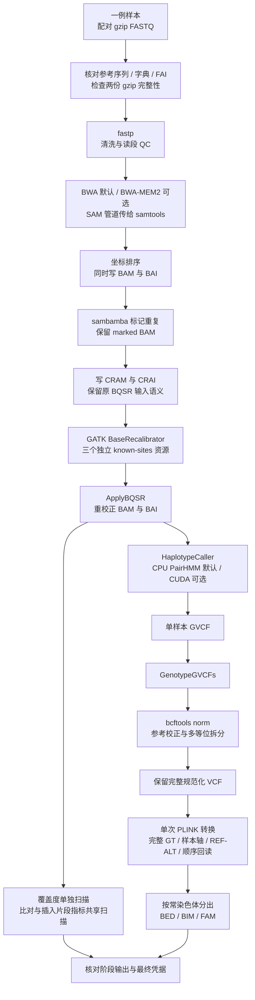

# 单样本 WGS：配对 FASTQ 到 VCF 与 PLINK

## 1. 功能与流程

`single_subj_preprocessing` 处理一个真实样本的一对 WGS FASTQ，依次完成读段清洗、比对、排序、重复标记、碱基质量重校正、变异检测、VCF 规范化和常染色体 PLINK 输出。默认使用 BWA 与原 GATK/GKL CPU PairHMM；BWA-MEM2 和项目 CUDA PairHMM 均需显式选择。

本入口保留 GVCF、规范化 VCF 和中间比对文件。PLINK 输出只编码常染色体的双等位 hard-call 基因型；完整 VCF 保存相位、质量、过滤和其他 FORMAT/INFO 信息。后续准备功能注释和关联分析请参见 [WGS 数据准备](wgs_data_preparation.md)、[二分类分析](wgs_binary.md)和[连续表型分析](wgs_continuous.md)。本入口不创建功能注释、表型、协变量或 GRM，也不执行关联检验。



fastp、比对、排序、重复标记、BQSR、QC、VCF 和 PLINK 转换目前均由 CPU 执行。默认使用一个 fastp 清洗 worker 固定输出顺序，其他阶段继续按整个调用的 CPU 预算并行。可选 CUDA 仅替换 HaplotypeCaller 内部的 PairHMM 计算，不把整个 GATK 或全部预处理步骤变成 GPU 程序。PairHMM 使用 FP32；整数基因型、碱基和 CIGAR 不转为 TF32。当前真实稀疏小区间中，原 CPU 路径更快，因此仍是默认值。

## 2. 安装与固定软件

预处理环境与关联分析的 `environment.yml` 分开。Linux x86-64 使用固定包锁安装全部预处理工具；锁中含 CUDA 编译器，但默认 CPU 路径不使用 GPU。

```bash
git clone https://github.com/weikanggong1/Fudan-WGS-Toolkit.git
cd Fudan-WGS-Toolkit
conda create -n fudan-wgs-preprocessing \
  --file environments/preprocessing-linux-64.explicit.txt
conda activate fudan-wgs-preprocessing
python -m pip install --no-deps --no-build-isolation -e .
```

`environment-preprocessing.yml` 提供可求解的依赖描述；精确复现优先使用上述 explicit 锁，重新求解的环境不能直接承接原锁的版本与性能结论。预处理模块按需导入，安装时不把另一套关联环境拼入运行时。

已测试的科学工具为 fastp 0.20.0、BWA 0.7.17、samtools 1.10、HTSlib 1.16、sambamba 0.7.1、GATK 4.2.0.0、BCFtools 1.10.2 和 PLINK 2.0.0-a.6.9（2025-01-29）；GATK 内含 Picard 2.25.0。环境提供 OpenJDK 8、R 及绘图依赖；Picard 的插入片段 PDF 需要这些绘图组件。可选构建所需的 Conda C/C++、make、CMake/Ninja、CUDA 与 Java 工具也由同一环境提供。当前 CUDA 构建目标为 sm_80，实测设备为 A100；其他型号未完成本页所述验收。

BWA-MEM2 的可选自动构建器从官方固定归档下载源码并核对字节数与 SHA-256，编译到新的项目目录，不原地更新 Conda 环境。CUDA/JNI 也编译到独立项目目录；构建器以 4 GiB 任务 PSS 预算、另留 4 GiB 实时主存及 4 GiB 构建存储准入，CPU 不超过可见有限 quota。每步退出、进程树清理及全部测试通过后，才原子提交 assets；复用时核对成功构建收据与源码清单。不需要 Docker 或 Parabricks。

参考 FASTA 和 known-sites VCF 由用户独立提供，保留其来源、版本、许可和校验记录。基因组版本、contig 名称和序列必须一致；本函数不做 liftOver，也不把未知过滤状态改成 PASS。

## 3. 输入数据与格式

| 输入 | 文件或结构 | 含义与要求 |
| --- | --- | --- |
| `read1`、`read2` | 两个不同的 gzip FASTQ 文件 | 同一样本、同一测序文库及配对轴的 R1/R2，记录以四行存储名称、序列、分隔行和质量；两路读段须按配对顺序对应。先执行完整 gzip 校验，再交给 fastp。同一文库的多 lane 数据可按项目规则组成一份配对输入并保留来源；不同文库不应混入这个固定 LB 的单输入。 |
| `reference_fasta` | 未压缩 FASTA，如 `/data/reference/reference.fa` | 本次比对和调用使用的完整参考；不接受 `.gz/.bgz` 参考。函数重新生成序列字典，核对 contig 顺序、长度和 MD5。 |
| FASTA 索引 | `reference.fa.fai` 与 `reference.dict` | FAI 与 FASTA 同名追加 `.fai`；字典由 FASTA 最后一个后缀替换为 `.dict`。例如 `reference.fasta` 对应 `reference.fasta.fai`、`reference.dict`。 |
| BWA 索引 | 同一前缀的 `.amb/.ann/.bwt/.pac/.sa` | 默认前缀为 `reference_fasta`。必须由同一参考生成；自备索引应有明确的参考绑定记录。 |
| BWA-MEM2 索引 | `.0123/.amb/.ann/.bwt.2bit.64/.pac` | 仅在选择 MEM2 时使用；不能把 BWA 索引当作 MEM2 索引。可用自动构建器创建新的独立索引。 |
| ALT contig sidecar | 如存在，为 `<reference>.alt` 与 `<index_prefix>.alt` | 两边必须同时存在且内容相同；文件进入输入绑定。它影响 ALT contig 比对策略，不可只换索引而漏掉该文件。 |
| `known_sites` | 长度恰为 3 的路径列表或 tuple | 三份与参考匹配的、BGZF 压缩且带 `.tbi` 的独立 VCF，供 BQSR 标识已知变异；不是本次样本的变异结果。常见组合为两个 indel 资源和一个 dbSNP 资源，具体版本以项目清单为准。 |
| `sample_id` | 非空字符串 | 真实样本 ID，允许英文字母、数字、下划线、点和连字符，不能为 `0`。用于 BAM read group 和 PLINK 的 FID/IID，不从文件名猜测身份。 |
| `output_dir` | 一个样本专用的私有输出目录 | 新目录以 0700 建立；现有目录必须由当前用户拥有且禁止组及其他用户访问。同一目录仅容许一个控制器；结果、命令、绑定及资源记录均保存在这里。 |

单样本 `GenotypeGVCFs` 输出是该样本的变异调用，不等于队列联合分型。多个样本应保留 GVCF，按项目规则联合 genotyping 后形成共同变异轴；不能把各样本 VCF 中未列出的位点直接填成 `0/0`。本入口不执行队列联合分型、VQSR 或队列层面的频率/缺失率筛选。

FASTQ 和已知变异资源的实际路径与身份只写入本地私有凭据。首次调用对输入记录文件身份，gzip 检查证明压缩流可完整读取；`input_content_SHA_assessed=False` 不等于已经对全部原始输入计算 SHA。输出及工具另有 SHA 绑定。

`intervals` 若提供，格式为字符串列表，每项为 `contig:start-end`，位置是 **1-based 闭区间**，contig 必须与 FASTA 相同。实际坐标放项目自己的私有 JSON 文件，例如由已核验的区域清单生成；本说明不包含真实样本或位点。`None` 表示完整参考调用。

## 4. 全部参数

```text
single_subj_preprocessing(
    read1, read2, reference_fasta, known_sites, output_dir, *,
    sample_id, conda_prefix=None, cpu_threads=None, cpu_affinity=None,
    fastp_threads=1,
    host_memory_limit_gib=None, host_memory_reserve_gib=4,
    aligner="bwa", aligner_executable=None, index_prefix=None,
    pairhmm_backend="cpu", gpu_uuid=None, gpu_memory_limit_gib=2,
    gpu_build_dir=None, intervals=None, qc_mode="shared",
    bqsr_input="cram", resume=False,
)
```

| 参数 | 默认值 | 作用 |
| --- | --- | --- |
| `read1` | 必填 | R1 gzip FASTQ 路径。 |
| `read2` | 必填 | 同配对轴的 R2 gzip FASTQ 路径。 |
| `reference_fasta` | 必填 | 未压缩参考 FASTA；相应字典、FAI 和选定比对索引必须已存在。 |
| `known_sites` | 必填 | 三份独立 BQSR VCF 的路径列表，每份均需 `.tbi`。 |
| `output_dir` | 必填 | 当前样本的独立输出目录。 |
| `sample_id` | 必填、keyword-only | 真实样本 ID；设置 RG 中的 ID/SM/LB，平台为 ILLUMINA，FID/IID 均取该 ID。 |
| `conda_prefix` | `None` | 完整预处理环境路径；`None` 使用当前 `CONDA_PREFIX`。所有科学工具和运行库来自这一个环境。 |
| `cpu_threads` | `None` | 整个调用的 CPU 数预算，至少 2。默认取允许 CPU 集和可见有限祖先 CPU quota 中的较小值；不按物理机器的全部核心数申请。 |
| `cpu_affinity` | `None` | 可使用的 Linux CPU 编号列表，不重复且须在当前允许集合内。最终最多取 `cpu_threads` 和实际 quota 允许的数量，调用结束恢复调用线程原 affinity。 |
| `fastp_threads` | `1` | 默认单清洗 worker，固定 fastp 0.20.0 的成对读段输出顺序；读入和两路压缩写出仍由原软件处理。可显式设为不超过 CPU 预算的 1–16；`None` 使用至多 6 个 worker。并行模式的跨次输出顺序可能变化，后续 PL 也可能受影响。 |
| `host_memory_limit_gib` | `None` | 任务主存准入与进程树 PSS 监控预算。默认不超过 64 GiB，且扣除实时预留后能被当前主存准入；至少 12 GiB。MEM2 阶段要求至少 32 GiB 的 prospective 预算。 |
| `host_memory_reserve_gib` | `4` | 阶段启动时，在可见有限祖先 cgroup 和物理可用内存中保留的 GiB；不是独占主存或新建硬配额。 |
| `aligner` | `"bwa"` | `"bwa"` 或显式 `"bwa-mem2"`。比对科学参数固定保留 `-K 10000000 -M -Y`。 |
| `aligner_executable` | `None` | 默认使用环境中的对应程序；可给项目源码构建的 MEM2 可执行文件路径。二进制及可能的派发 companion 均绑定 SHA。 |
| `index_prefix` | `None` | 默认与参考路径相同；MEM2 可指向独立派生索引前缀。必须确证索引来自当前参考，并匹配 ALT sidecar。 |
| `pairhmm_backend` | `"cpu"` | `"cpu"` 保留原 GATK/GKL；`"cuda"` 显式使用项目 CUDA/JNI PairHMM。其余 GATK 阶段仍在 CPU。 |
| `gpu_uuid` | `None` | CUDA 模式必填一个经项目分配的完整物理 GPU UUID；不能只凭编号猜测任务归属。CPU 模式不启用 GPU。 |
| `gpu_memory_limit_gib` | `2` | CUDA PairHMM 自有设备缓冲区预算，上限为 18 GiB；不代表整卡占用，也不限制其他项目。 |
| `gpu_build_dir` | `None` | CUDA/JNI 构建目录，默认 `<output_dir>/gpu_build`。可复用同一 Conda prefix 的已绑定构建产物，重新核对各文件 SHA。 |
| `intervals` | `None` | 默认完整参考；显式列表只限制 HC、genotyping 和覆盖度 QC 的区间。FASTQ 清洗、比对、重复标记和 BQSR 仍处理所给读段。此时结果标为局部调用。 |
| `qc_mode` | `"shared"` | 共享一次 SAM 遍历计算 alignment summary 与 insert-size 两类指标；`"separate"` 分别调用原工具。覆盖度 `CollectWgsMetrics` 始终另算。 |
| `bqsr_input` | `"cram"` | 当前仅发布 CRAM 语义；`"bam"` 会明确拒绝。CRAM 会重新表示部分比对标签，不能直接换成 BAM 后称科学输入完全相同。 |
| `resume` | `False` | `True` 仅复用输入、工具、源码及选项一致且输出绑定通过的已提交阶段。未完成阶段保留原记录，不覆盖后重跑；需要新的输出目录。 |

CPU、主存和 GPU 预算含义分别记录；共享节点 quota、整卡占用不自动归属于本样本。每次采样遍历所有线程的子进程，优先读取 `smaps_rollup`，旧内核回退完整 `smaps`；遇到进程切换地址空间造成的不完整端点，会丢弃该次部分计数并在同一启动身份下最多重读 5 次；仍存活但持续无法读取的进程会阻止继续运行，不把缺失值当成零。资源记录中的 PSS 是离散采样；不能据其推断精确瞬时峰或长期无泄漏。cgroup 的实际使用量与 inactive file 页的可回收估计分开保留；后者只参与主存准入估计，不代表已经释放，不抵扣任务 PSS。

## 5. Python 调用

### 5.1 默认 CPU 路径

以下路径与样本名仅说明格式，应替换为自己项目清单中的真实输入。示例不会创建模拟测序或伪表型。

```python
import os
from pathlib import Path
from fudan_wgs_toolkit import single_subj_preprocessing

conda_prefix = os.environ["CONDA_PREFIX"]
read1_path = Path("/data/project/subject_example_R1.fastq.gz")
read2_path = Path("/data/project/subject_example_R2.fastq.gz")
reference_fasta = Path("/data/reference/reference.fa")
known_site_vcfs = [
    "/data/reference/known_indels_a.vcf.gz",
    "/data/reference/known_indels_b.vcf.gz",
    "/data/reference/known_snps.vcf.gz",
]
output_directory = Path("/results/project/subject_example_cpu")
true_sample_id = "subject_example"  # 改为真实样本清单中的 ID。

# 从已分配给本任务的允许集合中选 3 核；共享节点应使用项目分配的集合。
allowed_cpu_ids = sorted(os.sched_getaffinity(0))
selected_cpu_ids = allowed_cpu_ids[:3]

result = single_subj_preprocessing(
    read1=read1_path,
    read2=read2_path,
    reference_fasta=reference_fasta,
    known_sites=known_site_vcfs,
    output_dir=output_directory,
    sample_id=true_sample_id,
    conda_prefix=conda_prefix,
    cpu_threads=len(selected_cpu_ids),
    cpu_affinity=selected_cpu_ids,
    host_memory_limit_gib=48,
    host_memory_reserve_gib=4,
    aligner="bwa",
    pairhmm_backend="cpu",
    intervals=None,               # 完整参考；不是只跑示例窗口。
    qc_mode="shared",
    bqsr_input="cram",
    resume=False,
)
print(result["status"], result["scope"])
print(result["vcf"], result["plink_directory"])
```

正式调用至少需要两个实际可用 CPU。上述允许集的前三核只是单机示例，不能代替调度器的项目资源分配。

做明确的小规模调用时，保留相同参数，只将 `intervals` 改为自己私有区域清单中的列表，并使用新目录：

```python
import json

benchmark_intervals = json.loads(
    Path("/data/project/benchmark_intervals.json").read_text()
)
# 将上例的 intervals 设置为 benchmark_intervals，
# output_dir 设置为独立小规模目录；结果 scope 为 selected_intervals。
```

### 5.2 可选源码 BWA-MEM2

```python
from fudan_wgs_toolkit.build_preprocessing_aligner import build_preprocessing_aligner

# 显式请求官方源码编译与新的参考索引，不覆盖原 BWA 索引。
# 全参考索引需较多主存；构建器先检查实时可用量和预留。
aligner_assets = build_preprocessing_aligner(
    conda_prefix=conda_prefix,
    build_dir="/results/project/aligner_build",
    reference=reference_fasta,
    cpu_affinity=selected_cpu_ids[:1],
)

mem2_result = single_subj_preprocessing(
    read1=read1_path,
    read2=read2_path,
    reference_fasta=reference_fasta,
    known_sites=known_site_vcfs,
    output_dir="/results/project/subject_example_mem2",
    sample_id=true_sample_id,
    conda_prefix=conda_prefix,
    cpu_threads=len(selected_cpu_ids),
    cpu_affinity=selected_cpu_ids,
    host_memory_limit_gib=48,
    aligner="bwa-mem2",
    aligner_executable=aligner_assets["executable"],
    index_prefix=aligner_assets["index_prefix"],
    pairhmm_backend="cpu",
    bqsr_input="cram",
)
```

构建器固定官方 v2.3 的 commit `7aa5ff6c3330490e5629ab9b7327683d2dce02d6` 与 safestringlib 子模块 `245c4b8cff1d2e7338b7f3a82828fc8e72b29549`。该 commit 的 CLI 自身报告 `2.2.1`，凭据同时保留 tag、commit、真实版本文字和二进制 SHA。使用一核 Conda 编译器；参考索引按 **28 倍未压缩 FASTA 字节数加 50 GiB 实时预留**准入，另检查磁盘空间。只编译时可设 `reference=None`，但随后必须提供来源明确且与参考匹配的现成 MEM2 索引。

### 5.3 可选 CUDA PairHMM

```python
# PROJECT_GPU_UUID 应由本项目的资源分配记录提供完整 GPU UUID。
assigned_gpu_uuid = os.environ["PROJECT_GPU_UUID"]

cuda_result = single_subj_preprocessing(
    read1=read1_path,
    read2=read2_path,
    reference_fasta=reference_fasta,
    known_sites=known_site_vcfs,
    output_dir="/results/project/subject_example_cuda",
    sample_id=true_sample_id,
    conda_prefix=conda_prefix,
    cpu_threads=len(selected_cpu_ids),
    cpu_affinity=selected_cpu_ids,
    host_memory_limit_gib=48,
    aligner="bwa",
    pairhmm_backend="cuda",
    gpu_uuid=assigned_gpu_uuid,
    gpu_memory_limit_gib=2,
    gpu_build_dir="/results/project/pairhmm_build",
    intervals=benchmark_intervals,  # 明确的小规模区间调用。
    qc_mode="shared",
    bqsr_input="cram",
)
print(cuda_result["actual_GPU_work"])
```

首次调用自动用同一环境编译 C++/CUDA/JNI；可复用已绑定构建目录。完成凭据按实际 GPU 调用和 pair 计数记录是否执行科学计算，不能用加载库、初始化 CUDA 或存在进程代替。数值下溢的原 GKL double 复核按实际计数保留；不能把回退计为 GPU pair。CUDA 当前为可选功能，下面的真实小区间没有提速。

## 6. 命令行调用

将 Python 参数名原样写成 JSON；`Path` 改为字符串，布尔值采用 JSON 的 `true/false`。例如 `preprocessing.private.json`：

```json
{
  "read1": "/data/project/subject_example_R1.fastq.gz",
  "read2": "/data/project/subject_example_R2.fastq.gz",
  "reference_fasta": "/data/reference/reference.fa",
  "known_sites": [
    "/data/reference/known_indels_a.vcf.gz",
    "/data/reference/known_indels_b.vcf.gz",
    "/data/reference/known_snps.vcf.gz"
  ],
  "output_dir": "/results/project/subject_example_cpu",
  "sample_id": "subject_example",
  "conda_prefix": "/opt/conda/envs/fudan-wgs-preprocessing",
  "cpu_threads": 3,
  "cpu_affinity": [0, 1, 2],
  "host_memory_limit_gib": 48,
  "host_memory_reserve_gib": 4,
  "aligner": "bwa",
  "pairhmm_backend": "cpu",
  "intervals": null,
  "qc_mode": "shared",
  "bqsr_input": "cram",
  "resume": false
}
```

CPU 编号需改为当前项目获分配的编号。这个 JSON 含真实运行路径与身份时应私有保存。

```bash
conda activate fudan-wgs-preprocessing
single_subj_preprocessing --config preprocessing.private.json

# 与上面的 console entry 等价。
python -m fudan_wgs_toolkit.single_preprocessing \
  --config preprocessing.private.json
```

## 7. 输出、完整性与恢复

```text
output_dir/
├── plan.private.json                 输入、源码、工具、选项与预算绑定
├── journal.private.jsonl             已提交阶段记录
├── stages/<stage>/                   命令、私有日志、退出与资源凭据
├── files/
│   ├── clean_1.fq.gz / clean_2.fq.gz
│   ├── sorted.bam / sorted.bam.bai
│   ├── marked.bam
│   ├── marked.cram / marked.cram.crai
│   ├── recal.table
│   ├── recalibrated.bam / recalibrated.bam.bai
│   ├── sample.g.vcf.gz / sample.g.vcf.gz.tbi
│   ├── genotyped.vcf.gz / genotyped.vcf.gz.tbi
│   ├── normalized.vcf.gz / normalized.vcf.gz.tbi
│   ├── wgs_metrics.txt
│   ├── qc.*                          共享 QC 的表和插入片段 PDF
│   └── autosomes.bed / .bim / .fam   单次转换的完整常染色体数据
├── finalization/attempt_<id>/
│   ├── vcf_oracle/                   VCF 独立 GT 与变异轴
│   └── plink/chr<chromosome>.*       逐染色体 BED/BIM/FAM
└── complete.private.json            全部核验通过后的完成凭据
```

`result` 是可 JSON 序列化的字典，主要字段如下。

| 字段 | 含义 |
| --- | --- |
| `status` | 所有要求阶段和最终回读完成后为 `complete_verified`；仅有输出文件或活进程不构成完成。 |
| `scope` | `complete_reference` 或显式小区间的 `selected_intervals`。 |
| `gvcf`、`vcf` | 保留的 GVCF 和规范化 VCF 路径。 |
| `plink_directory` | 本次成功收尾 attempt 下的逐染色体 PLINK 目录。只为实际含变异的常染色体生成文件。 |
| `scan` | 完整 VCF 样本轴检查、常染色体变异数、各染色体计数及排除的非常染色体记录。 |
| `PLINK` | 完整 hard-call、样本 FID/IID、ID、REF/ALT、顺序及 BED 填充位核验结果和输出绑定。 |
| `stages` | 已提交阶段的实际命令、退出、wall 和采样 PSS。 |
| `total_wall_seconds` | 本次调用实际总耗时，包含校验、输出哈希和收尾工作；复用完成结果时返回原完成凭据中的值。 |
| `final_PLINK_readback_seconds` | 收尾中的独立 VCF 扫描、转换和完整 PLINK 回读耗时。 |
| `actual_GPU_work`、`GPU_evidence` | 按实际 CUDA PairHMM 调用计数与审计记录得到的执行覆盖；CPU 模式不声称 GPU 科学执行。 |
| `full_reference_calling_completed` | 是否完成完整参考调用；不能把 `selected_intervals` 结果说成全 WGS。 |

BED 使用 variant-major 格式：BIM 第一行对应第一个变异，FAM 第一行对应第一个样本。当前单样本每变异占一个字节，其高六位须为零填充。A1 固定为 VCF ALT、A2 固定为 VCF REF；ID 为 `CHR:POS:REF:ALT`，CHR 为未加 `chr` 的常染色体编号。完整缺失保留为 missing；半缺失、非二倍体或未拆分多等位 GT 明确报错，不静默填补。`.fam` 中 FID/IID 保留真实 `sample_id`，父母、性别和 phenotype 列是格式占位的未知值，不代表已生成关联表型。见 [PLINK BED 格式](https://www.cog-genomics.org/plink/1.9/formats#bed)。

`bcftools norm -m -any` 按实际工具默认规则拆分多等位。拆分后的双等位 hard-call 可逐项核对，但不能称原多等位 GT 或相位在 BED 中无损保存。双等位 `*` 或 symbolic ALT 的处理以实际 PLINK 转换与完整 allele/GT 回读为准；原 VCF 始终保留。若没有常染色体变异，`PLINK.status="no_autosomal_variants"`、`all_hard_calls_verified=None`，提供真实的空输出目录，不宣称有零变异 BED 完成了数值检验。

使用同一输入和选项设置 `resume=True` 时，先核对已提交阶段输出的完整绑定。未完成阶段和失败记录保留，不自动覆盖重跑。最终回读采用新的 attempt 目录，避免把旧部分输出误认为完成。PSS、输入、工具或源码核验失败会保留明确失败凭据；默认不停止其他项目进程。

## 8. 对应原软件命令

以下是默认 CPU 路径的科学命令，路径仅说明结构。Python 入口额外负责资源准入、gzip/参考核验、绑定、阶段提交和完整 PLINK 回读。完整软件版本与命令写入私有凭据；下列工具本身没有覆盖这些附加审计步骤。

```bash
set -euo pipefail
reference_fasta=/data/reference/reference.fa
read1_path=/data/project/subject_example_R1.fastq.gz
read2_path=/data/project/subject_example_R2.fastq.gz
sample_id=subject_example
output_directory=/results/project/original_commands
known_indels_a=/data/reference/known_indels_a.vcf.gz
known_indels_b=/data/reference/known_indels_b.vcf.gz
known_snps=/data/reference/known_snps.vcf.gz
cpu_threads=3
aligner_threads=2
java_common_options="-XX:ActiveProcessorCount=${cpu_threads} -XX:ParallelGCThreads=1 -Djava.io.tmpdir=${output_directory}/tmp"
mkdir -p "$output_directory/tmp"

# 1. 原始压缩流与清洗。
gzip -t -- "$read1_path" "$read2_path"
fastp -i "$read1_path" -I "$read2_path" \
  -o "$output_directory/clean_1.fq.gz" -O "$output_directory/clean_2.fq.gz" \
  -j "$output_directory/fastp.json" -h "$output_directory/fastp.html" \
  -w 1

# 2. 比对、坐标排序，同时写显式 BAI。
bwa mem -K 10000000 -M -Y -t "$aligner_threads" \
  -R "@RG\tID:${sample_id}\tSM:${sample_id}\tLB:${sample_id}\tPL:ILLUMINA" \
  "$reference_fasta" "$output_directory/clean_1.fq.gz" \
  "$output_directory/clean_2.fq.gz" |
  samtools sort -@ 1 -m 512M -O BAM --write-index \
    --reference "$reference_fasta" \
    -o "$output_directory/sorted.bam##idx##$output_directory/sorted.bam.bai" -

# 3. 标记重复，保留原 CRAM BQSR 输入。
sambamba markdup -t "$cpu_threads" --sort-buffer-size=6144 \
  --tmpdir="$output_directory/tmp" \
  "$output_directory/sorted.bam" "$output_directory/marked.bam"
samtools view -@ 2 -h -O CRAM --write-index --no-PG \
  --reference "$reference_fasta" \
  -o "$output_directory/marked.cram##idx##$output_directory/marked.cram.crai" \
  "$output_directory/marked.bam"

# 4. BQSR 模型与应用；三个 known-sites 均使用同一参考版本。
gatk --java-options "-Xmx4g $java_common_options" \
  BaseRecalibrator -R "$reference_fasta" -I "$output_directory/marked.cram" \
  --known-sites "$known_indels_a" --known-sites "$known_indels_b" \
  --known-sites "$known_snps" -O "$output_directory/recal.table"
gatk --java-options "-Xmx4g $java_common_options" \
  ApplyBQSR -R "$reference_fasta" -I "$output_directory/marked.cram" \
  --bqsr-recal-file "$output_directory/recal.table" \
  -O "$output_directory/recalibrated.bam" --create-output-bam-index false
samtools quickcheck -v "$output_directory/recalibrated.bam"
samtools index -@ 2 "$output_directory/recalibrated.bam" \
  "$output_directory/recalibrated.bam.bai"

# 5. 单样本 GVCF 和 genotyping。此例不加 -L，覆盖完整参考。
gatk --java-options "-Xms8g -Xmx8g $java_common_options" \
  HaplotypeCaller -R "$reference_fasta" -I "$output_directory/recalibrated.bam" \
  --emit-ref-confidence GVCF --native-pair-hmm-threads "$cpu_threads" \
  -O "$output_directory/sample.g.vcf.gz"
gatk --java-options "-Xmx4g $java_common_options" \
  GenotypeGVCFs -R "$reference_fasta" -V "$output_directory/sample.g.vcf.gz" \
  -O "$output_directory/genotyped.vcf.gz"

# 6. QC：覆盖度单独计算，另外两种指标共享一遍比对记录。
gatk --java-options "-Xmx4g $java_common_options" \
  CollectWgsMetrics -R "$reference_fasta" -I "$output_directory/recalibrated.bam" \
  -O "$output_directory/wgs_metrics.txt"
gatk --java-options "-Xmx4g $java_common_options" \
  CollectMultipleMetrics -R "$reference_fasta" -I "$output_directory/recalibrated.bam" \
  -O "$output_directory/qc" --PROGRAM null \
  --PROGRAM CollectAlignmentSummaryMetrics --PROGRAM CollectInsertSizeMetrics

# 7. 参考规范化、拆分多等位，再做一次常染色体 BED 转换。
bcftools norm -f "$reference_fasta" -m -any --threads 2 \
  "$output_directory/genotyped.vcf.gz" -Oz \
  -o "$output_directory/normalized.vcf.gz"
bcftools index -t "$output_directory/normalized.vcf.gz"
# 从规范化 VCF 流式取得实际最大等位基因长度。
maximum_allele_length="$(python - "$output_directory/normalized.vcf.gz" <<'PY'
import gzip
import sys
maximum_length = 1
with gzip.open(sys.argv[1], "rt") as variant_stream:
    for variant_line in variant_stream:
        if not variant_line.startswith("#"):
            variant_columns = variant_line.rstrip().split("\t")
            maximum_length = max(maximum_length, len(variant_columns[3]), len(variant_columns[4]))
print(maximum_length)
PY
)"
plink2 --vcf "$output_directory/normalized.vcf.gz" --double-id \
  --vcf-allow-no-nonvar --vcf-half-call error --set-all-var-ids '@:#:$r:$a' \
  --new-id-max-allele-len "$maximum_allele_length" error --chr 1-22 --output-chr 26 \
  --threads "$cpu_threads" --memory 4096 --make-bed \
  --out "$output_directory/autosomes"
```

使用 MEM2 时替换比对程序及其匹配的独立索引前缀，其余参数保持一致。原 ZIP 的排序命令已支持同时写索引；这里保留该机制。小区间时 HC 和 GenotypeGVCFs 使用同一份 `-L` 清单，覆盖度 QC 使用由相同区间生成的 Picard interval list，不能把这种调用称为完整基因组。

原 GATK CPU 和可选 CUDA HC 具有不同的实现入口，CUDA 的实际 Java classpath、JNI 库和模式由构建器生成并绑定；它不是在原命令后附加一个不存在的 `--gpu` 参数。

## 9. 精度、耗时与内存：已完成范围

所有数字均来自真实测序数据及真实退出凭据。当前现场为共享的**单张 A100**节点；CPU 工具并未使用 GPU。工具过程 wall、带资源观察器的阶段 wall 和完整调用 wall 分开记录，不能把不同输入和计时边界的组件加速比相乘。

### 9.1 源码 BWA-MEM2：十万对真实读段

同一参考、同一份同顺序清洗 FASTQ、相同 RG 和 `-K 10000000 -M -Y`；两个后端各预热一次，交错三对。整任务固定 3 核，BWA 两线程、sort 一个线程，组件对照的排序内存为 `-m 256M`；当前完整入口使用 `512M`；第 9.5 节另列最终入口的端到端结果。

| 三次重复中位数 | BWA 0.7.17 | 源码 BWA-MEM2 |
| --- | ---: | ---: |
| 比对＋排序 wall | 29.8780 s | 21.9081 s |
| 比对＋排序＋索引＋quickcheck wall | **30.0463 s** | **22.0497 s** |
| 含阶段记录 wall | 30.2128 s | 22.2371 s |
| 三次重复采样的进程树 PSS 最大值 | 5.501 GiB | 17.220 GiB |

工具过程加速 **1.36267×，耗时减少 26.61%**。三对每路各 **200,423** 条 alignment，全部 11 核心字段、非 PG 标签、多重集合、记录顺序和非 PG header 差异为 0。BWA 是对照而非生物学真值；BAM 字节不要求完全相同。索引装载和进程启动已计时，完整 SAM 回读另计。下游小规模 gVCF/VCF/PLINK 比较见第 9.5 节；完整 WGS 尚未验收。

独立人类参考索引的既有冷建实测为 15.21 分钟、17.70 GB 派生文件、采样进程树 PSS 最大约 71.915 GiB。完整流程的第一次运行不能隐去该成本。新发布构建器在同一只读 Conda 环境完成了官方归档校验、**21.38 秒单核编译**、版本和动态依赖检查；新构建产物随后也用于第 9.5 节的完整小规模工作流；组件三次中位加速比仍来自前述固定产物，不能冒充新产物又测了三对。

### 9.2 共享 QC：两类指标

真实十万对、尚未标记重复或执行 BQSR 的 BAM；GATK 4.2.0.0/Picard 2.25.0，整任务 2 核，三对交错对照。

| 范围 | 独立调用两工具 | CollectMultipleMetrics 共享遍历 |
| --- | ---: | ---: |
| alignment summary＋insert-size，中位 wall | **79.7503 s** | **76.4881 s** |

加速 **1.04265×，耗时减少约 4.09%**。数值指标与 histogram bins 全部一致，PDF 存在且非空；没有把 PDF 字节一致作为精度结论。这只覆盖三类 QC 中的两类，`CollectWgsMetrics` 没有合并，重校正后最终入口的完成范围另见第 9.5 节。

### 9.3 同时建 BAI：避免额外 BAM 读回

同一份**已经坐标排序**的真实十万对 BAM，`sort -@ 1 -m 256M`，三对完整字段比较与实际 BAI magic、idxstats 均通过。

| 三次中位数 | sort 后单独 index | sort 同时写 BAI |
| --- | ---: | ---: |
| 工具 sort＋index wall | 1.44873 s | 1.42525 s |
| 含资源采集的阶段 wall | 1.74951 s | 2.02936 s |

工具过程仅约 1.6% 改善，外层阶段反而更长，这轮不构成端到端净收益证据。原 ZIP 本来已有同时建索引；当前入口恢复这一行为以免额外完整读 BAM。短阶段的 PSS 采样没有覆盖实际 sort 峰值；GNU time 最大 RSS 约 74.9→86.4 MiB。大 BAM 的净收益仍需完整流程实测。

### 9.4 CUDA PairHMM：已执行，但当前小负载更慢

同一真实 BAM 的约 8 kb 小区间 HC，实际阶段 wall 为：

| 实现 | HC wall |
| --- | ---: |
| 原 GATK/GKL CPU | **2.937360 s** |
| 项目 CUDA PairHMM | **7.102339 s** |

该次小区间 CUDA 约为 CPU 的 **2.42 倍耗时**，没有加速。初始化与传输在小负载中占有明显成本，因此默认保留 CPU。另对捕获的 **34 对真实 PairHMM batch 重复 128 轮**核验，输出最大差为 **0**；这不是 1,280 对数据，也不等于完成了全 WGS 变异级精度比较。GPU 计数来自真实 provider 审计，不使用仅初始化或自动回退冒充 GPU 执行。

### 9.5 最终 API：真实 FASTQ 前缀的完整流程

同一真实样本的 **100,000 对原始 FASTQ**完成清洗、完整参考比对、重复标记、BQSR，以及八个自然 1 kb 区间的 HC、genotyping、覆盖度 QC 和最终 PLINK 回读。其余两类 QC 遍历全部所给 BAM。三路各用 3 核、64 GiB 任务主存准入预算、10 GiB 预留，在同一共享节点并行执行；这是固定前缀与局部调用，**不是完整原始样本或全 WGS**。

| 最终调用 | 端到端 wall | 全阶段采样进程树 PSS 最大值 | 实际 CUDA PairHMM |
| --- | ---: | ---: | --- |
| BWA＋GKL，独立两类 QC | **235.496 s** | **5.535 GiB** | 否 |
| 源码 MEM2＋GKL，共享两类 QC | **225.562 s** | **17.108 GiB** | 否 |
| 源码 MEM2＋CUDA，共享两类 QC | **227.370 s** | **17.181 GiB** | 是 |

三路均实际退出 0、提交 **15 个阶段**。完整有序回读分别核对 **200,422 条比对记录的科学字段**、BQSR 全部表格单元、fastp 科学 QC、三类最终 QC 指标及 histogram bins；均一致。gVCF 的 **150 条记录**与规范化 VCF 的 **1 条记录**全部字段及顺序一致；BED/BIM/FAM 字节、真实样本轴、等位方向和每个 hard call 一致。比对的 PG 来源记录与时间/命令注释不作为数值字段相同的要求，分别保留。PDF 已生成，未要求 PDF 字节相同。

该次固定前缀的优化 CPU 路径观察到 **1.044×**端到端加速；可选 GPU 相对优化 CPU 为 **0.992×**。这是一组短流程观察，存在共享缓存与并行资源竞争，不能外推整样本加速，也不能把各组件加速比相乘。此处对照两路均使用同一 fastp 单 worker、CPU 预算和调用区间，不是原 ZIP 的 16 线程全样本原封运行。

总耗时包含输入/参考核验、阶段输出 SHA、资源观察、完整 VCF 扫描和 PLINK 回读；上表使用现成比对索引和已编译后端，冷建索引与编译成本见第 9.1 节。额外独立比对和 QC 回读耗时 **2.399 s**，另列于[匿名 benchmark](../validation/single_subj_preprocessing_20261020.anonymous.json)，没有冒充 API 运行时间。各阶段耗时和采样主存峰值也保存在该摘要中。

原完整输入的 fastp 先前实际完成 **35.53 分钟**；同次下游仍缺少已核验的全部成功凭据。**完整原始 WGS 的净加速、全深度变异精度和长期内存平台尚未完成验收。** 短流程预算检查与 128 轮 PairHMM 自有缓冲区平台仅说明各自范围，不作为完整样本长期稳定性的结论。

### 9.6 fastp 的顺序复现成本与未采用方案

对真实 **100 万对原始 FASTQ**，每种设置预热一次，再交错三对，总共八次完整回读。fastp `-w1` 中位 **10.2025 s**，`-w3` 为 **7.3769 s**：固定单 worker 的成本为多 **2.8256 s（38.30%）**，这项调整服务于可复现性，不是清洗加速。八份结果均保留 **967,774 对**、读段多重集合一致；单 worker 的有序解压内容和全部科学 QC 字段跨次一致，多 worker 的写出顺序及部分 QC 不稳定。

上游 fastp 0.20.0 的并行 worker 按完成顺序写出；换顺序后，后续 BQSR 表及部分 gVCF PL 曾变化。最终对照因此在两路使用相同的 `-w1`，避免把读段排序差异误判为 PairHMM 数值误差。GPU 精度另以同一 BAM 对照。

两个 Conda gzip 解压进程向普通 FIFO 供给 fastp 的候选已用真实输入实测。fastp 的预读评估会关闭并重开流，解压进程出现 SIGPIPE；没有提交任何输出，候选未发布。直接改以 BAM 做 BQSR 的候选也因 CRAM 解码标签不同未进入默认路径；通过原解码器一次转 BAM 的候选虽然字段和数值一致，短重复的收益与波动接近，当前继续保留原 CRAM 语义。

## 10. 当前实现与 benchmark 记录

- **2026-10-20：单样本入口与验证。** 加入独立 CLI、参考/输入/工具/源码绑定、按实际配额的 CPU/主存准入、单次 PLINK 转换、独立完整 GT/等位基因/轴回读，以及按染色体有界拆分。零变异与未完成阶段保持明确状态。
- **2026-10-20：保留科学语义的 CPU 优化。** 验证源码 MEM2 候选、显式 BAI 同步写出和两类 QC 共享遍历；默认 BWA，不把组件收益当作完整 WGS 已提速。
- **2026-10-20：资源与失败恢复。** 旧内核完整 smaps 回退、进程切换时有界重读、存活未知拒绝、全部线程子进程与自有 session 清理；已有输出目录必须私有。构建收据与 assets 原子提交相互绑定，未完成构建不复用。
- **2026-10-20：可选 CUDA/JNI。** FP32 PairHMM 已实际执行并通过所述真实 batch 验证；小区间 HC 更慢，保留 CPU 默认。最终 API 的三个完整小规模工作流按第 9.5 节明确报告；完整原始 WGS 与长期稳定性仍未验收。

## 11. 原实现、格式与参考文献

| 实现或格式 | 固定来源及说明 |
| --- | --- |
| fastp | [v0.20.0 官方源码](https://github.com/OpenGene/fastp/tree/v0.20.0)，包含输入解压、处理 worker 与 gzip writer。 |
| BWA | [v0.7.17 官方源码](https://github.com/lh3/bwa/tree/v0.7.17)，保留批次、配对和 split-hit 参数。 |
| BWA-MEM2 | [固定 v2.3 commit](https://github.com/bwa-mem2/bwa-mem2/tree/7aa5ff6c3330490e5629ab9b7327683d2dce02d6)，由 Conda 编译器构建。 |
| samtools / BCFtools | [samtools 1.10](https://github.com/samtools/samtools/tree/1.10)、[BCFtools 1.10.2](https://github.com/samtools/bcftools/tree/1.10.2)、[HTSlib 1.16](https://github.com/samtools/htslib/tree/1.16)。 |
| sambamba | [v0.7.1 官方源码](https://github.com/biod/sambamba/tree/v0.7.1)，用于重复标记。 |
| GATK / Picard | [GATK 4.2.0.0](https://github.com/broadinstitute/gatk/tree/4.2.0.0)、[Picard 2.25.0 CollectMultipleMetrics](https://github.com/broadinstitute/picard/blob/2.25.0/src/main/java/picard/analysis/CollectMultipleMetrics.java)。 |
| PLINK | [PLINK 2 VCF 输入](https://www.cog-genomics.org/plink/2.0/input)、[变异 ID 与数据处理](https://www.cog-genomics.org/plink/2.0/data)、[BED/BIM/FAM 格式](https://www.cog-genomics.org/plink/1.9/formats)。 |
| VCF / SAM | [HTS 官方格式规范](https://samtools.github.io/hts-specs/)，解释 GT、REF/ALT、相位和比对记录字段。 |

相关方法文献：

1. Chen S et al. *fastp: an ultra-fast all-in-one FASTQ preprocessor*. Bioinformatics, 2018. [doi:10.1093/bioinformatics/bty560](https://doi.org/10.1093/bioinformatics/bty560)。
2. Li H. *Aligning sequence reads, clone sequences and assembly contigs with BWA-MEM*, 2013. [原文](https://arxiv.org/abs/1303.3997)。
3. Vasimuddin Md et al. *Efficient Architecture-Aware Acceleration of BWA-MEM for Multicore Systems*. IPDPS, 2019. [doi:10.1109/IPDPS.2019.00041](https://doi.org/10.1109/IPDPS.2019.00041)。
4. Tarasov A et al. *Sambamba: fast processing of NGS alignment formats*. Bioinformatics, 2015. [doi:10.1093/bioinformatics/btv098](https://doi.org/10.1093/bioinformatics/btv098)。
5. DePristo MA et al. *A framework for variation discovery and genotyping using next-generation DNA sequencing data*. Nature Genetics, 2011. [doi:10.1038/ng.806](https://doi.org/10.1038/ng.806)。
6. Danecek P et al. *Twelve years of SAMtools and BCFtools*. GigaScience, 2021. [doi:10.1093/gigascience/giab008](https://doi.org/10.1093/gigascience/giab008)。
7. Chang CC et al. *Second-generation PLINK: rising to the challenge of larger and richer datasets*. GigaScience, 2015. [doi:10.1186/s13742-015-0047-8](https://doi.org/10.1186/s13742-015-0047-8)。

第三方软件及参考数据库各有自己的许可与引用要求；本项目的许可不替代它们。公开仓库保存接口、构建器和匿名验证摘要，不发布原始测序、参考资源副本或样本级遗传结果。
