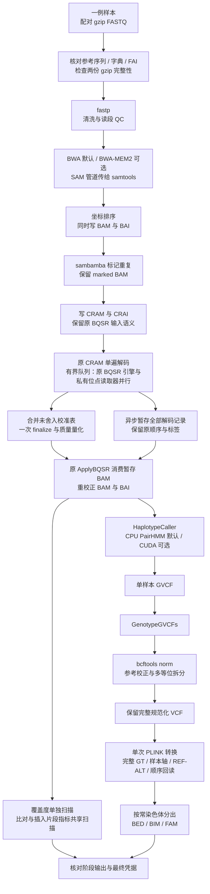
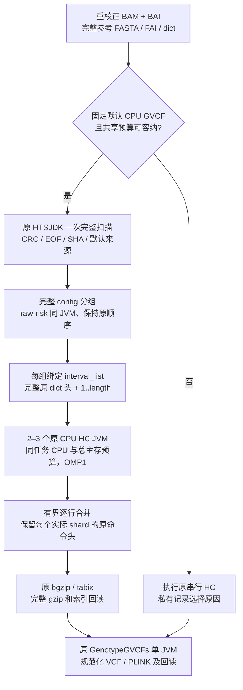

# 单样本 WGS：配对 FASTQ 到 VCF 与 PLINK

## 1. 功能与流程

`single_subj_preprocessing` 处理一个真实样本的一对 WGS FASTQ，依次完成读段清洗、比对、排序、重复标记、碱基质量重校正、变异检测、VCF 规范化和常染色体 PLINK 输出。默认使用 BWA 与原 GATK/GKL CPU PairHMM；分配至少 4 核时，BQSR 以多个独立原 GATK 引擎并行训练。BWA-MEM2 和项目 CUDA PairHMM 均需显式选择。

**版本范围：** 本页说明 **v0.13.0**，已完成4例、每例1,000万对真实原始读段前缀、完整参考的同输入范围验收。原软件源码补丁、参考核验复用及[完整contig HC调度](#hc-whole-contig)的三臂计时和全字段比较见[第9.2节](#92-已闭合的完整科学流程计时与同输入验收)及[完整匿名benchmark](../validation/single_subj_preprocessing_four10m_20261024.anonymous.json)；资源分析已闭合，未知采样和堆覆盖缺口仍保留。该范围不是完整原始测序深度、独立生物学真值或长期无泄漏证明；v0.12.0历史验证见[第9.5节](#historical-validation)。

本入口保留 GVCF、规范化 VCF 和中间比对文件。PLINK 输出只编码常染色体的双等位 hard-call 基因型；完整 VCF 保存相位、质量、过滤和其他 FORMAT/INFO 信息。后续准备功能注释和关联分析请参见 [WGS 数据准备](wgs_data_preparation.md)、[二分类分析](wgs_binary.md)和[连续表型分析](wgs_continuous.md)。本入口不创建功能注释、表型、协变量或 GRM，也不执行关联检验。



fastp、比对、排序、重复标记、BQSR、QC、VCF 和 PLINK 转换目前均由 CPU 执行。默认使用一个 fastp 清洗 worker 固定输出顺序。各科学阶段按序提交，阶段内部使用整个调用的有效 CPU 预算；BQSR 的解码、多个训练 worker 与 BAM writer 同时工作。流程图中 HC 与 QC 的分支表示数据依赖，当前不同时启动这两个阶段。CPU 预算限定允许 CPU 集及可用算力，不是操作系统线程数的硬上限。可选 CUDA 仅替换 HaplotypeCaller 内部的 PairHMM 计算，不把整个 GATK 或全部预处理步骤变成 GPU 程序。PairHMM 使用 FP32；整数基因型、碱基和 CIGAR 不转为 TF32。当前真实稀疏小区间中，原 CPU 路径更快，因此仍是默认值。

## 2. 安装与固定软件

预处理环境与关联分析的 `environment.yml` 分开。Linux x86-64 使用固定包锁安装全部预处理工具；锁中含 CUDA 编译器，但默认 CPU 路径不使用 GPU。

```bash
git clone https://github.com/weikanggong1/Fudan-WGS-Toolkit.git
cd Fudan-WGS-Toolkit
conda create -n fudan-wgs-preprocessing \
  --file environments/preprocessing-linux-64.explicit.txt
conda activate fudan-wgs-preprocessing
python -m pip install --no-deps --no-build-isolation -e .
```

`environment-preprocessing.yml` 提供可求解的依赖描述；精确复现优先使用上述 explicit 锁，重新求解的环境不能直接承接原锁的版本与性能结论。预处理模块按需导入，安装时不把另一套关联环境拼入运行时。

v0.12 验收及公开锁中的科学工具为 fastp 0.20.0、BWA 0.7.17、samtools 1.10、HTSlib 1.16、sambamba 0.7.1、GATK 4.2.0.0、BCFtools 1.10.2 和 PLINK 2.0.0-a.6.9（2025-01-29）；GATK 内含 Picard 2.25.0。环境提供 OpenJDK 8、R 及绘图依赖；Picard 的插入片段 PDF 需要这些绘图组件。可选构建所需的 Conda C/C++、make、CMake/Ninja、CUDA 与 Java 工具也由同一环境提供。当前公开 CUDA 构建目标为 sm_80，实测设备为 A100；其他型号未完成本页所述验收。第 9.1 节列出本轮的 CPU 测试环境；H100 是所在节点的设备信息，本轮原工具测试没有执行 GPU 科学计算。

BWA-MEM2 的可选自动构建器从官方固定归档下载源码并核对字节数与 SHA-256，编译到新的项目目录，不原地更新 Conda 环境。CUDA/JNI 也编译到独立项目目录；构建器以 4 GiB 任务 PSS 预算、另留 4 GiB 实时主存及 4 GiB 构建存储准入，CPU 不超过可见有限 quota。每步退出、进程树清理及全部测试通过后，才原子提交 assets；复用时核对成功构建收据与源码清单。不需要 Docker 或 Parabricks。

参考 FASTA 和 known-sites VCF 由用户独立提供，保留其来源、版本、许可和校验记录。基因组版本、contig 名称和序列必须一致；本函数不做 liftOver，也不把未知过滤状态改成 PASS。

### 2.1 v0.13.0：构建固定原软件的源码优化版

使用上述同一 Conda 环境中的 C/C++、make、zlib、JDK 8 和原 GATK jar，在环境外的新目录构建；不替换环境已安装的可执行文件，也不升级科学工具版本。

| 构建入口 | 版本与修改范围 | 传给单样本入口的参数 |
| --- | --- | --- |
| [build_preprocessing_fastp](build_preprocessing_fastp.md) | fastp 0.20.0；`append` 直接追加普通双端通过记录，减少临时字符串和复制；保留过滤、adapter、overlap 和默认 `-w 1`。`original` 构建同源码原版。 | `fastp_source_patch_assets` |
| [build_preprocessing_bwa](build_preprocessing_bwa.md) | BWA 0.7.17；`mate_profile` 在同一 mate 的救援候选间复用 query profile，保留配对统计、动态规划和 tie/rescue 顺序。`original` 构建同源码原版。 | `bwa_source_patch_assets`，同时设 `aligner="bwa"` |
| [build_preprocessing_gatk_sourcepatch](../fudan_wgs_toolkit/_preprocessing_gatk_sourcepatch/README.zh.md) | GATK 4.2.0.0；只编译两个原 BQSR 训练类的对象复用补丁及类加载核验入口，形成独立 overlay jar。ApplyBQSR、HC 和 QC 使用原类。 | `gatk_source_patch_assets` |

每个构建产物都有独立的 `assets.private.json`、源码/补丁/许可 SHA、工具与环境绑定和实际退出收据。fastp/BWA 还核对实际 ELF loader 解析出的全部动态库，包括 Conda libz；若运行环境解析到另一份库，入口会拒绝复用并提示恢复原环境或重新构建。GATK 在科学 JVM 中核对实际加载的类来源和 SHA。构建成功证明编译及相应契约通过，真实数据验收另列。

### 2.2 v0.13.0：多个样本共用参考核验

`prepare_preprocessing_reference` 先对一份未压缩参考 FASTA、相邻 `.fai/.dict` 和同环境 samtools 做一次核验，输出新的私有资产目录。准备时完整读取参考两遍：一遍计算 SHA 并核对 FAI 的位置、行长等几何结构；另一遍由原 samtools 计算每条序列的 MD5。多样本随后通过 `reference_validation_assets` 共用该结果。

复用要求 FASTA 的设备、inode、大小、mtime、ctime 不变，sidecar、工具、helper 和收据绑定也必须一致；复制、替换或修改文件后需重新准备。复用不再重复完整扫描 FASTA，但本次索引、known-sites、FASTQ 和输出仍分别核验。一次准备的耗时应计入整批样本的端到端总耗时。

### 2.3 本轮 CPU 测试的工具环境快照

第9节三臂使用同一份实际科学工具环境，其 **118包快照**见[独立 explicit 锁](../environments/preprocessing-tested-tools-linux-64.explicit.txt)和[逐包 URL、MD5 与 SHA-256 清单](../environments/preprocessing-tested-tools.manifest.json)。这份工具环境含 HTSlib 1.21、Python 3.9.9；Toolkit 控制器另用 Python 3.11.16，最低支持 Python 3.10。上面的 v0.12 安装锁使用 HTSlib 1.16/Python 3.10.0，不能把它称为本轮测试环境。

需要按本轮工具快照新建环境时，将工具与控制器分开：

```bash
# 科学工具环境；不要在这份 Python 3.9 环境中安装 Toolkit。
conda create -n wgs-tested-tools \
  --file environments/preprocessing-tested-tools-linux-64.explicit.txt

# Toolkit 控制器环境；预处理入口按需导入，不需要 PyTorch。
conda create -n wgs-preprocessing-controller -c conda-forge \
  python=3.11 pip setuptools wheel
conda activate wgs-preprocessing-controller
python -m pip install --no-deps --no-build-isolation -e .

# 保存真实科学工具 prefix；Python 示例读取此变量，CLI JSON中填写该物理路径。
export WGS_TOOLS_PREFIX="$(conda run -n wgs-tested-tools python -c 'import sys; print(sys.prefix)')"
```

`conda_prefix` 指向科学工具环境，运行 Toolkit 的 Python 可以来自另一个符合版本要求的环境。上面的控制器环境命令会重新求解 Python 3.11，不保证得到本轮实测的 3.11.16。源码补丁与 guard 须在新目录重新构建并核对绑定；不能复制其他物理 prefix 的旧资产收据。该锁完整导自已运行环境的 Conda 包记录，本轮未重新下载118包或完成新 prefix 安装验证；它不覆盖控制器环境、pip/未跟踪文件或可选 CUDA 依赖，也不承诺重定位后全部环境字节一致。

## 3. 输入数据与格式

| 输入 | 文件或结构 | 含义与要求 |
| --- | --- | --- |
| `read1`、`read2` | 两个不同的 gzip FASTQ 文件 | 同一样本、同一测序文库及配对轴的 R1/R2，记录以四行存储名称、序列、分隔行和 Phred+33 质量；两路读段须按配对顺序对应。先执行完整 gzip 校验，再交给 fastp。同一文库的多 lane 数据可按项目规则组成一份配对输入并保留来源；不同文库不应混入这个固定 LB 的单输入。 |
| `reference_fasta` | 未压缩 FASTA，如 `/data/reference/reference.fa` | 本次比对和调用使用的完整参考；不接受 `.gz/.bgz` 参考。默认重新生成序列字典并核对 contig 顺序、长度和 MD5；可使用已绑定的 `reference_validation_assets`。 |
| FASTA 索引 | `reference.fa.fai` 与 `reference.dict` | FAI 与 FASTA 同名追加 `.fai`；字典由 FASTA 最后一个后缀替换为 `.dict`。例如 `reference.fasta` 对应 `reference.fasta.fai`、`reference.dict`。 |
| BWA 索引 | 同一前缀的 `.amb/.ann/.bwt/.pac/.sa` | 默认前缀为 `reference_fasta`。必须由同一参考生成；自备索引应有明确的参考绑定记录。 |
| BWA-MEM2 索引 | `.0123/.amb/.ann/.bwt.2bit.64/.pac` | 仅在选择 MEM2 时使用；不能把 BWA 索引当作 MEM2 索引。可用自动构建器创建新的独立索引。 |
| ALT contig sidecar | 如存在，为 `<reference>.alt` 与 `<index_prefix>.alt` | 两边必须同时存在且内容相同；文件进入输入绑定。它影响 ALT contig 比对策略，不可只换索引而漏掉该文件。 |
| `known_sites` | 长度恰为 3 的路径列表或 tuple | 三份与参考匹配的、BGZF 压缩且带 `.tbi` 的独立 VCF，供 BQSR 标识已知变异；不是本次样本的变异结果。常见组合为两个 indel 资源和一个 dbSNP 资源，具体版本以项目清单为准。 |
| `sample_id` | 非空字符串 | 真实样本 ID，允许英文字母、数字、下划线、点和连字符，不能为 `0`。用于 BAM read group 和 PLINK 的 FID/IID，不从文件名猜测身份。 |
| `output_dir` | 一个样本专用的私有输出目录 | 新目录以 0700 建立；现有目录必须由当前用户拥有且禁止组及其他用户访问。同一目录仅容许一个控制器；结果、命令、绑定及资源记录均保存在这里。 |

单样本 `GenotypeGVCFs` 输出是该样本的变异调用，不等于队列联合分型。多个样本应保留 GVCF，按项目规则联合 genotyping 后形成共同变异轴；不能把各样本 VCF 中未列出的位点直接填成 `0/0`。本入口不执行队列联合分型、VQSR 或队列层面的频率/缺失率筛选。

FASTQ 和已知变异资源的实际路径与身份只写入本地私有凭据。首次调用对输入记录文件身份，gzip 检查证明压缩流可完整读取；`input_content_SHA_assessed=False` 不等于已经对全部原始输入计算 SHA。输出及工具另有 SHA 绑定。

`intervals` 若提供，格式为字符串列表，每项为 `contig:start-end`，位置是 **1-based 闭区间**，contig 必须与 FASTA 相同。实际坐标放项目自己的私有 JSON 文件，例如由已核验的区域清单生成；本说明不包含真实样本或位点。`None` 表示完整参考调用。

## 4. 全部参数

```text
single_subj_preprocessing(
    read1, read2, reference_fasta, known_sites, output_dir, *,
    sample_id, conda_prefix=None, cpu_threads=None, cpu_affinity=None,
    fastp_threads=1,
    host_memory_limit_gib=None, host_memory_reserve_gib=4,
    aligner="bwa", aligner_executable=None, index_prefix=None,
    pairhmm_backend="cpu", gpu_uuid=None, gpu_memory_limit_gib=2,
    gpu_build_dir=None, intervals=None, qc_mode="shared",
    bqsr_input="cram", qc_exit_fix=True, runtime_build_dir=None,
    bqsr_mode="auto", bqsr_workers=None, bqsr_build_dir=None,
    haplotypecaller_workers=None, haplotypecaller_guard_assets=None,
    haplotypecaller_guard_build_dir=None,
    gatk_source_patch_assets=None, fastp_source_patch_assets=None,
    bwa_source_patch_assets=None, reference_validation_assets=None,
    resume=False,
)
```

| 参数 | 默认值 | 作用 |
| --- | --- | --- |
| `read1` | 必填 | R1 gzip FASTQ 路径。 |
| `read2` | 必填 | 同配对轴的 R2 gzip FASTQ 路径。 |
| `reference_fasta` | 必填 | 未压缩参考 FASTA；相应字典、FAI 和选定比对索引必须已存在。 |
| `known_sites` | 必填 | 三份独立 BQSR VCF 的路径列表，每份均需 `.tbi`。 |
| `output_dir` | 必填 | 当前样本的独立输出目录。 |
| `sample_id` | 必填、keyword-only | 真实样本 ID；设置 RG 中的 ID/SM/LB，平台为 ILLUMINA，FID/IID 均取该 ID。 |
| `conda_prefix` | `None` | 科学工具环境路径；`None` 使用当前 `CONDA_PREFIX`。Toolkit 控制器可来自另一个 Python≥3.10 环境；工具及实际解析的动态库均记录绑定。 |
| `cpu_threads` | `None` | 整个调用的 CPU 数预算，至少 2。默认取允许 CPU 集和可见有限祖先 CPU quota 中的较小值；不按物理机器的全部核心数申请。 |
| `cpu_affinity` | `None` | 可使用的 Linux CPU 编号列表，不重复且须在当前允许集合内。最终最多取 `cpu_threads` 和实际 quota 允许的数量，调用结束恢复调用线程原 affinity。 |
| `fastp_threads` | `1` | 默认单清洗 worker，固定 fastp 0.20.0 的成对读段输出顺序；读入和两路压缩写出仍由原软件处理。可显式设为不超过 CPU 预算的 1–16；`None` 使用至多 6 个 worker。并行模式的跨次输出顺序可能变化，后续 PL 也可能受影响。 |
| `host_memory_limit_gib` | `None` | 任务主存准入与进程树 PSS 监控预算。默认不超过 64 GiB，且扣除实时预留后能被当前主存准入；至少 12 GiB。MEM2 阶段要求至少 32 GiB 的 prospective 预算。 |
| `host_memory_reserve_gib` | `4` | 阶段启动时，在可见有限祖先 cgroup 和物理可用内存中保留的 GiB；不是独占主存或新建硬配额。 |
| `aligner` | `"bwa"` | `"bwa"` 或显式 `"bwa-mem2"`。比对科学参数固定保留 `-K 10000000 -M -Y`。 |
| `aligner_executable` | `None` | 默认使用环境中的对应程序；可给显式源码构建的比对器路径，二进制及派发 companion 均绑定 SHA。选择 `bwa_source_patch_assets` 时由资产指定程序，不再另填本参数。 |
| `index_prefix` | `None` | 默认与参考路径相同；MEM2 可指向独立派生索引前缀。必须确证索引来自当前参考，并匹配 ALT sidecar。 |
| `pairhmm_backend` | `"cpu"` | `"cpu"` 保留原 GATK/GKL；`"cuda"` 显式使用项目 CUDA/JNI PairHMM。其余 GATK 阶段仍在 CPU。 |
| `gpu_uuid` | `None` | CUDA 模式必填一个经项目分配的完整物理 GPU UUID；不能只凭编号猜测任务归属。CPU 模式不启用 GPU。 |
| `gpu_memory_limit_gib` | `2` | CUDA PairHMM 自有设备缓冲区预算，上限为 18 GiB；不代表整卡占用，也不限制其他项目。 |
| `gpu_build_dir` | `None` | CUDA/JNI 构建目录，默认 `<output_dir>/gpu_build`。可复用同一 Conda prefix 的已绑定构建产物，重新核对各文件 SHA。 |
| `intervals` | `None` | 默认完整参考；显式列表只限制 HC、genotyping 和覆盖度 QC 的区间。FASTQ 清洗、比对、重复标记和 BQSR 仍处理所给读段。此时结果标为局部调用。 |
| `qc_mode` | `"shared"` | 共享一次 SAM 遍历计算 alignment summary 与 insert-size 两类指标；`"separate"` 分别调用原工具。覆盖度 `CollectWgsMetrics` 始终另算。 |
| `bqsr_input` | `"cram"` | 当前仅发布 CRAM 语义；`"bam"` 会明确拒绝。CRAM 会重新表示部分比对标签，不能直接换成 BAM 后称科学输入完全相同。 |
| `qc_exit_fix` | `True` | 通过同一 Conda Java 编译的项目入口运行原 Picard QC；原工具正常关闭并返回后，正常退出 JVM，消除 R 子进程管理线程的空闲等待。指标、直方图、绘图及错误退出保留。`False` 使用原 GATK 启动入口，供同配置对照。 |
| `runtime_build_dir` | `None` | QC 入口构建目录，默认 `<output_dir>/runtime_build`；可复用同一 Conda、项目源码与原 GATK jar 绑定的已提交构建。构建耗时计入端到端耗时，不修改 Conda 或原软件 jar。 |
| `bqsr_mode` | `"auto"` | `"original"` 使用原 BaseRecalibrator/ApplyBQSR；`"parallel"` 单遍解码并由独立原 GATK 引擎并行训练，合并未舍入内部表后只做一次全局 finalize 和量化，再由原 ApplyBQSR 应用。`"auto"` 在已分配 CPU 至少 4 核时选并行，否则选原路径。所有路径均先消费原 CRAM 解码语义。 |
| `bqsr_workers` | `None` | 并行训练 worker 数；默认最多 16，并给读入和写出留出 2 个 CPU 预算。每个 worker 使用自己的原引擎、参考与已知位点读取器、协变量缓存和 header；相邻 16 条合格记录送往同一 worker，减少重复查询与解析。仅用于实际选中的 parallel 模式；不能超过 `max(1, 实际有效 CPU 数 - 2)`，有效 CPU 数已结合请求、允许 CPU 集与有限 quota 裁剪。 |
| `bqsr_build_dir` | `None` | 并行 BQSR 入口的独立构建目录，默认 `<output_dir>/bqsr_build`；只用同一 Conda 的 Java/JAR，已提交构建可按源码、环境和 SHA 复用。 |
| `haplotypecaller_workers` | `None` | v0.13.0：总预算内自动选择最多 2–3 个原 CPU JVM；`1` 明确原串行，`2/3` 请求对应数量。原参数、适用范围和预算见[第 5.3 节](#hc-whole-contig)。 |
| `haplotypecaller_guard_assets` | `None` | 已构建guard的完整资产对象或JSON路径；None在运行目录构建，绑定同原Java/GATK。 |
| `haplotypecaller_guard_build_dir` | `None` | 可选新构建目录；默认私有运行目录hc_guard_build，源码与成功收据严格绑定。 |
| `gatk_source_patch_assets` | `None` | 可选的原 GATK 4.2.0.0 源码补丁已提交 assets 字典或 JSON 绝对路径；仅 BQSR 训练加载两个优化原类，原/并行/auto 两路径均核验同 JVM 的实际类来源与 SHA。ApplyBQSR、调用与 QC 保持原入口。独立构建和环境/源码绑定见[构建说明](../fudan_wgs_toolkit/_preprocessing_gatk_sourcepatch/README.zh.md)。`None` 保留已有行为。 |
| `fastp_source_patch_assets` | `None` | v0.13.0。`build_preprocessing_fastp` 返回的已提交字典或 `assets.private.json` 绝对路径；支持 `original/append`，入口使用其中绑定的程序与动态库。`None` 使用环境安装的 fastp。 |
| `bwa_source_patch_assets` | `None` | v0.13.0。`build_preprocessing_bwa` 返回的已提交字典或 JSON 绝对路径；支持 `original/mate_profile`，必须为同一 Conda prefix 且 `aligner="bwa"`。无需另填 `aligner_executable`；若显式给出，必须与绑定程序相同。无需环境中另有 BWA 程序；参考 BWA 索引仍须提供。 |
| `reference_validation_assets` | `None` | v0.13.0。`prepare_preprocessing_reference` 返回的资产字典或 JSON 绝对路径；复用同一物理参考文件的完整核验。`None` 在本次调用中重新生成并核对参考字典。该资产不替代比对索引或 known-sites 的核验。 |
| `resume` | `False` | `True` 仅复用输入、工具、源码及选项一致且输出绑定通过的已提交阶段。未完成阶段保留原记录，不覆盖后重跑；需要新的输出目录。 |

v0.13.0在创建运行记录前拒绝输出目录包含输入、工具或固定源码资产，也拒绝输出保留目录中的符号链接和多硬链接文件；不覆盖原始输入来续跑。默认在运行目录中生成的 QC/BQSR 构建目录仍可正常复用。科学子进程使用同一受控环境，清除外部 `PYTHONPATH`、`JAVA_TOOL_OPTIONS`、`_JAVA_OPTIONS`、`JDK_JAVA_OPTIONS` 和 `CLASSPATH`；Java 参数以入口显式生成的命令为准，环境变量不能注入另一套 classpath、agent 或堆配置。

CPU、主存和 GPU 预算含义分别记录；共享节点 quota、整卡占用不自动归属于本样本。每次采样遍历所有线程的子进程，优先读取 `smaps_rollup`，旧内核回退完整 `smaps`。回退先快速捕获完整原始字节，再严格检查每个内存映射及其计数；原始捕获上限为 32 MiB，超限或不完整均报告未知。解析工作区另有解码等临时开销，这个上限不是全部观察器内存上限。地址空间变化造成的不完整端点会整份丢弃，同次采样的重试共享 2 秒期限，并核对进程身份；持续未知仍中止。这个期限约束重试，同步读取本身不是可强制中断的 2 秒硬超时。失败凭据保留固定错误分类和重试记录，不用 RSS 或旧值代替 PSS。资源记录中的 PSS 是离散采样；不能据其推断精确瞬时峰或长期无泄漏。cgroup 的实际使用量与 inactive file 页的可回收估计分开保留；后者只参与主存准入估计，不代表已经释放，不抵扣任务 PSS。

本版本对退出期间的“无附着用户地址空间”另作严格分类：同一身份、单线程、退出标志、完整状态字段及空内存端点等条件必须同时核验。该端点的 PSS/RSS 保留 `null`，不记作零；只对仍能验证的其他地址空间汇总 PSS。内核中的物理回收可能仍在进行，任务主存预算、实时 cgroup/物理余量检查和进程所有权继续保留，直到实际 wait 与会话排空。证据不足仍是未知，不允许据此提前放行下一批工作。新版已在一个真实完整索引回读阶段记录同一退出进程的 8 次严格阳性采样，该阶段实际退出 0；这不证明物理内存已释放，该阶段证据不能单独替代下述完整验收。

## 5. Python 调用

### 5.1 默认 CPU 路径

以下路径与样本名仅说明格式，应替换为自己项目清单中的真实输入。示例不会创建模拟测序或伪表型。

```python
import os
from pathlib import Path
from fudan_wgs_toolkit import single_subj_preprocessing

conda_prefix = os.environ.get("WGS_TOOLS_PREFIX") or os.environ["CONDA_PREFIX"]
read1_path = Path("/data/project/subject_example_R1.fastq.gz")
read2_path = Path("/data/project/subject_example_R2.fastq.gz")
reference_fasta = Path("/data/reference/reference.fa")
known_site_vcfs = [
    "/data/reference/known_indels_a.vcf.gz",
    "/data/reference/known_indels_b.vcf.gz",
    "/data/reference/known_snps.vcf.gz",
]
output_directory = Path("/results/project/subject_example_cpu")
true_sample_id = "subject_example"  # 改为真实样本清单中的 ID。

# 从已分配给本任务的允许集合中选 9 核；共享节点应使用项目分配的集合。
allowed_cpu_ids = sorted(os.sched_getaffinity(0))
selected_cpu_ids = allowed_cpu_ids[:9]

result = single_subj_preprocessing(
    read1=read1_path,
    read2=read2_path,
    reference_fasta=reference_fasta,
    known_sites=known_site_vcfs,
    output_dir=output_directory,
    sample_id=true_sample_id,
    conda_prefix=conda_prefix,
    cpu_threads=len(selected_cpu_ids),
    cpu_affinity=selected_cpu_ids,
    host_memory_limit_gib=48,
    host_memory_reserve_gib=4,
    aligner="bwa",
    pairhmm_backend="cpu",
    intervals=None,               # 完整参考；不是只跑示例窗口。
    qc_mode="shared",
    bqsr_input="cram",
    qc_exit_fix=True,              # 原 QC 正常返回后退出，省去线程空闲超时。
    bqsr_mode="auto",              # >=4 核并行训练；较小 CPU 预算保留原路径。
    resume=False,
)
print(result["status"], result["scope"])
print(result["vcf"], result["plink_directory"])
```

正式调用至少需要两个实际可用 CPU。上述允许集的前九核只是单机示例，不能代替调度器的项目资源分配。

做明确的小规模调用时，保留相同参数，只将 `intervals` 改为自己私有区域清单中的列表，并使用新目录：

```python
import json

benchmark_intervals = json.loads(
    Path("/data/project/benchmark_intervals.json").read_text()
)
# 将上例的 intervals 设置为 benchmark_intervals，
# output_dir 设置为独立小规模目录；结果 scope 为 selected_intervals。
```

<a id="source-optimizations"></a>

### 5.2 v0.13.0：三个源码补丁与参考核验复用

以下示例完整展示构建与单样本调用。路径均为格式示例；先准备真实配对 FASTQ、同版本参考、索引和三份 known-sites。构建目录必须是新目录，保存后不得移动或改写。资产可为后续同环境样本复用，但每个样本使用独立输出目录。

```python
import os
from pathlib import Path
from fudan_wgs_toolkit import single_subj_preprocessing
from fudan_wgs_toolkit.build_preprocessing_fastp import build_preprocessing_fastp
from fudan_wgs_toolkit.build_preprocessing_bwa import build_preprocessing_bwa
from fudan_wgs_toolkit.build_preprocessing_gatk_sourcepatch import build_preprocessing_gatk_sourcepatch
from fudan_wgs_toolkit.preprocessing_reference import prepare_preprocessing_reference

conda_prefix = os.environ.get("WGS_TOOLS_PREFIX") or os.environ["CONDA_PREFIX"]
reference_fasta = Path("/data/reference/reference.fa")
# 必须改为调度器分配给本项目的 CPU 集合，而非其他任务使用的核心。
project_cpu_ids = [0, 1, 2, 3, 4, 5, 6, 7]
build_cpu_ids = project_cpu_ids[:2]

fastp_assets = build_preprocessing_fastp(
    conda_prefix=conda_prefix,
    build_dir="/work/build/fastp_append",
    variant="append",  # 同源码原版对照另建目录，设为 original。
    cpu_affinity=build_cpu_ids,
    host_memory_limit_gib=2,
    host_memory_reserve_gib=4,
)
bwa_assets = build_preprocessing_bwa(
    conda_prefix=conda_prefix,
    build_dir="/work/build/bwa_mate_profile",
    variant="mate_profile",  # 同源码原版对照设为 original。
    cpu_affinity=build_cpu_ids,
    host_memory_limit_gib=2,
    host_memory_reserve_gib=4,
)
gatk_assets = build_preprocessing_gatk_sourcepatch(
    conda_prefix=conda_prefix,
    build_dir="/work/build/gatk_bqsr_sourcepatch",
    cpu_affinity=build_cpu_ids,
    host_memory_limit_gib=4,
    host_memory_reserve_gib=4,
)
reference_assets = prepare_preprocessing_reference(
    reference_fasta=reference_fasta,
    conda_prefix=conda_prefix,
    output_dir="/work/reference_validation",
    cpu_affinity=build_cpu_ids[:1],
    host_memory_limit_gib=2,
    host_memory_reserve_gib=4,
    resume=False,  # 同一资产目录再次核验使用 True。
)

result = single_subj_preprocessing(
    read1="/data/project/sample_R1.fastq.gz",
    read2="/data/project/sample_R2.fastq.gz",
    reference_fasta=reference_fasta,
    known_sites=[
        "/data/reference/known_indels_a.vcf.gz",
        "/data/reference/known_indels_b.vcf.gz",
        "/data/reference/known_snps.vcf.gz",
    ],
    output_dir="/results/project/sample_sourcepatch",
    sample_id="sample",  # 替换为真实清单中的唯一 ID。
    conda_prefix=conda_prefix,
    cpu_threads=len(project_cpu_ids),
    cpu_affinity=project_cpu_ids,
    fastp_threads=1,
    host_memory_limit_gib=48,
    host_memory_reserve_gib=4,
    aligner="bwa",
    pairhmm_backend="cpu",
    intervals=None,  # 对所给全部读段进行完整参考调用。
    bqsr_mode="parallel",
    fastp_source_patch_assets=fastp_assets,
    bwa_source_patch_assets=bwa_assets,
    gatk_source_patch_assets=gatk_assets,
    reference_validation_assets=reference_assets,
    resume=False,
)
print(result["status"], result["gvcf"], result["plink_directory"])
```

源码下载来自固定官方版本并核对 SHA，离线可通过 fastp/BWA 的 `source_archive` 或 GATK 的 `upstream_source_dir` 指定同一份固定源码。fastp 为 MIT、BWA 为 GPLv3、GATK 为 Apache 2.0；各构建保留原许可。输出资产中的路径、环境身份和运行凭据应私有保存。参数为 `None` 时仍使用原有工具与核验路径，源码补丁不会自动启用。

<a id="hc-whole-contig"></a>

### 5.3 v0.13.0：完整 contig 的原 HaplotypeCaller 并行

本版本将原 HaplotypeCaller（HC）的组装与变异检测按完整 contig 并行，保留原 GATK 4.2.0.0 CPU HC 的打分、过滤和 GVCF 参考块算法，将完整 contig 分配给少量原 JVM。它只用于固定默认的单 BAM、CPU、完整参考 GVCF；CUDA 和显式小区间继续使用原路径。普通变异调用、自定义注释或读段过滤不在这一并行路径范围。

原 HTSJDK 对重校正 BAM 做一次完整读取，核对 CRC/EOF、压缩字节 SHA、原 GATK 来源和参考字典。任一比对起点原始 mapped 读段数超过 50 的 contig 全部留在同一 JVM，保持原字典顺序为子序列；其他 contig 可分给各 JVM。调度成本 `length + 100 × original_filter_passing_reads` 只是启发式，不跳过低深度、空 contig 或读段，不将任务数当耗时比例。



新增参数与格式：

| 参数 | 默认与格式 | 输入或输出含义 |
| --- | --- | --- |
| `haplotypecaller_workers` | `None`、`1`、`2` 或 `3`，不接受布尔值 | `None` 在可用总预算内自动选 2–3 个原 JVM；`1` 明确串行；2/3 请求对应数量。原 heap、每 JVM 2 GiB 非堆和控制器 1 GiB 必须合计可容纳，否则回原串行并私有说明。 |
| `haplotypecaller_guard_assets` | `None`、资产 JSON 路径或完整对象 | 可选已构建 guard；None 在当前运行目录构建。guard 使用同 Conda Java 和原 GATK jar，只核验输入、不改写 BAM。 |
| `haplotypecaller_guard_build_dir` | `None` 或新目录路径 | 默认运行目录 `hc_guard_build`；已有产物须有完全相同的源码、工具、前缀和成功收据。 |

独立构建只编译项目 Java guard 与无输入 probe，不读取 BAM 或运行 HC：

```python
from fudan_wgs_toolkit.build_preprocessing_hc_guard import build_preprocessing_hc_guard

guard_assets = build_preprocessing_hc_guard(
    conda_prefix="/tools/wgs-env",       # 已安装原 GATK 4.2.0.0、JDK8 的环境
    build_dir="/analysis/guard-build",  # 新建私有目录，不能覆盖环境
    cpu_affinity=[0],                   # 当前允许的 Linux CPU 编号
    host_memory_limit_gib=4,            # 构建任务 PSS 准入预算
    host_memory_reserve_gib=10,         # 共享节点实时预留
)
# 在第 5.1 或 5.2 节的完整单样本调用中增加以下 keyword：
# haplotypecaller_workers=None,
# haplotypecaller_guard_assets=guard_assets,
```

CLI 继续接受第6节完整配置 JSON 的 Python 参数名，另可使用 `single_subj_preprocessing --config config.json --haplotypecaller-workers 1` 明确串行；与 JSON 中设置冲突会拒绝。构建 CLI 为 `build-preprocessing-hc-guard --conda-prefix /tools/wgs-env --build-dir /analysis/guard-build`。

原科学命令仍为 `gatk --java-options "原堆、CPU与临时目录参数" HaplotypeCaller -R reference.fa -I recal.bam -O sample.g.vcf.gz --emit-ref-confidence GVCF --native-pair-hmm-threads N`。各并行 JVM 仅使用自己的输出/tmp、CPU集合和 `-L whole_contigs.interval_list`。每份 interval_list 保留完整原 `.dict` 头，所选 contig 全部为 1..length；冒号、星号等合法名称作为字段保存，不按区间表达式拆解。

最终输出路径与格式不变。完整 body、等位基因、GT/FORMAT/INFO/QUAL/FILTER 和记录顺序均需核验。每个实际 shard 的原 GATKCommandLine 保留，其他头必须相同，不伪造串行执行头；索引回读用完整 contig BED 字段避免名称歧义。初版还保留 plain 合并文件和完整查询日志，额外 I/O 计入总耗时。最终 HC aggregate 与子 stage 的时钟相互重叠，不能相加。

任务共享主存预算包含所有 JVM 和控制器，live PSS 与有限祖先 cgroup/物理余量持续核对；这不是每 JVM 独立的硬配额。 原 HC heap 为每 JVM 8 GiB；再计每 JVM 2 GiB 非堆和控制器 1 GiB，两个 JVM 的计划为 21 GiB，三个为 31 GiB。在 CPU 数足够且实时准入通过时，28 GiB 的单样本预算自动选择最多两个 JVM，32 GiB 才可选择三个；实际分组仍可能降级。四例批次使用每例 28 GiB，不能套用 32 GiB 独立组件试验的并行度或速度。未知身份不发 signal，已实际 wait 且 session 排空的 PID 立即释放。完整提交恢复时重验实际分片、合并、索引及完整回读的阶段凭据和持久 journal；任何一项缺失或不一致均拒绝恢复。未完成阶段保存失败原因，使用新目录继续处理。源码/工具/输出绑定损坏会拒绝，不以串行回退掩盖。

本版本还修正原入口的一项环境问题：先移除继承的 `GATK_LOCAL_JAR`、`GATK_SPARK_JAR`，再由本次计划明确指定原 jar，避免外部变量改变实际科学类来源。SamJdk 原默认设置不变。

源码依据：[原 AssemblyRegionWalker](https://github.com/broadinstitute/gatk/blob/1f7fade2afbd706539eb983087907a0cb11ee734/src/main/java/org/broadinstitute/hellbender/engine/AssemblyRegionWalker.java)、[原 PositionalDownsampler](https://github.com/broadinstitute/gatk/blob/1f7fade2afbd706539eb983087907a0cb11ee734/src/main/java/org/broadinstitute/hellbender/utils/downsampling/PositionalDownsampler.java)、[原 HaplotypeCallerEngine](https://github.com/broadinstitute/gatk/blob/1f7fade2afbd706539eb983087907a0cb11ee734/src/main/java/org/broadinstitute/hellbender/tools/walkers/haplotypecaller/HaplotypeCallerEngine.java)、[HTS 格式规范](https://samtools.github.io/hts-specs/)。GATK 方法引用沿用第11节 DePristo 等文献；这里没有更换调用算法。

### 5.4 可选源码 BWA-MEM2

```python
from fudan_wgs_toolkit.build_preprocessing_aligner import build_preprocessing_aligner

# 显式请求官方源码编译与新的参考索引，不覆盖原 BWA 索引。
# 全参考索引需较多主存；构建器先检查实时可用量和预留。
aligner_assets = build_preprocessing_aligner(
    conda_prefix=conda_prefix,
    build_dir="/results/project/aligner_build",
    reference=reference_fasta,
    cpu_affinity=selected_cpu_ids[:1],
)

mem2_result = single_subj_preprocessing(
    read1=read1_path,
    read2=read2_path,
    reference_fasta=reference_fasta,
    known_sites=known_site_vcfs,
    output_dir="/results/project/subject_example_mem2",
    sample_id=true_sample_id,
    conda_prefix=conda_prefix,
    cpu_threads=len(selected_cpu_ids),
    cpu_affinity=selected_cpu_ids,
    host_memory_limit_gib=48,
    aligner="bwa-mem2",
    aligner_executable=aligner_assets["executable"],
    index_prefix=aligner_assets["index_prefix"],
    pairhmm_backend="cpu",
    bqsr_input="cram",
)
```

构建器固定官方 v2.3 的 commit `7aa5ff6c3330490e5629ab9b7327683d2dce02d6` 与 safestringlib 子模块 `245c4b8cff1d2e7338b7f3a82828fc8e72b29549`。该 commit 的 CLI 自身报告 `2.2.1`，凭据同时保留 tag、commit、真实版本文字和二进制 SHA。使用一核 Conda 编译器；参考索引按 **28 倍未压缩 FASTA 字节数加 50 GiB 实时预留**准入，另检查磁盘空间。只编译时可设 `reference=None`，但随后必须提供来源明确且与参考匹配的现成 MEM2 索引。

### 5.5 可选 CUDA PairHMM

```python
# PROJECT_GPU_UUID 应由本项目的资源分配记录提供完整 GPU UUID。
assigned_gpu_uuid = os.environ["PROJECT_GPU_UUID"]

cuda_result = single_subj_preprocessing(
    read1=read1_path,
    read2=read2_path,
    reference_fasta=reference_fasta,
    known_sites=known_site_vcfs,
    output_dir="/results/project/subject_example_cuda",
    sample_id=true_sample_id,
    conda_prefix=conda_prefix,
    cpu_threads=len(selected_cpu_ids),
    cpu_affinity=selected_cpu_ids,
    host_memory_limit_gib=48,
    aligner="bwa",
    pairhmm_backend="cuda",
    gpu_uuid=assigned_gpu_uuid,
    gpu_memory_limit_gib=2,
    gpu_build_dir="/results/project/pairhmm_build",
    intervals=benchmark_intervals,  # 明确的小规模区间调用。
    qc_mode="shared",
    bqsr_input="cram",
)
print(cuda_result["actual_GPU_work"])
```

首次调用自动用同一环境编译 C++/CUDA/JNI；可复用已绑定构建目录。完成凭据按实际 GPU 调用和 pair 计数记录是否执行科学计算，不能用加载库、初始化 CUDA 或存在进程代替。GPU 尝试与数值下溢后的原 GKL double 复核分别计数，后者不能当作纯 GPU 完成。CUDA 当前为可选功能，下面的真实小区间没有提速。

## 6. 命令行调用

将 Python 参数名原样写成 JSON；`Path` 改为字符串，布尔值采用 JSON 的 `true/false`。例如 `preprocessing.private.json`：

```json
{
  "read1": "/data/project/subject_example_R1.fastq.gz",
  "read2": "/data/project/subject_example_R2.fastq.gz",
  "reference_fasta": "/data/reference/reference.fa",
  "known_sites": [
    "/data/reference/known_indels_a.vcf.gz",
    "/data/reference/known_indels_b.vcf.gz",
    "/data/reference/known_snps.vcf.gz"
  ],
  "output_dir": "/results/project/subject_example_cpu",
  "sample_id": "subject_example",
  "conda_prefix": "/opt/conda/envs/fudan-wgs-preprocessing",
  "cpu_threads": 9,
  "cpu_affinity": [0, 1, 2, 3, 4, 5, 6, 7, 8],
  "host_memory_limit_gib": 48,
  "host_memory_reserve_gib": 4,
  "aligner": "bwa",
  "pairhmm_backend": "cpu",
  "intervals": null,
  "qc_mode": "shared",
  "bqsr_input": "cram",
  "qc_exit_fix": true,
  "bqsr_mode": "auto",
  "resume": false
}
```

CPU 编号需改为当前项目获分配的编号。这个 JSON 含真实运行路径与身份时应私有保存。

```bash
conda activate fudan-wgs-preprocessing
single_subj_preprocessing --config preprocessing.private.json

# 与上面的 console entry 等价。
python -m fudan_wgs_toolkit.single_preprocessing \
  --config preprocessing.private.json
```

v0.13.0的源码资产需要先独立构建，再把资产 JSON 路径加入上述运行配置：

```bash
python -m fudan_wgs_toolkit.build_preprocessing_fastp \
  --conda-prefix /opt/conda/envs/fudan-wgs-preprocessing \
  --build-dir /work/build/fastp_append --variant append --cpu-affinity 0,1
python -m fudan_wgs_toolkit.build_preprocessing_bwa \
  --conda-prefix /opt/conda/envs/fudan-wgs-preprocessing \
  --build-dir /work/build/bwa_mate_profile --variant mate_profile --cpu-affinity 0,1
python -m fudan_wgs_toolkit.build_preprocessing_gatk_sourcepatch \
  --conda-prefix /opt/conda/envs/fudan-wgs-preprocessing \
  --build-dir /work/build/gatk_bqsr_sourcepatch --cpu-affinity 0,1
```

参考核验也使用 Python 参数名的配置文件，例如 `reference_validation.private.json`：

```json
{
  "reference_fasta": "/data/reference/reference.fa",
  "conda_prefix": "/opt/conda/envs/fudan-wgs-preprocessing",
  "output_dir": "/work/reference_validation",
  "cpu_affinity": [0],
  "host_memory_limit_gib": 2,
  "host_memory_reserve_gib": 4,
  "resume": false
}
```

```bash
python -m fudan_wgs_toolkit.preprocessing_reference \
  --config reference_validation.private.json
```

完整运行 JSON 保留本节前面的全部输入，另加入以下四项，并使用新的 `output_dir`。运行命令仍为 `single_subj_preprocessing --config preprocessing.private.json`。

```json
{
  "fastp_source_patch_assets": "/work/build/fastp_append/assets.private.json",
  "bwa_source_patch_assets": "/work/build/bwa_mate_profile/assets.private.json",
  "gatk_source_patch_assets": "/work/build/gatk_bqsr_sourcepatch/assets.private.json",
  "reference_validation_assets": "/work/reference_validation/assets.private.json"
}
```

这是加入完整 JSON 的字段片段，不能单独作为运行配置。resume 不接受把已提交结果改标成另一份源码或工具；资产、源码、工具、实际动态库或输入身份变化后，恢复原绑定或在新目录重新运行。

## 7. 输出、完整性与恢复

```text
output_dir/
├── plan.private.json                 输入、源码、工具、选项与预算绑定
├── journal.private.jsonl             已提交阶段记录
├── stages/<stage>/                   命令、私有日志、退出与资源凭据
├── runtime_build/                    默认 QC 构建、源码与提交收据
├── bqsr_build/                       选择并行 BQSR 时的默认构建目录
├── bqsr_training.private.json        并行训练计数、队列和 worker 关闭凭据
├── bqsr_sourcepatch.private.json     可选：训练 JVM 实际类来源和 SHA
├── files/
│   ├── clean_1.fq.gz / clean_2.fq.gz
│   ├── sorted.bam / sorted.bam.bai
│   ├── marked.bam
│   ├── marked.cram / marked.cram.crai
│   ├── recal.table
│   ├── canonical_bqsr.bam            并行路径保留的原 CRAM 解码工作文件
│   ├── recalibrated.bam / recalibrated.bam.bai
│   ├── sample.g.vcf.gz / sample.g.vcf.gz.tbi
│   ├── genotyped.vcf.gz / genotyped.vcf.gz.tbi
│   ├── normalized.vcf.gz / normalized.vcf.gz.tbi
│   ├── wgs_metrics.txt
│   ├── qc.*                          共享 QC 的表、插入片段与读长 PDF
│   └── autosomes.bed / .bim / .fam   单次转换的完整常染色体数据
├── finalization/attempt_<id>/
│   ├── vcf_oracle/                   VCF 独立 GT 与变异轴
│   └── plink/chr<chromosome>.*       逐染色体 BED/BIM/FAM
└── complete.private.json            全部核验通过后的完成凭据
```

`result` 是可 JSON 序列化的字典，主要字段如下。

三种源码构建目录和参考核验目录由调用者单独指定，可供多个样本复用；它们不合并到样本的 `files/` 中。样本计划绑定完整资产及相应源码、工具、库和收据，收尾再次核验。fastp/BWA 是否使用补丁及其 variant 以 `plan.private.json` 的资产记录为准。

| 字段 | 含义 |
| --- | --- |
| `status` | 所有要求阶段和最终回读完成后为 `complete_verified`；仅有输出文件或活进程不构成完成。 |
| `scope` | `complete_reference` 或显式小区间的 `selected_intervals`。 |
| `gvcf`、`vcf` | 保留的 GVCF 和规范化 VCF 路径。 |
| `plink_directory` | 本次成功收尾 attempt 下的逐染色体 PLINK 目录。只为实际含变异的常染色体生成文件。 |
| `scan` | 完整 VCF 样本轴检查、常染色体变异数、各染色体计数及排除的非常染色体记录。 |
| `PLINK` | 完整 hard-call、样本 FID/IID、ID、REF/ALT、顺序及 BED 填充位核验结果和输出绑定。 |
| `stages` | 已提交阶段的实际命令、退出、wall、采样 PSS 和 CPU 时间。`reaped_child_cpu_user_seconds/system_seconds` 为该阶段已 wait 工具及后代的 CPU，计算一次；`controller_cpu_user_seconds/system_seconds` 另列 Python 控制器的监控、提交与哈希成本。线程 CPU 不再重复加入工具总量。 |
| `bqsr_mode`、`bqsr_workers` | 实际选中的训练路径与 worker 数，区别于请求的 `auto` 选项。 |
| `gatk_source_patch_applied`、`gatk_source_patch_class_audit` | 是否启用可选原源码补丁，以及科学 JVM 的实际类来源/SHA 凭据路径；类加载核验与训练成功分别记录。 |
| `total_wall_seconds` | 本次调用实际总耗时，包含校验、输出哈希和收尾工作；复用完成结果时返回原完成凭据中的值。 |
| `final_PLINK_readback_seconds` | 收尾中的独立 VCF 扫描、转换和完整 PLINK 回读耗时。 |
| `actual_GPU_work`、`GPU_evidence` | 按实际 CUDA PairHMM 调用计数与审计记录得到的执行覆盖；CPU 模式不声称 GPU 科学执行。 |
| `full_reference_calling_completed` | 是否完成完整参考调用；不能把 `selected_intervals` 结果说成全 WGS。 |

BED 使用 variant-major 格式：BIM 第一行对应第一个变异，FAM 第一行对应第一个样本。当前单样本每变异占一个字节，其高六位须为零填充。A1 固定为 VCF ALT、A2 固定为 VCF REF；ID 为 `CHR:POS:REF:ALT`，CHR 为未加 `chr` 的常染色体编号。完整缺失保留为 missing；半缺失、非二倍体或未拆分多等位 GT 明确报错，不静默填补。`.fam` 中 FID/IID 保留真实 `sample_id`，父母、性别和 phenotype 列是格式占位的未知值，不代表已生成关联表型。见 [PLINK BED 格式](https://www.cog-genomics.org/plink/1.9/formats#bed)。

`bcftools norm -m -any` 按实际工具默认规则拆分多等位。拆分后的双等位 hard-call 可逐项核对，但不能称原多等位 GT 或相位在 BED 中无损保存。双等位 `*` 或 symbolic ALT 的处理以实际 PLINK 转换与完整 allele/GT 回读为准；原 VCF 始终保留。若没有常染色体变异，`PLINK.status="no_autosomal_variants"`、`all_hard_calls_verified=None`，提供真实的空输出目录，不宣称有零变异 BED 完成了数值检验。

使用同一输入和选项设置 `resume=True` 时，先核对已提交阶段输出的完整绑定。未完成阶段和失败记录保留，不自动覆盖重跑。最终回读采用新的 attempt 目录，避免把旧部分输出误认为完成。PSS、输入、工具或源码核验失败会保留明确失败凭据；默认不停止其他项目进程。

## 8. 对应原软件命令

以下是原 CPU 工具路径的科学命令，对应 `bqsr_mode="original"`、`qc_exit_fix=False`、`haplotypecaller_workers=1`；路径仅说明结构。Python 入口额外负责资源准入、gzip/参考核验、绑定、阶段提交和完整 PLINK 回读。完整软件版本与命令写入私有凭据；下列工具本身没有覆盖这些附加审计步骤。

```bash
set -euo pipefail
reference_fasta=/data/reference/reference.fa
read1_path=/data/project/subject_example_R1.fastq.gz
read2_path=/data/project/subject_example_R2.fastq.gz
sample_id=subject_example
output_directory=/results/project/original_commands
known_indels_a=/data/reference/known_indels_a.vcf.gz
known_indels_b=/data/reference/known_indels_b.vcf.gz
known_snps=/data/reference/known_snps.vcf.gz
cpu_threads=3
aligner_threads=2
java_common_options="-XX:ActiveProcessorCount=${cpu_threads} -XX:ParallelGCThreads=1 -Djava.io.tmpdir=${output_directory}/tmp"
mkdir -p "$output_directory/tmp"

# 1. 原始压缩流与清洗。
gzip -t -- "$read1_path" "$read2_path"
fastp -i "$read1_path" -I "$read2_path" \
  -o "$output_directory/clean_1.fq.gz" -O "$output_directory/clean_2.fq.gz" \
  -j "$output_directory/fastp.json" -h "$output_directory/fastp.html" \
  -w 1

# 2. 比对、坐标排序，同时写显式 BAI。
bwa mem -K 10000000 -M -Y -t "$aligner_threads" \
  -R "@RG\tID:${sample_id}\tSM:${sample_id}\tLB:${sample_id}\tPL:ILLUMINA" \
  "$reference_fasta" "$output_directory/clean_1.fq.gz" \
  "$output_directory/clean_2.fq.gz" |
  samtools sort -@ 1 -m 512M -T "$output_directory/tmp/sort" -O BAM --write-index \
    --reference "$reference_fasta" \
    -o "$output_directory/sorted.bam##idx##$output_directory/sorted.bam.bai" -

# 3. 标记重复，保留原 CRAM BQSR 输入。
sambamba markdup -t "$cpu_threads" --sort-buffer-size=6144 \
  --tmpdir="$output_directory/tmp" \
  "$output_directory/sorted.bam" "$output_directory/marked.bam"
samtools view -@ 2 -h -O CRAM --write-index --no-PG \
  --reference "$reference_fasta" \
  -o "$output_directory/marked.cram##idx##$output_directory/marked.cram.crai" \
  "$output_directory/marked.bam"

# 4. BQSR 模型与应用；三个 known-sites 均使用同一参考版本。
gatk --java-options "-Xmx4g $java_common_options" \
  BaseRecalibrator -R "$reference_fasta" -I "$output_directory/marked.cram" \
  --known-sites "$known_indels_a" --known-sites "$known_indels_b" \
  --known-sites "$known_snps" -O "$output_directory/recal.table"
gatk --java-options "-Xmx4g $java_common_options" \
  ApplyBQSR -R "$reference_fasta" -I "$output_directory/marked.cram" \
  --bqsr-recal-file "$output_directory/recal.table" \
  -O "$output_directory/recalibrated.bam" --create-output-bam-index false
samtools quickcheck -v "$output_directory/recalibrated.bam"
samtools index -@ 2 "$output_directory/recalibrated.bam" \
  "$output_directory/recalibrated.bam.bai"

# 5. 单样本 GVCF 和 genotyping。此例不加 -L，覆盖完整参考。
gatk --java-options "-Xms8g -Xmx8g $java_common_options" \
  HaplotypeCaller -R "$reference_fasta" -I "$output_directory/recalibrated.bam" \
  --emit-ref-confidence GVCF --native-pair-hmm-threads "$cpu_threads" \
  -O "$output_directory/sample.g.vcf.gz"
gatk --java-options "-Xmx4g $java_common_options" \
  GenotypeGVCFs -R "$reference_fasta" -V "$output_directory/sample.g.vcf.gz" \
  -O "$output_directory/genotyped.vcf.gz"

# 6. QC：覆盖度单独计算，另外两种指标共享一遍比对记录。
gatk --java-options "-Xmx4g $java_common_options" \
  CollectWgsMetrics -R "$reference_fasta" -I "$output_directory/recalibrated.bam" \
  -O "$output_directory/wgs_metrics.txt"
gatk --java-options "-Xmx4g $java_common_options" \
  CollectMultipleMetrics -R "$reference_fasta" -I "$output_directory/recalibrated.bam" \
  -O "$output_directory/qc" --PROGRAM null \
  --PROGRAM CollectAlignmentSummaryMetrics --PROGRAM CollectInsertSizeMetrics

# 7. 参考规范化、拆分多等位，再做一次常染色体 BED 转换。
bcftools norm -f "$reference_fasta" -m -any --threads 2 \
  "$output_directory/genotyped.vcf.gz" -Oz \
  -o "$output_directory/normalized.vcf.gz"
bcftools index -t "$output_directory/normalized.vcf.gz"
# 从规范化 VCF 流式取得实际最大等位基因长度。
maximum_allele_length="$(python - "$output_directory/normalized.vcf.gz" <<'PY'
import gzip
import sys
maximum_length = 1
with gzip.open(sys.argv[1], "rt") as variant_stream:
    for variant_line in variant_stream:
        if not variant_line.startswith("#"):
            variant_columns = variant_line.rstrip().split("\t")
            maximum_length = max(maximum_length, len(variant_columns[3]), len(variant_columns[4]))
print(maximum_length)
PY
)"
plink2 --vcf "$output_directory/normalized.vcf.gz" --double-id \
  --vcf-allow-no-nonvar --vcf-half-call error --set-all-var-ids '@:#:$r:$a' \
  --new-id-max-allele-len "$maximum_allele_length" error --chr 1-22 --output-chr 26 \
  --threads "$cpu_threads" --memory 4096 --make-bed \
  --out "$output_directory/autosomes"
```

使用 MEM2 时替换比对程序及其匹配的独立索引前缀，其余参数保持一致。原 ZIP 的排序命令已支持同时写索引；这里保留该机制。小区间时 HC 和 GenotypeGVCFs 使用同一份 `-L` 清单，覆盖度 QC 使用由相同区间生成的 Picard interval list，不能把这种调用称为完整基因组。

原 GATK CPU 和可选 CUDA HC 具有不同的实现入口，CUDA 的实际 Java classpath、JNI 库和模式由构建器生成并绑定；它不是在原命令后附加一个不存在的 `--gpu` 参数。

## 9. 精度、耗时与内存：本次验收范围

### 9.1 四例完整参考对照的设置

本次目标是 **4 例真实原始配对 FASTQ 前缀，每例 1,000 万对读段，调用完整参考**。前缀包含所取读段，不等于完整原始样本或原始测序深度；完整参考调用也不等于已完成队列联合分型或关联分析。三臂四例科学流程现已闭合；下表报告实际计时。四例独立全字段比较已完成；资源/堆记录也已分析，覆盖与未知项见9.3节。同输入实现一致不等于生物学真值，也不能推出长期内存平台。

| 项目 | 固定配置或计时范围 |
| --- | --- |
| 原科学工具 | fastp 0.20.0、BWA 0.7.17、sambamba 0.7.1、GATK 4.2.0.0；原版与源码补丁分别绑定，不以软件升级替代源码优化。 |
| 环境 | 同一份原工具 Conda 独立环境；samtools 1.10 实际链接 HTSlib 1.21，不同于 v0.12 explicit 锁中的 HTSlib 1.16。控制器 Python 3.11，原工具环境自带 Python 3.9.9。 |
| 计算设备 | 共享 H100 节点上的 **CPU 原工具路径**，本轮不执行 GPU 科学计算。早期 A100/CUDA 结果只作为历史记录。 |
| 每例资源 | 8 CPU、28 GiB 共享任务主存预算；`fastp -w 1`，原 CPU PairHMM。v0.13.0 的 HC 实际使用两个原 JVM，两旧臂使用原串行 HC；保持原打分、过滤、精度及参考块参数。 |
| 批次资源 | 四例科学预算 112 GiB，协调器 8 GiB、两类观察器各 4 GiB，共 128 GiB，另保留实时可用主存 10 GiB。它们是预算与准入要求，不是四份独占 cgroup 硬配额。 |
| 输入与准备 | 两侧使用同一份有序 FASTQ、参考/索引/字典、known-sites、read group 和科学参数。输入前缀制作、现有参考索引、编译、参考核验和额外独立审计各自列出实际成本。 |
| 比较层次 | 原工具冻结对照到既有优化冻结对照，包含三个源码补丁、参考复用及成熟 BQSR/QC 改进；既有优化冻结对照到v0.13.0，增量只评估完整 contig HC 调度与资源生命周期改进。后一组不能再称为三个源码补丁或参考复用的独立增量。 |

三臂均按各自冻结源码、工具与资产 SHA 绑定，实际结果采用以下固定含义：

| 对照臂 | 冻结配置 | 能回答的问题 |
| --- | --- | --- |
| 原工具冻结对照 | 原 GATK 串行 BQSR、独立 QC、原 JVM 退出行为；不启用三个源码补丁。 | 原工具路径到全部组合优化的总差异。 |
| 既有优化冻结对照 | **已经启用** fastp/BWA/BQSR 三个源码补丁及参考核验复用，并采用既有并行 BQSR、共享 QC 和正常返回后的退出修复。 | 保留这些已有改进，作为新 HC 调度的增量基线。 |
| v0.13.0冻结版 | 保留既有优化冻结对照的上述工具与资产；增加受 guard 约束的完整 contig HC 调度和资源生命周期改进。 | 与既有优化对照比较 HC inclusive、资源及完整流程；不重复归因三个源码补丁或参考复用。 |

三个源码补丁各自的同版本组件对照另见第 9.4 节。完整流程的冻结配置不同于只切换一个源码补丁的实验，不据此报告“纯源码补丁”端到端速度比。

### 9.2 已闭合的完整科学流程计时与同输入验收

**三臂各四例完整科学流程、v0.13.0的独立全字段比较及资源收尾均已闭合。** 本轮同输入比较每例87组均一致，范围与限制见下表和[完整匿名benchmark](../validation/single_subj_preprocessing_four10m_20261024.anonymous.json)。每臂只运行一轮有序四例，未随机换序、未做 ABBA，也未清空 OS 文件缓存；共享节点和存储负载可能影响耗时。这是已准备资产的运行时间比较，不是隔离每个源码补丁的因果实验。

单位均为秒。每格为 **API wall / 整例进程 wall**，按相同匿名样本一一对应；不是四次重复测量。

| 匿名样本：每例 1,000 万对、完整参考 | 原工具冻结对照 | 既有优化冻结对照 | v0.13.0 | 本轮验收状态 |
| --- | --- | --- | --- | --- |
| S1 | 12244.82 / 12246.60 | 11298.13 / 11299.90 | 8054.10 / 8055.99 | 实际退出0；87组同输入比较一致；资源见9.3 |
| S2 | 12672.11 / 12673.75 | 11566.83 / 11568.46 | 8304.93 / 8306.67 | 实际退出0；87组同输入比较一致；资源见9.3 |
| S3 | 12697.99 / 12699.76 | 11808.61 / 11810.36 | 8477.65 / 8479.52 | 实际退出0；87组同输入比较一致；资源见9.3 |
| S4 | 12472.06 / 12473.82 | 11716.74 / 11718.48 | 8351.08 / 8352.94 | 实际退出0；87组同输入比较一致；资源见9.3 |

原工具冻结对照到既有优化的同输入全字段一致，来自此前已闭合的四例完整比较；本轮在这些既有优化结果的同一输入与输出绑定上，直接完成既有优化到v0.13.0的四例完整比较。两段闭合证据链分别覆盖组合优化及新增HC调度，不把第二段称为重跑原工具或单个源码补丁的独立实验。

| 匿名样本 | 完整比较组 | BAM/canonical重放比较组 | BQSR表 | GVCF/VCF类型 | PLINK文件对 | GVCF正文记录数（每侧） |
| --- | --- | --- | --- | --- | --- | --- |
| S1 | 87 | 5 | 5 | 3 | 69 | 50,158,016 |
| S2 | 87 | 5 | 5 | 3 | 69 | 49,435,412 |
| S3 | 87 | 5 | 5 | 3 | 69 | 49,819,304 |
| S4 | 87 | 5 | 5 | 3 | 69 | 50,133,550 |

五组BAM比较包含sorted、marked、recalibrated及两侧各自的CRAM→canonical重放，完整核对11个核心字段、typed AUX与记录顺序；五张BQSR表的全部单元格一致。三类VCF为GVCF、GenotypeGVCFs及规范化结果，包含参考块END、全部正文/FORMAT/INFO与顺序，HC命令头仅按实际执行的分片来源做窄规则核验。四例GVCF共 **199,546,282条正文记录（每侧）**，包含参考块，不等于变异数；两侧记录不重复相加。每例PLINK的69个文件对及两侧独立GT/等位/样本变异轴均完成核验，差异为0；QC数值与直方图一致，PDF只核验完整非空容器，不声称图形渲染或字节等价。

API wall 直接取 `complete.total_wall_seconds`，已包含入口核验、阶段内资源观察、产物哈希和最终回读。整例进程 wall 另含进程内的前置输入复核等工作；旧、新控制器的这部分边界不同，不能据整例秒数相除声称独立优化收益。

| 批次或汇总时钟 | 原工具冻结对照 | 既有优化冻结对照 | v0.13.0 |
| --- | --- | --- | --- |
| 四例 API 中位数 | 12572.09 | 11641.79 | 8328.00 |
| 四例并发批次 body wall | 12701.57 | 11811.63 | 8480.26 |
| 每臂独立外层实际 wall | 未单独记录 | 未单独记录 | 8480.52 |
| 包含全部一次性准备的冷批次 wall | 未核验 | 未核验 | 未核验 |
| 从首次准备到全部验收可用的实际总等待 | 未核验 | 未核验 | 未核验；不由准备、科学及审计墙钟相加代替 |

整批 body 是协调器实际测得的并发墙钟，不能用四例 wall 的和或中位数替代。旧两臂同属一个外层作业，其外层总秒数不拆填为每臂独立外层时间。

本轮已准备资产的批次 body 观察值：原工具到既有优化为 **1.075 倍**，既有优化到v0.13.0为 **1.393 倍**，原工具到v0.13.0为 **1.498 倍**。对应 API 中位数比为 1.080 / 1.398 / 1.510 倍。它们是单轮组合路径的观察值，不是长期稳定加速、纯源码补丁收益或含全部冷准备的端到端速度。

共享软件构建、HC guard 构建、参考准备的完整一次性成本尚未统一核验，冷成本及其加速比保留未知。本轮明确传入已构建的共享 guard，API 内 guard **编译**为 0；每例 guard **全 BAM 扫描**仍实际执行并计入 HC。外部共享构建不能补成 0，也不能向每例重复加一次。

下表每格按 **S1 / S2 / S3 / S4** 列出实际秒数，保留样本间波动；各阶段含自身资源采样、提交和哈希开销。

| 阶段 | 原工具冻结对照 | 既有优化冻结对照 | v0.13.0 |
| --- | --- | --- | --- |
| 参考字典核验 / 参考资产复验 | 16.05 / 15.78 / 16.10 / 16.05 | 0.31 / 0.32 / 0.31 / 0.31 | 0.32 / 0.32 / 0.32 / 0.32 |
| 原始 gzip 完整性 | 35.26 / 34.65 / 34.77 / 35.07 | 35.31 / 34.48 / 34.60 / 35.10 | 35.15 / 34.67 / 34.78 / 35.05 |
| fastp | 147.48 / 144.22 / 145.35 / 148.44 | 141.77 / 138.40 / 138.53 / 141.40 | 143.69 / 140.57 / 140.64 / 143.79 |
| 比对、排序与 BAI | 1104.02 / 1160.60 / 1157.62 / 1164.32 | 1094.24 / 1142.16 / 1140.32 / 1145.45 | 1096.06 / 1145.46 / 1144.62 / 1148.12 |
| 重复标记 | 155.39 / 156.61 / 158.07 / 156.53 | 157.26 / 156.98 / 159.09 / 157.74 | 157.80 / 157.71 / 162.94 / 159.90 |
| CRAM 与索引 | 22.17 / 22.49 / 22.53 / 22.35 | 22.29 / 22.87 / 23.02 / 22.47 | 22.14 / 22.57 / 22.31 / 21.99 |
| BQSR 训练 | 1406.45 / 1449.16 / 1426.45 / 1404.27 | 613.07 / 590.40 / 599.96 / 591.40 | 591.96 / 622.05 / 602.68 / 595.88 |
| 原 ApplyBQSR | 295.98 / 294.45 / 299.08 / 298.77 | 270.62 / 274.27 / 278.53 / 274.98 | 276.13 / 274.95 / 272.77 / 276.31 |
| 重校准 BAM 索引 | 2.93 / 2.93 / 2.93 / 2.93 | 2.68 / 2.97 / 2.95 / 2.95 | 2.69 / 2.69 / 2.69 / 2.96 |
| HC runtime inclusive | 7829.46 / 8140.68 / 8165.70 / 7985.73 | 7851.89 / 8072.08 / 8287.85 / 8213.82 | 4573.93 / 4631.52 / 4688.98 / 4646.69 |
| 覆盖度 QC | 640.75 / 646.66 / 655.00 / 647.23 | 632.90 / 646.26 / 640.25 / 652.94 | 628.92 / 729.13 / 824.14 / 793.37 |
| 比对及插入片段 QC | 275.14 / 289.70 / 298.34 / 276.45 | 160.98 / 169.35 / 181.37 / 155.60 | 166.51 / 195.83 / 208.02 / 184.64 |
| GenotypeGVCFs | 300.65 / 301.03 / 302.93 / 300.79 | 296.30 / 296.49 / 302.19 / 303.54 | 338.18 / 326.27 / 351.99 / 321.85 |
| 规范化及索引 | 3.57 / 3.60 / 3.58 / 3.59 | 3.09 / 3.64 / 3.63 / 3.63 | 3.61 / 3.62 / 3.64 / 3.36 |
| 初次 PLINK 转换 | 0.87 / 0.87 / 0.88 / 0.88 | 0.90 / 1.14 / 1.16 / 0.89 | 0.89 / 0.89 / 0.89 / 0.89 |
| API 内未逐项归属的核验与最终收尾 | 8.63 / 8.69 / 8.65 / 8.65 | 14.50 / 15.02 / 14.84 / 14.51 | 16.12 / 16.67 / 16.24 / 15.96 |

最后一行是 API 总 wall 减去 15 个有效阶段的差额，不能将其全部解释为独立 PLINK 回读。入口的最终 VCF/PLINK 完整回读已包含在 API 内，不等同于另行启动的跨版本全字段审计。

v0.13.0每例有 21 个已提交阶段，计总账时折为 15 个：`HaplotypeCaller` 是一次聚合时钟，已经包含 guard 扫描、并发 HC 波次、合并、bgzip、tabix 和完整索引回读。以下六个子阶段只解释其组成，**不能再加入 HC、API 或批次 wall**；并发 HC 波次也不能再与各 JVM wall 相加。

| v0.13.0 HC组成（秒） | S1 | S2 | S3 | S4 |
| --- | --- | --- | --- | --- |
| HC runtime inclusive | 4573.93 | 4631.52 | 4688.98 | 4646.69 |
| guard 完整扫描 | 91.95 | 93.99 | 93.47 | 93.69 |
| 两个原 HC JVM 并发波次 | 4122.50 | 4182.36 | 4245.58 | 4193.05 |
| bgzip | 22.35 | 22.08 | 22.47 | 22.44 |
| tabix 建索引 | 12.14 | 12.17 | 12.17 | 12.20 |
| 索引 contig 清单 | 0.32 | 0.31 | 0.31 | 0.31 |
| 完整索引查询回读 | 27.90 | 28.20 | 27.68 | 29.17 |

HC 聚合与六个已计时子阶段之差还包含未单独列时的有序合并、解析及聚合收尾，不将差额直接命名为某一个已测算法时间。共享 guard 编译不在上述 runtime 聚合内，其 API 外成本仍未知。

| API 外独立作业 | 实际墙钟 | 当前状态 |
| --- | --- | --- |
| 四例跨版本全字段精度审计 | 3429.142 s | 实际退出0，四个比较worker实际退出0，每例87组一致 |
| 一次合并资源/PSS 与 heap 收尾分析 | 4.714 s | 实际退出0，范围与缺口见9.3 |
| 首次全字段审计尝试 | 815.180 s | 参考证明类型绑定错误而失败，未通过；已在新目录独立完成重验 |

前两行分别是最终全字段精度角色与一次合并资源/heap分析，第三行另列失败历史。资源和heap合并分析只记一次。可能并行的审计墙钟不相加，不加回科学 API/batch wall；科学退出 0 也不能替代这两项验收。

HC 32 GiB、最多三个 JVM 的独立组件试验与本批次每例 28 GiB、两个 JVM 不同。历史失败及后续收尾分别保留实际退出和耗时，不拼接成一次干净冷启动端到端成功；本表直接使用新的四例完整运行。

<a id="validation-scope"></a>

### 9.3 同输入精度与内存的验收方式

预处理验收比较 **同一输入的完整字段、序列、轴和记录顺序**，不采用关联检验的 `-log10P` 阈值，也不只比较变异数或输出文件是否存在。

| 输出 | 完整比较内容 |
| --- | --- |
| FASTQ / fastp | 两路全部 gzip CRC/EOF、有序解码字节、配对 ID、清洗计数及科学 JSON 字段。仅预声明的实际命令来源字段可不同。 |
| BAM / CRAM / BQSR 重放 | 完整解码全部记录；11 个核心字段（含 QUAL）、typed AUX 类型和值、标签与记录顺序、read-group/contig 轴和 header 语义。压缩文件字节不相同不能代替全字段比较。 |
| BQSR / QC | 五张 BQSR 表全部单元格、全部 QC 指标和 histogram bins；PDF 必须真实生成，但不要求 PDF 字节相同。 |
| GVCF / VCF | 完整 header 与全部 body：等位基因、GT/FORMAT/INFO/QUAL/FILTER、参考块 END、样本/contig 轴和顺序；真实索引查询与顺序全读结果一致。 |
| HC 来源头 | 保留并逐项核验每个实际 shard 的 GATKCommandLine、原 Version 和预声明输出/tmp/interval_list 映射。其余科学参数及 header 不放宽，不伪造未执行的串行命令。 |
| PLINK | 全部 hard calls、REF/ALT 方向、样本/变异轴、ID、顺序和 BED 填充位；不以行数一致替代。 |

原软件输出是同输入实现对照，不是独立生物学真值集；完整参考的稀疏前缀结果也不证明全深度 WGS 的灵敏度。本轮上述必需比较均已通过，仅限已声明的同输入工作集与比较字段。

主存报告给出实际覆盖点数、PSS 采样最大值、阶段/进程身份、有限祖先 cgroup 及实际 wait/关闭证据。未知点保持未知，不补零；不能由有限尾段、单次运行或退出后的低驻留推出长期无泄漏。严格 no-mm 分类只说明没有可查询的附着用户地址空间，PSS/RSS 仍为 `null`，物理 teardown 未知，预算和所有权持续保留。新版曾在一次真实完整索引回读中对同一退出进程记录 8 次严格阳性采样，阶段完整提交并实际退出 0；这份历史阶段证据不等于四例最终验收。本次新的四例科学流程及资源/堆收尾分析已完成。早期堆观察器的一次失败及后续补充观察须分开报告；补充观察不能重建已错过的早期 HC 堆窗口，不推断该失败为 OOM 或 exit-mm。

冷构建、首次输入与参考核验、新 guard 的完整扫描、合并和索引全回读都应保留成本。共享已绑定资产时另列一次准备与暖复用时间；短窗口暖运行或将 guard 成本除以样本数，不能代替一次真实冷调用。共享节点未清空 OS 文件缓存，存储和其他任务的负载会影响 wall；单次四例结果不写成重复试验中位数或长期稳态。

#### 本轮实际资源结果

完整匿名证据见[四例资源摘要](../validation/single_subj_preprocessing_four10m_resources_20261024.anonymous.json)。独立观察覆盖 8424.31 s（约2.34小时）、4211个周期；其中4200个周期具有完整的科学任务加协调器 PSS，11个周期未知。其采样中位数为23.81 GiB、p95为29.56 GiB、最大值为31.60 GiB，已知超出120 GiB任务预算的周期为0。整个项目另为两个观察器各预留4 GiB，合计128 GiB；不同时间的观察器峰值不能相加成项目同步峰，后者仍未核验。

| 匿名样本 | 单例预算 | 采样 PSS 最大值 |
| --- | --- | --- |
| S1 | 28 GiB | 7.62 GiB |
| S2 | 28 GiB | 8.17 GiB |
| S3 | 28 GiB | 7.99 GiB |
| S4 | 28 GiB | 8.33 GiB |

66766组全部线程亲和性采样有效、18组未知、已知越界0；HC JVM的15835组采样全部有效且无越界。新鲜身份复核确认636个已观察身份均已离开，四个实际科学进程正常退出，最终所有权集合为空。这证明本轮已观察进程的关闭，不测量物理页 teardown，也不补齐未捕获的短进程。有效祖先记录中未观察到有限内存限制，另有1个cgroup周期未核验；不能据此声明 memory.events 为零或存在独占硬配额。匿名/文件/共享PSS分拆不可用，VmPin/VmLck没有在本分析中汇总。

后续堆观察共有527次查询、526份有效快照、1次可选查询错误。早期观察器失败前只持久提交61次查询，返回计数却为62；未落盘查询与致命查询的独立退出证据保持未知。前后观察器持久周期相隔1126.57 s（18.78分钟），各HC早段约918–996 s未由后续观察器覆盖，不能补值。八个HC JVM的后段PSS中位数均高于前段约0.49–0.91 GiB；它们处理的科学工作量不同，时间三等分不代表等量工作。**本轮未发现已知预算超限或遗留科学进程，但尚未证明长期平台或无泄漏。** 这些证据也不覆盖完整原始测序深度或OOM故障恢复。

### 9.4 小组件结果与未采用方案

以下是已有真实组件证据，输入、并行度和计时边界各不相同；它们不能填入第 9.2 节，也不能相乘为端到端加速。

| 组件与工作集 | 已有实际结果 | 结论范围 |
| --- | --- | --- |
| fastp 0.20.0 `append`，一例 10M 对，4 CPU、`-w 1`、gzip 4，原–补–补–原 | CLI：原 147.550 / 143.626 s；补 140.095 / 140.364 s。两次中位数 145.588 → 140.229 s（减少 3.68%）；采样任务 PSS 最大 1.120 GiB。 | 四份完整有序解码及科学 JSON 一致。独立完整回读另耗 184.303–186.066 s/次，未包含在 CLI 时钟中；每版仅两次。 |
| BWA 0.7.17 `mate_profile`，真实 1M 前缀经清洗后，8 CPU、7 比对 worker，原–补–补–原 | 原 112.545 / 155.383 s；补 95.254 / 99.140 s；采样 PSS 最大均约 5.38 GiB。 | 四份各 1,930,900 条 SAM 的全部字段和顺序一致；完整回读另计。原版波动明显，不报告稳定净加速。 |
| 原 BQSR 两个训练类对象复用，100k 历史 BAM 记录、4 CPU | 原训练 7.173 s；原训练+补丁 6.397 s；已有并行 7.244 s；已有并行+补丁 8.125 s。Apply 各 6.952–7.815 s。 | 四臂训练/应用实际退出 0，全部表格单元和 BAM 字段/顺序一致。fixture 只修正无效平台值为 ILLUMINA，未测本次 FASTQ 上游及 CRAM 解码；单次小工作集不构成加速接受证据。 |
| 暂存 BAM 压缩 0/1，1M 历史 BAM 记录 | 按 0–1–1–0 顺序，训练+Apply wall 为 70.797 / 66.796 / 57.333 / 49.234 s；字节 336,558,263 → 124,080,263。 | 全字段一致，但随运行顺序明显变快；减少体积不等于净提速，默认压缩 0 不变。该测试的 CRAM 显式 storeMD/NM，非入口默认输入。 |

在同一份已闭合的1,000万对读段输入BAM上，三个固定调用区间合计30 Mb的Java hprof记录了7,921个样本，其中包含`AssemblyBasedCallerUtils.assembleReads`的栈有3,760个（47.47%）；这是包含子调用的采样占比，不能与子方法比例相加或视为墙钟占比。
同窗、原科学参数的OMP1–OMP8–OMP8–OMP1比较中，stage wall中位数从78.272增至95.539 s（慢22.06%），本工作集不支持仅增加OpenMP线程。
因此v0.13.0保留[原GATK 4.2.0.0 HC算法与科学参数](https://github.com/broadinstitute/gatk/blob/1f7fade2afbd706539eb983087907a0cb11ee734/src/main/java/org/broadinstitute/hellbender/tools/walkers/haplotypecaller/HaplotypeCallerEngine.java)，经guard分组后在预算内按完整contig调度独立JVM，并将扫描、合并、索引及回读计入HC聚合；完整参考收益以第9.2节实测为准，不由30 Mb采样外推。

v0.13.0相对v0.12包含 fastp 输出追加、BWA mate 救援 query-profile 复用、BQSR 训练类对象复用、参考核验复用，以及受 guard 约束的完整 contig 调度。前三个源码补丁与参考复用**已经包含在本次既有优化冻结对照中**；v0.13.0相对该对照的增量只涉及 HC 调度与资源生命周期。并行 BQSR、共享 QC、约 61 秒退出空等修复属于更早实现；原工具到组合候选的总收益不能全部归于本次源码补丁或新 HC。

未采用的路径保留简要结论：fastp 多处理 worker 的跨次输出顺序不稳定，默认仍为 `-w 1`；外置 gzip FIFO 方案因原 fastp 重开输入触发 SIGPIPE，未提交输出；直接以 BAM 替换原 CRAM BQSR 输入改变标签语义，未进入默认路径；暂存压缩 1 未显示可靠净提速。可选 CUDA PairHMM 的历史小区间 HC 为 CPU 2.937360 s、CUDA 7.102339 s，保留 CPU 默认；本版本没有合入实验 HC allocation overlay 或独立 GPU 重写。

<a id="historical-validation"></a>

### 9.5 已发布版本的验证追溯

v0.12 的成熟验证为一例 1,000 万对前缀、8.8 Mb 调用区间，并非本次四例完整参考。其原 CPU 与优化 CPU 完整 API 为 2534.253 / 1762.059 s，收益包含既有并行 BQSR、共享 QC 和退出修复；不能作为本轮新增补丁的独立速度比。精确范围、额外比较时钟、资源覆盖及未验证部分保存在[完整匿名验证 JSON](../validation/single_subj_preprocessing_10M_20261020.anonymous.json)。

其他成熟验证可分别追溯[初版小区间完整调用](../validation/single_subj_preprocessing_20261020.anonymous.json)、[QC 生命周期](../validation/single_subj_preprocessing_QC_20261020.anonymous.json)、[排序分块正确性](../validation/single_subj_preprocessing_sort_spill_20261020.anonymous.json)、[BQSR 组件](../validation/single_subj_preprocessing_BQSR_1M_20261020.anonymous.json)和[资源读取回归](../validation/single_subj_preprocessing_guard_20261020.anonymous.json)。旧环境、输入和调用区间各按原证据解释，不与本轮时间直接相除。

## 10. 最近更新

- **v0.13.0：原软件源码优化与完整 contig HC。** 三个固定上游版本的最小源码补丁、独立构建资产和参考核验复用接入 Python/CLI；HC 保留原科学参数，在同一资源预算内按完整 contig 调度。四例完整参考科学流程及每例87组全字段比较已完成，报告三臂计时；资源已闭合，采样及未覆盖部分见9.3节。
- **v0.13.0：资源与恢复可靠性。** 输出保护、源码/工具/动态库/实际类来源、完整阶段恢复及严格 PSS 诊断相互绑定；退出期 no-mm 分类已有一个真实索引回读阶段的阳性覆盖，仍保留未知 PSS、预算及所有权，不把阶段成功当作整流程验收。
- **v0.12.0。** 已有并行 BQSR、共享 QC、正常返回后的约 61 秒等待修复、分块排序和完整输出回读；历史验收范围见[第 9.5 节](#historical-validation)。

## 11. 原实现、格式与参考文献

| 实现或格式 | 固定来源及说明 |
| --- | --- |
| fastp | [v0.20.0 官方源码](https://github.com/OpenGene/fastp/tree/v0.20.0)，包含输入解压、处理 worker 与 gzip writer。 |
| BWA | [v0.7.17 官方源码](https://github.com/lh3/bwa/tree/v0.7.17)，保留批次、配对和 split-hit 参数。 |
| BWA-MEM2 | [固定 v2.3 commit](https://github.com/bwa-mem2/bwa-mem2/tree/7aa5ff6c3330490e5629ab9b7327683d2dce02d6)，由 Conda 编译器构建。 |
| samtools / BCFtools | [samtools 1.10](https://github.com/samtools/samtools/tree/1.10)、[BCFtools 1.10.2](https://github.com/samtools/bcftools/tree/1.10.2)；[HTSlib 1.16](https://github.com/samtools/htslib/tree/1.16)对应v0.12锁，本轮实际工具环境链接[HTSlib 1.21](https://github.com/samtools/htslib/tree/1.21)，快照与安装边界见第2.3节。 |
| sambamba | [v0.7.1 官方源码](https://github.com/biod/sambamba/tree/v0.7.1)，用于重复标记。 |
| GATK / Picard | [GATK 4.2.0.0](https://github.com/broadinstitute/gatk/tree/4.2.0.0)、[Picard 2.25.0 CollectMultipleMetrics](https://github.com/broadinstitute/picard/blob/2.25.0/src/main/java/picard/analysis/CollectMultipleMetrics.java)。 |
| 并行 BQSR | [原引擎与未 finalize 表归并](../fudan_wgs_toolkit/_preprocessing_bqsr/SOURCES.md)，原 [BaseRecalibratorSparkFn](https://github.com/broadinstitute/gatk/blob/4.2.0.0/src/main/java/org/broadinstitute/hellbender/tools/spark/transforms/BaseRecalibratorSparkFn.java) 展示同类内存统计表归并。 |
| QC 进程生命周期 | [HTSJDK 2.24.0 ProcessExecutor](https://github.com/samtools/htsjdk/blob/2.24.0/src/main/java/htsjdk/samtools/util/ProcessExecutor.java#L52-L57)、[GATK Main](https://github.com/broadinstitute/gatk/blob/4.2.0.0/src/main/java/org/broadinstitute/hellbender/Main.java#L198-L205)；科学工具正常返回后才退出 JVM。 |
| PLINK | [PLINK 2 VCF 输入](https://www.cog-genomics.org/plink/2.0/input)、[变异 ID 与数据处理](https://www.cog-genomics.org/plink/2.0/data)、[BED/BIM/FAM 格式](https://www.cog-genomics.org/plink/1.9/formats)。 |
| VCF / SAM | [HTS 官方格式规范](https://samtools.github.io/hts-specs/)，解释 GT、REF/ALT、相位和比对记录字段。 |

相关方法文献：

1. Chen S et al. *fastp: an ultra-fast all-in-one FASTQ preprocessor*. Bioinformatics, 2018. [doi:10.1093/bioinformatics/bty560](https://doi.org/10.1093/bioinformatics/bty560)。
2. Li H. *Aligning sequence reads, clone sequences and assembly contigs with BWA-MEM*, 2013. [原文](https://arxiv.org/abs/1303.3997)。
3. Vasimuddin Md et al. *Efficient Architecture-Aware Acceleration of BWA-MEM for Multicore Systems*. IPDPS, 2019. [doi:10.1109/IPDPS.2019.00041](https://doi.org/10.1109/IPDPS.2019.00041)。
4. Tarasov A et al. *Sambamba: fast processing of NGS alignment formats*. Bioinformatics, 2015. [doi:10.1093/bioinformatics/btv098](https://doi.org/10.1093/bioinformatics/btv098)。
5. DePristo MA et al. *A framework for variation discovery and genotyping using next-generation DNA sequencing data*. Nature Genetics, 2011. [doi:10.1038/ng.806](https://doi.org/10.1038/ng.806)。
6. Danecek P et al. *Twelve years of SAMtools and BCFtools*. GigaScience, 2021. [doi:10.1093/gigascience/giab008](https://doi.org/10.1093/gigascience/giab008)。
7. Chang CC et al. *Second-generation PLINK: rising to the challenge of larger and richer datasets*. GigaScience, 2015. [doi:10.1186/s13742-015-0047-8](https://doi.org/10.1186/s13742-015-0047-8)。

第三方软件及参考数据库各有自己的许可与引用要求；本项目的许可不替代它们。公开仓库保存接口、构建器和匿名验证摘要，不发布原始测序、参考资源副本或样本级遗传结果。
