# 多二分类表型 WGS

本页说明 `run_WGS_all_binanry`：从已经完成的遗传目录直接分析多个二分类表型，保存各表型的 Single、coding、noncoding 和 ncRNA CSV。公开函数和命令中的 `binanry` 保留现有拼写。

遗传目录的首次制作见[数据准备](wgs_data_preparation.md)；连续表型使用[连续表型 WGS](wgs_continuous.md)。本入口不执行遗传数据准备，也不接受连续表型。

## 功能与流程

表型 CSV 至少包含两个表型列，每列只允许 `0`（对照）、`1`（病例）和缺失值。默认 `impute_missing=True` 将已有 CSV 行中的缺失标签填为 `0`，原有病例不变；`False` 使用各列自己的 available 样本。默认每列使用协变量文件的全部列，也可逐表型指定协变量。身份匹配、所选协变量有效性和指定母样本范围决定实际分析人数。

每个表型独立拟合二分类零模型，独立计算残差、病例概率、投影、检验统计量和 SPA。共享协变量列或样本轴不表示共享零模型或检验协方差。多 GPU 按完整染色体分工，每个关联 worker 消费所分染色体的全部表型；GPU 多于染色体数时，部分设备可以空闲。

```mermaid
flowchart TD
    GENETICS["已有完成遗传目录<br/>身份、压缩遗传帧、原注释与 catalog"] --> CHECK
    PHENOTYPES["表型 CSV<br/>FID / IID + 至少两个 0 / 1 / 缺失列"] --> CHECK
    COVARIATES["协变量 CSV<br/>FID / IID + 数值协变量"] --> CHECK["核对身份、值域与输入绑定<br/>只检查各表型所选协变量"]
    CHECK --> POLICY{"impute_missing"}
    POLICY -- "True：默认" --> FILL["缺失标签设为对照 0"]
    POLICY -- "False" --> AVAILABLE["每列表型自己的 available 样本"]
    FILL --> MODELS
    AVAILABLE --> MODELS["病例 / 对照计数<br/>每表型独立零模型；同设计复用结构"]
    GRM["身份绑定 sparse GRM<br/>或 grm='none'"] --> MODELS
    MODELS --> VERIFY{"模型文件身份与 expected SHA<br/>是否匹配既有私有核验凭据"}
    VERIFY -- "首次或不匹配" --> HASH["完整内容 SHA<br/>打开的同一文件前后核对身份"]
    HASH --> RECEIPT["锁内原子保存核验凭据"]
    VERIFY -- "匹配" --> OPEN["重新打开并核对文件身份"]
    RECEIPT --> STORE["有界普通模型 / SPA 库<br/>相同 ID / X / 稀疏索引共享存储"]
    OPEN --> STORE
    STORE --> RESUME["新运行或核验 resume 科学块<br/>源码、模型、输入、策略与 CSV 绑定"]
    RESUME --> GPUS["完整染色体分配给 GPU<br/>各卡处理全部表型"]
    GPUS --> NEEDSINDEX{"当前分析是否需要候选索引"}
    NEEDSINDEX -- "否" --> FRAMES
    NEEDSINDEX -- "是" --> ANNOTATION["校验原注释文件与选择规则<br/>QC、变异类别、精确 promoter 区间"]
    ANNOTATION --> INDEX{"注释派生缓存是否有效"}
    INDEX -- "有效" --> MMAP["只读数值数组与候选行 mmap<br/>全部基因共享少量映射文件"]
    INDEX -- "缺失、损坏或失效" --> PARSE["沿用原选择器构建候选索引<br/>可写时分块、锁内原子保存"]
    MMAP --> FRAMES
    PARSE --> FRAMES["有界读取、解码与 CPU-GPU 传输<br/>额外预读下一压缩帧，最多 64 MiB"]
    FRAMES --> COHORT["按有序样本轴分组<br/>各组自己的频率、方向、缺失填补与过滤"]
    COHORT --> SINGLE["Single：共享当前遗传块<br/>IEEE FP32 Score；TF32 投影合批"]
    SINGLE --> SINGLEVAR["逐表型方差对角线、效应 / SE<br/>独立 precision；选中列执行原 SPA"]
    COHORT --> GENE["coding / noncoding / ncRNA<br/>当前 mask 的原过滤、方向和稳定排序"]
    GENE --> STORAGE{"当前 mask 是否适合驻留 GPU"}
    STORAGE -- "是" --> RESIDENT["共享当前 FP32 基因型矩阵<br/>计算 Z = G W"]
    STORAGE -- "面板回退" --> PANELS["保留有序变异和频率 recipe<br/>最多 512 列在 GPU 解码、填补、累加 Z"]
    RESIDENT --> NOMINAL
    PANELS --> PREFILL{"同样本组至少 128 个二值表型<br/>且新增内存可用"}
    PREFILL -- "是" --> SEED["同一有界面板读取同时准备<br/>普通 Burden 与原 SPA Burden"]
    PREFILL -- "否" --> NOMINAL
    SEED --> NOMINAL["样本轴分块、表型轴批算<br/>Score、完整稀疏方差对角线<br/>长投影 TF32；小协方差投影 FP32"]
    NOMINAL --> SELECT{"各表型名义 P 是否选择 SPA"}
    SELECT -- "是" --> EXACT["复用已验证 SPA seed<br/>或惰性计算选中的原权重列"]
    EXACT --> SPA["最多 4 个独立拟合状态 / 16 列<br/>残差认证双尾求根与稳定概率合并"]
    SELECT -- "否" --> COMBINE["保留名义概率<br/>批量点运算、归约与结果传输"]
    SPA --> COMBINE
    SINGLEVAR --> QUEUE["有界 CPU 输出队列<br/>最多 64 MiB；超限时等待"]
    COMBINE --> QUEUE
    QUEUE --> CSV["独立写出线程批量写 gzip CSV<br/>文件 fsync + SQLite FULL 提交"]
    CSV --> ACK["确认落盘后计入已完成任务"]
    ACK --> AUDIT["全部 worker 成功<br/>CSV 完整回读、行数 / 字段 / SHA 核验"]
    AUDIT --> REPORT["完成报告、样本计数和资源诊断"]
```



Single 的位置分区用于读取和写出，不是窗口关联检验。二分类 gene-based 采用 Burden 路线，不要求构造完整变异协方差或执行 SKAT 特征分解。合法 mask 不因变异数超过 5,000 而跳过；原有科学过滤仍保留。

共享读取、方差对角线和选择性 SPA 的计算方式见下文[读取复用与多表型批量计算](#读取复用与多表型批量计算)。各表型的样本轴、拟合状态和结果始终独立绑定。

## 安装与环境

```bash
git clone https://github.com/weikanggong1/Fudan-WGS-Toolkit.git
cd Fudan-WGS-Toolkit
conda env create -f environment.yml
conda activate fudan-wgs-toolkit
```

关联需要支持 TF32 的 NVIDIA GPU 和兼容 CUDA 驱动。项目环境使用 Python 3.10、PyTorch 2.5.1 / CUDA 11.8、NumPy 1.26、SciPy 1.13、pandas 和 zstandard。运行时采用项目 Python / PyTorch 实现，不调用官方 R 软件。

零模型保留成熟 FP64 拟合；主要关联算子使用原生 TF32 / FP32。Burden 的基因型加权矩阵乘法采用 TF32，单输出列等向量分支采用 IEEE FP32；Score 与稀疏方差项使用 FP32。选中的精确 Burden 和 SPA 使用稳定 FP64 分支。没有使用多次 TF32 分量乘法重建 FP64，也不采用 float16。

## 输入数据

### 三个科学输入与输出位置

| 参数 | 意义 | 格式与要求 |
| --- | --- | --- |
| `phenotype_csv` | 每列一个独立二分类表型 | UTF-8、逗号分隔、有表头；前两列 `FID,IID`，其后至少两列数值 `0/1/缺失` |
| `covariate_csv` | 零模型的固定效应协变量 | UTF-8 CSV；前两列 `FID,IID`，其后数值协变量；只有身份列时使用截距模型 |
| `prepared_directory` | 已存储的遗传样本轴、基因型、注释与任务目录 | 完成的 `dataset.json` 目录或兼容的 `cache_dataset.json` 目录；其清单与完成凭据必须通过核验 |
| `output_directory` | 本次模型、结果、检查点与报告的位置 | 新运行使用新的目录；恢复使用首次运行目录；不要与遗传输入目录重叠 |

表型格式示例仅表示文件结构：

```csv
FID,IID,trait_a,trait_b
family_a,person_001,1,NaN
family_a,person_002,0,1
family_b,person_003,NaN,0
```

协变量文件可以包含：

```csv
FID,IID,age,sex,PC1,PC2
family_a,person_001,52,0,0.013,-0.021
family_a,person_002,61,1,-0.004,0.009
family_b,person_003,45,0,0.007,0.015
```

`FID/IID` 按完整字符串对匹配，保留前导零；不同 FID 的相同 IID 属于不同身份。CSV 行序可以不同，重复身份会报错。现代遗传目录保存完整双列身份；兼容数字身份目录要求 `FID="0"`、IID 为与缓存一致的规范正整数文本，不接受改变身份的前导零。

空单元格、`NA`、`NaN`、`NULL`、`None` 和 `N/A` 可表示缺失，大小写不敏感。无穷值、文本标签和除 `0/1` 外的有限表型数值均报错，不能用 `2` 或 `-1` 表示未患病。协变量始终不填补。

### 缺失策略与协变量

| 设置 | 纳入样本 | 对计算的影响 |
| --- | --- | --- |
| `impute_missing=True`（默认） | 在身份匹配、所选协变量有效及母样本范围内，将该列表型缺失标签设为 `0` | 同协变量选择通常可共用母样本轴与设计结构，增加矩阵批算机会；病例比例随新增对照改变 |
| `impute_missing=False` | 上述范围中，仅保留该列表型原始有限 `0/1` 标签 | 每列允许不同样本数和顺序；相同有序样本及设计可进一步合批 |

缺失标签填为对照是一项分析定义，应与研究设计一致。不存在于表型 CSV 或协变量 CSV 的遗传样本不会自动补入。每列最终必须有病例和对照，并满足模型拟合的有效样本要求；填补后只有对照的表型会报错。不填补时不会取所有表型共同完整样本交集。

`phenotype_covariates=None` 表示全部表型使用协变量文件的全部列。映射中的每个值是列名列表，例如：

```json
{
  "trait_a": ["age", "sex", "PC1", "PC2"],
  "trait_b": ["sex", "PC1", "PC2"]
}
```

未列出的表型仍用全部协变量，空列表使用截距模型。仅检查该表型所选列的缺失；未选列的缺失不排除其样本。不存在或重复的列名会报错。设计矩阵自动加入截距并进行既有标准化与冗余列处理，记录采用的列和尺度；不同模型的系数、残差与二分类权重保持独立。

本入口不自动选择祖源。分析母样本范围来自已准备输入及清单中绑定的 cohort 选择；应在运行前确认该范围，不能把遗传缓存总人数当作每个表型的实际人数。

### GRM

默认 `grm="sparse"` 使用身份绑定的稀疏亲缘矩阵，显式 `grm_file` 优先，否则读取遗传清单的 `phewas.kinship_npz`。缺少必需 GRM 会报错，遗传准备和关联入口都不会自动估计它。

`grm="none"` 拟合普通 logistic 零模型，不读取已有 GRM；此时不能再传 `grm_file`。

GRM 为不依赖 pickle 的 NPZ：

| 数组 | 格式 | 含义 |
| --- | --- | --- |
| `sample_ids` | 长度 n 的唯一字符串数组 | GRM 样本顺序；覆盖分析样本，可按身份重排 |
| `diagonal` | 长度 n 的有限非负数值数组 | 亲缘矩阵对角线 |
| `edge_rows`, `edge_cols` | 等长的零基整数数组 | 非对角关系的位置，均在 `[0,n)` 内 |
| `edge_values` | 与 edge 索引等长的有限数值数组 | 对应亲缘值；单侧边或一致的对称边均按读取约定核验 |

现代目录的内部样本键为完整 FID/IID 对的无歧义 JSON 字符串，例如 `['family_a','person_001']` 对应字符串 `["family_a","person_001"]`；可用 `fudan_wgs_toolkit.identity.sample_keys` 从双列数组生成。兼容目录使用原有规范数字身份。GRM 的身份键必须匹配所消费的遗传格式。

## Python 调用

下面直接消费完成的遗传目录，默认填补二分类标签，共享全部协变量，在两卡上按染色体并行：

```python
from pathlib import Path
from fudan_wgs_toolkit import run_WGS_all_binanry

if __name__ == "__main__":
    phenotype_csv = Path("/data/binary_phenotypes.csv")
    covariate_csv = Path("/data/covariates.csv")
    prepared_genetic_directory = Path("/data/completed_genetics")
    association_output_directory = Path("/data/binary_imputed_results")
    sparse_grm_file = Path("/data/sample_bound_grm.npz")

    association_report = run_WGS_all_binanry(
        phenotype_csv=phenotype_csv,
        covariate_csv=covariate_csv,
        prepared_directory=prepared_genetic_directory,
        output_directory=association_output_directory,
        chromosomes="all",  # 已完成遗传目录中声明的全部常染色体
        analyses=("individual", "coding", "noncoding", "ncrna"),
        device=2,           # 前两张可见 GPU；也可写 ["cuda:0", "cuda:1"]
        cpu_threads=8,      # 每 worker 上限，仍受节点实际 CPU 配额约束
        memory_limit_gib=None,
        memory_reserve_gib=1.0,
        host_memory_limit_gib=None,
        phenotype_covariates=None,
        impute_missing=True,
        trait_batch_size=32,
        gene_variant_type="SNV",
        grm="sparse",
        grm_file=sparse_grm_file,
        resume=False,
    )
    print(association_report["completed"])
    print(association_report["phenotype_counts"])
```

保留各列表型的 observed 样本、指定协变量、仅分析 chr21/22，使用普通 logistic 模型时：

```python
from pathlib import Path
from fudan_wgs_toolkit import run_WGS_all_binanry

if __name__ == "__main__":
    phenotype_csv = Path("/data/binary_phenotypes.csv")
    covariate_csv = Path("/data/covariates.csv")
    prepared_genetic_directory = Path("/data/completed_genetics")
    association_output_directory = Path("/data/binary_available_results")
    phenotype_covariates = {
        "trait_a": ["age", "sex", "PC1", "PC2"],
        "trait_b": ["sex", "PC1", "PC2"],
    }

    association_report = run_WGS_all_binanry(
        phenotype_csv=phenotype_csv,
        covariate_csv=covariate_csv,
        prepared_directory=prepared_genetic_directory,
        output_directory=association_output_directory,
        chromosomes=[21, 22],
        analyses=("individual", "coding", "noncoding", "ncrna"),
        device=["cuda:0", "cuda:1"],
        cpu_threads=8,
        phenotype_covariates=phenotype_covariates,
        impute_missing=False,
        grm="none",
        resume=False,
    )
    print(association_report["completed"])
```

多进程调用放在 `if __name__ == "__main__":` 内；完整可运行命令行示例还见 [examples/run_binary_wgs.py](../examples/run_binary_wgs.py)。改变缺失策略或科学输入应使用新的输出目录，分别拟合对应零模型。

### 全部参数

| 参数 | 默认值 | 意义 |
| --- | --- | --- |
| `phenotype_csv` | 必填 | 至少两列严格二分类表型的 FID/IID CSV |
| `covariate_csv` | 必填 | FID/IID 与数值协变量 CSV |
| `prepared_directory` | 必填 | 已核验完成的遗传目录 |
| `output_directory` | 必填，仅关键字 | 结果、模型、检查点与报告目录 |
| `chromosomes` | `"all"` | 全部声明的已完成常染色体，或如 `[21,22]` 的指定列表；请求缓存中不存在的染色体会报错 |
| `analyses` | `("individual","coding","noncoding","ncrna")` | 非空分析类别列表；按绑定顺序运行 |
| `device` | `("cuda:0",)` | 单卡或多卡名称列表；正整数 n 使用前 n 张可见 CUDA GPU；不接受 CPU 关联 |
| `cpu_threads` | `8` | 每 worker 的 CPU 线程及亲和性上限；不代表独占 CPU |
| `memory_limit_gib` | `None` | 每 GPU 整体预算；自动检测物理显存，显式正值必须遵守 |
| `memory_reserve_gib` | `1.0` | 各 GPU 工作区的实时安全预留；不小于 0，低于显式上限 |
| `host_memory_limit_gib` | `None` | 整个节点任务的共享主存预算；自动取物理与全部有限 cgroup 祖先约束并结合实时余量 |
| `phenotype_covariates` | `None` | 表型名到协变量名列表的可选映射；未列出的表型使用全部协变量 |
| `impute_missing` | `True` | `True` 仅将标签缺失填为 0；`False` 使用各列 available 样本 |
| `gene_variant_type` | `"SNV"` | gene-based 使用 `SNV`、`Indel` 或 `variant`；Single 保留自身 QC、MAC 与变异资格 |
| `covariance_block_size` | `4096` | 计算引擎的有界矩阵 panel 配置；不是 mask 变异数上限 |
| `seed` | `1729` | 绑定随机计算状态的种子 |
| `single_mac_cutoff` | `20` | Single 每表型的 MAC 资格阈值 |
| `single_group_variants` | `5000` | Single 的提取 / 分组大小；不限制全部可分析变异数 |
| `single_region_size` | `10_000_000` | Single 位置读取分区宽度，单位 bp |
| `individual_effective_block_size` | `1024` | Single 有效变异的计算块大小 |
| `device_cache_bytes` | `536870912`（512 MiB） | 设备 reader 缓存预算，单位 bytes |
| `compact_cache_bytes` | `67108864`（64 MiB） | compact reader 缓存预算，单位 bytes |
| `metadata_cache_bytes` | `268435456`（256 MiB） | metadata 缓存预算，单位 bytes |
| `resume` | `False` | 默认新目录全量运行选定范围；`True` 核验同一运行后只补未提交块 |
| `trait_batch_size` | `32` | 每次关联表型 tile 的最大列数；资源不足时缩小，不是表型总数限制 |
| `grm` | `"sparse"` | `sparse` 为稀疏亲缘 logistic 混合模型；`none` 为普通 logistic |
| `grm_file` | `None` | 显式身份绑定 GRM NPZ；默认使用遗传清单声明的路径 |

本入口固定为二分类，不接受表型家族映射、连续转换或谱近似方法参数。`impute_missing` 是该入口的缺失策略参数。

## 命令行调用

```bash
run-WGS-all-binanry /data/binary_phenotypes.csv /data/covariates.csv /data/completed_genetics \
  --output-directory /data/binary_imputed_results \
  --chromosomes all --analyses individual coding noncoding ncrna \
  --device cuda:0 cuda:1 --cpu-threads 8 --trait-batch-size 32 \
  --impute-missing --grm sparse --grm-file /data/sample_bound_grm.npz
```

`python -m fudan_wgs_toolkit` 和 `fudan-wgs` 使用同一二分类解析器。`--device 2` 选择前两张可见卡；`--chromosomes 21 22` 指定染色体；`--no-impute-missing` 保留各列 available 样本。`--phenotype-covariates /data/phenotype_covariates.json` 读取上述 JSON 映射文件，不能把 JSON 字符串直接当作文件名。

其余 Python 参数对应同名短横线选项，例如 `--single-mac-cutoff`、`--covariance-block-size`、`--device-cache-bytes`。设置 `--memory-limit-gib 20 --memory-reserve-gib 1` 约束每卡预算；`--host-memory-limit-gib 64` 设置整个任务的共享主存预算。恢复使用 `--resume`，保留首次科学输入、选列及缺失策略。CLI 最终打印完成状态、关联行数、端到端时间和输出目录。

## 输出、计算与恢复

### 文件与字段

```text
binary_results/
  csv/
    chromosomes/chr21/traits/trait_0000/<分析>/chr21/<字段签名>/results.csv.gz
    chromosomes/chr21/.trait_checkpoints/
    worker_<编号>.complete.private.json
  models/                       # 各表型普通关联及 SPA 状态
  trait_index.private.csv       # 表型索引、原列名与 family
  phenotype_sample_counts.csv
  inputs/                       # 匹配轴与绑定，视遗传清单路线
  plan.private.json
  status.private.json
  report.private.json
```

每个表型独立输出 gzip 文本 CSV。`trait_index` 是表型 CSV 列序中的零基索引；原名仅保存在私有索引中。不同分析与字段结构分别写出，真实路径以返回报告各 worker 的 `output["receipts"]` 中 `csv_file` 为准，路径相对于 `output_directory/csv`。

| 结果字段 | 含义 |
| --- | --- |
| `trait_index` | 原输入表型列的零基索引 |
| Single：`CHR,POS,REF,ALT` | 染色体、1-based 位置和遗传目录绑定的 REF/ALT |
| Single：`ALT_AF,MAF,N` | 原 ALT 频率、该表型样本中的次要等位基因频率、实际分析人数 |
| Single：`pvalue,pvalue_log10` | 最终 P 与正值 `−log10(P)`；稳定分支优先保留对数概率 |
| Single：`Score,Score_se,Est,Est_se` | 既有 score、score 标准误、基于 score 的效应与效应标准误；沿用次要等位基因方向与原导出约定 |
| Single：`normal_pvalue,normal_pvalue_log10` | SPA 校正前的普通尾概率与 `−log10(P)` |
| Single：`pvalue_log` | 启用二分类校正时保存的正值 `−ln(P)` |
| Single：`spa_selected,spa_failed,spa_used_bisection,spa_iterations,spa_iteration_limit` | 是否选择 SPA、失败、是否使用二分、迭代次数及是否达到迭代上限 |
| Single：`spa_zero_log_unverified` | SPA 的 P 下溢为 0 且没有可验证有限对数概率；单独标记，不添加人为 floor |
| gene-based：`Gene name,Chr,Category,#SNV,cMAC` | gene / mask 身份、类别、实际选入变异数、累计 MAC；`#SNV` 保留原字段名，选择 Indel / variant 时仍表示对应选入变异数 |
| gene-based：`Burden(1,25),Burden(1,1)` 及注释后缀列 | 两套 Beta 权重及功能注释权重的独立 Burden P |
| gene-based：`STAAR-B(1,25),STAAR-B(1,1),STAAR-B` | 注释与两套 Beta 概率的既有合并结果 |
| coding 的其他合并列 | 按实际类别可含 Disruptive 与 `WGS-B` 合并；以 CSV 表头为准 |

SPA 校正替换 Single 的最终 P，不重新定义 normal-model score、效应或 SE。每表型独立执行基因型缺失填补、AF/MAF/MAC、方向和变异过滤。gene-based 原有 rare-variant 等科学筛选与空 mask 行为保留；没有满足科学条件的 mask 可提交零行块。不能用 gene 的 rare-variant 筛选代替 Single 的 QC。

结果顺序由绑定计划、表型列序、原始任务 / mask 序和 Single 提取序确定，改变完成先后不改变科学块顺序。每条染色体有独立输出命名空间；不要把多文件的物理完成次序当作全基因组排序。

`phenotype_sample_counts.csv` 与返回字典的 `phenotype_counts` 包含 `trait_index,phenotype,samples,cases,controls,available_cases,available_controls,imputed_controls`。available 计数指身份匹配、所选协变量有效且在指定母样本范围内的原始有限标签；其他计数指本次最终样本。默认模式中 `controls=available_controls+imputed_controls`；不填补时 `imputed_controls=0`。

`association_report["completed"]` 只有在本次全部 worker 成功、范围覆盖及 CSV 完整性通过后才为真。`association_rows` 按分析类别记录结果行数，`eligible_association_tests` 为这些行数之和，不是所有概率字段数。`workers` 保存输出收据与诊断，`end_to_end_seconds` 记录本次整体墙时。历史完成报告、模型存在或 PID 存活均不是本次完成证据。

Single 结果可能很大，可按收据定位并分块读取：

```python
from pathlib import Path
import pandas as pd

association_output_directory = Path(association_report["output_directory"])
for worker_report in association_report["workers"]:
    for output_receipt in worker_report["output"]["receipts"]:
        if output_receipt["kind"] != "individual":
            continue
        single_result_file = (
            association_output_directory / "csv" / output_receipt["csv_file"]
        )
        for single_result_batch in pd.read_csv(single_result_file, chunksize=100_000):
            print(len(single_result_batch))
```

### 读取复用与多表型批量计算

本轮不增加公开调用参数，已有 Python 与命令行示例继续适用。`prepared_directory` 中的压缩遗传帧保持原样；自动保存的候选行和数值注释是模型无关的派生缓存，不重新转存遗传数据，不保存表型、填补后的基因型或关联结果。

**压缩帧预取。** 每个 reader 用一个 CPU 线程预读下一物理帧，额外保留最多 64 MiB 压缩字节；超过上限时沿用同步读取。解压、校验、遗传状态解释及样本筛选仍在原路径执行。预取线程不调用 CUDA；关闭 reader 时先结束预取，再核对文件身份并关闭句柄。预读命中与多余预读单独计数，物理相邻不等于下一个 mask 一定命中。

**注释准备。** [候选索引](../fudan_wgs_toolkit/annotation_index.py)保留原 QC、变异类型、基因归属语法、远端增强子及 promoter 选择规则，候选行仍是唯一、有序的原始物理行。自动缓存绑定原注释清单与文件 SHA、catalog、QC 路径、染色体、变异类型、请求类别、精确 promoter 区间和选择源码。命中后使用只读数值数组及一个平铺候选行文件的切片，不再解码同一批注释字符串或重建索引。样本相关的频率、缺失填补和 rare-variant 筛选仍在各样本组中执行。

[注释派生缓存](../fudan_wgs_toolkit/annotation_cache.py)仅用 JSON 与非 object 的 NPY，按块写入、校验和映射，不拼接第二份完整候选行。写入使用非阻塞进程锁和原子目录提交；锁忙、目录只读、可选缓存损坏或超过缓存文件界限时继续使用原选择器。原注释本身校验失败仍报错。缓存 I/O 在可用的任务主存账本中预留有界空间，映射校验分块执行并释放已扫描页；每个索引使用少量文件，不按基因增加映射文件数。报告的 `annotation_cache` 记录命中、构建、发布字节、回退及读写时间；`mapped_bytes` 是 reader 生命周期累计映射文件大小，不是峰值主存。

**模型文件核验。** [共享核验凭据](../fudan_wgs_toolkit/model_verification_cache.py)减少多个 worker 或后续调用对同一模型文件的重复内容扫描。首次完整 SHA 成功后，私有锁内原子保存文件的 expected SHA 与 device、inode、size、mtime、ctime 身份；复用时重新打开文件并核对身份。凭据缺失、损坏、不匹配或不可写时执行完整校验，文件改变或内容与预期 SHA 不符会报错。模型数组仍核对 dtype、shape、样本轴及拟合绑定；相同存储可共享，表型各自的残差、概率和精度值保持独立。

**Single。** [批量 Single](../fudan_wgs_toolkit/phewas_runtime/single.py)让同一样本组共享一个当前遗传块，在表型轴合并 Score 与结果传输。协变量维度相同且符合原拟合核心的模型可将投影组织为 TF32 小矩阵批算，直接使用各模型已有的投影数组视图，不复制一整套设计矩阵。每个表型仍独立应用 precision 并计算自己的方差对角线。投影批次最多 32 个表型，预算不足时在分配批量缓冲前回到原逐表型计算。Score 保持 IEEE FP32 路线；极端尾部及严格 SPA 选择边界保留成熟向量计算。

**gene-based。** 当前 mask 的全部原权重构成 `W`，共享 Burden 为 `Z=GW`，形状是样本数 × 权重数。每个表型保留自己的残差 `r`、精度矩阵 `S`、`A=SX` 和拟合协方差 `C=(XᵀSX)⁻¹`，计算 `u=Zᵀr`、`H=AᵀZ` 和 `d=diag(ZᵀSZ)−colsum(H⊙CH)`，名义统计量为 `u²/d`。[方差对角线内核](../fudan_wgs_toolkit/_binary_burden_diag.py)将样本与稀疏非零元分别分块，每批最多 32 个表型，保留各自的矩阵指针与原步幅。稀疏项累加全部 `S[i,j]·Z[i,b]·Z[j,b]`，包含非对角项；不会堆叠样本 × 表型 × 权重张量，也不为取得对角线生成完整 Burden 协方差。

Score 和方差归约使用 IEEE FP32，长投影 `H` 使用 TF32。小型拟合协方差投影 `CH` 采用有界 IEEE FP32 乘加，保留其小数值，避免 TF32 舍入放大方差误差。接近 SPA 选择边界时只复查成熟 FP32 向量 Score，保留已计算的方差。[批算准入](../fudan_wgs_toolkit/binary_null.py)拒绝表型批次后按单表型重新申请；其他 CUDA 普通 FP32 precision 布局使用原精度矩阵和长投影、方差列归约及同一小矩阵乘加。单表型预算仍不足时明确报错。CPU、FP64 和 SPA 控制保留原计算路径。

[mask 内的精确 Burden 缓存](../fudan_wgs_toolkit/binary.py)绑定原基因型、样本轴、MAF、注释和源张量版本，只在当前 mask 内保留。主存面板路径中，同一样本组至少有 128 个二值表型且预算允许时，同一遍面板读取同时准备普通 Burden 和原 FP64 SPA Burden；否则按实际选择的权重列惰性计算，供后续表型复用。原 FP64 权重与面板计算单独保留，不把普通 TF32 Burden 转换后当作原 FP64 输入，也不构建完整 FP64 基因型矩阵。

[选择性 SPA 批算](../fudan_wgs_toolkit/binary_gene_batch.py)每批最多合并 4 个独立拟合状态、16 个选中列，各列保留自己的病例概率与投影；上下尾在同一次有界求根调用中计算，残差认证、尾概率公式和结果标记保持原定义。选中列较多或批次准入失败时使用现有独立 SPA 路径。所有状态租约在批次内保持有效，临时投影在释放预留前清理。该路线不使用谱近似。

纯二分类的大 mask 回退使用[有界面板源](../fudan_wgs_toolkit/binary_gene_batch.py)。第一遍沿用原 rare-variant 过滤和稳定提取顺序，仅保留变异、频率和注释轴；第二遍按相同顺序重读最多 512 列。CUDA 路径直接把已有 GPU 整数遗传状态解码和填补为原 FP32 列布局，减少 GPU→CPU 填补→GPU 的往返；CPU 读取保留为独立参考。它保留原始遗传帧，复用现有有界读取缓存，不生成另一份遗传缓存，也不保留完整的样本×变异主存矩阵。精确 SPA Burden 使用同一面板源；每次读取核对样本、变异、频率和已打开源的绑定。cMAC 在原 Burden 准备阶段求得，最终 CSV 格式不变。工作区随样本数、面板宽度和权重数变化；候选行与频率等一维索引仍随 mask 长度增长，因此每次分配仍受主存门控约束。

SPA 的固定协变量投影按不可变模型、设备、布局和张量版本复用，纳入原模型库的物理存储计数和淘汰机制。它不合并不同表型的拟合状态，也不缓存随 mask 改变的完整投影基因型。

不同 available 样本仍分组计算；共享原遗传帧不代表把不同缺失模式的表型强行组成同一检验。上述变化的实际精度、速度及不同长度 mask 的资源结果以真实同输入验证记录为准，组件回归不替代全量端到端验收。

### 有界计算与资源

同一样本轴的遗传读取、索引、注释和设计结构在预算内复用；各表型的模型权重与检验投影独立。Single 和二分类 gene-based 普通 GPU 路径只计算所需方差对角线。名义 `P<0.05` 的选择性精确 Burden / SPA 分支与最终概率合并保留。

填补模式中，同协变量选择更容易共享母样本轴与整理；available 模式仍可共用原始遗传帧，同样本顺序和设计进一步合批。不同 NaN 模式不会被强制改成共同样本，也不共用不同模型的检验协方差。

GPU 预算覆盖模型、SPA、缓存及尚未分配的工作区，分配前检查实时空闲量和预留。纯二分类运行默认将扣除预留后的可用预算的 75% 用于模型缓存；连续或混合模型仍使用 50%。实际工作区不足时继续淘汰冷模型，不把缓存比例当成额外显存额度。任务主存预算由全部 worker 共用，按绑定进程及子进程的 PSS 汇总比例常驻量，再计未来新增峰值；物理 / cgroup 实际用量仍与各自限制单独比较。共享节点中的其他任务不会直接占用本任务较小的预算，已物化缓冲不重复计入未来量。没有 `smaps_rollup` 的内核使用完整 `smaps` 汇总；PSS 无法核验时明确推迟分配。RSS 只作诊断，该预算不创建独立 cgroup 硬配额。CPU 参数受实际节点共享配额限制，不能把每卡上限相加当作独占核心。

显存预留同时从 CUDA 实时容量和显式进程上限中扣除，模型缓存、原始遗传帧缓存和 TF32 工作区使用同一口径。binary Burden 开始分配前再次核对模型 tile 占用。大基因型矩阵的有限值校验按原布局分块，FP32 CUDA 临时空间控制在约 64 MiB，只回传一次最终判断。cMAC 也按块执行 FP64 归约，避免整张矩阵转换或拷贝。Single 仅在有选中变异需要 SPA 时，先预留最多 512 列的统计工作区，再加载拟合状态；预留保持到校正结束，冷模型可释放，正在使用的模型保留。上述调整保留全部数值校验、现有变异分块和统计公式。

显存上限按 CUDA 实际容量设置。标称 80 GB 的 A100 返回的可分配容量可能低于 80 GiB，不能直接将标称值填为上限。例如，可将进程预算设为 76 GiB、其中预留 2 GiB，并在进程预算之外保留驱动空间。已有模型库能够放入 28 GiB 缓存时，增加 GPU 上限仅为大 mask 工作区提供余量，无需同步扩大缓存。CPU 和任务主存上限分别由 `cpu_threads` 与 `host_memory_limit_gib` 设置。

CSV 两遍解析先确定形状再预分配，不保存整张表的 Python 行对象。模型、样本轴、reader 与 metadata 使用有界共享和冷热管理；压力时释放冷缓存、缩小 tile 或工作块。

完全相同且通过校验的样本 ID、设计矩阵及已排序稀疏索引共用存储，残差、病例概率、精度矩阵的值和协变量投影仍按表型独立。共享索引保留所有存活 owner 的突变检查，冷模型淘汰后共享结构也可释放。

NPY 数组用未缓冲的文件头解析后只读映射，避免文件系统块大小放大每次重载的头部读取；首次内容校验继续保留。注释内容校验按路径和文件身份有界复用，变更后重新校验。

主存预留的释放或缩减沿用已准入账本，不再重复扫描全进程 PSS；任何新增预留仍检查当前节点与任务约束。常驻缓存、阶段临时量、allocated、reserved 与峰值分开记录。该准入不是操作系统 RSS 硬限制，也不能仅凭整卡显存或多个 worker 的 RSS 和判定泄漏。

新增预留在锁内取得一份新鲜任务 PSS 快照，同一次准入复用这份快照，避免重复遍历全部进程。内部 `HostMemoryGate` 可显式使用经过文件系统类型、所有者和任务身份核验的节点本地 IPC 目录；该模式保留进程锁和原子替换，无需把短生命周期租约反复 fsync 到共享盘。默认持久账本行为保留；结果与科学检查点仍在指定输出目录持久提交。

CSV 由一个独立 CPU 线程写出，队列内 payload 和事件按实际 Python 存储保守计数，上限 64 MiB，不接受 CUDA 张量或延迟迭代器。固定 1 MiB Bloom 索引、票据、SQLite、gzip 和线程自身开销另计；这不是整个 worker 的新增内存上限。最多 32 个 tile 或等待 2 秒后批量同步：同一文件的多个 gzip 成员合并一次 fsync，随后用一个 SQLite FULL 事务提交各自的科学块。队列满时计算端等待；超大 tile 在排空后同步写出。只有收到持久提交确认，任务才计入完成；`finish` 排空队列并完整回读 CSV。失败写入保留未提交尾部证据并恢复，已提交块不会因后续写出异常而丢失。压缩范围、表头、行数、SHA、gzip CRC、原 CSV 字段和顺序继续核验。

性能诊断区分结果暂存、输出入队、后台实际写入和最终等待落盘；这些时间存在重叠，不能相加当作总耗时。队列与压缩预取的额外内存均应计入 worker 主存预留。

### 恢复

`resume=True` 使用首次输出目录，核验输入 CSV、遗传清单、身份、协变量、缺失策略、GRM、模型、科学参数与源码。提交块核验压缩范围 SHA、gzip CRC、表头及行数，只补未完成块。范围写入并 fsync 后才提交 SQLite 事务；未提交尾部保留证据后恢复，已提交结果损坏会报错。同一输出目录有运行锁，避免并发写入。

恢复时复用首次调用的完整参数，仅改变 `resume`：

```python
from fudan_wgs_toolkit import run_WGS_all_binanry

if __name__ == "__main__":
    phenotype_csv = "/data/binary_phenotypes.csv"
    covariate_csv = "/data/covariates.csv"
    prepared_genetic_directory = "/data/completed_genetics"
    association_output_directory = "/data/binary_available_results"
    phenotype_covariates = {
        "trait_a": ["age", "sex", "PC1", "PC2"],
        "trait_b": ["sex", "PC1", "PC2"],
    }
    association_report = run_WGS_all_binanry(
        phenotype_csv=phenotype_csv,
        covariate_csv=covariate_csv,
        prepared_directory=prepared_genetic_directory,
        output_directory=association_output_directory,
        chromosomes=[21, 22],
        analyses=("individual", "coding", "noncoding", "ncrna"),
        device=["cuda:0", "cuda:1"],
        cpu_threads=8,
        phenotype_covariates=phenotype_covariates,
        impute_missing=False,
        grm="none",
        resume=True,
    )
    print(association_report["completed"])
```

每次调用有新的 attempt 状态，旧报告保留为历史。`resume` 核验整个计算包的源码摘要，跨计算版本的旧块会被拒绝；更新版本后应使用新输出目录，完成的遗传目录仍可复用。同版本恢复可在核验后调整资源预算。跨源码或缺失策略的模型导入需要独立兼容证明，`resume` 不自动把不同版本的模型或输出混合。

## 原 STAAR 软件调用

官方软件仅用于外部对照。先以同一标签策略、身份顺序、协变量、遗传方向、GRM、注释和 mask 准备参考输入，再调用官方零模型与对应分析；不能把不同样本的旧结果当作同输入精度验收。

| 本入口 analyses | 原软件入口与源码 |
| --- | --- |
| `individual` | [Individual_Analysis_PheWAS](https://github.com/li-lab-genetics/STAARpipelinePheWAS/blob/main/R/Individual_Analysis_PheWAS.R) |
| `coding` | [Gene_Centric_Coding_PheWAS](https://github.com/li-lab-genetics/STAARpipelinePheWAS/blob/main/R/Gene_Centric_Coding_PheWAS.R) |
| `noncoding` | [Gene_Centric_Noncoding_PheWAS](https://github.com/li-lab-genetics/STAARpipelinePheWAS/blob/main/R/Gene_Centric_Noncoding_PheWAS.R) |
| `ncrna` | [ncRNA_PheWAS](https://github.com/li-lab-genetics/STAARpipelinePheWAS/blob/main/R/ncRNA_PheWAS.R) |

本轮外部参考固定以下代码版本。该 PheWAS 版本调用的旧稀疏二分类函数依赖作者维护的兼容包；参考环境单独安装这些版本，Single 另编译下表的官方 C++ 核对。

| 参考角色 | 固定版本与源码 |
| --- | --- |
| 官方多表型接口 | STAARpipelinePheWAS 0.9.7.1，[`7a2c496`](https://github.com/li-lab-genetics/STAARpipelinePheWAS/tree/7a2c49617b3791c35a20504e260c038c02a4c643) |
| 作者维护的稀疏二分类核心 | STAAR 0.9.9.1，[`51da518`](https://github.com/yuxinyuanqt/STAAR/tree/51da5189456bb25e5e667360e1033c2fc9db6790) |
| 作者维护的兼容 pipeline | STAARpipeline 0.9.9.1，[`0b12061`](https://github.com/yuxinyuanqt/STAARpipeline/tree/0b12061f23f66556199494bc336fc40c793c3d09) |
| 实际运行的官方 Single 与独立加权 Burden / SPA 核心 | STAARpipeline 0.9.8.2，[`ed3e26f`](https://github.com/li-lab-genetics/STAARpipeline/tree/ed3e26f7fb4c5d70a765840d089e5863896ec081) 的 [Score](https://github.com/li-lab-genetics/STAARpipeline/blob/ed3e26f7fb4c5d70a765840d089e5863896ec081/src/Individual_Score_Test_sp.cpp) 与 [SPA](https://github.com/li-lab-genetics/STAARpipeline/blob/ed3e26f7fb4c5d70a765840d089e5863896ec081/src/Individual_Score_Test_SPA.cpp) |

二分类 gene-based 采用原 Burden / SPA 定义。独立 R 核查先按原权重构造 `Z=GW`，调用表中固定官方 Score / SPA 核心，再以原 CCT 规则汇总；coding 与 noncoding 另有作者兼容 wrapper 的重复核查。`gene_variant_type="variant"` 按原选择器规则关闭注释权重，只保留两组 Beta 权重；SNV 注释权重分支须另外验证。本轮统计核心对照复用已经拟合的模型与对齐后的 mask，独立零模型拟合及注释筛选不包含在这一精度范围内。

以下为独立 R 对照脚本的调用形式。`reference_samples_by_trait` 已分别匹配并应用本次标签 / 协变量策略，包含 `sample_id` 与相应表型；`reference_covariates_by_trait` 和 `reference_kinships_by_trait` 分别保存每列采用的协变量和对应亲缘矩阵，无 GRM 时后者各元素为 `NULL`。`reference_genetic_object` 是官方接口打开的遗传对象，注释目录和任务来自相同独立资源。二分类参考零模型显式启用 `use_SPA=TRUE`。[fit_nullmodel 源码](https://github.com/li-lab-genetics/STAARpipeline/blob/main/R/fit_nullmodel.R)

```r
reference_trait_names <- names(reference_samples_by_trait)
reference_null_models <- setNames(lapply(reference_trait_names, function(trait_name) {
    reference_formula <- reformulate(
        reference_covariates_by_trait[[trait_name]], response = trait_name
    )
    STAARpipeline::fit_nullmodel(
        fixed = reference_formula,
        data = reference_samples_by_trait[[trait_name]],
        kins = reference_kinships_by_trait[[trait_name]], id = "sample_id",
        family = "binomial", use_SPA = TRUE
    )
}), reference_trait_names)

single_reference <- STAARpipelinePheWAS::Individual_Analysis_PheWAS(
    chr = chromosome, start_loc = region_start, end_loc = region_end,
    genofile = reference_genetic_object, obj_nullmodel_list = reference_null_models,
    mac_cutoff = 20, variant_type = "variant", geno_missing_imputation = "mean",
    SPA_p_filter = TRUE, p_filter_cutoff = 0.05
)
coding_reference <- STAARpipelinePheWAS::Gene_Centric_Coding_PheWAS(
    chr = chromosome, gene_name = coding_gene_name, category = "all_categories",
    genofile = reference_genetic_object, obj_nullmodel_list = reference_null_models,
    Annotation_name_catalog = annotation_name_catalog,
    Annotation_name = annotation_names, Use_annotation_weights = TRUE,
    rare_maf_cutoff = 0.01, rv_num_cutoff = 2,
    variant_type = "SNV", geno_missing_imputation = "mean"
)
noncoding_reference <- STAARpipelinePheWAS::Gene_Centric_Noncoding_PheWAS(
    chr = chromosome, gene_name = noncoding_gene_name, category = "all_categories",
    genofile = reference_genetic_object, obj_nullmodel_list = reference_null_models,
    Annotation_name_catalog = annotation_name_catalog,
    Annotation_name = annotation_names, Use_annotation_weights = TRUE,
    rare_maf_cutoff = 0.01, rv_num_cutoff = 2,
    variant_type = "SNV", geno_missing_imputation = "mean"
)
ncrna_reference <- STAARpipelinePheWAS::ncRNA_PheWAS(
    chr = chromosome, gene_name = ncrna_gene_name,
    genofile = reference_genetic_object, obj_nullmodel_list = reference_null_models,
    Annotation_name_catalog = annotation_name_catalog,
    Annotation_name = annotation_names, Use_annotation_weights = TRUE,
    rare_maf_cutoff = 0.01, rv_num_cutoff = 2,
    variant_type = "SNV", geno_missing_imputation = "mean"
)
```

保存参考脚本后使用 `Rscript official_binary_reference.R` 独立执行。例中 gene-based 的 `variant_type="SNV"` 对应本包默认 `gene_variant_type`；采用 Indel / variant 时应同步调整。正式对照应固定官方代码版本，记录实际函数参数、输入 / 模型摘要及各阶段时间；上述接口链接用于查阅，不替代固定版本凭据。

## 验证与 benchmark

### 2026-10-13：方差对角线与有界 SPA 批算

当前实现将 gene-based 普通关联改为样本 / 稀疏非零元分块的方差对角线计算，保留长投影的 TF32，使用 IEEE FP32 完成小型拟合协方差投影；新增同面板 SPA Burden 预填、不同拟合概率的有界 SPA 合批，以及 CSV 同步和文件注册复用。精度目标仍为同输入、同拟合状态下有限 `−log10(P)` 的绝对差不超过 0.001。

本节对应冻结计算源码摘要 `cacef6df8e1a`。所有真实调用复用已有遗传缓存和已拟合模型，没有重新转存或拟合；四卡全量运行仍使用它启动时冻结的此前源码。

| 组件验收 | 结果 |
| --- | --- |
| 完整 CPU 回归 | 2,951 passed、188 skipped、204 subtests passed |
| 真实 CUDA 内核与回退合同 | 24 passed，7.78 s |

组件验收覆盖布局、稀疏非对角项、不同协变量维度、内存准入拒绝、状态生命周期和小型协方差抵消情形。CPU 合同和 CUDA 内核合同分别记录；关联精度来自以下真实数据对照。

**六个真实二分类表型与官方对照。** 固定 343,034 个样本及原模型、遗传方向、MAF 和 mask，覆盖 coding 的 M=8 / 158、noncoding 的 M=60 / 426、ncRNA 的 M=9,950，以及 10 个 Single 变异。每个 SPA Burden 预填模式有 210 个主要概率列值：gene-based 150 个、Single 60 个；另有 120 个官方作者 wrapper 对相同 gene 结果的重复核查。预填开启 / 关闭两路概率完全一致，不把这两路或 wrapper 重复计成更多独立检验。

| 原官方统计核心比较 | 有限概率列值 | 最大 Δ−log10(P) | 超过 0.001 |
| --- | ---: | ---: | ---: |
| coding | 60 | 0.0001138 | 0 |
| noncoding | 60 | 0.0001055 | 0 |
| ncRNA | 30 | 0.0001035 | 0 |
| Single：直接通过原官方比较的列值 | 59 | 0.0001201 | 0 |
| Single：官方求根回退差异 | 1 | 2.7933 | 1 |

本轮使用 `gene_variant_type="variant"`，对照两组原 Beta 权重；SNV 的全部注释权重、独立零模型拟合及完整注释选择器未由这次 R 核查覆盖。含重复 wrapper 的 330 对结果中，329 对直接通过原官方比较；这些直接配对的显著并集最大误差为 1.184×10⁻⁵。整个两模式精度重放用时 88.90 s，采样 CPU PSS 高水位 3.91 GiB、GPU allocated / reserved 峰值 3.55 / 4.77 GiB；这不是从完成遗传缓存开始的完整染色体时间，也不用于计算 R/GPU 速度比。

官方 SPA 的固定求根区间可能无法包住真实根，随后返回 `P=1`；本包保留已通过残差认证的收敛结果。已捕获的这类 Single 调用用独立 R 区间求根和原累积量 / 尾概率公式核对，求根残差最大为 1.162×10⁻⁹，与本包的 `−log10(P)` 差为 2.362×10⁻¹⁰。这项核对替换了参考求根器，不能记为未修改官方输出的一致性；最终报告分别列出直接官方比较与该回退差异。

**128 表型有限端到端速度。** 基线源码摘要 `827b8ea4fe6a` 与本节候选分别在同一张 A100 80 GB 上执行两个原始任务，各重复两次：coding 作业包含 7 个 mask，实际 M=8–158；ncRNA 作业实际 M=9,950，科学过滤前有 16,069 个候选变异。128 个真实二值表型使用相同的 343,034 个样本。资源为 5 CPU、20 GiB 任务主存预算和 76 GiB GPU 预算。完整测试包括模型加载、四次关联调用、最终 CSV 写出 / 回读和输入校验，不包含零模型拟合和遗传数据准备。

| 完整关联调用及写出 | 基线 / s | 候选 / s | 提速 |
| --- | ---: | ---: | ---: |
| coding 首次 | 65.510 | 63.464 | 1.03× |
| coding 重复 | 40.354 | 39.558 | 1.02× |
| ncRNA 首次 | 153.226 | 97.666 | 1.57× |
| ncRNA 重复 | 139.841 | 85.328 | 1.64× |
| 完整测试程序 | 486.931 | 376.052 | 1.295× |

完整测试减少 22.8% 墙时。这里的首次 / 重复是本程序缓存状态，未清空操作系统页缓存；共享节点资源也未隔离。它是两个有限作业的端到端结果，不能直接推算 799 表型、22 条染色体的完成时间。

| 暖次 ncRNA 的阶段 | 基线 / s | 候选 / s |
| --- | ---: | ---: |
| 读取、解码与样本整理 | 3.194 | 2.936 |
| 共享 Burden 准备，包含候选的同面板 SPA seed | 59.114 | 71.444 |
| 普通 Score / 方差 | 0.152 | 0.0295 |
| 后续共享精确 Burden 取得 | 66.699 | 0.00555 |
| 普通关联及选择性 SPA 总调用 | 67.269 | 0.356 |

这些是嵌套 host wall 阶段，不能相加为作业墙时；CUDA stream 间隔也包含 CPU 调度等待，不代表 GPU 利用率。新路线把再次取得精确 Burden 的成本移入第一次面板遍历，避免大 mask 的重复解码与整理。该作业主存面板调用由 40 次降到 20 次，逻辑变异列读取由 19,900 降到 9,950；原始遗传帧读取仍各为 60 次，约 54 MB 的进程 `rchar` 也包含缓存读取，不能称为物理磁盘流量减半。当前大 mask 的主要剩余成本是共享 Burden / SPA seed 准备，普通关联阶段已很短。

| 整个 128 表型测试的资源 | 基线 / GiB | 候选 / GiB |
| --- | ---: | ---: |
| 身份核验后的采样 PSS 高水位 | 5.322 | 5.272 |
| GPU allocated 峰值 | 7.511 | 8.163 |
| GPU reserved 峰值 | 8.676 | 10.752 |

四次调用及最终 CSV 回读均完成，没有 OOM 或异常退出。采样 PSS 不是严格连续峰值，reserved 是 allocator 缓存；这次有限测试没有验证四卡长期内存平台。

**输出与数值修复。** 128 表型的实际最终 CSV 对照核验了 10,752 对有限概率值，行序、元数据、cMAC 和非有限值模式一致。550 对显著概率值的最大误差为 8.87×10⁻⁷。ncRNA 有 512 对非显著值与旧版差异超过 0.001，最大为 0.05236；原始差异记录保留，不能把旧 / 新结果记为全部一致。

从实际差异中选出三个最严重的真实表型，复用同一 M=9,950 mask 的遗传矩阵、MAF、样本轴、原权重及各自拟合状态，独立运行固定官方 R 核心。15 个概率列值中，基线对 R 的最大误差为 0.05238，15 个均超过 0.001；候选对 R 的最大误差为 0.00008802，没有超限或缺失 / 非有限状态差异。这确认了这三个表型的旧数值偏差已被修正，没有将其推广为其余 128 表型的逐一 R 验收。R 调用正常退出，用时 40.18 s、2 CPU，采样 PSS 高水位 1.33 GiB；它不包含模型拟合或遗传缓存生成。

Missense 的 Disruptive 合并修复更新原行已有的汇总列，避免同时留下未更新的另一组别名。128 对真实已保存的 elementary 概率经官方 R CCT 得到 384 个汇总值，与本包的最大 Δ−log10(P) 为 2.00×10⁻¹⁵，最终 CSV 汇总值与本包重组完全一致。这只验证结果组装，没有另外用 R 重算这 128 个 Disruptive 关联检验。

下文数字保留各自当时的源码与任务范围；本节最终匿名证据另见[验证汇总](../validation/binary_bounded_20261013.anonymous.json)。

### 此前版本：注释复用、表型轴批算与大 mask 验证

基线与候选分别采用单卡 A100 80 GB，对照冻结基线 `350b062` 与候选源码摘要 `827b8ea4fe6a`，使用 343,034 个样本、64 个二值表型。染色体 12、21 的 8 个完整 gene-based 调度任务覆盖 48 个非空 mask；另跑染色体 21 的 5,001 bp Single 区域，每表型输出 139 个变异。9 个任务均执行两次，全部 18 个配对通过。

两版使用相同已准备的遗传数据、零模型、样本/QC 和任务范围。有限测试的整体墙时为 3,887.54 → 1,605.42 秒，提速 2.42 倍；此口径包含模型预热、全部选定任务、输出回读和首尾核验。这次对照是本包基线，未重新独立运行 R。下表的时间覆盖选定任务的读取、计算及最终 CSV 写入，不包含遗传转换、模型初次拟合或附加 CSV 回读，也不是整条染色体耗时。每次任务新建遗传读取器；此前失败尝试已填充部分注释缓存，操作系统页缓存未控制，因此使用“首次／重复调用”，不称为冷启动。

**精度。** 最终文件经 SHA-256、gzip CRC、字段、行序和科学输入绑定核验。67,584 对有限 P 与 53,376 对有限 logP 的最大 Δ−log10(P) 为 **3.723871×10⁻⁶**，超出 0.001 的条目为 **0**；P<0.05 的 6,046 对列值最大误差 **7.059894×10⁻⁷**。P 与 logP 是列值配对数，不能相加解释为独立检验数。Single 的 Score、SE、效应和概率均逐值相同；gene-based 的 cMAC 最大绝对差 1.4552×10⁻¹¹、相对差 1.2613×10⁻¹⁶，来自 FP64 分块归约次序。两版 SPA 选中数相同、失败数均为 0。

**任务耗时与资源。** 表内箭头均为“基线 → 候选”，GPU allocated 与采样 PSS 取该任务两次调用中的较大值，单位 GiB。PSS 是身份核验后的任务采样/端点高水位，不能视为精确瞬时峰值；进程累计 VmHWM 不混作任务峰值。

| 匿名任务 / 分析 / 染色体 | 实际 M | 首次调用秒 | 重复调用秒 | GPU allocated 峰值 | 采样 PSS 高水位 | 最大 Δ−log10(P) |
| --- | --- | --- | --- | --- | --- | --- |
| 1 / coding / 12 | 8–158 | 60.148 → 52.725 | 51.664 → 35.963 | 2.97 → 2.89 | 6.25 → 5.82 | 1.34263e-06 |
| 2 / noncoding / 12 | 27–426 | 324.315 → 39.731 | 320.787 → 33.507 | 4.20 → 4.12 | 7.94 → 4.28 | 1.70057e-06 |
| 3 / noncoding / 21 | 204–4297 | 116.319 → 77.039 | 112.631 → 68.311 | 9.77 → 5.54 | 9.73 → 4.60 | 3.72387e-06 |
| 4 / noncoding / 12 | 208–3218 | 331.308 → 36.435 | 338.300 → 36.285 | 8.45 → 8.45 | 8.62 → 4.29 | 1.3006e-06 |
| 5 / noncoding / 12 | 203–9075 | 398.511 → 156.482 | 394.193 → 156.588 | 5.69 → 5.61 | 24.29 → 7.53 | 3.37239e-06 |
| 6 / noncoding / 12 | 222–15351 | 462.625 → 243.477 | 461.685 → 237.860 | 7.37 → 7.29 | 35.12 → 7.60 | 3.10594e-06 |
| 7 / coding / 12 | 39–2690 | 52.259 → 37.966 | 52.619 → 36.755 | 7.47 → 7.39 | 11.99 → 6.29 | 2.04831e-06 |
| 8 / ncrna / 21 | 9950–9950 | 137.263 → 141.437 | 138.739 → 141.455 | 5.52 → 5.46 | 23.54 → 5.12 | 3.4174e-06 |
| 9 / Single / 21 | 逐变异 | 22.969 → 20.533 | 22.055 → 19.742 | 2.77 → 2.77 | 8.22 → 2.12 | 0 |

重复调用的 runtime+writer 提速为 1.12–9.57 倍，但 ncRNA 任务未提速：138.739 → 141.455 秒；它的采样 PSS 从 23.54 降到 5.12 GiB。最大 M=15,351 的任务则从 35.12 降到 7.60 GiB。流式回退减少完整基因型主存占用，却仍有面板重读和 Burden 构建成本，不能把内存改善等同于所有任务加速。

**分步骤。** 下表只取每个 gene 任务最大实际 M 的 mask；时间为被测函数的 inclusive host 秒。采用流式回退的 mask 在原版准备完整矩阵，候选只准备 recipe，后续重读计入 Burden 或核心阶段。核心包含嵌套计算，不能与其他 profile 阶段直接相加。每个核心完成相同 64 个表型；原逐表型 64 次调用改为 2 次 tile 调用，每次最多 32 个。

| 匿名任务 | 最大 M | 首次准备秒 | 重复准备秒 | 首次外层核心秒 | 重复外层核心秒 |
| --- | --- | --- | --- | --- | --- |
| 1 | 158 | 0.099 → 0.430 | 0.104 → 0.153 | 1.830 → 2.339 | 1.863 → 0.269 |
| 2 | 426 | 0.291 → 0.183 | 0.129 → 0.118 | 1.892 → 0.260 | 1.836 → 0.264 |
| 3 | 4297 | 14.718 → 2.182 | 15.477 → 1.479 | 2.046 → 29.438 | 2.055 → 29.384 |
| 4 | 3218 | 1.540 → 0.907 | 1.462 → 0.908 | 2.073 → 0.416 | 2.104 → 0.422 |
| 5 | 9075 | 43.692 → 2.277 | 40.964 → 3.171 | 26.281 → 62.892 | 25.114 → 63.209 |
| 6 | 15351 | 69.414 → 4.129 | 71.439 → 4.110 | 60.979 → 105.942 | 61.518 → 105.877 |
| 7 | 2690 | 0.654 → 0.621 | 0.667 → 0.595 | 1.880 → 0.312 | 1.897 → 0.303 |
| 8 | 9950 | 35.193 → 3.657 | 37.091 → 3.505 | 53.010 → 68.109 | 52.562 → 68.106 |

真实运行的后端计数确认执行了批量 TF32：任务 2 的逻辑矩阵产品数保持 1,285，实际 kernel launch 从 1,285 降为 45，候选最大表型 batch 为 32；Single 的实际矩阵 launch 从 384 降为 198。流式主存路径在任务 3、5、6、8 中被实际使用。

<details>
<summary>按最终输出实际 M 汇总精度（两次调用合并）</summary>

实际 M 是过滤后的输出变异数，不是候选位点数。M>5,000 已比较 1,920 对有限 P、最大误差 3.417396×10⁻⁶；M>10,000 已比较 640 对有限 P、最大误差 3.105942×10⁻⁶。以下所有分组的超限与分类差异均为 0。

| 实际 M | 有限 P / 有限 logP 配对 | 最大 Δ−log10(P) | P<0.05 配对 / 最大误差 |
| --- | --- | --- | --- |
| 8 | 640 / 0 | 1.51055e-07 | 10 / 0 |
| 10 | 640 / 0 | 1.1341e-06 | 20 / 0 |
| 22 | 640 / 0 | 2.97927e-07 | 30 / 0 |
| 27 | 640 / 0 | 1.34395e-06 | 40 / 0 |
| 30 | 640 / 0 | 3.44324e-07 | 10 / 0 |
| 32 | 640 / 0 | 1.34263e-06 | 10 / 0 |
| 39 | 640 / 0 | 2.04831e-06 | 40 / 0 |
| 46 | 640 / 0 | 1.70057e-06 | 40 / 0 |
| 48 | 640 / 0 | 9.15842e-07 | 20 / 0 |
| 60 | 640 / 0 | 7.66943e-07 | 40 / 0 |
| 98 | 1,280 / 0 | 1.2049e-06 | 80 / 0 |
| 158 | 1,280 / 0 | 6.92297e-07 | 34 / 3.11878e-08 |
| 203 | 640 / 0 | 2.04225e-06 | 54 / 0 |
| 204 | 640 / 0 | 6.15618e-07 | 30 / 0 |
| 208 | 640 / 0 | 9.60665e-07 | 60 / 0 |
| 222 | 640 / 0 | 1.11773e-06 | 14 / 0 |
| 225 | 1,280 / 0 | 1.16281e-06 | 10 / 0 |
| 229 | 640 / 0 | 9.45217e-07 | 20 / 0 |
| 238 | 640 / 0 | 1.631e-06 | 40 / 0 |
| 291 | 640 / 0 | 7.23011e-07 | 30 / 0 |
| 334 | 640 / 0 | 1.3006e-06 | 40 / 0 |
| 360 | 640 / 0 | 1.15686e-06 | 40 / 0 |
| 383 | 640 / 0 | 9.9961e-07 | 30 / 0 |
| 421 | 640 / 0 | 1.5728e-06 | 66 / 7.05989e-07 |
| 426 | 640 / 0 | 6.73213e-07 | 20 / 0 |
| 472 | 640 / 0 | 6.74101e-07 | 10 / 0 |
| 484 | 640 / 0 | 1.07637e-06 | 30 / 0 |
| 624 | 640 / 0 | 9.23546e-07 | 30 / 0 |
| 735 | 640 / 0 | 8.17161e-07 | 30 / 0 |
| 740 | 640 / 0 | 1.14603e-06 | 10 / 0 |
| 772 | 640 / 0 | 1.37702e-06 | 10 / 0 |
| 779 | 640 / 0 | 9.66975e-07 | 10 / 0 |
| 788 | 640 / 0 | 1.43839e-06 | 10 / 0 |
| 957 | 640 / 0 | 1.01094e-06 | 50 / 0 |
| 1053 | 640 / 0 | 8.31327e-07 | 50 / 0 |
| 1195 | 640 / 0 | 1.44783e-06 | 20 / 0 |
| 1230 | 640 / 0 | 1.39171e-06 | 20 / 0 |
| 1282 | 640 / 0 | 1.41122e-06 | 20 / 0 |
| 1373 | 640 / 0 | 1.10411e-06 | 60 / 0 |
| 2424 | 640 / 0 | 2.08406e-06 | 30 / 0 |
| 2690 | 1,280 / 0 | 1.40044e-06 | 46 / 6.85427e-08 |
| 3218 | 640 / 0 | 1.16897e-06 | 60 / 0 |
| 4297 | 640 / 0 | 3.72387e-06 | 50 / 0 |
| 9075 | 640 / 0 | 3.37239e-06 | 20 / 0 |
| 9950 | 640 / 0 | 3.4174e-06 | 40 / 0 |
| 15351 | 640 / 0 | 3.10594e-06 | 30 / 0 |
| Single 区域 | 35,584 / 53,376 | 0 | 4,582 / 0 |

</details>

**回归与诊断修复。** 冻结候选的完整 CPU 回归为 2,802 passed、166 skipped、204 subtests passed，耗时 445.30 秒；同一批量 TF32 模块（摘要 `acba57f2329a`）的真实 CUDA 内核合同为 12 passed。关联精度由上述真实数据对照验证，组件合同不替代该对照。验证期间发现流式 recipe 被内存诊断误作矩阵引发 TypeError，现已让诊断仅显式计数其样本、身份、变异、MAF 和样本 ID 五个一维数组，并记录逻辑形状；读取和统计公式未改变。

**799 表型资源压力验证。** 同一冻结候选在完整 799 个二值表型上执行 3 个原始任务、两轮共 6 次调用：最大实际 M=15,351 的流式 noncoding、最大实际 M=3,218 的驻留 noncoding，以及同一 5,001 bp Single 区域。所有表型复用原模型，未重新拟合或转存。运行使用一张 A100 80 GB、5 CPU；GPU 进程上限 76 GiB，其中预留 2 GiB，模型缓存 28 GiB；任务主存可用 90 GiB，现场约束为 200 GiB，节点预留 20 GiB。

| 799 表型任务 | 首次调用秒 | 重复调用秒 | GPU allocated 峰值 GiB | GPU reserved 峰值 GiB | SPA 失败 |
| --- | --- | --- | --- | --- | --- |
| noncoding：最大 M=15,351 | 314.367 | 297.304 | 30.762 | 32.018 | 0 |
| noncoding：最大 M=3,218 | 93.182 | 91.997 | 31.920 | 33.443 | 0 |
| Single：每表型 139 变异 | 161.505 | 160.321 | 26.243 | 33.443 | 0 |

799 个模型及 SPA 预热耗时 784.262 秒，驻留唯一存储 25.595 GiB；包含预热、6 次调用、回读和核验的总墙时 1908.902 秒。全部 4,794 个 CSV、244,494 行通过完整回读，进程正常退出，清理及采样错误均为 0。采样 PSS 高水位 7.329 GiB；每次任务完成后 allocated 均回落到 25.605 GiB。reserved 高水位属于 allocator 缓存，不是仍存活的张量。此证据是应用准入和 5 秒采样，未安装独立 cgroup 硬配额，也未验证四卡长期运行峰值。

另比较共有 64 表型的同一 3 任务、两轮共 6 个配对：44,544 对有限 P 与 53,376 对有限 logP，最终 CSV 全字段一致，最大 Δ−log10(P)=0。所有原始 799 表型文件均经完整性认证；其余 735 表型未另作精度对照。该测试只覆盖选定任务，不代表全染色体或全基因组验收。


### 2026-10-13 大矩阵显存修复

全量运行在 binary Burden 的有限值校验中触发显存不足：原实现对完整样本 × 变异矩阵生成绝对值及布尔临时矩阵，cMAC 归约还可能产生整张矩阵的布局或精度副本。新版复用分块校验、增加有界 cMAC 归约与 Single SPA 工作区预留，并统一显式 GPU 上限内的安全余量。

真实复测使用 343,034 个样本，先加载全部 799 个普通模型及对应 SPA 状态，再选择 64 个代表表型，完整执行此前失败的一个 noncoding 作业两次。两版消费同一份遗传缓存和已拟合模型，使用一张 A100 80 GB、76 GiB 进程显存预算及 28 GiB 模型缓存，保留全部原 mask、样本、权重和概率公式。

| 真实有限复测 | 修复前 | 修复后 |
| --- | --- | --- |
| 总墙时，含模型库载入与文件核验 | 1,079.428 s | 1,232.023 s |
| 模型预热后 noncoding 首轮 | 299.833 s | 295.189 s |
| 相同 noncoding 重复轮 | 31.536 s | 31.531 s |
| 进程峰值 allocated | 40.502 GiB | 32.480 GiB |
| 进程峰值 reserved | 40.678 GiB | 32.572 GiB |

预热后的作业耗时接近，峰值 allocated 降低 8.023 GiB。模型载入包含首次 SHA 检查，两版总墙时还受到冷读取和文件校验波动影响；本轮得到显存峰值下降的结果，没有得到端到端加速结论。

64 个压缩 CSV 共 896 行，schema、行数和元数据字段匹配。4,480 对有限正概率的最大绝对 `−log10(P)` 差为 0，其中任一路径 `P<0.05` 的 226 对也为 0。cMAC 的最大绝对差为 3.638×10⁻¹²、相对差为 1.972×10⁻¹⁶，来自分块 FP64 归约的累加次序；其余非概率数值逐项一致。

另以相同尺寸构造 F 布局张量检查分配组件：有限值校验的新增峰值由 8.274 GiB 降为 56 MiB，cMAC 归约由 9.457 GiB 降为 64.08 MiB。这是仅构造张量的分配测试，不包含遗传读取、零模型拟合或关联分析。

合并后的相关回归为 346 passed、22 skipped，另有两项真实 CUDA cMAC 检查通过。Single SPA 预留的惰性触发、冷状态淘汰、活跃模型保留及异常释放已由回归核对。本次真实复测覆盖该 noncoding 作业；四卡全量结果、长期显存平台及重新运行的官方对照仍待验收。

### 2026-10-13 模型读取与缓存验证

复用同一份真实遗传缓存和已拟合零模型，比较上一版与本次读取修复。范围为 343,034 个样本、128 个二值表型、5 个有限作业：同一 coding 作业的首轮与重复轮、一个 noncoding 作业、一个 Single 区间及一个 ncRNA 作业。ncRNA 在原科学过滤后为零行；该项验证空 mask 与输出结构，未验证非空 ncRNA 的概率。使用一张 A100 80 GB、5 个 CPU 线程、40 GiB GPU 上限。没有重新拟合、重新准备遗传数据或改变标签策略、过滤、权重和概率公式。

上一轮全量任务人为将普通模型与 SPA 的共享 LRU 限为 3 GiB，无法留住多表型状态。有限基准复现这个设置；修复版使用 28 GiB 上限，并继续受 75% 实时可用预算与当前工作区约束。799 个真实表型的已拟合模型库中，独立普通状态约 19 GiB、最小 SPA 状态约 6 GiB；相同设计和稀疏结构只按实际共享存储计一次。

| 完整有限调用 / 作业墙时 | 修复前 | 修复后 |
| --- | --- | --- |
| 5 作业及最终 CSV 审计总墙时 | 550.770 s | 409.118 s |
| coding 首轮 | 105.775 s | 92.619 s |
| coding 重复轮 | 54.950 s | 24.521 s |
| noncoding | 240.885 s | 195.185 s |
| Single 区间 | 121.988 s | 69.686 s |
| ncRNA 空 mask 作业 | 3.237 s | 1.819 s |

有限端到端提速 1.35 倍、耗时减少 25.7%；coding 重复轮提速 2.24 倍，Single 提速 1.75 倍。两版按顺序执行，文件页缓存状态可能影响冷调用；这些数字不是全染色体或全基因组耗时。

| 读取与资源诊断 | 修复前 | 修复后 |
| --- | --- | --- |
| 普通模型加载次数 | 2,561 | 128 |
| SPA 状态加载次数 | 467 | 128 |
| 拟合缓存淘汰次数 | 2,883 | 0 |
| 进程逻辑读取 `rchar` | 119.129 GiB | 32.387 GiB |
| 普通模型加载累计时间，含首次校验 | 102.222 s | 50.745 s |
| SPA 状态加载累计时间，含首次校验 | 48.479 s | 48.299 s |
| 拟合文件内容 SHA 累计 | 70.176 s | 98.369 s |
| 遗传帧读取累计 | 0.579 s | 0.428 s |
| 主存压力采样次数 / 累计时间 | 84 / 6.582 s | 12 / 0.703 s |
| GPU 峰值 allocated | 6.890 GiB | 7.311 GiB |
| GPU 峰值 reserved | 9.900 GiB | 10.410 GiB |

逻辑读取减少 72.8%，主要对应减少模型重载与 NPY 文件头缓冲放大。`rchar` 统计 read/pread 返回的逻辑字节，不是物理磁盘吞吐，也不含全部 mmap 缺页数据。表中累计时间存在嵌套，不能逐行相加。首次内容 SHA 仍保留；新版也校验共享设计命中时该表型自己的源文件，所以本次首次校验累计更长。单个 metadata reader 原本就缓存已检查字段，本次新增的进程级有界校验复用主要用于重建 reader，不能把初次注释扫描说成每 mask 重复扫描。

512 个最终压缩 CSV 共 36,224 行，包括 34,048 行 Single、1,536 行 coding、640 行 noncoding 和零行 ncRNA。两版最终文件各自的压缩 SHA 核验通过，schema、行序、元数据、行数和非概率数值一致；80,256 对有限正概率的最大绝对 `−log10(P)` 差为 0，其中任一路径 `P<0.05` 的 4,022 对也为 0，满足 0.001 门槛。这证明本次有限同输入、同模型范围的一致性；没有将旧版作为独立官方全流程精度证明。

整套 CPU 回归为 2,577 passed、204 subtests passed、150 skipped；唯一失败是子进程被终止后的 5 秒退出时限，隔离复测 1 passed。新增模型共享、文件身份、NPY 读取、工作区及预算测试通过。完整 799 表型、22 染色体四卡运行将使用新冻结源码与原拟合模型；全量耗时和持续内存验收仍待实际完成。

### SPA 数值修复与有限调用验证


2026-10-12 修复了二分类 SPA 在极端倾斜概率下的溢出和求根停滞。此前本包的备用累积量实现漏掉了线性项，备用二阶导数漏掉了指数分子；遇到溢出后会改变曲率。旧 Newton 分支还可能按绝对残差提前接受低方差列，或达到迭代上限后仍返回有限概率。修复针对本包移植实现，官方对应公式保留了这两个项。核对的官方源码固定在提交 [`38845b5`](https://github.com/li-lab-genetics/STAAR/tree/38845b5cdf2ab2619d2669c53724879d9ecba66a/src)，具体见 [备用累积量](https://github.com/li-lab-genetics/STAAR/blob/38845b5cdf2ab2619d2669c53724879d9ecba66a/src/K_Binary_SPA_alt.cpp)、[备用二阶导数](https://github.com/li-lab-genetics/STAAR/blob/38845b5cdf2ab2619d2669c53724879d9ecba66a/src/K2_Binary_SPA_alt.cpp) 和 [鞍点尾概率](https://github.com/li-lab-genetics/STAAR/blob/38845b5cdf2ab2619d2669c53724879d9ecba66a/src/Saddle_Binary_SPA.cpp)。

给定零模型概率 \(\mu_i\)、投影后的遗传列 \(g_i\) 和待求尾部的 score \(q\)，仍使用中心化 Bernoulli 累积量及同一鞍点尾概率公式：

\[
K(t)=\sum_i\{\log(1-\mu_i+\mu_i e^{tg_i})-t\mu_i g_i\},\qquad K'(t)=q.
\]

令 \(p_i(t)=\operatorname{sigmoid}(\operatorname{logit}(\mu_i)+tg_i)\)，则 \(K'(t)=\sum_i g_i[p_i(t)-\mu_i]\)、\(K''(t)=\sum_i g_i^2p_i(t)[1-p_i(t)]\)。新版用 `logaddexp` 和稳定 logistic 表达式计算这些量，并同步缩放遗传列与 score，保持 \(tg_i\) 和 \(tq\) 不变。求根先建立支持域内的符号区间，再结合 Newton 与二分更新；仅继续处理未收敛列，按残差验证收敛，保留真实失败和迭代上限诊断。零模型和必要的 SPA 稳定计算继续使用 FP64，关联矩阵主路径保持 FP32 / TF32；普通模型与混合模型的 score、协变量投影和统计定义均未改变。

中心 score 的尾概率采用连续极限；零 score、正方差可合法得到 `P=1`，退化方差单独报告失败。双尾中的反射 score 若超出 Bernoulli 支持域，该尾概率为 0；实际 score 超域则检查并报告失败。恰好落在支持端点时，使用对应极端标签组合的精确概率质量。这是鞍点近似在边界上的扩展，已用独立组件测试核对，不计作旧实现的数值一致性证明。

真实验证复用一次触发旧迭代上限的调用：343,034 个样本、11 个变异、两个权重列。输入相同，独立 CPU 参考使用稳定 Bernoulli 累积量、区间求根及相同尾概率公式。运行资源为一张 A100 80 GB（GPU 0）、4 个 CPU 线程和 12 GiB 显存预算。

| 捕获调用指标 | 修复前 | 修复后 |
| --- | --- | --- |
| 最大迭代数 | 1,006 | 12 |
| 达到迭代上限的列数 | 2 | 0 |
| `failed` 列数 | 0 | 0 |
| 一次调用耗时 | 1.50653 s | 冷调用 1.05189 s |
| 暖调用耗时中位数 | `not_assessed` | 0.0191029 s |
| 与独立参考的最大 −log10(P) 误差 | `not_assessed` | 4.2184×10⁻¹² |

这些时间只覆盖捕获的 SPA 调用，不包含 CSV、零模型拟合、遗传读取、权重构造或最终结果写出；暖调用复用了已驻留的输入，不能外推为端到端加速比。旧 `failed=0` 同时伴随迭代上限，不能据此判定求根已收敛。该真实任务使用原生存储模型模式 `stored_native`，本轮 SPA 结果不归因于另一模式的 `derived_fp64` 派生缓存。


### 32 表型有限 coding 作业验证

同一真实 coding 区域的两个作业、32 个真实二值表型，分别执行修复前和修复后的冷、暖两轮调用，两条路线均正常退出。此范围包含遗传读取与整理、模型获取、关联计算、CSV 写出及最终审计，不含整条染色体的全部 Single、coding、noncoding 和 ncRNA。模型采用原生存储模式 `stored_native`；派生 `derived_fp64` 缓存没有参与本次收益。

| 有限作业墙时 | 修复前 | 修复后 |
| --- | --- | --- |
| 冷调用 | 36.20160 s | 18.75426 s |
| 暖调用 | 16.86613 s | 6.553443 s |
| 两轮完整测量总时间 | 72.25451 s | 45.33749 s |

暖调用提速 2.57 倍。冷调用按顺序执行，受文件页缓存状态影响，时间差不能全部归因于 SPA 修复。两轮总测量还包含外围审计等开销，不能直接用表中冷、暖调用相加重建。

| 暖调用阶段 | 修复前 | 修复后 |
| --- | --- | --- |
| SPA 累计 | 10.35759 s | 0.2139219 s |
| 遗传读取与整理 | 0.246187 s | 0.201929 s |
| CSV 写出 | 0.108950 s | 0.113145 s |
| 文件同步 | 0.045223 s | 0.054171 s |
| GPU 峰值 allocated | 1.546302 GiB | 1.546305 GiB |
| GPU 峰值 reserved | 1.8027 GiB | 1.8027 GiB |

SPA 暖调用节省 10.14367 s，占暖调用总节省 10.31269 s 的 98.36%，是本次有限范围加速的主要来源。阶段计时存在嵌套关系，不能逐行相加；输入整理及写出未形成新的主要收益。

修复后，逐表型的名义检验与 SPA 阶段累计 5.65081 s，占暖调用墙时约 86.23%；其中 SPA 已降至 0.213922 s。模型暖获取约 0.243586 s，读取整理约 0.201929 s。后续应优先合并同样本组的投影和名义检验，并减少重复的样本轴校验；该部分尚未分别测量，不能预报全量加速比。本轮还让 `derived_fp64` 模式的派生普通模型进入同一有界缓存，避免重复派生及长时间固定原始 FP64 状态；真实计时采用 `stored_native`，因此不把这项缓存改动计入上述提速。

两轮各执行 6 次 SPA 调用，修复前累计 `failed=8`、`iteration_limit=20`，修复后累计均为 0。这是 12 次调用中状态列的累加，包含冷、暖重复，不能解释为 8 个独立表型失败。此前捕获的两个权重列已与独立参考达到最大 −log10(P) 误差 4.2184×10⁻¹²。本次另核验 4 次原失败调用，对应 2 个唯一输入、冷暖重复；其修复结果与独立参考比较。64 个最终 CSV 共 384 行，压缩大小、SHA、schema 和元数据核对通过；原失败列的最终 CSV 数值也与独立参考比较。旧失败回退 `P=1` 不作为精度参考。

| 32 表型有限作业精度检查 | 最大绝对 −log10(P) 误差 |
| --- | --- |
| 原失败调用的修复结果与独立参考 | 2.4754×10⁻¹² |
| 原失败列最终 CSV 与独立参考 | 2.4794×10⁻¹² |
| 修复后结果与旧有效参考概率 | 3.6111×10⁻⁵ |

| 尚未完成的验证范围 | 状态 |
| --- | --- |
| 修复后全染色体、全部分析的端到端耗时与持续内存 | `not_assessed` |
| 官方软件完整流程对照 | `not_assessed` |

### 接口迁移时的真实有限任务（SPA 修复前）

现有验收覆盖 4 个真实二分类表型、两个 A100 GPU、chr21/22 的有限遗传任务；每条染色体各一个 coding、noncoding、ncRNA 作业和一个 1 kb Single 区间。每 worker 使用 4 CPU 线程、12 GiB GPU 上限，`grm="none"`，消费已有遗传缓存。任务范围通过原 metadata / mask 规则选定，四类分析均产生真实结果；这不是完整染色体或千表型全量运行。

该次接口迁移验收的计算源码指纹为 `f738315e2d880fb822d7911c569eeb566bccbdb82d23547a806ff9f8f78f9fe2`。两种缺失策略分别新拟合四个零模型、生成结果，再与同一拟合模型的独立逐表型成熟 Python 计算路线比较。

| 缺失策略 | 每列表型实际样本数 | 公开入口端到端墙时 | 有限概率比较数 | 最大 `\|Δ−log10(P)\|` | 任一路径 `P<0.05` 的显著并集最大误差 |
| --- | --- | --- | --- | --- | --- |
| 默认缺失标签→0 | 均为 343,034 | 178.773 s | 2,092 | 7.374×10⁻⁷ | 0 |
| 各列 available | 280,534–284,138 | 154.734 s | 2,006 | 0 | 0 |

墙时包含 CSV 读取、输入整理、四个零模型拟合、worker 启动、实际关联和最终 CSV 校验。首次任务筛选另耗时 209.002 s，最终调用复用已认证的有限任务配置，该筛选时间不计入上表墙时。

验收目标为同输入 / 模型 / mask 下有限 `−log10(P)` 的绝对差小于 0.001；另核对样本、资格过滤、行数、字段、行序、概率 NaN / 下溢模式与 SPA 状态。当时部分 SPA 按旧分支报告 Newton 迭代上限，两路状态一致，不能因此判定所有根均收敛；本轮稳定求根修复见上文，这组历史墙时不作为修复后的端到端结果。极小 P 优先比较保存的有限对数概率，缺少该值的零 P 单独标记未验证。两种缺失策略改变样本与病例比例，不能把其结果差异解释为浮点误差。

### CSV 读取组件

两个真实 CSV 各 343,034 行，包含 4 个二分类表型和 15 个协变量。原读取与两遍预分配读取在独立单线程 CPU 进程中执行，新旧数值数组、NaN 位置、FID/IID、列名及 SHA 完全一致。

| 指标 | 原读取 | 两遍预分配读取 |
| --- | --- | --- |
| 两个文件读取时间 | 10.708 s | 6.688 s |
| 独立进程峰值 RSS | 435.07 MiB | 145.17 MiB |

组件提速 1.60 倍，峰值 RSS 降低 66.63%。测量没有初始化 GPU、拟合模型或执行关联，不能外推为全量端到端加速或千表型主存降幅。

### 覆盖与缺口

| 验证层次 | 现有证据 |
| --- | --- |
| 当前方差对角线 / SPA 批算 | 完整 CPU：2,951 passed、204 subtests passed、188 skipped；真实 CUDA 内核与回退合同 24 passed；六表型官方统计核心对照、128 表型有限端到端与最终 CSV 核查见本轮记录 |
| 此前注释复用 / 表型轴批算的真实验证 | 冻结源码摘要 `827b8ea4fe6a` 的 48 个 mask、有限 Single 与资源压力任务见相应记录；这些结果不代替当前源码验收 |
| 接口迁移时公开入口的回归 | Python 3.10 合并回归 2,438 passed、204 subtests；160 项 CUDA 或可选后端检查跳过；主存预算补修另有 79 项针对性检查通过 |
| 接口迁移时入口与独立单表型核心 | 上述双 GPU、两种缺失策略、四类有限真实任务；同样本 / 模型与输出语义检查通过 |
| 既有计算核心的历史参考 | 验证口径见[验证说明](../validation/README.md)；已有核心证据不替代新入口 / 新标签定义的完整验收 |
| 当前冻结源码与官方同配置二分类统计核心 | 六表型、5 个非空 gene mask 及 10 个 Single 变异：150 个 gene 与 59 个 Single 概率值通过直接官方比较；唯一 Single 求根回退差异独立记录。独立零模型拟合、完整选择器和全部 SNV 注释权重未由这次 R 对照覆盖 |
| 当前最终 Missense 汇总 | 128 对真实 elementary 输入、384 个合并汇总值通过官方 R CCT；结果组装与关联检验精度分别记录 |
| 修复后的分阶段耗时 | 32 表型有限 coding 作业已记录读取整理、SPA、写出与同步，见上表；完整染色体及其余阶段未独立测量 |
| 修复后的原失败列精度与最终 CSV | 2 个唯一输入的独立参考及冷暖重复核验通过；64 个 CSV、384 行的完整性与修复值核验通过，误差见上表 |
| 全染色体、上千二分类表型端到端时间 | 未测 |
| 预热后长期主存 / 显存平台、全量峰值 | 未测 |
| 与已下载官方 gene-based 结果的描述性相关性 | 不包含在本次接口验收；不同样本、标签处理或模型的对比不能声明同输入精度等价 |

这里分别记录组件、有限真实运行和全量验收。推送成功、通过短测试或后台进程存在，都不代表完整全量计算与输出验收完成。

### 最近更新记录

| 版本 / 更新 | 内容与验证范围 |
| --- | --- |
| 2026-10-13 方差对角线与有界 SPA 批算 | 样本 / 稀疏非零元分块、IEEE FP32 小型协方差投影、单表型准确回退、同面板 SPA Burden 预填、最多 4 状态 / 16 列 SPA 合批、CSV 同步与注册复用。CPU 2,951 passed、CUDA 24 passed；六表型直接官方比较除已说明的 Single 求根回退外最大误差 0.0001201；128 表型有限端到端 486.931→376.052 s，资源与旧版非显著差异详见本轮记录 |
| 2026-10-13 注释复用与表型轴批算 | 自动保存原语义的候选行及数值注释；共享不可变模型文件核验凭据；Single 投影合批、独立二分类 precision 与小型 Burden 矩阵批算、当前 mask 的选择性精确 Burden 复用。公开参数、科学筛选和结果格式保持现有定义；48 个完整 mask、实际 M=8–15,351 及有限 Single 的 64 表型两轮对照通过，最大 −log10(P) 差 3.724×10⁻⁶；799 表型 6 次压力任务及共享 64 表型对照通过，详情见本轮记录 |
| 2026-10-13 大矩阵显存修复 | 有界有限值校验及 cMAC 归约、Single SPA 工作区预留、GPU 显式上限内的统一余量；真实失败 noncoding 作业复测峰值 allocated 40.502→32.480 GiB，4,480 对概率最大 −log10(P) 差为 0；346 项相关回归通过、22 项跳过，四卡全量验收待完成 |
| 2026-10-13 模型读取与资源预算 | 未缓冲 NPY 头部映射、样本 ID / 稀疏索引共享、纯二分类缓存与线性工作区预算、主存释放快路径；128 表型有限端到端提速 1.35 倍，逻辑读取减少 72.8%，80,256 对有限概率最大 −log10(P) 差为 0；完整全量验收待完成 |
| 2026-10-12 二分类 SPA 数值修复 | 修正本包备用累积量及二阶导数漏项，采用稳定 Bernoulli 计算与带区间保护的求根；真实捕获调用独立参考误差 4.2184×10⁻¹²；32 表型有限 coding 暖调用提速 2.57 倍，原失败列最终 CSV 对独立参考误差 2.4794×10⁻¹²；全染色体端到端未评估 |
| 2026-10-12 文档拆分 | 二分类、连续表型、数据准备分别说明；总说明保留功能入口，不改变分析参数及输入定义 |
| 0.10.0 二分类入口与连续入口整合 | 严格二值、多表型缺失策略、病例 / 对照报告、整染色体多卡、输出运行锁；4 表型双 GPU 有限验收见历史记录 |
| 0.10.0 CPU 输入整理 | 两遍 CSV 预分配、设计结构共享与活跃不可变样本轴复用；真实 CSV 组件提速 1.60 倍，峰值 RSS 降低 66.63% |
| 0.9.0 共享计算与恢复 | 有界缓存、逐表型样本、自动资源预算与科学块恢复；原有验证范围见[验证说明](../validation/README.md) |

## 参考文献与原实现

- [STAARpipelinePheWAS 官方代码库](https://github.com/li-lab-genetics/STAARpipelinePheWAS)：多表型 Single、coding、noncoding 和 ncRNA 接口。
- [STAARpipeline 官方代码库](https://github.com/li-lab-genetics/STAARpipeline)：零模型及遗传关联流程。
- [SPA 固定版本源码](https://github.com/li-lab-genetics/STAAR/tree/38845b5cdf2ab2619d2669c53724879d9ecba66a/src)：提交 `38845b5cdf2ab2619d2669c53724879d9ecba66a`，本轮核对 Bernoulli 累积量、导数、求根与尾概率公式。
- Li et al. **Dynamic incorporation of multiple in silico functional annotations empowers rare variant association analysis of large whole-genome sequencing studies at scale.** Nature Genetics (2020). [DOI: 10.1038/s41588-020-0676-4](https://doi.org/10.1038/s41588-020-0676-4).
- Li et al. **A framework for detecting noncoding rare-variant associations of large-scale whole-genome sequencing studies.** Nature Methods (2022). [DOI: 10.1038/s41592-022-01640-x](https://doi.org/10.1038/s41592-022-01640-x).
- Chen et al. **Control for population structure and relatedness for binary traits in genetic association studies via logistic mixed models.** American Journal of Human Genetics (2016). [DOI: 10.1016/j.ajhg.2016.02.012](https://doi.org/10.1016/j.ajhg.2016.02.012).
- **Rare coding and noncoding variants map 1,342 diseases and biomarkers in 490,549 whole genomes.** medRxiv (2026), preprint. [DOI: 10.64898/2026.03.24.26349148](https://doi.org/10.64898/2026.03.24.26349148).
