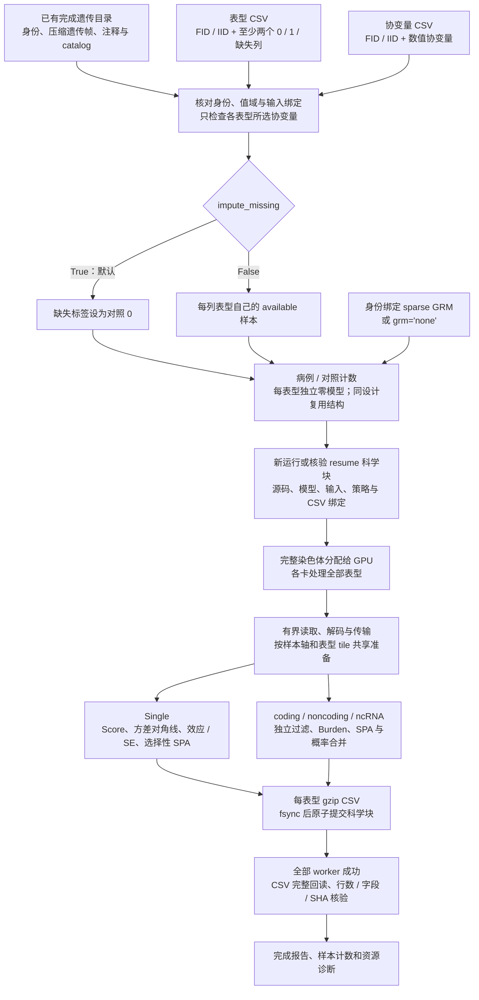

# 多二分类表型 WGS

本页说明 `run_WGS_all_binanry`：从已经完成的遗传目录直接分析多个二分类表型，保存各表型的 Single、coding、noncoding 和 ncRNA CSV。公开函数和命令中的 `binanry` 保留现有拼写。

遗传目录的首次制作见[数据准备](wgs_data_preparation.md)；连续表型使用[连续表型 WGS](wgs_continuous.md)。本入口不执行遗传数据准备，也不接受连续表型。

## 功能与流程

表型 CSV 至少包含两个表型列，每列只允许 `0`（对照）、`1`（病例）和缺失值。默认 `impute_missing=True` 将已有 CSV 行中的缺失标签填为 `0`，原有病例不变；`False` 使用各列自己的 available 样本。默认每列使用协变量文件的全部列，也可逐表型指定协变量。身份匹配、所选协变量有效性和指定母样本范围决定实际分析人数。

每个表型独立拟合二分类零模型，独立计算残差、病例概率、投影、检验统计量和 SPA。共享协变量列或样本轴不表示共享零模型或检验协方差。多 GPU 按完整染色体分工，每个关联 worker 消费所分染色体的全部表型；GPU 多于染色体数时，部分设备可以空闲。



Single 的位置分区用于读取和写出，不是窗口关联检验。二分类 gene-based 采用 Burden 路线，不要求构造完整变异协方差或执行 SKAT 特征分解。合法 mask 不因变异数超过 5,000 而跳过；原有科学过滤仍保留。

## 安装与环境

```bash
git clone https://github.com/weikanggong1/Fudan-WGS-Toolkit.git
cd Fudan-WGS-Toolkit
conda env create -f environment.yml
conda activate fudan-wgs-toolkit
```

关联需要支持 TF32 的 NVIDIA GPU 和兼容 CUDA 驱动。项目环境使用 Python 3.10、PyTorch 2.5.1 / CUDA 11.8、NumPy 1.26、SciPy 1.13、pandas 和 zstandard。运行时采用项目 Python / PyTorch 实现，不调用官方 R 软件。

零模型保留成熟 FP64 拟合；主要关联算子使用原生 TF32 / FP32。Burden 的基因型加权乘法采用 IEEE FP32，选中的精确 Burden 和 SPA 使用稳定 FP64 分支。没有使用多次 TF32 分量乘法重建 FP64，也不采用 float16。

## 输入数据

### 三个科学输入与输出位置

| 参数 | 意义 | 格式与要求 |
| --- | --- | --- |
| `phenotype_csv` | 每列一个独立二分类表型 | UTF-8、逗号分隔、有表头；前两列 `FID,IID`，其后至少两列数值 `0/1/缺失` |
| `covariate_csv` | 零模型的固定效应协变量 | UTF-8 CSV；前两列 `FID,IID`，其后数值协变量；只有身份列时使用截距模型 |
| `prepared_directory` | 已存储的遗传样本轴、基因型、注释与任务目录 | 完成的 `dataset.json` 目录或兼容的 `cache_dataset.json` 目录；其清单与完成凭据必须通过核验 |
| `output_directory` | 本次模型、结果、检查点与报告的位置 | 新运行使用新的目录；恢复使用首次运行目录；不要与遗传输入目录重叠 |

表型格式示例仅表示文件结构：

```csv
FID,IID,trait_a,trait_b
family_a,person_001,1,NaN
family_a,person_002,0,1
family_b,person_003,NaN,0
```

协变量文件可以包含：

```csv
FID,IID,age,sex,PC1,PC2
family_a,person_001,52,0,0.013,-0.021
family_a,person_002,61,1,-0.004,0.009
family_b,person_003,45,0,0.007,0.015
```

`FID/IID` 按完整字符串对匹配，保留前导零；不同 FID 的相同 IID 属于不同身份。CSV 行序可以不同，重复身份会报错。现代遗传目录保存完整双列身份；兼容数字身份目录要求 `FID="0"`、IID 为与缓存一致的规范正整数文本，不接受改变身份的前导零。

空单元格、`NA`、`NaN`、`NULL`、`None` 和 `N/A` 可表示缺失，大小写不敏感。无穷值、文本标签和除 `0/1` 外的有限表型数值均报错，不能用 `2` 或 `-1` 表示未患病。协变量始终不填补。

### 缺失策略与协变量

| 设置 | 纳入样本 | 对计算的影响 |
| --- | --- | --- |
| `impute_missing=True`（默认） | 在身份匹配、所选协变量有效及母样本范围内，将该列表型缺失标签设为 `0` | 同协变量选择通常可共用母样本轴与设计结构，增加矩阵批算机会；病例比例随新增对照改变 |
| `impute_missing=False` | 上述范围中，仅保留该列表型原始有限 `0/1` 标签 | 每列允许不同样本数和顺序；相同有序样本及设计可进一步合批 |

缺失标签填为对照是一项分析定义，应与研究设计一致。不存在于表型 CSV 或协变量 CSV 的遗传样本不会自动补入。每列最终必须有病例和对照，并满足模型拟合的有效样本要求；填补后只有对照的表型会报错。不填补时不会取所有表型共同完整样本交集。

`phenotype_covariates=None` 表示全部表型使用协变量文件的全部列。映射中的每个值是列名列表，例如：

```json
{
  "trait_a": ["age", "sex", "PC1", "PC2"],
  "trait_b": ["sex", "PC1", "PC2"]
}
```

未列出的表型仍用全部协变量，空列表使用截距模型。仅检查该表型所选列的缺失；未选列的缺失不排除其样本。不存在或重复的列名会报错。设计矩阵自动加入截距并进行既有标准化与冗余列处理，记录采用的列和尺度；不同模型的系数、残差与二分类权重保持独立。

本入口不自动选择祖源。分析母样本范围来自已准备输入及清单中绑定的 cohort 选择；应在运行前确认该范围，不能把遗传缓存总人数当作每个表型的实际人数。

### GRM

默认 `grm="sparse"` 使用身份绑定的稀疏亲缘矩阵，显式 `grm_file` 优先，否则读取遗传清单的 `phewas.kinship_npz`。缺少必需 GRM 会报错，遗传准备和关联入口都不会自动估计它。

`grm="none"` 拟合普通 logistic 零模型，不读取已有 GRM；此时不能再传 `grm_file`。

GRM 为不依赖 pickle 的 NPZ：

| 数组 | 格式 | 含义 |
| --- | --- | --- |
| `sample_ids` | 长度 n 的唯一字符串数组 | GRM 样本顺序；覆盖分析样本，可按身份重排 |
| `diagonal` | 长度 n 的有限非负数值数组 | 亲缘矩阵对角线 |
| `edge_rows`, `edge_cols` | 等长的零基整数数组 | 非对角关系的位置，均在 `[0,n)` 内 |
| `edge_values` | 与 edge 索引等长的有限数值数组 | 对应亲缘值；单侧边或一致的对称边均按读取约定核验 |

现代目录的内部样本键为完整 FID/IID 对的无歧义 JSON 字符串，例如 `['family_a','person_001']` 对应字符串 `["family_a","person_001"]`；可用 `fudan_wgs_toolkit.identity.sample_keys` 从双列数组生成。兼容目录使用原有规范数字身份。GRM 的身份键必须匹配所消费的遗传格式。

## Python 调用

下面直接消费完成的遗传目录，默认填补二分类标签，共享全部协变量，在两卡上按染色体并行：

```python
from pathlib import Path
from fudan_wgs_toolkit import run_WGS_all_binanry

if __name__ == "__main__":
    phenotype_csv = Path("/data/binary_phenotypes.csv")
    covariate_csv = Path("/data/covariates.csv")
    prepared_genetic_directory = Path("/data/completed_genetics")
    association_output_directory = Path("/data/binary_imputed_results")
    sparse_grm_file = Path("/data/sample_bound_grm.npz")

    association_report = run_WGS_all_binanry(
        phenotype_csv=phenotype_csv,
        covariate_csv=covariate_csv,
        prepared_directory=prepared_genetic_directory,
        output_directory=association_output_directory,
        chromosomes="all",  # 已完成遗传目录中声明的全部常染色体
        analyses=("individual", "coding", "noncoding", "ncrna"),
        device=2,           # 前两张可见 GPU；也可写 ["cuda:0", "cuda:1"]
        cpu_threads=8,      # 每 worker 上限，仍受节点实际 CPU 配额约束
        memory_limit_gib=None,
        memory_reserve_gib=1.0,
        host_memory_limit_gib=None,
        phenotype_covariates=None,
        impute_missing=True,
        trait_batch_size=32,
        gene_variant_type="SNV",
        grm="sparse",
        grm_file=sparse_grm_file,
        resume=False,
    )
    print(association_report["completed"])
    print(association_report["phenotype_counts"])
```

保留各列表型的 observed 样本、指定协变量、仅分析 chr21/22，使用普通 logistic 模型时：

```python
from pathlib import Path
from fudan_wgs_toolkit import run_WGS_all_binanry

if __name__ == "__main__":
    phenotype_csv = Path("/data/binary_phenotypes.csv")
    covariate_csv = Path("/data/covariates.csv")
    prepared_genetic_directory = Path("/data/completed_genetics")
    association_output_directory = Path("/data/binary_available_results")
    phenotype_covariates = {
        "trait_a": ["age", "sex", "PC1", "PC2"],
        "trait_b": ["sex", "PC1", "PC2"],
    }

    association_report = run_WGS_all_binanry(
        phenotype_csv=phenotype_csv,
        covariate_csv=covariate_csv,
        prepared_directory=prepared_genetic_directory,
        output_directory=association_output_directory,
        chromosomes=[21, 22],
        analyses=("individual", "coding", "noncoding", "ncrna"),
        device=["cuda:0", "cuda:1"],
        cpu_threads=8,
        phenotype_covariates=phenotype_covariates,
        impute_missing=False,
        grm="none",
        resume=False,
    )
    print(association_report["completed"])
```

多进程调用放在 `if __name__ == "__main__":` 内；完整可运行命令行示例还见 [examples/run_binary_wgs.py](../examples/run_binary_wgs.py)。改变缺失策略或科学输入应使用新的输出目录，分别拟合对应零模型。

### 全部参数

| 参数 | 默认值 | 意义 |
| --- | --- | --- |
| `phenotype_csv` | 必填 | 至少两列严格二分类表型的 FID/IID CSV |
| `covariate_csv` | 必填 | FID/IID 与数值协变量 CSV |
| `prepared_directory` | 必填 | 已核验完成的遗传目录 |
| `output_directory` | 必填，仅关键字 | 结果、模型、检查点与报告目录 |
| `chromosomes` | `"all"` | 全部声明的已完成常染色体，或如 `[21,22]` 的指定列表；请求缓存中不存在的染色体会报错 |
| `analyses` | `("individual","coding","noncoding","ncrna")` | 非空分析类别列表；按绑定顺序运行 |
| `device` | `("cuda:0",)` | 单卡或多卡名称列表；正整数 n 使用前 n 张可见 CUDA GPU；不接受 CPU 关联 |
| `cpu_threads` | `8` | 每 worker 的 CPU 线程及亲和性上限；不代表独占 CPU |
| `memory_limit_gib` | `None` | 每 GPU 整体预算；自动检测物理显存，显式正值必须遵守 |
| `memory_reserve_gib` | `1.0` | 各 GPU 工作区的实时安全预留；不小于 0，低于显式上限 |
| `host_memory_limit_gib` | `None` | 整个节点任务的共享主存预算；自动取物理与全部有限 cgroup 祖先约束并结合实时余量 |
| `phenotype_covariates` | `None` | 表型名到协变量名列表的可选映射；未列出的表型使用全部协变量 |
| `impute_missing` | `True` | `True` 仅将标签缺失填为 0；`False` 使用各列 available 样本 |
| `gene_variant_type` | `"SNV"` | gene-based 使用 `SNV`、`Indel` 或 `variant`；Single 保留自身 QC、MAC 与变异资格 |
| `covariance_block_size` | `4096` | 计算引擎的有界矩阵 panel 配置；不是 mask 变异数上限 |
| `seed` | `1729` | 绑定随机计算状态的种子 |
| `single_mac_cutoff` | `20` | Single 每表型的 MAC 资格阈值 |
| `single_group_variants` | `5000` | Single 的提取 / 分组大小；不限制全部可分析变异数 |
| `single_region_size` | `10_000_000` | Single 位置读取分区宽度，单位 bp |
| `individual_effective_block_size` | `1024` | Single 有效变异的计算块大小 |
| `device_cache_bytes` | `536870912`（512 MiB） | 设备 reader 缓存预算，单位 bytes |
| `compact_cache_bytes` | `67108864`（64 MiB） | compact reader 缓存预算，单位 bytes |
| `metadata_cache_bytes` | `268435456`（256 MiB） | metadata 缓存预算，单位 bytes |
| `resume` | `False` | 默认新目录全量运行选定范围；`True` 核验同一运行后只补未提交块 |
| `trait_batch_size` | `32` | 每次关联表型 tile 的最大列数；资源不足时缩小，不是表型总数限制 |
| `grm` | `"sparse"` | `sparse` 为稀疏亲缘 logistic 混合模型；`none` 为普通 logistic |
| `grm_file` | `None` | 显式身份绑定 GRM NPZ；默认使用遗传清单声明的路径 |

本入口固定为二分类，不接受表型家族映射、连续转换或谱近似方法参数。`impute_missing` 是该入口的缺失策略参数。

## 命令行调用

```bash
run-WGS-all-binanry /data/binary_phenotypes.csv /data/covariates.csv /data/completed_genetics \
  --output-directory /data/binary_imputed_results \
  --chromosomes all --analyses individual coding noncoding ncrna \
  --device cuda:0 cuda:1 --cpu-threads 8 --trait-batch-size 32 \
  --impute-missing --grm sparse --grm-file /data/sample_bound_grm.npz
```

`python -m fudan_wgs_toolkit` 和 `fudan-wgs` 使用同一二分类解析器。`--device 2` 选择前两张可见卡；`--chromosomes 21 22` 指定染色体；`--no-impute-missing` 保留各列 available 样本。`--phenotype-covariates /data/phenotype_covariates.json` 读取上述 JSON 映射文件，不能把 JSON 字符串直接当作文件名。

其余 Python 参数对应同名短横线选项，例如 `--single-mac-cutoff`、`--covariance-block-size`、`--device-cache-bytes`。设置 `--memory-limit-gib 20 --memory-reserve-gib 1` 约束每卡预算；`--host-memory-limit-gib 64` 设置整个任务的共享主存预算。恢复使用 `--resume`，保留首次科学输入、选列及缺失策略。CLI 最终打印完成状态、关联行数、端到端时间和输出目录。

## 输出、计算与恢复

### 文件与字段

```text
binary_results/
  csv/
    chromosomes/chr21/traits/trait_0000/<分析>/chr21/<字段签名>/results.csv.gz
    chromosomes/chr21/.trait_checkpoints/
    worker_<编号>.complete.private.json
  models/                       # 各表型普通关联及 SPA 状态
  trait_index.private.csv       # 表型索引、原列名与 family
  phenotype_sample_counts.csv
  inputs/                       # 匹配轴与绑定，视遗传清单路线
  plan.private.json
  status.private.json
  report.private.json
```

每个表型独立输出 gzip 文本 CSV。`trait_index` 是表型 CSV 列序中的零基索引；原名仅保存在私有索引中。不同分析与字段结构分别写出，真实路径以返回报告各 worker 的 `output["receipts"]` 中 `csv_file` 为准，路径相对于 `output_directory/csv`。

| 结果字段 | 含义 |
| --- | --- |
| `trait_index` | 原输入表型列的零基索引 |
| Single：`CHR,POS,REF,ALT` | 染色体、1-based 位置和遗传目录绑定的 REF/ALT |
| Single：`ALT_AF,MAF,N` | 原 ALT 频率、该表型样本中的次要等位基因频率、实际分析人数 |
| Single：`pvalue,pvalue_log10` | 最终 P 与正值 `−log10(P)`；稳定分支优先保留对数概率 |
| Single：`Score,Score_se,Est,Est_se` | 既有 score、score 标准误、基于 score 的效应与效应标准误；沿用次要等位基因方向与原导出约定 |
| Single：`normal_pvalue,normal_pvalue_log10` | SPA 校正前的普通尾概率与 `−log10(P)` |
| Single：`pvalue_log` | 启用二分类校正时保存的正值 `−ln(P)` |
| Single：`spa_selected,spa_failed,spa_used_bisection,spa_iterations,spa_iteration_limit` | 是否选择 SPA、失败、是否使用二分、迭代次数及是否达到迭代上限 |
| Single：`spa_zero_log_unverified` | SPA 的 P 下溢为 0 且没有可验证有限对数概率；单独标记，不添加人为 floor |
| gene-based：`Gene name,Chr,Category,#SNV,cMAC` | gene / mask 身份、类别、实际选入变异数、累计 MAC；`#SNV` 保留原字段名，选择 Indel / variant 时仍表示对应选入变异数 |
| gene-based：`Burden(1,25),Burden(1,1)` 及注释后缀列 | 两套 Beta 权重及功能注释权重的独立 Burden P |
| gene-based：`STAAR-B(1,25),STAAR-B(1,1),STAAR-B` | 注释与两套 Beta 概率的既有合并结果 |
| coding 的其他合并列 | 按实际类别可含 Disruptive 与 `WGS-B` 合并；以 CSV 表头为准 |

SPA 校正替换 Single 的最终 P，不重新定义 normal-model score、效应或 SE。每表型独立执行基因型缺失填补、AF/MAF/MAC、方向和变异过滤。gene-based 原有 rare-variant 等科学筛选与空 mask 行为保留；没有满足科学条件的 mask 可提交零行块。不能用 gene 的 rare-variant 筛选代替 Single 的 QC。

结果顺序由绑定计划、表型列序、原始任务 / mask 序和 Single 提取序确定，改变完成先后不改变科学块顺序。每条染色体有独立输出命名空间；不要把多文件的物理完成次序当作全基因组排序。

`phenotype_sample_counts.csv` 与返回字典的 `phenotype_counts` 包含 `trait_index,phenotype,samples,cases,controls,available_cases,available_controls,imputed_controls`。available 计数指身份匹配、所选协变量有效且在指定母样本范围内的原始有限标签；其他计数指本次最终样本。默认模式中 `controls=available_controls+imputed_controls`；不填补时 `imputed_controls=0`。

`association_report["completed"]` 只有在本次全部 worker 成功、范围覆盖及 CSV 完整性通过后才为真。`association_rows` 按分析类别记录结果行数，`eligible_association_tests` 为这些行数之和，不是所有概率字段数。`workers` 保存输出收据与诊断，`end_to_end_seconds` 记录本次整体墙时。历史完成报告、模型存在或 PID 存活均不是本次完成证据。

Single 结果可能很大，可按收据定位并分块读取：

```python
from pathlib import Path
import pandas as pd

association_output_directory = Path(association_report["output_directory"])
for worker_report in association_report["workers"]:
    for output_receipt in worker_report["output"]["receipts"]:
        if output_receipt["kind"] != "individual":
            continue
        single_result_file = (
            association_output_directory / "csv" / output_receipt["csv_file"]
        )
        for single_result_batch in pd.read_csv(single_result_file, chunksize=100_000):
            print(len(single_result_batch))
```

### 有界计算与资源

同一样本轴的遗传读取、索引、注释和设计结构在预算内复用，表型 tile 合并 Score；每个表型的模型权重与检验投影独立。Single 只计算方差对角线，不构造完整 M×M 矩阵。二分类 gene-based 将权重组成 `W`，计算 `Z=GW` 后求 score 和小型 Burden 协方差；名义 `P<0.05` 的选择性精确 Burden / SPA 分支保留，最终使用成熟概率合并。

填补模式中，同协变量选择更容易共享母样本轴与整理；available 模式仍可共用原始遗传帧，同样本顺序和设计进一步合批。不同 NaN 模式不会被强制改成共同样本，也不共用不同模型的检验协方差。

GPU 预算覆盖模型、SPA、缓存及尚未分配的工作区，分配前检查实时空闲量和预留。节点主存预算由全部 worker 共用，结合物理 / cgroup 用量与未来新增峰值，避免把已物化缓冲重复计入。CPU 参数受实际节点共享配额限制，不能把每卡上限相加当作独占核心。

CSV 两遍解析先确定形状再预分配，不保存整张表的 Python 行对象。模型、样本轴、reader 与 metadata 使用有界共享和冷热管理；压力时释放冷缓存、缩小 tile 或工作块。常驻缓存、阶段临时量、allocated、reserved 与峰值分开记录。该准入不是操作系统 RSS 硬限制，也不能仅凭整卡显存或多个 worker 的 RSS 和判定泄漏。

### 恢复

`resume=True` 使用首次输出目录，核验输入 CSV、遗传清单、身份、协变量、缺失策略、GRM、模型、科学参数与源码。提交块核验压缩范围 SHA、gzip CRC、表头及行数，只补未完成块。范围写入并 fsync 后才提交 SQLite 事务；未提交尾部保留证据后恢复，已提交结果损坏会报错。同一输出目录有运行锁，避免并发写入。

恢复时复用首次调用的完整参数，仅改变 `resume`：

```python
from fudan_wgs_toolkit import run_WGS_all_binanry

if __name__ == "__main__":
    phenotype_csv = "/data/binary_phenotypes.csv"
    covariate_csv = "/data/covariates.csv"
    prepared_genetic_directory = "/data/completed_genetics"
    association_output_directory = "/data/binary_available_results"
    phenotype_covariates = {
        "trait_a": ["age", "sex", "PC1", "PC2"],
        "trait_b": ["sex", "PC1", "PC2"],
    }
    association_report = run_WGS_all_binanry(
        phenotype_csv=phenotype_csv,
        covariate_csv=covariate_csv,
        prepared_directory=prepared_genetic_directory,
        output_directory=association_output_directory,
        chromosomes=[21, 22],
        analyses=("individual", "coding", "noncoding", "ncrna"),
        device=["cuda:0", "cuda:1"],
        cpu_threads=8,
        phenotype_covariates=phenotype_covariates,
        impute_missing=False,
        grm="none",
        resume=True,
    )
    print(association_report["completed"])
```

每次调用有新的 attempt 状态，旧报告保留为历史。跨源码或缺失策略的模型导入需要独立兼容证明，`resume` 不自动把不同版本的模型或输出混合。

## 原 STAAR 软件调用

官方软件仅用于外部对照。先以同一标签策略、身份顺序、协变量、遗传方向、GRM、注释和 mask 准备参考输入，再调用官方零模型与对应分析；不能把不同样本的旧结果当作同输入精度验收。

| 本入口 analyses | 原软件入口与源码 |
| --- | --- |
| `individual` | [Individual_Analysis_PheWAS](https://github.com/li-lab-genetics/STAARpipelinePheWAS/blob/main/R/Individual_Analysis_PheWAS.R) |
| `coding` | [Gene_Centric_Coding_PheWAS](https://github.com/li-lab-genetics/STAARpipelinePheWAS/blob/main/R/Gene_Centric_Coding_PheWAS.R) |
| `noncoding` | [Gene_Centric_Noncoding_PheWAS](https://github.com/li-lab-genetics/STAARpipelinePheWAS/blob/main/R/Gene_Centric_Noncoding_PheWAS.R) |
| `ncrna` | [ncRNA_PheWAS](https://github.com/li-lab-genetics/STAARpipelinePheWAS/blob/main/R/ncRNA_PheWAS.R) |

以下为独立 R 对照脚本的调用形式。`reference_samples_by_trait` 已分别匹配并应用本次标签 / 协变量策略，包含 `sample_id` 与相应表型；`reference_covariates_by_trait` 和 `reference_kinships_by_trait` 分别保存每列采用的协变量和对应亲缘矩阵，无 GRM 时后者各元素为 `NULL`。`reference_genetic_object` 是官方接口打开的遗传对象，注释目录和任务来自相同独立资源。二分类参考零模型显式启用 `use_SPA=TRUE`。[fit_nullmodel 源码](https://github.com/li-lab-genetics/STAARpipeline/blob/main/R/fit_nullmodel.R)

```r
reference_trait_names <- names(reference_samples_by_trait)
reference_null_models <- setNames(lapply(reference_trait_names, function(trait_name) {
    reference_formula <- reformulate(
        reference_covariates_by_trait[[trait_name]], response = trait_name
    )
    STAARpipeline::fit_nullmodel(
        fixed = reference_formula,
        data = reference_samples_by_trait[[trait_name]],
        kins = reference_kinships_by_trait[[trait_name]], id = "sample_id",
        family = "binomial", use_SPA = TRUE
    )
}), reference_trait_names)

single_reference <- STAARpipelinePheWAS::Individual_Analysis_PheWAS(
    chr = chromosome, start_loc = region_start, end_loc = region_end,
    genofile = reference_genetic_object, obj_nullmodel_list = reference_null_models,
    mac_cutoff = 20, variant_type = "variant", geno_missing_imputation = "mean",
    SPA_p_filter = TRUE, p_filter_cutoff = 0.05
)
coding_reference <- STAARpipelinePheWAS::Gene_Centric_Coding_PheWAS(
    chr = chromosome, gene_name = coding_gene_name, category = "all_categories",
    genofile = reference_genetic_object, obj_nullmodel_list = reference_null_models,
    Annotation_name_catalog = annotation_name_catalog,
    Annotation_name = annotation_names, Use_annotation_weights = TRUE,
    rare_maf_cutoff = 0.01, rv_num_cutoff = 2,
    variant_type = "SNV", geno_missing_imputation = "mean"
)
noncoding_reference <- STAARpipelinePheWAS::Gene_Centric_Noncoding_PheWAS(
    chr = chromosome, gene_name = noncoding_gene_name, category = "all_categories",
    genofile = reference_genetic_object, obj_nullmodel_list = reference_null_models,
    Annotation_name_catalog = annotation_name_catalog,
    Annotation_name = annotation_names, Use_annotation_weights = TRUE,
    rare_maf_cutoff = 0.01, rv_num_cutoff = 2,
    variant_type = "SNV", geno_missing_imputation = "mean"
)
ncrna_reference <- STAARpipelinePheWAS::ncRNA_PheWAS(
    chr = chromosome, gene_name = ncrna_gene_name,
    genofile = reference_genetic_object, obj_nullmodel_list = reference_null_models,
    Annotation_name_catalog = annotation_name_catalog,
    Annotation_name = annotation_names, Use_annotation_weights = TRUE,
    rare_maf_cutoff = 0.01, rv_num_cutoff = 2,
    variant_type = "SNV", geno_missing_imputation = "mean"
)
```

保存参考脚本后使用 `Rscript official_binary_reference.R` 独立执行。例中 gene-based 的 `variant_type="SNV"` 对应本包默认 `gene_variant_type`；采用 Indel / variant 时应同步调整。正式对照应固定官方代码版本，记录实际函数参数、输入 / 模型摘要及各阶段时间；上述接口链接用于查阅，不替代固定版本凭据。

## 验证与 benchmark

### 当前二分类入口的真实有限任务

现有验收覆盖 4 个真实二分类表型、两个 A100 GPU、chr21/22 的有限遗传任务；每条染色体各一个 coding、noncoding、ncRNA 作业和一个 1 kb Single 区间。每 worker 使用 4 CPU 线程、12 GiB GPU 上限，`grm="none"`，消费已有遗传缓存。任务范围通过原 metadata / mask 规则选定，四类分析均产生真实结果；这不是完整染色体或千表型全量运行。

最终发布计算源码指纹为 `f738315e2d880fb822d7911c569eeb566bccbdb82d23547a806ff9f8f78f9fe2`。两种缺失策略分别新拟合四个零模型、生成结果，再与同一拟合模型的独立逐表型成熟 Python 计算路线比较。

| 缺失策略 | 每列表型实际样本数 | 公开入口端到端墙时 | 有限概率比较数 | 最大 `\|Δ−log10(P)\|` | 任一路径 `P<0.05` 的显著并集最大误差 |
| --- | --- | --- | --- | --- | --- |
| 默认缺失标签→0 | 均为 343,034 | 178.773 s | 2,092 | 7.374×10⁻⁷ | 0 |
| 各列 available | 280,534–284,138 | 154.734 s | 2,006 | 0 | 0 |

墙时包含 CSV 读取、输入整理、四个零模型拟合、worker 启动、实际关联和最终 CSV 校验。首次任务筛选另耗时 209.002 s，最终调用复用已认证的有限任务配置，该筛选时间不计入上表墙时。

验收目标为同输入 / 模型 / mask 下有限 `−log10(P)` 的绝对差小于 0.001；另核对样本、资格过滤、行数、字段、行序、概率 NaN / 下溢模式与 SPA 状态。部分 SPA 按原分支报告 Newton 迭代上限，两路状态一致，不能因此宣称所有根均收敛。极小 P 优先比较保存的有限对数概率，缺少该值的零 P 单独标记未验证。两种缺失策略改变样本与病例比例，不能把其结果差异解释为浮点误差。

### CSV 读取组件

两个真实 CSV 各 343,034 行，包含 4 个二分类表型和 15 个协变量。原读取与两遍预分配读取在独立单线程 CPU 进程中执行，新旧数值数组、NaN 位置、FID/IID、列名及 SHA 完全一致。

| 指标 | 原读取 | 两遍预分配读取 |
| --- | --- | --- |
| 两个文件读取时间 | 10.708 s | 6.688 s |
| 独立进程峰值 RSS | 435.07 MiB | 145.17 MiB |

组件提速 1.60 倍，峰值 RSS 降低 66.63%。测量没有初始化 GPU、拟合模型或执行关联，不能外推为全量端到端加速或千表型主存降幅。

### 覆盖与缺口

| 验证层次 | 现有证据 |
| --- | --- |
| 当前公开入口的回归 | Python 3.10 合并回归 2,438 passed、204 subtests；160 项 CUDA 或可选后端检查跳过；主存预算补修另有 79 项针对性检查通过 |
| 当前入口与独立单表型核心 | 上述双 GPU、两种缺失策略、四类有限真实任务；同样本 / 模型与输出语义检查通过 |
| 既有计算核心的历史参考 | 验证口径见[验证说明](../validation/README.md)；已有核心证据不替代新入口 / 新标签定义的完整验收 |
| 当前入口与官方同配置二分类流程 | 未重新执行，未测 |
| 当前入口读取、解码、H2D/D2H、Score、Burden、SPA、写出与回读的独立阶段耗时 | 未分别测量；不使用旧连续或混合表型阶段数值填补 |
| 全染色体、上千二分类表型端到端时间 | 未测 |
| 预热后长期主存 / 显存平台、全量峰值 | 未测 |
| 与已下载官方 gene-based 结果的描述性相关性 | 不包含在本次接口验收；不同样本、标签处理或模型的对比不能声明同输入精度等价 |

这里分别记录组件、有限真实运行和全量验收。推送成功、通过短测试或后台进程存在，都不代表完整全量计算与输出验收完成。

## 参考文献与原实现

- [STAARpipelinePheWAS 官方代码库](https://github.com/li-lab-genetics/STAARpipelinePheWAS)：多表型 Single、coding、noncoding 和 ncRNA 接口。
- [STAARpipeline 官方代码库](https://github.com/li-lab-genetics/STAARpipeline)：零模型及遗传关联流程。
- Li et al. **Dynamic incorporation of multiple in silico functional annotations empowers rare variant association analysis of large whole-genome sequencing studies at scale.** Nature Genetics (2020). [DOI: 10.1038/s41588-020-0676-4](https://doi.org/10.1038/s41588-020-0676-4).
- Li et al. **A framework for detecting noncoding rare-variant associations of large-scale whole-genome sequencing studies.** Nature Methods (2022). [DOI: 10.1038/s41592-022-01640-x](https://doi.org/10.1038/s41592-022-01640-x).
- Chen et al. **Control for population structure and relatedness for binary traits in genetic association studies via logistic mixed models.** American Journal of Human Genetics (2016). [DOI: 10.1016/j.ajhg.2016.02.012](https://doi.org/10.1016/j.ajhg.2016.02.012).
- **Rare coding and noncoding variants map 1,342 diseases and biomarkers in 490,549 whole genomes.** medRxiv (2026), preprint. [DOI: 10.64898/2026.03.24.26349148](https://doi.org/10.64898/2026.03.24.26349148).
