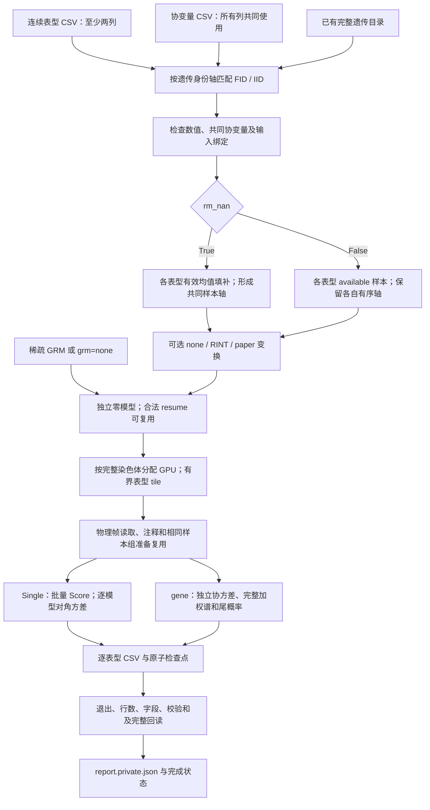

# 连续多表型 WGS

`run_WGS_continuous` 在已有遗传缓存上独立分析多个连续表型，完成 Single、coding、noncoding 和 ncRNA，并为每个表型保存 CSV。它只接受至少两个连续数值列，所有表型使用协变量文件中的全部协变量。默认以各表型的有效均值填补表型缺失；`rm_nan=False` 保留每个表型自己的 available 样本。协变量缺失始终剔除。

遗传数据只需准备一次，格式和准备方法见 [遗传数据准备](wgs_data_preparation.md)。严格二分类输入使用 [二分类 WGS](wgs_binary.md)。本入口不调用 R、不重新转换遗传数据，也不生成样本子集遗传缓存。

多 GPU 按完整染色体分工，每个 worker 分块处理其染色体的全部表型。相同有序样本轴可共享遗传读取、基因型整理、Score 矩阵计算和协变量设计；每个表型的残差、模型参数、投影矩阵 P、协方差和加权谱仍独立。这里是多个单表型检验，不是 MultiSTAAR 联合检验。



## 输入与样本处理

| 输入 | 格式 | 意义与要求 |
| --- | --- | --- |
| `phenotype_csv` | UTF-8 CSV，含 `FID`、`IID` 和至少两个连续数值列 | 每个数值列是一次独立分析。列名唯一；身份按字符串保留前导零；完整 FID/IID 对不能重复。不能包含二分类列、文本列、Inf、全缺失列或有效样本内常量列。 |
| `covariate_csv` | UTF-8 CSV，含 `FID`、`IID`，其余列均为数值协变量 | 所有表型共同使用全部列，模型自动加入截距。类别协变量须先编码成数值或哑变量。任何共同协变量缺失的样本均剔除，不填补协变量。 |
| `prepared_directory` | 已完成的遗传目录，根目录含 `dataset.json` 或 `cache_dataset.json` | 包含样本轴、完整基因型缓存、功能注释、基因目录和完成证明。两种目录不能同时放在一个根目录。只消费已认证缓存，不重新 prepare。 |
| `output_directory` | 本次结果目录 | 默认新目录；恢复时必须是同一已绑定运行的目录。结果、模型、计划、私有表型字典和检查点写入这里。 |
| `grm_file` | 可选、身份绑定的稀疏 GRM NPZ | `grm="sparse"` 时读取显式文件，或遗传清单的 `phewas.kinship_npz`。不能仅提供无身份的矩阵。`grm="none"` 时不提供此文件。 |

以下仅为格式示例。空单元格、`NA`、`NaN`、`null`、`none` 和 `n/a` 可表示缺失；大小写不敏感。不要用缺失编码数字代替空值。

表型 CSV：

```csv
FID,IID,trait_a,trait_b
family_a,sample_a,1.7,3.2
family_a,sample_b,,2.8
family_b,sample_c,2.1,
```

协变量 CSV：

```csv
FID,IID,age,sex,PC1,PC2
family_a,sample_a,50,0,0.02,-0.01
family_a,sample_b,54,1,0.01,0.03
family_b,sample_c,49,0,-0.02,0.01
```

`dataset.json` 目录使用完整 FID/IID 双列身份，两个家庭中相同 IID 不合并。数字身份轴的 `cache_dataset.json` 保留原轴：新 CSV 使用 `FID="0"` 和原数字 IID，不丢弃家庭身份去匹配；既有单 ID CSV 的兼容读取只适用于这种数字缓存。不能将身份转成浮点数再匹配。两份 CSV 可以采用不同原始行序，实际分析按遗传缓存和模型绑定的有序样本轴进行。

GRM NPZ 的标准字段如下；读取时禁用 pickle。对于双列身份目录，`sample_ids` 使用缓存生成的完整 FID/IID 规范身份键；数字身份缓存使用其原始身份轴。应从遗传清单读取该轴，不自行拼接或重新编号。

| NPZ 字段 | 形状与类型 | 意义 |
| --- | --- | --- |
| `sample_ids` | `[n]`，唯一字符串 | GRM 的完整样本身份，必须覆盖实际分析样本。 |
| `diagonal` | `[n]`，有限非负数 | GRM 对角线。 |
| `edge_rows`、`edge_cols` | `[e]`，从 0 开始的整数 | 非对角项坐标，不能有对角项或越界。 |
| `edge_values` | `[e]`，有限数 | 对应亲缘系数，可保存一个三角或一致的对称对。 |

完整替代字段组 `ids/grm_diagonal/grm_edge_row/grm_edge_col/grm_edge_value` 也可读取。加载过程不重新阈值化 GRM；逐表型精确提取其样本顺序下的子矩阵。

### 填补、变换与共同协变量

- `rm_nan=True`：先匹配已有表型行、协变量行与遗传身份，再剔除共同协变量缺失。每个表型只用这个合格母样本集合内的有限值计算均值，填补该表型的 NaN；不会为 CSV 中不存在的样本行生成表型。各列至少需要两个有效有限值且有变异。
- `rm_nan=False`：每个表型进一步剔除自己的 NaN，保留自身样本顺序、AF/MAF/MAC、等位基因方向、基因型缺失处理及资格筛选。不会把所有表型取一个共同 complete-case 交集。只有完全相同的有序样本轴才共享样本组准备。
- `continuous_transform="none"`：默认直接分析处理缺失后的原数值，在两种缓存格式中含义相同。`"rint"` 对这些数值进行秩逆正态变换；`"paper"` 先用共同协变量做 OLS，残差按平均秩和 Blom 偏移 0.375 做 RINT，再乘原表型的样本标准差。变换后零模型仍包含相同协变量和所选 GRM。

有限值只为 0/1 的列按二分类拒绝，不能通过指定 Gaussian 强行加入。若表型与协变量完全重合，或回归后残差方差退化，也会明确报错；应在运行前排除该表型。共同协变量只共享 X 和可复用的结构，不强制共用模型系数、逆方差权重、P 或谱。

## Python 调用

从项目主页的环境安装后使用以下公开函数。多进程调用放在 `if __name__ == "__main__"` 中。

```python
from pathlib import Path
from fudan_wgs_toolkit import run_WGS_continuous


def main():
    # 表型文件至少包含两个连续数值列，身份采用 FID / IID。
    phenotype_csv = Path("inputs/continuous_phenotypes.csv")
    covariate_csv = Path("inputs/covariates.csv")
    prepared_genetic_directory = Path("prepared_genetic_data")
    association_output_directory = Path("continuous_results")
    sparse_grm_file = Path("inputs/sparse_grm.npz")

    association_report = run_WGS_continuous(
        phenotype_csv=phenotype_csv,
        covariate_csv=covariate_csv,
        prepared_directory=prepared_genetic_directory,
        output_directory=association_output_directory,
        chromosomes="all",  # 1–22；也可写 [1, 2] 选择指定染色体。
        analyses=("individual", "coding", "noncoding", "ncrna"),
        device=["cuda:0", "cuda:1"],  # 两卡按完整染色体分工。
        cpu_threads=8,  # 每 worker 上限，仍共享节点实际 CPU 配额。
        memory_limit_gib=None,  # 自动检测；显式数值限制每张卡整体用量。
        host_memory_limit_gib=None,  # 自动检测整个节点任务的共享主存预算。
        rm_nan=True,  # 默认各列均值填补，协变量不填补。
        continuous_transform="none",
        grm="sparse",
        grm_file=sparse_grm_file,
        long_mask_method="full",  # 完整谱；同一协方差中完全相同的权重可精确复用。
        resume=False,
    )
    print(association_report["completed"])
    print(association_report["association_rows"])
    print(association_report["end_to_end_seconds"])


if __name__ == "__main__":
    main()
```

使用 available 样本时，改为 `rm_nan=False` 并为这个样本策略使用新的输出目录。无 GRM 时设 `grm="none"`、`grm_file=None`，得到普通连续零模型；这与稀疏 GRM 的混合模型是不同的分析配置。

### 全部参数

GiB 为 `2**30` 字节；缓存参数以字节计。以下默认值对应当前公开入口。

| 参数 | 默认值 | 含义 |
| --- | --- | --- |
| `phenotype_csv` | 必填 | 连续表型 CSV，至少两个数值列，格式见上。 |
| `covariate_csv` | 必填 | 所有表型共同使用的数值协变量 CSV。 |
| `prepared_directory` | 必填 | 已完成遗传缓存根目录。 |
| `output_directory` | 必填，关键字参数 | 新运行或同绑定恢复的结果目录。 |
| `chromosomes` | `"all"` | 1–22 全部常染色体，或数字/数字字符串列表，如 `[1, 2]`；所选染色体必须在缓存中。 |
| `analyses` | `("individual", "coding", "noncoding", "ncrna")` | 所选分析类型；保留顺序并去重。 |
| `device` | `("cuda:0",)` | CUDA 名称列表，或正整数 n 选择前 n 张可见 GPU；也接受单个 CUDA 名称。公开入口要求可用 CUDA。 |
| `cpu_threads` | `8` | 每 worker CPU 线程/亲和性上限；不代表独占 CPU。实际节点额度约束所有 worker。 |
| `memory_limit_gib` | `None` | 每 GPU 整体预算，覆盖驻留模型、缓存、传输及临时峰值；自动检测容量和实时余量，显式正数上限必须遵守。 |
| `memory_reserve_gib` | `1.0` | GPU 安全预留，可设非负值；须小于显式 GPU 上限。 |
| `host_memory_limit_gib` | `None` | 整个节点任务、所有 worker 共享的主存上限；自动考虑物理容量、全部可见有限 cgroup 祖先限制和实时余量。 |
| `rm_nan` | `True` | True 均值填补表型 NaN；False 逐表型 available 样本。两者都剔除共同协变量缺失。 |
| `continuous_transform` | `"none"` | `none`、`rint` 或 `paper`，在缺失处理后执行。 |
| `null_fit_mode` | `"fp64"` | 成熟 FP64 零模型拟合。CLI 保留 `tf32` 取值检查，但当前拟合器拒绝 TF32；关联仍用原生 TF32/FP32。 |
| `gene_variant_type` | `"SNV"` | gene 分析可选 `SNV`、`Indel`、`variant`；Single 保留独立的 variant QC/MAC，不套用 gene 的稀有变异过滤。 |
| `covariance_block_size` | `4096` | gene 协方差 panel 的变异块大小；不是样本量或全部显存上限。 |
| `long_mask_threshold` | `5000` | 分块和显式近似分支的阈值；默认 full 不因跨过此值改成近似或跳过 mask。 |
| `long_mask_method` | `"full"` | `full` 保留全部特征值，正常使用 FP32；同一调用中位模式完全相同的权重复用完整谱。仅收敛失败时，对原 FP32 加权矩阵进行有预算检查的 FP64 谱重试。`fastskat`、`liu` 是显式近似选择，须单独评估。 |
| `long_mask_rank` | `512` | 显式 FastSKAT 的目标低秩；默认 full 不使用此近似。 |
| `seed` | `1729` | 随机分支种子，参与配置绑定。 |
| `single_mac_cutoff` | `20` | Single 的最小 MAC 资格条件，每个表型独立计算。 |
| `single_group_variants` | `5000` | Single 的逻辑有效变异分组大小，保留原分组和输出语义。 |
| `single_region_size` | `10000000` | Single 逻辑区域长度，单位 bp。 |
| `individual_effective_block_size` | `1024` | Single 每个物理请求内的有效变异缓冲上限；改变此值仍须保持逻辑序号和顺序。 |
| `device_cache_bytes` | `536870912`，512 MiB | 每 worker 有界设备数据缓存容量；不是全部模型与计算工作区预算。 |
| `compact_cache_bytes` | `67108864`，64 MiB | 每 worker 有界 compact 数据缓存容量，计入整体资源准入。 |
| `metadata_cache_bytes` | `268435456`，256 MiB | 每 worker 可选 metadata LRU 容量；不能当作进程总 RSS。 |
| `resume` | `False` | True 验证同运行已提交块后仅补未完成部分；False 要求新的输出目录。 |
| `gpu_ids` | `None` | 兼容的 GPU 编号列表；使用时保持 device 默认，不能与另一个设备选择同时指定。 |
| `trait_batch_size` | `32` | 染色体 worker 内的全局固定表型 tile 上限，支持有界工作区和确定性恢复，不等于同时驻留全部模型。 |
| `grm` | `"sparse"` | `sparse` 使用身份绑定的稀疏 GRM；`none` 为普通零模型。 |
| `grm_file` | `None` | 显式稀疏 GRM NPZ；None 使用清单 sidecar，sparse 模式缺少二者时报错。 |

本入口不接受模型族覆盖、逐表型协变量选择或额外表型来源。当前公开关联入口分别为 `run_WGS_continuous` 和 `run_WGS_all_binanry`；连续调用使用本函数，二分类接口详见 [二分类 WGS](wgs_binary.md)。

## 命令行调用

以下是与 Python 示例相同的均值填补、全部染色体、两卡配置：

```bash
run-WGS-continuous \
  inputs/continuous_phenotypes.csv inputs/covariates.csv prepared_genetic_data \
  --output-directory continuous_results \
  --chromosomes all \
  --analyses individual coding noncoding ncrna \
  --device cuda:0 cuda:1 \
  --cpu-threads 8 --trait-batch-size 32 \
  --rm-nan --continuous-transform none \
  --grm sparse --grm-file inputs/sparse_grm.npz \
  --long-mask-method full
```

available 样本与无 GRM 的示例：

```bash
run-WGS-continuous \
  inputs/continuous_phenotypes.csv inputs/covariates.csv prepared_genetic_data \
  --output-directory continuous_available_results \
  --chromosomes 1 2 --device 2 \
  --no-rm-nan --grm none --continuous-transform none
```

已中断运行使用完全相同的输入、样本策略和科学参数，添加 `--resume`。同一入口也可通过 `python -m fudan_wgs_toolkit.continuous_run` 调用。

参数表中的关键字均有对应长选项，以连字符替换下划线，如 `--host-memory-limit-gib`、`--individual-effective-block-size`、`--metadata-cache-bytes`。三个科学输入是位置参数；`--output-directory` 必填；`--device 2` 表示卡数，`--gpu-ids 0 1` 表示指定编号。`--rm-nan/--no-rm-nan` 是成对开关；`--resume` 默认为关闭，不接受 `--resume False`。

## 计算、资源与恢复

Single 以物理遗传块共享读取和解码，同有序样本组批量计算 Score；方差保留各模型的中心化及投影修正，仅计算对角，不构造 Single 的完整 M×M 协方差。最终统计与稳定 log P 批量回传。gene 在相同样本组中复用准备、注释和可复用的 panel，但各模型的 P 与协方差独立；每个不同的实际注释权重求完整谱。同一次协方差计算中，FP32 位模式完全相同的权重列直接复制已经求出的完整谱；成比例或仅数值接近的权重仍各自求解，不跨 mask 保存谱缓存。保留成熟 Saddle、矩匹配和 ACAT 分支。

默认 coding 包含 `plof`、`plof_ds`、`missense`、`disruptive_missense`、`synonymous`；noncoding 包含 `upstream`、`downstream`、`UTR`、四种 CAGE/DHS promoter/enhancer；ncRNA 保留原 ncRNA exonic/splicing 规则。保留科学 QC、MAF 和最小变异数筛选，不增加长 mask 的性能型跳过规则。

所有 GPU worker 共用任务主存预算。通过绑定进程身份汇总 PSS，计入全部 worker、缓存和子进程的比例常驻量；账本另外预留未来新增峰值，不能重复计入已物化缓冲。任务占用与其主存上限比较，节点及全部有限 cgroup 祖先的实际用量与各自限制分别比较；共享节点中其他任务的占用不会直接套用本任务较小的上限。没有 `smaps_rollup` 的内核使用完整 `smaps` 汇总；无法核验时明确推迟分配，RSS 保留作诊断。PSS 是动态端点，记录采样次数、耗时和来源，不能把它称为原子快照。这是共享任务的准入控制，不创建独立 cgroup 硬配额。设备模型、设计、样本轴、reader、metadata 和输出缓存按字节有界；活动对象受保护，阶段结束释放临时基因型、矩阵和租约。allocated 表示当前实际 CUDA 张量持有量，reserved 包含分配器保留，两者分开报告。资源不足先使用受限块和工作区；最小合法工作集仍不足时明确记录未完成原因，不提高上限或改变方法。

均值填补通常形成共同样本轴，便于复用设计和批量 Score；available 模式仍按完全相同的样本轴分组，跨组保留独立过滤和模型。提高 tile 或线程数的收益依赖样本组、协变量、节点配额和内存，不能仅由 batch 维推断加速。按染色体分工保持 reader 局部性，染色体数少于 GPU 数时可能有空闲卡，长染色体也可能造成收尾不均衡。

`resume=True` 核对输入、源码、样本轴、填补/变换、GRM、模型、逻辑块和输出身份，依据已原子提交且校验通过的 CSV 检查点恢复。合法完成块不重复计算，其模型可复用；未提交 partial 尾部不计完成，按提交边界恢复或补算。并发所有权锁保护同一输出目录。改变 `rm_nan`、变换、协变量或科学配置应使用新目录，不能把旧输出接入新模型。新的 `resume=False` 运行正常拟合各表型的零模型，不凭其他模型目录存在自动复用。

完整谱求解遇到收敛错误时，只把已构造的 FP32 加权矩阵转成 FP64，重试完整特征值；基因型、Score、协方差及正常求解仍使用原 TF32/FP32 路径。重试前检查整体 GPU 预算与实时余量，随后核对谱长度、有限性、顺序、PSD、trace 和结构零模，不增加正则项、不截断谱、不对 P 值截底。资源不足、实际 OOM 和数值失败分别报告未完成原因。

长 mask 的主存剂量准备保留已核验的 MAC／缺失计数，直接填充最终 FP32 矩阵，减少重复整数归约和临时拷贝。同样本组的多个 mask 只复用已核验的样本维度；真实模型在准备前释放，每个表型进入统计计算时仍独立取得并核验自己的模型。这些复用受现有 GPU、主存和队列预算约束。

## 输出格式与读取

连续入口保留每个表型独立目录。文件按分析类型、染色体和实际表头签名分开；不同 mask 产生不同表头时不会强行展平。

```text
continuous_results/
  csv/
    traits/
      trait_0000/
        individual/chr21/<表头签名>/results.csv.gz
        coding/chr21/<表头签名>/results.csv.gz
        noncoding/chr21/<表头签名>/results.csv.gz
        ncrna/chr21/<表头签名>/results.csv.gz
      trait_0001/...
    .trait_checkpoints/            # 已提交范围、校验和与所有权
    worker_<编号>.complete.private.json
  models/                        # 本运行的独立零模型及绑定
  trait_index.private.csv        # 输入列顺序对应的表型字典
  plan.private.json
  status.private.json
  report.private.json
```

尚未完成的 CSV 使用 `.partial`；只有完成收据指向的文件是完整输出。输入派生文件及 worker 的模型、退出和错误收据随缓存格式存放，以绑定计划为准。`trait_index` 从 0 开始，按表型 CSV 中非身份列的原始顺序编号；对应名称只保存在私有字典。每条 CSV 行带这个索引。

### Single 字段

| 字段 | 含义 |
| --- | --- |
| `trait_index` | 本运行的表型列索引。 |
| `CHR`、`POS`、`REF`、`ALT` | 染色体、1-based 位置及缓存原始等位基因。 |
| `ALT_AF`、`MAF` | 该表型样本中的原 ALT 频率、minor allele 频率；保留原导出约定。 |
| `N` | 该表型实际分析样本数，不是缓存总人数。 |
| `pvalue` | 单变异检验 P，可在极小尾部下溢。 |
| `pvalue_log10` | 原生稳定的 **−log10(P)**，不是 log10(P)；极小 P 优先读取此字段，不人为加 floor。 |
| `Score`、`Score_se` | 原 Score 统计及其标准误，Score_se 为方差平方根。 |
| `Est`、`Est_se` | 原检验约定的效应估计与标准误，使用模型中实际检验的 minor allele 方向，不据 ALT 字符重新定义符号。 |

保留逐表型有效变异序号和原提取/分组语义，最终表内按位置排序；恢复仍依据逻辑块与提交顺序，不能只从最后一个 POS 推断哪些变异已完成。CSV 中不导出仅供内部整理的 `_chunk`、`_common`、`_base_group`。

### Gene-based 字段

| 字段 | 含义 |
| --- | --- |
| `trait_index`、`Gene name`、`Chr`、`Category` | 表型、基因、染色体和原 mask 类别。 |
| `#SNV`、`cMAC` | 原字段名下的合格变异数及累计 minor dosage；选择 Indel 时保留同一字段名，不另行重定义统计量。 |
| `SKAT(1,25)`、`SKAT(1,1)` | 两套 Beta 频率权重的基础 SKAT P。 |
| `Burden(1,25)`、`Burden(1,1)` | 两套基础 Burden P。 |
| `ACAT-V(1,25)`、`ACAT-V(1,1)` | 两套基础 ACAT-V P。 |
| `WGS-S(1,25/1,1)`、`WGS-B(1,25/1,1)`、`WGS-A(1,25/1,1)` | 各测试族与功能注释权重 P 的 Cauchy 聚合；两个 Beta 权重各有独立列。 |
| `ACAT-O`、`WGS-O` | 基础组合与所有实际权重/测试的 omnibus P。WGS-O 对应本实现的连续 STAAR-O 语义，字段继续使用当前 WGS 命名。 |
| 注释后缀及诊断列 | 按实际注释和原分支产生，保留原表头、含义与失败/近似标记，以实际 CSV 为准。 |

gene 行按绑定的基因任务和 mask 顺序提交。科学筛选后无有效结果的任务可提交零行检查点，这与未运行或性能跳过不同。跨染色体或不同表头文件读取时，保留目录中的顺序和完整表头；如需另做排序，不能覆盖恢复所用的原文件。

```python
import csv
import gzip
from pathlib import Path

association_output_directory = Path("continuous_results")
single_output_files = sorted(
    (association_output_directory / "csv" / "traits" / "trait_0000" / "individual")
    .glob("chr*/*/results.csv.gz")
)
for single_output_file in single_output_files:
    with gzip.open(single_output_file, "rt", newline="", encoding="utf-8") as handle:
        single_output_reader = csv.DictReader(handle)
        for single_result in single_output_reader:
            negative_log10_pvalue = float(single_result["pvalue_log10"])
            # 逐行消费，避免把整个 Single 结果同时载入主存。
```

`association_report["association_rows"]` 给出四类实际输出行数，`eligible_association_tests` 是这些行数之和，不是遗传作业组数量；`end_to_end_seconds` 是本次入口的墙时。`completed=True` 在 worker、输出和绑定通过后写入，单独存在进程、partial 文件或开始事件不表示完成。官方结果对照属于另行验收，本入口不会自动启动 R 或宣称官方全基因组通过。

## 原 STAAR 软件调用

官方 STAARpipeline 使用带注释的 GDS/aGDS 和 R 零模型；它不能直接读取本工具的压缩遗传缓存。下面是**外部对照脚本**的调用方式，生产 Python 流程不依赖它。对照须先导出并绑定同一个有序样本轴、共同协变量、GRM、变换、变异方向、填补、筛选和注释。以下选择默认 `continuous_transform="none"`，逐表型拟合 Gaussian；不把多个响应放进同一个联合模型。

```r
library(SeqArray)
library(STAARpipeline)

# 私有、同配置导出的样本表，sample_id 与 aGDS、GRM 身份严格对应。
reference_sample_data <- read.csv("reference_samples.csv",
    colClasses=c(sample_id="character"), check.names=FALSE)
reference_kinship <- readRDS("reference_sparse_grm.rds")
reference_annotation_catalog <- read.csv("annotation_catalog.csv")
reference_configuration <- readRDS("reference_configuration.rds")
reference_covariate_names <- c("age", "sex", "PC1", "PC2")
reference_phenotype_names <- c("trait_a", "trait_b")
reference_annotation_names <- reference_configuration$annotation_names
reference_chromosome <- reference_configuration$chromosome
reference_gene_name <- reference_configuration$coding_gene_name
reference_ncrna_name <- reference_configuration$ncrna_gene_name
reference_impute_missing <- TRUE
reference_genetic_file <- seqOpen("reference_chr.gds")

tryCatch({
    reference_results <- lapply(reference_phenotype_names, function(reference_phenotype_name) {
        reference_data <- reference_sample_data[
            complete.cases(reference_sample_data[, reference_covariate_names, drop=FALSE]),
            , drop=FALSE]
        reference_values <- reference_data[[reference_phenotype_name]]
        if (reference_impute_missing) {
            reference_data[[reference_phenotype_name]][is.na(reference_values)] <-
                mean(reference_values, na.rm=TRUE)
        } else {
            reference_data <- reference_data[!is.na(reference_values), , drop=FALSE]
        }
        reference_sample_ids <- reference_data$sample_id
        reference_null_model <- fit_nullmodel(
            fixed=reformulate(reference_covariate_names, response=reference_phenotype_name),
            data=reference_data,
            kins=reference_kinship[reference_sample_ids, reference_sample_ids],
            id="sample_id", family=gaussian(), use_sparse=TRUE, use_SPA=FALSE)

        reference_gene_arguments <- list(
            chr=reference_chromosome, genofile=reference_genetic_file,
            obj_nullmodel=reference_null_model,
            rare_maf_cutoff=0.01, rv_num_cutoff=2,
            QC_label="annotation/filter", variant_type="SNV",
            geno_missing_imputation="mean",
            Annotation_dir="annotation/info/FunctionalAnnotation",
            Annotation_name_catalog=reference_annotation_catalog,
            Use_annotation_weights=TRUE, Annotation_name=reference_annotation_names)
        list(
            individual=Individual_Analysis(
                chr=reference_chromosome, start_loc=1,
                end_loc=max(seqGetData(reference_genetic_file, "position")),
                genofile=reference_genetic_file, obj_nullmodel=reference_null_model,
                mac_cutoff=20, subset_variants_num=5000, variant_type="variant",
                geno_missing_imputation="mean"),
            coding=do.call(Gene_Centric_Coding,
                c(list(gene_name=reference_gene_name, category="all_categories"),
                  reference_gene_arguments)),
            noncoding=do.call(Gene_Centric_Noncoding,
                c(list(gene_name=reference_gene_name, category="all_categories"),
                  reference_gene_arguments)),
            ncrna=do.call(ncRNA,
                c(list(gene_name=reference_ncrna_name), reference_gene_arguments)))
    })
    saveRDS(reference_results, "continuous_reference_results.rds")
}, finally=seqClose(reference_genetic_file))
```

`reference_configuration.rds` 是私有 R list，含对照工作集的 `annotation_names`、`chromosome`、`coding_gene_name`、`ncrna_gene_name`，不是工具默认结果；注释 catalog 含 `name` 与 aGDS `dir` 映射。无 GRM 对照将 `kins=NULL`，不读取稀疏亲缘矩阵。`rint/paper` 对照须先按相同规则变换响应，不能用以上原数值例子替代。多个基因和染色体在外部脚本中按对应目录循环，最终逐表型保存。

脚本保存为 `continuous_reference.R` 后调用 `Rscript continuous_reference.R`。函数名、参数和 Gaussian/稀疏 GRM 方式已核对官方 [fit_nullmodel](https://github.com/li-lab-genetics/STAARpipeline/blob/main/R/fit_nullmodel.R)、[Individual_Analysis](https://github.com/li-lab-genetics/STAARpipeline/blob/main/R/Individual_Analysis.R)、[Gene_Centric_Coding](https://github.com/li-lab-genetics/STAARpipeline/blob/main/R/Gene_Centric_Coding.R)、[Gene_Centric_Noncoding](https://github.com/li-lab-genetics/STAARpipeline/blob/main/R/Gene_Centric_Noncoding.R) 和 [ncRNA](https://github.com/li-lab-genetics/STAARpipeline/blob/main/R/ncRNA.R)。

## 验证与 benchmark

以下是真实数据上、当前入口继续复用的连续关联内核证据，不是对新入口或染色体分工重新测出的多卡吞吐。完整精度口径见 [验证记录](../validation/README.md)。

### 完整谱与资源修复的真实局部端到端对照

两个连续表型复用已认证零模型，直接消费已有完整遗传缓存；两条染色体的局部工作集覆盖四类分析和一个 M=9,950 长 mask。每轮完整写出并回读 546 行 CSV：528 Single、12 coding、2 noncoding、4 ncRNA。冻结参考与当前实现使用相同的完整谱配置，各运行首轮和暖轮；同一设备先运行参考，再运行当前实现。两边统一使用修复后的主存准入，比较的是冻结科学内核及当前实现，不把原任务无限等待计作耗时。没有重新 prepare、建立样本子集遗传缓存或重新拟合模型。匿名数值见 [实测记录](../validation/continuous_resource_benchmark.anonymous.json)。

| 实测指标 | 冻结参考 | 当前实现 |
| --- | ---: | ---: |
| 首轮关联、写出与完整回读墙时 | 192.840 s | 174.690 s |
| 暖轮关联、写出与完整回读墙时 | 190.586 s | 165.062 s |
| 暖轮读取、解码与样本整理，host wall | 41.556 s | 33.826 s |
| 暖轮协方差，host wall | 35.821 s | 38.367 s |
| 暖轮 panel H2D，host wall | 32.841 s | 33.190 s |
| 暖轮谱与尾概率，host wall | 7.110 s | 7.108 s |

暖轮端到端耗时降低 **13.39%**，观察加速为 **1.155 倍**。读取与整理下降，协方差和谱阶段未观察到加速；各阶段嵌套，panel H2D 已包含在协方差中，不能直接相加或据此分摊总耗时。计时包含资源采样、关联、正式 CSV 写出与完整回读，不含原遗传准备和零模型拟合。共享负载及操作系统缓存未控制；首轮不称为清空缓存后的 cold 测试。只有一个暖轮配对，没有统计置信区间，也不外推多卡或全基因组速度。

随后另行执行同配置独立单表型、诊断和受控收敛失败三项真实数据检查；这些并行辅助耗时不计入加速比。五种角色共七轮和两个比较进程均取得实际退出 0，全部 CSV 再次完整回读。每轮有 792 个有限 P 字段和 47 个 P<0.05 显著并集字段。当前批算与冻结参考最大 `|Δ−log10(P)|=0`；重新运行的独立单表型控制最大差异 **0.00000177947**。Single 原生 log P、样本数、资格、AF/MAC、字段、行数、顺序和失败标记均通过。该工作集没有 P=0，不扩展成下溢尾部覆盖；本轮没有运行官方 R。

受控失败发生在真实 M=8 的 H32 上：普通 FP32 求解仅被注入一次收敛异常，随后对相同 H32 上三角进行完整 FP64 重试，有限性、长度、顺序、PSD、迹和结构零模式检查通过。最终 P 最大差异 **0.0000000941873**。它验证异常分支，不等于重放先前未保存矩阵的自然报错，也不验证所有大矩阵重试。常规矩阵乘法和谱求解仍为原生 TF32/FP32。此工作集的 36 个实际权重没有位级相同列，因此没有实测到谱复用收益；位级相同权重的复用另由 CPU/CUDA 合同检查覆盖。

两轮末 allocated 均为 83,508,736 字节，reserved 均为 18,264,096,768 字节；当前与参考峰值 allocated 均为约 15.35 GiB。关闭模型仓库和资源注册后 allocated 降至 8,519,680 字节。主存 PSS 在服务器上实测可核验；参考与当前两轮累计各有 264 次成功采样，累计采样时间分别为 17.048 s 和 17.108 s，已包含在墙时中。旧内核通过完整 smaps 回退核验，缺失统计仍拒绝新增分配，不以 RSS 替代。短轮未观察到 GPU 端点累积，但不能替代长期、多模型驱逐和全量多卡的主存/GPU平台验收。

另一个已有真实 SNV 多注释控制包含两个连续模型、M=628 与 149，每组 26 个实际权重，共 104 个概率字段，预热后重复三次。完整谱路径与绑定控制的有限正 P 最大差异为 **0.000000798742**。该控制没有 P<0.05，不覆盖显著并集，也不是本轮重新运行的端到端 benchmark。

### 官方同配置精度与入口契约覆盖

已有成熟 TF32/FP32 内核与官方单表型 Gaussian 流程的局部对照，使用同样本、协变量、稀疏 GRM、变换、基因型及注释绑定，覆盖一个连续表型的 coding、noncoding、ncRNA 三个完整小 mask、42 个 P 字段。原软件独立拟合零模型，最大 `|Δ−log10(P)|` 为 **0.0000680933**，小于 0.001。它不包含 Single、长 mask，也不是当前完整谱改动后重新进行的官方全范围对照；上面的完整谱验证以实现间绑定参考单列报告。

连续专用入口另有六项 CPU 集成控制：使用六个匿名样本的 PLINK BED 夹具，实际执行缓存解码、Gaussian 拟合、原 Single 数学、CSV 提交/回读及 resume。均值填补和 available 两条路径与当时同配置独立入口的字段、数值和顺序一致；已提交块恢复没有新增行。二分类、有效样本常量和全缺失列在拟合前拒绝。这些串行 CPU FP64 控制验证输入、输出和恢复契约，不充当真实数据、GPU 性能或长期内存 benchmark。

新入口的完整多 GPU、两种缺失策略下的全染色体耗时、长期主存/GPU 平台及所有真实权重精度，仍需以具体运行的绑定、退出、完整 CSV 和资源收据逐项验收。已有局部验证不代表全基因组官方验收，未发布的官方 Single 结果也没有比较覆盖。

## 参考文献与原实现

- Li X et al. Dynamic incorporation of multiple in silico functional annotations empowers rare variant association analysis of large whole-genome sequencing studies at scale. *Nature Genetics* (2020). [DOI](https://doi.org/10.1038/s41588-020-0676-4)。原算法与代码：[STAAR](https://github.com/li-lab-genetics/STAAR)。
- Li Z et al. A framework for detecting noncoding rare-variant associations of large-scale whole-genome sequencing studies. *Nature Methods* (2022). [DOI](https://doi.org/10.1038/s41592-022-01640-x)。流程与示例：[STAARpipeline](https://github.com/li-lab-genetics/STAARpipeline)、[官方教程](https://github.com/li-lab-genetics/STAARpipeline-Tutorial)。
- Liu Y, Xie J. Cauchy combination test: a powerful test with analytic p-value calculation under arbitrary dependency structures. *JASA* (2020). [DOI](https://doi.org/10.1080/01621459.2018.1554485)。
- Zhou H et al. FAVOR: functional annotation of variants online resource and annotator for variation across the human genome. *Nucleic Acids Research* (2023). [DOI](https://doi.org/10.1093/nar/gkac966)。注释输入与版本绑定见 [遗传数据准备](wgs_data_preparation.md)。
