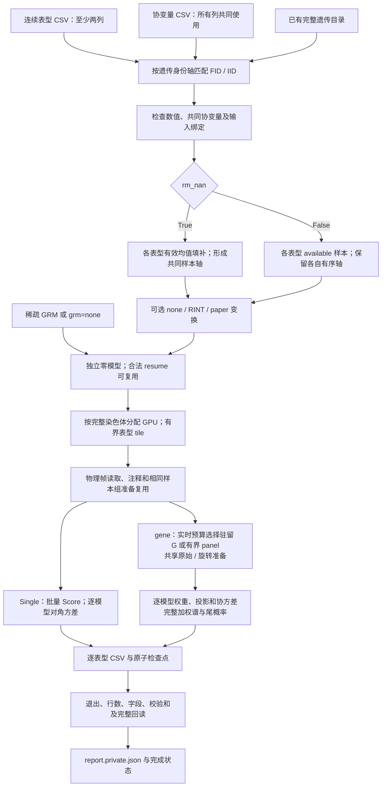
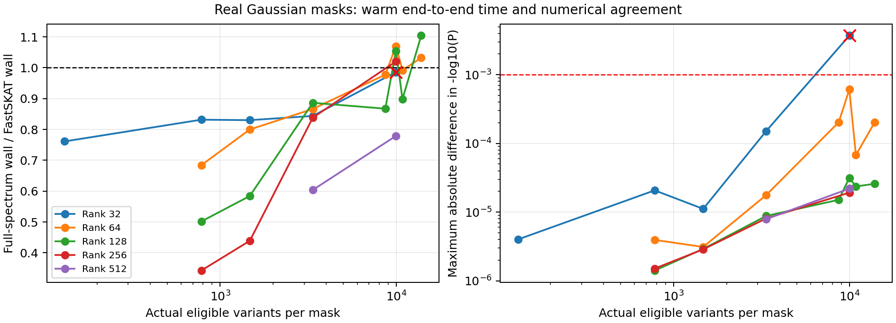
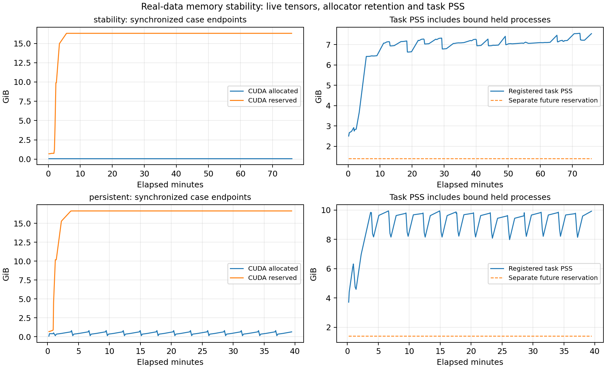

# 连续多表型 WGS

`run_WGS_continuous` 在已有遗传缓存上独立分析多个连续表型，完成 Single、coding、noncoding 和 ncRNA，并为每个表型保存 CSV。它只接受至少两个连续数值列，所有表型使用协变量文件中的全部协变量。默认以各表型的有效均值填补表型缺失；`rm_nan=False` 保留每个表型自己的 available 样本。协变量缺失始终剔除。

遗传数据只需准备一次，格式和准备方法见 [遗传数据准备](wgs_data_preparation.md)。严格二分类输入使用 [二分类 WGS](wgs_binary.md)。本入口不调用 R、不重新转换遗传数据，也不生成样本子集遗传缓存。

多 GPU 按完整染色体分工，每个 worker 分块处理其染色体的全部表型。相同有序样本轴可共享遗传读取、基因型整理、Score 矩阵计算和协变量设计；每个表型的残差、模型参数、投影矩阵 P、协方差和加权谱仍独立。这里是多个单表型检验，不是 MultiSTAAR 联合检验。



## 输入与样本处理

| 输入 | 格式 | 意义与要求 |
| --- | --- | --- |
| `phenotype_csv` | UTF-8 CSV，含 `FID`、`IID` 和至少两个连续数值列 | 每个数值列是一次独立分析。列名唯一；身份按字符串保留前导零；完整 FID/IID 对不能重复。不能包含二分类列、文本列、Inf、全缺失列或有效样本内常量列。 |
| `covariate_csv` | UTF-8 CSV，含 `FID`、`IID`，其余列均为数值协变量 | 所有表型共同使用全部列，模型自动加入截距。类别协变量须先编码成数值或哑变量。任何共同协变量缺失的样本均剔除，不填补协变量。 |
| `prepared_directory` | 已完成的遗传目录，根目录含 `dataset.json` 或 `cache_dataset.json` | 包含样本轴、完整基因型缓存、功能注释、基因目录和完成证明。两种目录不能同时放在一个根目录。只消费已认证缓存，不重新 prepare。 |
| `output_directory` | 本次结果目录 | 默认新目录；恢复时必须是同一已绑定运行的目录。结果、模型、计划、私有表型字典和检查点写入这里。 |
| `grm_file` | 可选、身份绑定的稀疏 GRM NPZ | `grm="sparse"` 时读取显式文件，或遗传清单的 `phewas.kinship_npz`。不能仅提供无身份的矩阵。`grm="none"` 时不提供此文件。 |

以下仅为格式示例。空单元格、`NA`、`NaN`、`null`、`none` 和 `n/a` 可表示缺失；大小写不敏感。不要用缺失编码数字代替空值。

表型 CSV：

```csv
FID,IID,trait_a,trait_b
family_a,sample_a,1.7,3.2
family_a,sample_b,,2.8
family_b,sample_c,2.1,
```

协变量 CSV：

```csv
FID,IID,age,sex,PC1,PC2
family_a,sample_a,50,0,0.02,-0.01
family_a,sample_b,54,1,0.01,0.03
family_b,sample_c,49,0,-0.02,0.01
```

`dataset.json` 目录使用完整 FID/IID 双列身份，两个家庭中相同 IID 不合并。数字身份轴的 `cache_dataset.json` 保留原轴：新 CSV 使用 `FID="0"` 和原数字 IID，不丢弃家庭身份去匹配；既有单 ID CSV 的兼容读取只适用于这种数字缓存。不能将身份转成浮点数再匹配。两份 CSV 可以采用不同原始行序，实际分析按遗传缓存和模型绑定的有序样本轴进行。

GRM NPZ 的标准字段如下；读取时禁用 pickle。对于双列身份目录，`sample_ids` 使用缓存生成的完整 FID/IID 规范身份键；数字身份缓存使用其原始身份轴。应从遗传清单读取该轴，不自行拼接或重新编号。

| NPZ 字段 | 形状与类型 | 意义 |
| --- | --- | --- |
| `sample_ids` | `[n]`，唯一字符串 | GRM 的完整样本身份，必须覆盖实际分析样本。 |
| `diagonal` | `[n]`，有限非负数 | GRM 对角线。 |
| `edge_rows`、`edge_cols` | `[e]`，从 0 开始的整数 | 非对角项坐标，不能有对角项或越界。 |
| `edge_values` | `[e]`，有限数 | 对应亲缘系数，可保存一个三角或一致的对称对。 |

完整替代字段组 `ids/grm_diagonal/grm_edge_row/grm_edge_col/grm_edge_value` 也可读取。加载过程不重新阈值化 GRM；逐表型精确提取其样本顺序下的子矩阵。

### 填补、变换与共同协变量

- `rm_nan=True`：先匹配已有表型行、协变量行与遗传身份，再剔除共同协变量缺失。每个表型只用这个合格母样本集合内的有限值计算均值，填补该表型的 NaN；不会为 CSV 中不存在的样本行生成表型。各列至少需要两个有效有限值且有变异。
- `rm_nan=False`：每个表型进一步剔除自己的 NaN，保留自身样本顺序、AF/MAF/MAC、等位基因方向、基因型缺失处理及资格筛选。不会把所有表型取一个共同 complete-case 交集。只有完全相同的有序样本轴才共享样本组准备。
- `continuous_transform="none"`：默认直接分析处理缺失后的原数值，在两种缓存格式中含义相同。`"rint"` 对这些数值进行秩逆正态变换；`"paper"` 先用共同协变量做 OLS，残差按平均秩和 Blom 偏移 0.375 做 RINT，再乘原表型的样本标准差。变换后零模型仍包含相同协变量和所选 GRM。

有限值只为 0/1 的列按二分类拒绝，不能通过指定 Gaussian 强行加入。若表型与协变量完全重合，或回归后残差方差退化，也会明确报错；应在运行前排除该表型。共同协变量只共享 X 和可复用的结构，不强制共用模型系数、逆方差权重、P 或谱。

## Python 调用

从项目主页的环境安装后使用以下公开函数。多进程调用放在 `if __name__ == "__main__"` 中。

```python
from pathlib import Path
from fudan_wgs_toolkit import run_WGS_continuous


def main():
    # 表型文件至少包含两个连续数值列，身份采用 FID / IID。
    phenotype_csv = Path("inputs/continuous_phenotypes.csv")
    covariate_csv = Path("inputs/covariates.csv")
    prepared_genetic_directory = Path("prepared_genetic_data")
    association_output_directory = Path("continuous_results")
    sparse_grm_file = Path("inputs/sparse_grm.npz")

    association_report = run_WGS_continuous(
        phenotype_csv=phenotype_csv,
        covariate_csv=covariate_csv,
        prepared_directory=prepared_genetic_directory,
        output_directory=association_output_directory,
        chromosomes="all",  # 1–22；也可写 [1, 2] 选择指定染色体。
        analyses=("individual", "coding", "noncoding", "ncrna"),
        device=["cuda:0", "cuda:1"],  # 两卡按完整染色体分工。
        cpu_threads=8,  # 每 worker 上限，仍共享节点实际 CPU 配额。
        memory_limit_gib=None,  # 自动检测；显式数值限制每张卡整体用量。
        host_memory_limit_gib=None,  # 自动检测整个节点任务的共享主存预算。
        rm_nan=True,  # 默认各列均值填补，协变量不填补。
        continuous_transform="none",
        grm="sparse",
        grm_file=sparse_grm_file,
        long_mask_method="full",  # 完整谱；同一协方差中完全相同的权重可精确复用。
        resume=False,
    )
    print(association_report["completed"])
    print(association_report["association_rows"])
    print(association_report["end_to_end_seconds"])


if __name__ == "__main__":
    main()
```

使用 available 样本时，改为 `rm_nan=False` 并为这个样本策略使用新的输出目录。无 GRM 时设 `grm="none"`、`grm_file=None`，得到普通连续零模型；这与稀疏 GRM 的混合模型是不同的分析配置。

### 全部参数

GiB 为 `2**30` 字节；缓存参数以字节计。以下默认值对应当前公开入口。

| 参数 | 默认值 | 含义 |
| --- | --- | --- |
| `phenotype_csv` | 必填 | 连续表型 CSV，至少两个数值列，格式见上。 |
| `covariate_csv` | 必填 | 所有表型共同使用的数值协变量 CSV。 |
| `prepared_directory` | 必填 | 已完成遗传缓存根目录。 |
| `output_directory` | 必填，关键字参数 | 新运行或同绑定恢复的结果目录。 |
| `chromosomes` | `"all"` | 1–22 全部常染色体，或数字/数字字符串列表，如 `[1, 2]`；所选染色体必须在缓存中。 |
| `analyses` | `("individual", "coding", "noncoding", "ncrna")` | 所选分析类型；保留顺序并去重。 |
| `device` | `("cuda:0",)` | CUDA 名称列表，或正整数 n 选择前 n 张可见 GPU；也接受单个 CUDA 名称。公开入口要求可用 CUDA。 |
| `cpu_threads` | `8` | 每 worker CPU 线程/亲和性上限；不代表独占 CPU。实际节点额度约束所有 worker。 |
| `memory_limit_gib` | `None` | 每 GPU 整体准入预算，覆盖驻留模型、缓存、传输及临时峰值；自动检测容量和实时余量，显式正数限制新增分配的准入。 |
| `memory_reserve_gib` | `1.0` | GPU 安全预留，可设非负值；须小于显式 GPU 上限。 |
| `host_memory_limit_gib` | `None` | 整个节点任务、所有 worker 共享的主存上限；自动考虑物理容量、全部可见有限 cgroup 祖先限制和实时余量。 |
| `rm_nan` | `True` | True 均值填补表型 NaN；False 逐表型 available 样本。两者都剔除共同协变量缺失。 |
| `continuous_transform` | `"none"` | `none`、`rint` 或 `paper`，在缺失处理后执行。 |
| `null_fit_mode` | `"fp64"` | 成熟 FP64 零模型拟合。CLI 保留 `tf32` 取值检查，但当前拟合器拒绝 TF32；关联仍用原生 TF32/FP32。 |
| `gene_variant_type` | `"SNV"` | gene 分析可选 `SNV`、`Indel`、`variant`；Single 保留独立的 variant QC/MAC，不套用 gene 的稀有变异过滤。 |
| `covariance_block_size` | `4096` | gene 协方差 panel 的变异块大小；不是样本量或全部显存上限。 |
| `long_mask_threshold` | `5000` | 保留显式近似分支的阈值；连续 Gaussian 的驻留 G 由实时新增显存准入选择，不再只按此数值限制。默认 full 跨过此值仍使用完整谱，不跳过 mask。 |
| `long_mask_method` | `"full"` | `full` 保留全部特征值，正常使用 FP32；同一调用中位模式完全相同的权重复用完整谱。仅收敛失败时，对原 FP32 加权矩阵进行有预算检查的 FP64 谱重试。`fastskat`、`liu` 是显式近似选择，须单独评估。 |
| `long_mask_rank` | `512` | 显式 FastSKAT 的目标低秩；默认 full 不使用此近似。 |
| `seed` | `1729` | 随机分支种子，参与配置绑定。 |
| `single_mac_cutoff` | `20` | Single 的最小 MAC 资格条件，每个表型独立计算。 |
| `single_group_variants` | `5000` | Single 的逻辑有效变异分组大小，保留原分组和输出语义。 |
| `single_region_size` | `10000000` | Single 逻辑区域长度，单位 bp。 |
| `individual_effective_block_size` | `1024` | Single 每个物理请求内的有效变异缓冲上限；改变此值仍须保持逻辑序号和顺序。 |
| `device_cache_bytes` | `536870912`，512 MiB | 每 worker 有界设备数据缓存容量；不是全部模型与计算工作区预算。 |
| `compact_cache_bytes` | `67108864`，64 MiB | 每 worker 有界 compact 数据缓存容量，计入整体资源准入。 |
| `metadata_cache_bytes` | `268435456`，256 MiB | 每 worker 可选 metadata LRU 容量；不能当作进程总 RSS。 |
| `resume` | `False` | True 验证同运行已提交块后仅补未完成部分；False 要求新的输出目录。 |
| `gpu_ids` | `None` | 兼容的 GPU 编号列表；使用时保持 device 默认，不能与另一个设备选择同时指定。 |
| `trait_batch_size` | `32` | 染色体 worker 内的全局固定表型 tile 上限，支持有界工作区和确定性恢复，不等于同时驻留全部模型。 |
| `grm` | `"sparse"` | `sparse` 使用身份绑定的稀疏 GRM；`none` 为普通零模型。 |
| `grm_file` | `None` | 显式稀疏 GRM NPZ；None 使用清单 sidecar，sparse 模式缺少二者时报错。 |

本入口不接受模型族覆盖、逐表型协变量选择或额外表型来源。当前公开关联入口分别为 `run_WGS_continuous` 和 `run_WGS_all_binanry`；连续调用使用本函数，二分类接口详见 [二分类 WGS](wgs_binary.md)。

## 命令行调用

以下是与 Python 示例相同的均值填补、全部染色体、两卡配置：

```bash
run-WGS-continuous \
  inputs/continuous_phenotypes.csv inputs/covariates.csv prepared_genetic_data \
  --output-directory continuous_results \
  --chromosomes all \
  --analyses individual coding noncoding ncrna \
  --device cuda:0 cuda:1 \
  --cpu-threads 8 --trait-batch-size 32 \
  --rm-nan --continuous-transform none \
  --grm sparse --grm-file inputs/sparse_grm.npz \
  --long-mask-method full
```

available 样本与无 GRM 的示例：

```bash
run-WGS-continuous \
  inputs/continuous_phenotypes.csv inputs/covariates.csv prepared_genetic_data \
  --output-directory continuous_available_results \
  --chromosomes 1 2 --device 2 \
  --no-rm-nan --grm none --continuous-transform none
```

已中断运行使用完全相同的输入、样本策略和科学参数，添加 `--resume`。同一入口也可通过 `python -m fudan_wgs_toolkit.continuous_run` 调用。

参数表中的关键字均有对应长选项，以连字符替换下划线，如 `--host-memory-limit-gib`、`--individual-effective-block-size`、`--metadata-cache-bytes`。三个科学输入是位置参数；`--output-directory` 必填；`--device 2` 表示卡数，`--gpu-ids 0 1` 表示指定编号。`--rm-nan/--no-rm-nan` 是成对开关；`--resume` 默认为关闭，不接受 `--resume False`。

## 计算、资源与恢复

Single 以物理遗传块共享读取和解码，同有序样本组批量计算 Score；方差保留各模型的中心化及投影修正，仅计算对角，不构造 Single 的完整 M×M 协方差。最终统计与稳定 log P 批量回传。gene 在相同样本组中复用准备、注释和可复用的 panel，但各模型的 P 与协方差独立；每个不同的实际注释权重求完整谱。同一次协方差计算中，FP32 位模式完全相同的权重列直接复制已经求出的完整谱；成比例或仅数值接近的权重仍各自求解，不跨 mask 保存谱缓存。保留成熟 Saddle、矩匹配和 ACAT 分支。

默认 coding 包含 `plof`、`plof_ds`、`missense`、`disruptive_missense`、`synonymous`；noncoding 包含 `upstream`、`downstream`、`UTR`、四种 CAGE/DHS promoter/enhancer；ncRNA 保留原 ncRNA exonic/splicing 规则。保留科学 QC、MAF 和最小变异数筛选，不增加长 mask 的性能型跳过规则。

所有 GPU worker 共用任务主存预算。通过绑定进程身份汇总 PSS，计入全部 worker、缓存和子进程的比例常驻量；账本另外预留未来新增峰值，不能重复计入已物化缓冲。任务占用与其主存上限比较，节点及全部有限 cgroup 祖先的实际用量与各自限制分别比较；共享节点中其他任务的占用不会直接套用本任务较小的上限。没有 `smaps_rollup` 的内核使用完整 `smaps` 汇总；无法核验时明确推迟分配，RSS 保留作诊断。PSS 是动态端点，记录采样次数、耗时和来源，不能把它称为原子快照。这是共享任务的准入控制，不创建独立 cgroup 硬配额。设备模型、设计、样本轴、reader、metadata 和输出缓存按字节有界；活动对象受保护，阶段结束释放临时基因型、矩阵和租约。allocated 表示活跃 CUDA 分配块占用，reserved 包含分配器保留，两者分开报告。资源不足先使用受限块和工作区；最小合法工作集仍不足时明确记录未完成原因，不提高上限或改变方法。

均值填补通常形成共同样本轴，便于复用设计和批量 Score；available 模式仍按完全相同的样本轴分组，跨组保留独立过滤和模型。提高 tile 或线程数的收益依赖样本组、协变量、节点配额和内存，不能仅由 batch 维推断加速。按染色体分工保持 reader 局部性，染色体数少于 GPU 数时可能有空闲卡，长染色体也可能造成收尾不均衡。

GPU 预算通过已驻留分配、未来新增峰值估算、实时余量和预留共同准入，不设置 PyTorch allocator 的硬比例限额。实际块大小、库内部工作区和共享负载仍可能导致分配失败；这种失败保留错误与未完成块，不提高预算、改变精度或将其记为完成。实测记录将公开预算与测试专用 allocator 限额分开。

`resume=True` 核对输入、源码、样本轴、填补/变换、GRM、模型、逻辑块和输出身份，依据已原子提交且校验通过的 CSV 检查点恢复。合法完成块不重复计算，其模型可复用；未提交 partial 尾部不计完成，按提交边界恢复或补算。并发所有权锁保护同一输出目录。计划及 CSV 恢复绑定还记录共享准备、实时驻留、协方差 tile、完整谱批处理及 tail/reuse 开关和批处理参数。改变这些执行配置、`rm_nan`、变换、协变量或科学配置应使用新目录，不能把旧输出接入新模型。新的 `resume=False` 运行正常拟合各表型的零模型，不凭其他模型目录存在自动复用。

完整谱求解遇到收敛错误时，只把已构造的 FP32 加权矩阵转成 FP64，重试完整特征值；基因型、Score、协方差及正常求解仍使用原 TF32/FP32 路径。重试前检查整体 GPU 预算与实时余量，随后核对谱长度、有限性、顺序、PSD、trace 和结构零模，不增加正则项、不截断谱、不对 P 值截底。资源不足、实际 OOM 和数值失败分别报告未完成原因。

长 mask 的主存剂量准备保留已核验的 MAC／缺失计数，直接填充最终 FP32 矩阵，减少重复整数归约和临时拷贝。同样本组的多个 mask 只复用已核验的样本维度；真实模型在准备前释放，每个表型进入统计计算时仍独立取得并核验自己的模型。这些复用受现有 GPU、主存和队列预算约束。

### 连续 Gaussian 的默认共享路线

连续专用入口默认减少同一 mask 在不同 Gaussian 模型间重复的传输、旋转和协变量乘法。共享前核验完全相同的有序样本轴、亲缘旋转行号与矩阵，并检查输入存储身份、形状、步长和张量版本。相同 GRM 或共同协变量不意味着各模型的逆方差权重、P 或投影修正相同；这些拟合状态仍逐模型使用。条件不匹配或可选工作区不能准入时，沿用成熟路径。mixed 和 binary 入口的默认开关不随这次连续接线改变。

对应实现为[分块 panel 共享准备](../fudan_wgs_toolkit/_gaussian_covariance_shared.py)、[四模型协方差 tile](../fudan_wgs_toolkit/_gaussian_covariance_tile.py)和[驻留 G 共享准备](../fudan_wgs_toolkit/_gaussian_resident_shared.py)，由[连续配置](../fudan_wgs_toolkit/continuous_run.py)与[成熟 runtime](../fudan_wgs_toolkit/phewas_runtime/runtime.py)接入。

驻留协方差另外采用[有界列式加权](../fudan_wgs_toolkit/_gaussian_covariance_resident.py)：保留原整份旋转 G 和该模型的协变量 cross，只把逆方差加权矩阵分列物化。单份 FP32 加权缓冲的逻辑容量至多 512 MiB，列宽保留原 TF32 kernel 几何；末尾零填充仅维持计算形状，不增删实际变异。每个模型仍计算完整的两个方向乘积、投影修正及对称平均。整份 G、旋转、输出 C 和 tail 都继续计入整体准入，512 MiB 不是总显存峰值上限。实际准入或分配失败时释放失败暂存，再用成熟主存 panel 路线重试原完整 mask；重试仍不能完成时保留真实失败。

读取侧仅在索引严格递增时省去重复排序：基因型索引用相邻比较证明唯一性，无序索引仍执行原唯一性检查，重复索引仍拒绝；UTF8 内部解码的有序索引省去稳定排序，标量字段复用原索引轴，内部无序及重复索引继续用成熟排序恢复原顺序和重复值。公开字段读取入口仍执行原索引校验。样本轴、值、校验和与选择规则保持。

| 实时准入选择 | 复用内容 | 逐模型保留的计算 |
| --- | --- | --- |
| 驻留 GPU 的 FP32 G | 先准入读取、整理和最终 G 的新增存储，再核验后续模型、旋转、加权 G、协方差及 tail 的工作区。G 的选择不再只由 M≤5,000 决定；失败时完整退回主存路线。可准入时复用旋转 G，当前表型 tile 的各模型 `precision_x.T` 按行拼接，一次 TF32 乘法得到各自的 q×M cross。 | 每个模型自己的逆方差向量和 q×q 固定效应协方差，独立构造 M×M V；不共享 P 或 V。共享旋转缓存不能容纳整份 R 时，保留逐模型旋转。 |
| 主存 FP32 G | 每对原始 / 旋转 panel 按原几何准备一次，在最多四个模型之间依次使用，减少跨表型的重复 H2D；各模型投影缓存占用同一个有界容量。 | 各模型自己的 `precision_x.T @ G_panel`、固定效应修正、逆方差加权，以及原两个方向的 TF32 协方差乘积与对称平均。最多保留四份独立 C，联合新增峰值不能准入时逐模型计算。 |

这里 n 是该样本组人数、M 是实际合格变异数、q 是模型协变量数（含截距）。批量 cross 的新增拼接存储为 n×Σq，输出为 Σq×M，分配前纳入工作区检查；不产生 n×M×表型数的基因型副本。乘法保留现有 TF32 输入舍入、FP32 累计及原矩阵归约方式，单列等向量分支仍使用原 FP32 运算。不同 route 的矩阵 launch 形状可能不同，其真实 P 精度由下方配对单独验收。

共享对象只属于当前 mask，正常或异常退出时关闭准备 owner。panel 和旋转缓存继续受至多 8 GiB、当前可用空间 15% 的容量限制；不同模型的投影保持独立并计入同一容量，reader、元数据和模型库继续使用各自的有界 LRU。正在使用的对象由 pin 保护，压力回调只撤销未使用的可选引用。已分配的 G、旋转 G、cross、模型及暂存 C 计入 live allocated，后续只预留真正 NEW 的存储；撤销引用不作为 allocator 余量信用。常规 mask 不新增 `gc.collect` 或 `empty_cache` 调用来维持路线。

默认 `long_mask_method="full"` 在所有 M 上保留完整谱。M≤1,536 时可把最多 32 个完整加权矩阵交给批处理路径，精确权重关系比较的临时上限为 256 KiB；这些是执行容量，不是统计筛选阈值。原生选定 eigensolver 仅用于 CUDA FP32 的 M=33–128，其他尺寸或后端条件保留完整 Torch 求解；超过 1,536 仍逐权重求完整谱。同一个 C 范围内只复用 FP32 位模式完全相同的权重，数值接近或成比例的权重仍独立求解。最多四个模型组成有界 tail window；窗口满、资源压力或敏感 Score 回退时先完成并释放窗口，不跨模型复用 P、V 或谱。显式 `fastskat` / `liu` 保留原方法与参数，不启用这些 FULL 专属谱和 tail 开关。

gene 结果先按列组织，再按原表头与顺序写出各表型的 CSV 和原子检查点。连续入口启用主线既有的异步 PerTrait writer；journal 和完成进度等待持久写出 ACK，finish 等待队列排空。默认队列已拥有字节上限为 64 MiB，这只约束输出队列，不代表进程总峰值或整体主存预算。默认没有启用并行 fsync；输出字段、gzip、提交和恢复语义保持原约定。这次修复没有新增 writer 算法，也没有单独证明写出加速。本轮不改表型均值填补 / available 规则、样本顺序、AF/MAF/MAC 资格、等位基因方向、QC、基因型缺失填补和 mask 内容。资源与长期生命周期的验收状态单列，不能由精度或耗时通过推断。

### 连续多 GPU 子进程的 CPU 分配器

Linux CPython 的连续入口在已验证全部模型为 Gaussian、且采用多 GPU spawn 时，为新 worker 解释器补上缺省 `PYTHONMALLOC=malloc`。它控制 Python 小对象使用的 CPU 分配器，须在子进程解释器启动前提供；不改变 TF32/FP32 运算、模型或筛选规则。实现见[子进程启动 scope](../fudan_wgs_toolkit/_continuous_spawn_allocator.py)。

显式设置的 `PYTHONMALLOC` 值保持原样，`MALLOC_*` 和 `GLIBC_TUNABLES` 均不修改。启动段正常结束或失败后，父进程环境恢复原值；父进程已经初始化的分配器保持不变。单 GPU 使用原 inline 路线，mixed / binary 入口不应用此缺省值。单卡脚本或 notebook 如需使用 malloc，应在启动 Python 或 kernel 前设置该环境变量；运行中赋值不会切换当前解释器的分配器。例如，将上方 Python 调用保存为脚本后启动：

```bash
# 将上方调用保存为 run_continuous.py；单卡示例把 gpu_ids 设为 (0,)。
PYTHONMALLOC=malloc python run_continuous.py
```

分配器选择继续受实际任务 PSS、节点 / cgroup 余量和未来新增峰值准入约束。它不提高主存预算，也不代替临时引用、映射、pin、workspace 和 lease 的释放检查。

## 输出格式与读取

连续入口保留每个表型独立目录。文件按分析类型、染色体和实际表头签名分开；不同 mask 产生不同表头时不会强行展平。

```text
continuous_results/
  csv/
    traits/
      trait_0000/
        individual/chr21/<表头签名>/results.csv.gz
        coding/chr21/<表头签名>/results.csv.gz
        noncoding/chr21/<表头签名>/results.csv.gz
        ncrna/chr21/<表头签名>/results.csv.gz
      trait_0001/...
    .trait_checkpoints/            # 已提交范围、校验和与所有权
    worker_<编号>.complete.private.json
  models/                        # 本运行的独立零模型及绑定
  trait_index.private.csv        # 输入列顺序对应的表型字典
  plan.private.json
  status.private.json
  report.private.json
```

尚未完成的 CSV 使用 `.partial`；只有完成收据指向的文件是完整输出。输入派生文件及 worker 的模型、退出和错误收据随缓存格式存放，以绑定计划为准。`trait_index` 从 0 开始，按表型 CSV 中非身份列的原始顺序编号；对应名称只保存在私有字典。每条 CSV 行带这个索引。

### Single 字段

| 字段 | 含义 |
| --- | --- |
| `trait_index` | 本运行的表型列索引。 |
| `CHR`、`POS`、`REF`、`ALT` | 染色体、1-based 位置及缓存原始等位基因。 |
| `ALT_AF`、`MAF` | 该表型样本中的原 ALT 频率、minor allele 频率；保留原导出约定。 |
| `N` | 该表型实际分析样本数，不是缓存总人数。 |
| `pvalue` | 单变异检验 P，可在极小尾部下溢。 |
| `pvalue_log10` | 原生稳定的 **−log10(P)**，不是 log10(P)；极小 P 优先读取此字段，不人为加 floor。 |
| `Score`、`Score_se` | 原 Score 统计及其标准误，Score_se 为方差平方根。 |
| `Est`、`Est_se` | 原检验约定的效应估计与标准误，使用模型中实际检验的 minor allele 方向，不据 ALT 字符重新定义符号。 |

保留逐表型有效变异序号和原提取/分组语义，最终表内按位置排序；恢复仍依据逻辑块与提交顺序，不能只从最后一个 POS 推断哪些变异已完成。CSV 中不导出仅供内部整理的 `_chunk`、`_common`、`_base_group`。

### Gene-based 字段

| 字段 | 含义 |
| --- | --- |
| `trait_index`、`Gene name`、`Chr`、`Category` | 表型、基因、染色体和原 mask 类别。 |
| `#SNV`、`cMAC` | 原字段名下的合格变异数及累计 minor dosage；选择 Indel 时保留同一字段名，不另行重定义统计量。 |
| `SKAT(1,25)`、`SKAT(1,1)` | 两套 Beta 频率权重的基础 SKAT P。 |
| `Burden(1,25)`、`Burden(1,1)` | 两套基础 Burden P。 |
| `ACAT-V(1,25)`、`ACAT-V(1,1)` | 两套基础 ACAT-V P。 |
| `WGS-S(1,25/1,1)`、`WGS-B(1,25/1,1)`、`WGS-A(1,25/1,1)` | 各测试族与功能注释权重 P 的 Cauchy 聚合；两个 Beta 权重各有独立列。 |
| `ACAT-O`、`WGS-O` | 基础组合与所有实际权重/测试的 omnibus P。WGS-O 对应本实现的连续 STAAR-O 语义，字段继续使用当前 WGS 命名。 |
| 注释后缀及诊断列 | 按实际注释和原分支产生，保留原表头、含义与失败/近似标记，以实际 CSV 为准。 |

gene 行按绑定的基因任务和 mask 顺序提交。科学筛选后无有效结果的任务可提交零行检查点，这与未运行或性能跳过不同。跨染色体或不同表头文件读取时，保留目录中的顺序和完整表头；如需另做排序，不能覆盖恢复所用的原文件。

共享准备不增加公开参数或 CSV 字段。`trait_batch_size` 仍是固定表型 tile 上限，`covariance_block_size` 仍是变异分块参数，四类分析和每表型独立文件保持原语义。一个遗传作业可以包含多个表型 tile 检查点；提交块数、遗传作业数与关联行数分别记录。CSV 的字段、行序、gzip 成员提交与 resume 边界仍按原绑定校验，最终通过实际 worker 退出和完整文件回读确认。

```python
import csv
import gzip
from pathlib import Path

association_output_directory = Path("continuous_results")
single_output_files = sorted(
    (association_output_directory / "csv" / "traits" / "trait_0000" / "individual")
    .glob("chr*/*/results.csv.gz")
)
for single_output_file in single_output_files:
    with gzip.open(single_output_file, "rt", newline="", encoding="utf-8") as handle:
        single_output_reader = csv.DictReader(handle)
        for single_result in single_output_reader:
            negative_log10_pvalue = float(single_result["pvalue_log10"])
            # 逐行消费，避免把整个 Single 结果同时载入主存。
```

`association_report["association_rows"]` 给出四类实际输出行数，`eligible_association_tests` 是这些行数之和，不是遗传作业组数量；`end_to_end_seconds` 是本次入口的墙时。`completed=True` 在 worker、输出和绑定通过后写入，单独存在进程、partial 文件或开始事件不表示完成。官方结果对照属于另行验收，本入口不会自动启动 R 或宣称官方全基因组通过。

## 原 STAAR 软件调用

官方 STAARpipeline 使用带注释的 GDS/aGDS 和 R 零模型；它不能直接读取本工具的压缩遗传缓存。下面是**外部对照脚本**的调用方式，生产 Python 流程不依赖它。对照须先导出并绑定同一个有序样本轴、共同协变量、GRM、变换、变异方向、填补、筛选和注释。以下选择默认 `continuous_transform="none"`，逐表型拟合 Gaussian；不把多个响应放进同一个联合模型。

```r
library(SeqArray)
library(STAARpipeline)

# 私有、同配置导出的样本表，sample_id 与 aGDS、GRM 身份严格对应。
reference_sample_data <- read.csv("reference_samples.csv",
    colClasses=c(sample_id="character"), check.names=FALSE)
reference_kinship <- readRDS("reference_sparse_grm.rds")
reference_annotation_catalog <- read.csv("annotation_catalog.csv")
reference_configuration <- readRDS("reference_configuration.rds")
reference_covariate_names <- c("age", "sex", "PC1", "PC2")
reference_phenotype_names <- c("trait_a", "trait_b")
reference_annotation_names <- reference_configuration$annotation_names
reference_chromosome <- reference_configuration$chromosome
reference_gene_name <- reference_configuration$coding_gene_name
reference_ncrna_name <- reference_configuration$ncrna_gene_name
reference_impute_missing <- TRUE
reference_genetic_file <- seqOpen("reference_chr.gds")

tryCatch({
    reference_results <- lapply(reference_phenotype_names, function(reference_phenotype_name) {
        reference_data <- reference_sample_data[
            complete.cases(reference_sample_data[, reference_covariate_names, drop=FALSE]),
            , drop=FALSE]
        reference_values <- reference_data[[reference_phenotype_name]]
        if (reference_impute_missing) {
            reference_data[[reference_phenotype_name]][is.na(reference_values)] <-
                mean(reference_values, na.rm=TRUE)
        } else {
            reference_data <- reference_data[!is.na(reference_values), , drop=FALSE]
        }
        reference_sample_ids <- reference_data$sample_id
        reference_null_model <- fit_nullmodel(
            fixed=reformulate(reference_covariate_names, response=reference_phenotype_name),
            data=reference_data,
            kins=reference_kinship[reference_sample_ids, reference_sample_ids],
            id="sample_id", family=gaussian(), use_sparse=TRUE, use_SPA=FALSE)

        reference_gene_arguments <- list(
            chr=reference_chromosome, genofile=reference_genetic_file,
            obj_nullmodel=reference_null_model,
            rare_maf_cutoff=0.01, rv_num_cutoff=2,
            QC_label="annotation/filter", variant_type="SNV",
            geno_missing_imputation="mean",
            Annotation_dir="annotation/info/FunctionalAnnotation",
            Annotation_name_catalog=reference_annotation_catalog,
            Use_annotation_weights=TRUE, Annotation_name=reference_annotation_names)
        list(
            individual=Individual_Analysis(
                chr=reference_chromosome, start_loc=1,
                end_loc=max(seqGetData(reference_genetic_file, "position")),
                genofile=reference_genetic_file, obj_nullmodel=reference_null_model,
                mac_cutoff=20, subset_variants_num=5000, variant_type="variant",
                geno_missing_imputation="mean"),
            coding=do.call(Gene_Centric_Coding,
                c(list(gene_name=reference_gene_name, category="all_categories"),
                  reference_gene_arguments)),
            noncoding=do.call(Gene_Centric_Noncoding,
                c(list(gene_name=reference_gene_name, category="all_categories"),
                  reference_gene_arguments)),
            ncrna=do.call(ncRNA,
                c(list(gene_name=reference_ncrna_name), reference_gene_arguments)))
    })
    saveRDS(reference_results, "continuous_reference_results.rds")
}, finally=seqClose(reference_genetic_file))
```

`reference_configuration.rds` 是私有 R list，含对照工作集的 `annotation_names`、`chromosome`、`coding_gene_name`、`ncrna_gene_name`，不是工具默认结果；注释 catalog 含 `name` 与 aGDS `dir` 映射。无 GRM 对照将 `kins=NULL`，不读取稀疏亲缘矩阵。`rint/paper` 对照须先按相同规则变换响应，不能用以上原数值例子替代。多个基因和染色体在外部脚本中按对应目录循环，最终逐表型保存。

脚本保存为 `continuous_reference.R` 后调用 `Rscript continuous_reference.R`。函数名、参数和 Gaussian/稀疏 GRM 方式已核对官方 [fit_nullmodel](https://github.com/li-lab-genetics/STAARpipeline/blob/main/R/fit_nullmodel.R)、[Individual_Analysis](https://github.com/li-lab-genetics/STAARpipeline/blob/main/R/Individual_Analysis.R)、[Gene_Centric_Coding](https://github.com/li-lab-genetics/STAARpipeline/blob/main/R/Gene_Centric_Coding.R)、[Gene_Centric_Noncoding](https://github.com/li-lab-genetics/STAARpipeline/blob/main/R/Gene_Centric_Noncoding.R) 和 [ncRNA](https://github.com/li-lab-genetics/STAARpipeline/blob/main/R/ncRNA.R)。

## 验证与 benchmark

验证口径见 [验证记录](../validation/README.md)。本轮 OOM 修复绑定科学实现 `8ffe216c`，分别与公开基线 `b6320eb` 及原运行实现 `877757bd` 对照。此前正式 `variant` 配对仍绑定 `877757bd` 与干净公开基线 `840fee3`（科学实现 `cacef6df`）。SNV 和公开 20 GiB host 回退专项仍绑定较早科学实现 `33928d3c`，作为各自的补充范围单列；不把这些耗时或长窗口重标为 `8ffe216c`。下方 `00a655b` / `b58cca1c`、`d98a3ac` / `827b8ea4` 的窗口也保持历史绑定。

本轮修复及重复运行见 [匿名 OOM 修复 benchmark](../validation/continuous_oom_repair.anonymous.json)；此前实测和资源窗口见 [历史匿名 benchmark](../validation/continuous_covariance_optimization.anonymous.json)。

### 驻留协方差 OOM 修复的真实配对

复用原 Gaussian 模型和完整遗传缓存，不重新拟合或准备子集缓存。所有路径由原父进程实际等待退出 0，持久 CSV 全字段、行列顺序及资格完整回读，按 `|Δ−log10(P)|<0.001` 验收。下面的暖轮原生墙时包含读取、准备、计算、完整谱与尾概率和持久写出完成；CSV 回读另外计时。allocated 峰值来自各自完整运行，不能与 reserved 相加。

| 实际范围与源码绑定 | 暖轮原生墙时：基线 → 修复 | 配对暖轮耗时比 | 峰值 allocated：基线 → 修复 | P 配对 / 最大 `\|Δ−log10(P)\|` |
| --- | ---: | ---: | ---: | ---: |
| 四 Gaussian，`b6320eb` → `8ffe216c`，三轮中的两个暖轮 | 58.9565 → 54.3146 s | 1.0854× | 45.672 → 33.476 GiB | 3,024 / 0 |
| 原 OOM 任务的单模型完整重放，`877757bd` → `8ffe216c`，两轮中的一个暖轮 | 139.00 → 129.02 s | 1.0773× | 63.108 → 45.641 GiB | 196 / 0 |

这是两个绑定工作集的观测。单模型重放成功不代表原多模型暖驻留状态不会 OOM；整体准入仍同时计入活动模型、缓存、矩阵和未来新增工作区。默认 FULL 保留完整谱，不依据 M=5,000 自动切换近似、跳过或截断；加权缓冲和完整谱批处理的容量阈值只选择工作区及 kernel。TF32/FP32 路径和各模型独立 P 保持。

重复四模型测量中，同一 `8ffe216c` 的两个暖轮原生墙时为 58.6530 / 57.6943 s，包含另计回读后为 58.7965 / 57.7091 s；首轮测量对应值为 54.3159 / 54.3132 s，包含回读后为 54.4584 / 54.3281 s。设备和节点共享负载、重复运行波动都会影响小幅耗时差，首轮 1.0854× 不作为稳定加速保证或全量外推。仅缓存正常尾敏感检查的候选虽然 3,024 个 P 配对最大差为 0，首配对耗时比为 0.9470×，重复对照方向也发生变化，没有可重复的端到端净收益，已撤回并恢复准确 `8ffe216c` 字节。

以同一 `b6320eb` 参考比较这次 `8ffe216c` 重复运行，3,024 个 P 配对最大差仍为 0，暖轮耗时比为 1.01344×，仅作运行波动观测。另一个 `877757bd` 对照使用完整谱批处理容量 1,536 和同步 PerTrait 写出，而 `8ffe216c` 重复运行使用容量 512 和既有异步写出；3,024 个 P 配对最大差为 0，耗时比为 1.03501×。后者是不同历史 writer 配置的描述性对照，不替代同写出方式的优化基线验收，也不证明单独的写出或 kernel 收益；容量参数不跳过或近似较长 mask。

以下阶段值来自 `8ffe216c` 已完成运行，单位秒。四模型列为两个暖轮的中位数，单模型列为一个暖轮；每格为 host wall / CUDA stream interval。读取区间包含准备和等待，CUDA interval 也不是纯 GPU 算术时间。各区间可能嵌套或重叠，且这里没有列出全部 Single 阶段，不能相加反推端到端耗时。写出行只覆盖生产线程的 enqueue、持久 ACK 与 finish 控制区间，不覆盖全部后台磁盘工作。

| 原生 profiler 阶段 | 四模型工作集 | 单模型完整重放 |
| --- | ---: | ---: |
| 读取、解码与共同样本准备 | 5.580 / 5.580 | 56.369 / 56.370 |
| 独立协方差 | 7.814 / 9.664 | 3.643 / 4.066 |
| 完整谱、基础统计及 Pending 准备 | 16.173 / 16.175 | 9.782 / 9.782 |
| 打包 SKAT 尾及最终字段 | 0.470 / 0.470 | 0.103 / 0.103 |
| 写出 enqueue | 0.00237 / — | 0.00045 / — |
| 持久 ACK barrier | 0.01087 / — | 0.00609 / — |
| finish 与回读控制区间 | 0.10725 / — | 0.04560 / — |

`8ffe216c` 的组件实际执行 260 项，包含 33 项必需原生 CUDA 节点，全部通过且无跳过；组件结果与上述真实数据配对分开。该源另完成下面两个预注册资源窗口，资格工具实际退出 0、错误列表为空，科学源码保持不变；两个 worker 都由原父进程实际等待退出 0，并核验其自有进程已退出。

| 实际资源范围 | 测量端点 | allocated 最大值相对首点增长 | PSS 最大值相对首点增长 | PSS 两半中位数绝对差 |
| --- | ---: | ---: | ---: | ---: |
| 16 模型小工作集，40 轮，前 2 轮暖机 | 后 38 点 | 0 B | 62,291,968 B | 13,056,000 B |
| 上述窗口的末 20 点 | 20 点 | 0 B | 17,240,064 B | 3,539,456 B |
| 4 模型含真实大任务，4 轮，前 2 轮暖机 | 后 2 点 | 0 B | 3,723,264 B | 3,723,264 B |

这两个窗口按启动前绑定的门槛通过：allocated 增长至多 16 MiB，PSS 最大增长及两半中位数差分别至多 128 MiB；reserved 保留为分配器诊断，不作为泄漏判据。small40 的全部 38 点不满足原更严格的 PSS 最大增长 32 MiB 诊断，末 20 点满足该项；这些诊断保留，不把本轮通过称为与历史严格 40 轮协议相同。

40 次和 12 次原生 CSV 分别新鲜完整回读。每个 native finally 中，实际追踪的返回临时 owner 已释放，活动 pin、lease、workspace、policy、Pending 及 future 为 0；没有调用 `gc.collect`、`empty_cache` 或 `malloc_trim`。大工作集每轮由三个串行 native call 组成，沿原配置关闭并重建各 case 缓存，真实大任务重复完成而未发生 OOM；它不是单次 native 的跨染色体生命周期，也不是大任务 40 轮或全部 32 模型长期验收。未返回的内部 workspace、packed Px 和全部原生 owner 仍为 not_assessed，内存工具本身不新增 P 精度或真实 OOM retry 覆盖。本轮未重新执行官方 R。

### 历史连续共享路线的真实配对

复用四个真实 Gaussian 零模型、原完整遗传缓存和有序样本轴；不重新拟合，不准备样本子集缓存。正式 `variant` 配置使用两组 Beta 权重，SNV 配置使用 26 个权重列；两组完整工作集均覆盖 Single、coding、noncoding 和 ncRNA。公开 20 GiB 预算的 host 回退专项只含两个完整 ncRNA 任务，不能称为四类覆盖。每个路径运行三轮，其中第 2、3 轮为暖轮；各 case 调用重新建立 reader，模型库跨 case 存续，这不是单次原生 pipeline 的长期 reader 平台测试。

主表的 `877757bd` 正式配对采用下方列出的显式 fixed4 启动环境，环境与进程身份经新鲜两点核验。它与此前仅设置 `PYTHONMALLOC=malloc` 的同源测量属于不同实际资源配置，表中只保留最终 fixed4 三轮结果；公开入口仍只补缺省 `PYTHONMALLOC=malloc`，不由这项显式实验修改 glibc 默认策略。

两条路径的进程均由自己的父进程实际等待并核验退出 0，正式 CSV 完整回读。端到端包括读取、解码、样本准备、协方差、完整谱与尾概率、持久 CSV 完成及另计的回读；不包括模型拟合或遗传准备。表中端到端为两个暖轮的中位数，耗时比为逐暖轮原生运行墙时比的几何均值，原生墙时包含持久 CSV 完成但不包含另计回读，因此不能由表中四舍五入后的中位数反推同一个比值。首轮单列，不把冷启动混入暖轮。只有两个暖轮，没有置信区间。

| 实际对照范围 | 首轮端到端：基线 → 新路线 | 暖轮端到端中位数：基线 → 新路线 | 暖轮耗时比 | 最大 `\|Δ−log10(P)\|` | 显著并集最大差 |
| --- | ---: | ---: | ---: | ---: | ---: |
| `877757bd` 显式 fixed4：四 Gaussian、四类分析，`variant` 两组 Beta 权重 | 190.096 → 104.372 s | 170.848 → 71.661 s | **2.3857×** | 0.0000304712 | 0.000000464052 |
| `33928d3c` 补充：四 Gaussian、四类分析，SNV 26 权重列 | 363.226 → 282.686 s | 361.439 → 265.292 s | **1.3625×** | 0.0001704233 | 0.000001170035 |
| `33928d3c` 补充：四 Gaussian、两个 ncRNA，20 GiB host 回退专项 | 186.466 → 157.570 s | 169.009 → 143.053 s | **1.1815×** | 0.000000000000170919 | 0 |

这三项各自绑定源码与资源配置的暖轮运行耗时分别下降 58.08%、26.60% 和 15.36%。这些是固定工作集的实现间实测，不保证全基因组、全表型或不同资源上的同等收益，本轮没有重新执行官方 R。

### 精度、字段与归约口径

| 全部三轮比较 | 完整回读行数（每条路径） | 有限 P 配对数量 | 任一路径 P<0.05 的并集配对数量 | cMAC 归约微差配对数量 | 最大 cMAC 绝对 / 相对差 |
| --- | ---: | ---: | ---: | ---: | --- |
| `877757bd` 显式 fixed4：`variant` 四类工作集 | 1,560 | 3,024 | 207 | 24 | 1.891749×10⁻⁹ / 7.272974×10⁻¹⁵ |
| `33928d3c`：SNV 四类工作集 | 1,560 | 9,936 | 903 | 24 | 2.735760×10⁻⁹ / 1.148492×10⁻¹⁴ |
| `33928d3c`：20 GiB ncRNA 专项 | 24 | 336 | 24 | 0 | 0 / 0 |

所有有限 P 和原生稳定 log P 都按 `|Δ−log10(P)|<0.001` 验收，不截底、不放宽显著并集门槛；本工作集没有 P=0，不扩展下溢覆盖。上述四模型配对的字段及行列顺序、物理变异与样本资格、AF/MAC/QC、Single beta / SE 和其他非 P 字段继续精确比较。

唯一指定的非 P 浮点元数据例外为 `cMAC`：相同填补 FP32 G 的 NumPy FP64 求和与 CUDA 有界分块 FP64 求和顺序不同。两值均须有限且非负，要求 `abs(a-b) <= 1e-12*max(abs(a),abs(b))`，绝对容差为 0；任一零值时另一值也须为零，缺失状态保持原约定。这项差异单列计数、最大绝对差和最大相对差，不称整份 CSV 位级一致，也不替代原 AF/MAC 资格及 P 值检查。

#### 独立单模型与四模型批次的精度范围

科学实现 `877757bd` 另执行一个真实模型的独立路径，并与同模型在四模型批次中的输出比较。固定原模型、输入、完整 mask 和行序，两轮完整回读包含 504 个 P 配对；最大 `|Δ−log10(P)|` 为 **8.20×10⁻⁶**，低于 0.001。N、AF/MAF/MAC 资格、QC、行列顺序和标准误精确一致；`cMAC` 的四个微差配对继续使用上方已声明的相对 10⁻¹² 元数据规则。

Single 的成熟 IEEE FP32 GEMV 与批次 IEEE FP32 SIMT GEMM 使用不同归约顺序，观测到 Score 和 Est 最大绝对差分别为 **4.20×10⁻⁵** 和 **5.65×10⁻⁷**。四个相关 Score 路径源码模块的字节相同。本次没有为 Score / Est 新设容差；原全部非概率字段逐字符串比较的失败及其退出 1 记录保持，另按实际 P 精度、输入资格、顺序和标准误报告通过范围，不称全部字段 bitexact。该结果只覆盖这一独立单模型与四模型批次配对，不扩展为其他模型的独立执行等价。

### 阶段时间与资源状态

以下为两个暖轮阶段值的中位数，单位秒。host wall 表示该主机调用区间，CUDA stream interval 表示对应 stream event 区间；异步提交、CPU 等待与嵌套 panel 阶段可重叠，不能相加成端到端时间，也不能把短 host launch 时间当作整个 GPU 计算耗时。

| 工作集 / 阶段 | 基线 host wall / CUDA interval | 新路线 host wall / CUDA interval |
| --- | ---: | ---: |
| `877757bd` fixed4 `variant`：读取、解码、注释与样本准备 | 54.388 / 54.389 | 10.919 / 10.920 |
| `877757bd` fixed4 `variant`：协方差 | 73.494 / 78.886 | 0.275 / 12.715 |
| `877757bd` fixed4 `variant`：完整谱与尾概率 | 15.496 / 15.498 | 17.815 / 17.816 |
| `33928d3c` SNV：读取、解码、注释与样本准备 | 64.462 / 64.463 | 17.183 / 17.184 |
| `33928d3c` SNV：协方差 | 68.610 / 74.898 | 0.273 / 12.090 |
| `33928d3c` SNV：完整谱与尾概率 | 197.827 / 197.828 | 198.576 / 198.577 |
| `33928d3c` 20 GiB 专项：协方差 | 97.263 / 98.614 | 56.049 / 57.535 |
| `33928d3c` 20 GiB 专项：嵌套 panel H2D | 89.656 / 50.205 | 51.345 / 12.578 |
| `33928d3c` 20 GiB 专项：嵌套 panel 旋转 | 2.716 / 2.747 | 0.803 / 0.810 |

`33928d3c` 的 20 GiB 专项每个暖轮 panel 准备次数为 840 → 191，各模型投影次数仍为 80，两个方向的协方差产品数仍为 840。复用减少了传输与旋转，完整数学产品保持；完整谱与尾概率未观察到新的净收益，SNV 的该阶段仍占主要时间。正式 `variant` 两路径的暖轮 CSV 回读约 10–14 ms、SNV 约 13–18 ms、host20 约 1.4–2.8 ms。旧路径的 checkpoint 收集区间不覆盖全部物理 CSV 发布，写出优化的独立端到端收益尚未证明。

| 三轮观测 GPU 峰值（GiB） | 基线 allocated / reserved | 新路线 allocated / reserved |
| --- | ---: | ---: |
| `877757bd` fixed4 `variant`，AUTO 整体预算 | 15.582 / 17.344 | 45.672 / 55.471 |
| `33928d3c` SNV，AUTO 整体预算 | 15.979 / 17.096 | 44.459 / 54.207 |
| `33928d3c` 公开 20 GiB 预算的 ncRNA 专项 | 14.821 / 14.975 | 14.948 / 19.855 |

AUTO 驻留路线使用更多显存换取较少 H2D；20 GiB 专项验证 `33928d3c` 的受限 host 回退精度与耗时。allocated 与 reserved 分别记录、不能相加；reserved 包含 allocator 保留，不能直接当作泄漏或活跃工作集。短窗中模型库关闭后的 allocated 均为 8,519,680 B，不能据此推断所有内部 owner 已释放。

**本轮显式 fixed4 配置的代表性 40 轮资源验收已通过。** 16 个真实连续模型重复运行两个 coding 作业和 Single，模型库与 CUDA allocator 跨轮保留；2 轮预热后有 38 轮测量、120 个作业实际执行，全部 CSV 新鲜完整回读、实际退出 0。最后 20 轮 GPU allocated 增长为 0，PSS 端点最大增量为 4 KiB、前后半窗中位数差为 1 KiB，malloc XML 活跃 arena 估计范围约 6.57 MiB，均满足开始前固定的阈值。没有逐 mask 强制 gc、empty_cache 或显式 malloc_trim。这个窗口覆盖代表性重复工作集，不等于全部表型、长 mask 和染色体切换的长期平台。两个暖轮端点本身不足以证明平台。20 GiB 专项只有候选的已导出弱追踪 owner、pin、workspace、policy、lease 和 future 在 native 返回端点为零，且未强制 gc；基线未做同等生命周期追踪，未导出的内部对象仍为未知。进程退出后的 OS 回收、allocator 的 reserved 平台及下方旧源码长窗均不能替代本轮完整资源验收。

科学实现 `b1467263` 在同 16 个真实模型、三个遗传作业上另做 14 轮分配器诊断。默认 pymalloc 的当前 arena 容量从预热后的约 **149 MiB** 增至第 14 轮约 **255 MiB**；活跃小块仅从 **119.68** 增至 **123.11 MiB**，增加约 **3.43 MiB**，未使用 pool 从 **24.72** 增至 **122.44 MiB**。这部分 arena 增长主要伴随未使用 pool 留存，不能把 arena 容量或 PSS 直接当作活跃 Python 对象大小。

仅设置 `PYTHONMALLOC=malloc` 的历史 14 轮已核验实际退出 0，匿名映射 PSS 为 **87.27 MiB**、各端点相同，暖后总 PSS 约为 **1,855–1,887 MiB**；同时 heap 基数升至约 **1.8 GiB**。后续 onlymalloc 40 轮已观察到 glibc heap 增长，14 轮观察不能外推为长期平台，也不能证明所有内部 owner 可见或瞬时峰值受限。

当前 `877757bd` 的显式 fixed4 40 轮配置另提供 `PYTHONMALLOC=malloc`、`MALLOC_ARENA_MAX=2`、`MALLOC_MMAP_THRESHOLD_=131072` 和 `MALLOC_TRIM_THRESHOLD_=131072`，已经按上述 40 轮协议通过资源验收。这些 glibc 变量由运行配置显式设置；公开入口的缺省策略仍只补 `PYTHONMALLOC=malloc`，不修改 glibc 环境或科学源码。固定策略的内存、精度及速度结论各自绑定实际收据；未导出的内部 owner 仍为未知，不宣称普遍无泄漏。

组件合同与真实结果分开：共享 panel、resident、pair-major tile、准入拒绝与异常释放、两个连续计划入口及 resume 绑定有 CPU 合同；它们检查公式、原对象、容量与清理，不充当真实数据 benchmark。本节数值仅来自上述同输入的原生 GPU/CSV 配对，不把模拟夹具、启动回执或旧源码通过状态计入。

### 不同 mask 长度的 FULL / FastSKAT 对照

以下 mask 长度对照与长期资源窗口绑定公开基线 `00a655b`、科学实现 `b58cca1c`。后面的 85 次资源短窗另绑定测试提交 `d98a3ac`、科学实现 `827b8ea4`，保留各自范围。[匿名历史实测记录](../validation/continuous_resource_benchmark.anonymous.json)保存其证据；这些结果保持历史绑定。

两个真实 Gaussian 模型采用均值填补，共同样本轴为 343,034 人，复用原零模型和完整遗传缓存。工作集覆盖 Single、coding、noncoding、ncRNA 四类分析：九个完整 mask 的实际 M 为 8–9,950，Single 每个模型为 122 行。每项配置运行首轮和一个暖轮，FULL 与 FastSKAT 在同一设备配对；端到端包含读取、解码、样本整理、协方差、谱与尾概率、正式写出和完整 CSV 回读，不含遗传缓存准备和零模型拟合。首轮包含资源重试等待；共享资源下只有一个暖轮配对，没有置信区间。

全部 19 个原生执行进程实际退出 0，CSV 均完整回读。比较固定模型、样本顺序、原 mask、权重及非概率字段，覆盖全部有限 P 字段和任一路径 P<0.05 的显著并集，要求 `|Δ−log10(P)|<0.001`。完整谱首轮与暖轮差异为 0；近似候选单独判定。该工作集没有 P=0，没有扩展下溢尾部覆盖，本轮没有重新运行官方 R。

| 实际 M | FULL 暖轮 | 最快的精度通过 FastSKAT K | FastSKAT 暖轮 | FULL / FastSKAT 耗时比 |
| ---: | ---: | ---: | ---: | ---: |
| 8 | 9.562 s | 未测 | — | — |
| 42 | 43.553 s | 未测 | — | — |
| 46 | 42.473 s | 未测 | — | — |
| 48 | 9.053 s | 未测 | — | — |
| 131 | 9.023 s | 32 | 11.853 s | 0.761 |
| 781 | 9.755 s | 32 | 11.731 s | 0.832 |
| 1,473 | 11.342 s | 32 | 13.664 s | 0.830 |
| 3,356 | 64.326 s | 128 | 72.580 s | 0.886 |
| 9,950 | 147.978 s | 64 | 138.271 s | 1.070 |

耗时比小于 1 表示 FastSKAT 较慢。M=131–3,356 的所有已测近似候选虽通过精度门槛，端到端均慢于 FULL。M=9,950 的 rank 对照如下。

| K | 最大 `\|Δ−log10(P)\|` | 暖轮端到端 | 精度判定 |
| ---: | ---: | ---: | --- |
| 32 | 0.0037086425 | 150.091 s | 拒绝 |
| 64 | 0.00061047272 | 138.271 s | 通过 |
| 128 | 3.143346e-05 | 140.320 s | 通过 |
| 256 | 1.9192453e-05 | 145.006 s | 通过 |
| 512 | 2.1946684e-05 | 189.993 s | 通过 |

M=9,950 的 K=64 观察到 1.0702 倍加速，即耗时下降 **6.56%**；K=32 超过精度门槛，予以拒绝。K=512 的额外计算使端到端变慢。当前证据支持保留 FULL 默认及显式 FastSKAT 选择，不能据 M>5,000 自动改用近似，也不保证 FULL 对所有长度或资源条件都更快。

进一步在三个完整长 mask 上按 FULL → K64 → K128 顺序配对。九个原生进程均实际退出 0、18 个轮次完整提交，六个近似配对均通过有限 P 和显著并集的 0.001 门槛。每项仍只有一个暖轮，三条并行 lane 共享节点资源。

| 实际 M | FULL 暖轮 | K64 暖轮 / 最大误差 | K128 暖轮 / 最大误差 | FULL / K128 |
| ---: | ---: | ---: | ---: | ---: |
| 8,660 | 432.907 s | 442.859 s / 0.0002031492 | 499.164 s / 0.00001509343 | 0.867 |
| 10,842 | 440.924 s | 444.509 s / 0.00006762022 | 490.781 s / 0.00002358756 | 0.898 |
| 13,847 | 491.041 s | 475.610 s / 0.0002016132 | 444.745 s / 0.00002583462 | 1.104 |

合计 13 项 FULL 对照（12 个 gene mask、1 个 Single 工作集），25 个 FastSKAT 配对中 24 个通过、1 个拒绝。M=13,847 的 K128 耗时下降 9.43%，但另两个长度更慢；速度不随 M 单调变化。M=10,842 的显著并集为空，不将它称为显著尾部精度覆盖。仍保留 FULL 默认；显式近似须结合具体 mask、权重、谱形状和资源实测。



同一 M=9,950 FULL 暖轮总墙时为 147.978 s：读取、解码与样本整理 host wall 为 58.702 s，协方差 host wall 为 35.956 s、CUDA event 为 37.427 s，谱与尾概率约 6.738 s。该案例主要耗时在准备与协方差。panel H2D 嵌套在协方差中，host 33.184 s / CUDA 15.774 s 不能额外相加；事件时间还包含依赖和等待。

### 资源观测与完整谱异常分支

本节两个长窗及模型缓存压力仍属于 `b58cca1c`。`827b8ea4` 的组件回归首轮为 633 通过、33 CUDA 跳过、1 项权限夹具失败；修正该测试夹具后相关 9 项实际退出 0。随后原生 CUDA 组件实际执行 740 项，全部通过且无跳过，测试子进程及控制器退出均核验；其中包含 14 项私有 CUDA 检查、Gaussian 投影对照 1 项和 10 项公共批量 TF32 检查。其六角色短窗在下方另列，当前 `877757bd` 的资源验收仍按上方状态处理。

普通稳定性与单次原生 pipeline 持续工作集各完成 2 轮预热和 12 轮测量，分别有 140 次提交、3,668 行完整 CSV，均实际退出 0；持续工作集的全部 FULL 行与参考位级相同。两个观察窗口的数据如下，资源诊断墙时不作为性能配对加速比。

| 资源观测 | 普通工作集 | 单次原生 pipeline 持续工作集 |
| --- | ---: | ---: |
| 全部运行墙时 | 4,561.400 s | 2,367.867 s |
| 12 轮测量窗口 | 3,567.667 s | 1,806.046 s |
| allocated 前后半窗口中位数增长 | 0 B | 0 B |
| reserved 前后半窗口中位数增长 | 0 B | 0 B |
| 任务 PSS 中位数增长 | 243,657,216 B | 5,234,176 B |
| 弱引用对象数 / 返回端点存活数 | 911 / 0 | 911 / 0 |



图中为阶段结束端点，不能代替未采样的瞬时峰值。

两种诊断的调用生命周期不同：普通诊断逐次调用入口，持续诊断在一次原生 pipeline 中重复完整工作集，联合复用 runtime、模型与 reader。12 轮测量端点的中位耗时如下，只说明该持续工作集的整体复用效果，不作为解码或某个内核的独立加速比。

| 实际 M | 普通逐次入口 | 单次原生 pipeline 持续工作集 |
| ---: | ---: | ---: |
| 8 | 9.295 s | 0.698 s |
| 42 | 40.825 s | 0.931 s |
| 46 | 40.778 s | 0.614 s |

M 本身不足以预测墙时；小 noncoding / ncRNA 任务也可能需要完整注释整理。这些测量绑定基线实现；注释 mmap 与当前共享准备路线在上方真实配对单列记录，未隔离出 mmap 的独立加速比。

两窗 PSS 增长均处于预设 1 GiB 门槛内，弱引用检查均为 `forced_collection=False`。普通诊断有额外 gc.collect / empty_cache 调用为 0 的实际计数；持续工作集该计数字段缺失，单列为未知。结论限于这两个固定两模型窗口，primary、alias、workspace 和 lease 的释放覆盖按独立 owner 收据报告。

allocated 记录活跃 CUDA 分配块，reserved 还包含 allocator 保留的存储，分别记录。普通窗口 allocated 为 82,958,336 字节、reserved 为 17,511,219,200 字节；M=9,950 单次 FULL 的峰值 allocated 为 15,359.33 MiB，reserved 为 17,074 MiB。原 panel 缓存有 56 次驱逐、峰值约 8.43 GB，关闭后 storage 为 0。普通运行总 GPU 预算为 AUTO；内存诊断的 20 GiB allocator 限额与显式公开 20 GiB 运行预算分别验收。

有限值检查另做 36 次合成布局诊断，覆盖连续、转置及 strided 的有限值、NaN、正负 Inf 输入。逻辑临时申请峰值为 7,343,617–7,350,785 字节，均在原 7,350,786 字节估算内；allocator 的 allocated 峰值为 8,342,528–8,369,664 字节。两项结束占用均回到检查前水平，输入值与存储身份保持，未发生 OOM，也未调用 gc.collect 或 empty_cache。原私有测试将逻辑申请量当作物理块上限而误报，现分别核验申请量、观测分配块及临时引用释放。两个峰值计数并非同一时刻，不能相减当作瞬时物理余量。这是有限值组件诊断，不代替真实数据长期测试；科学算子与现有实时余量、安全预留保持不变。[PyTorch allocator 实现](https://github.com/pytorch/pytorch/blob/v2.5.1/c10/cuda/CUDACachingAllocator.cpp)区分 `requested_size` 与实际分配块的 `size`。

独立模型缓存压力实测在同一基线、两个 Gaussian 模型上完成四类分析与两个 chromosome 的 6 个完整工作集，共 30 次 case 提交，gene mask 的 M 为 8–1,473，墙时为 376.252 s。通过原生公开容量参数压缩模型仓库后，实际发生 132 次模型加载与 132 次预算驱逐；全部字段有限，FULL CSV 与原参考位级相同。结束时观测到 pin、workspace、本 benchmark 的 future 为 0，仓库 owner 已释放，未增加强制垃圾回收。该压力实验只验证这条模型缓存路线，不扩展到其他缓存容量、二分类或 SPA。

已有真实 M=8 受控收敛失败检查仅注入一次 FP32 谱异常，随后对原 H32 上三角执行有界完整 FP64 重试，长度、有限性、顺序、PSD、迹及结构零检查通过，最终 P 最大差异为 0.0000000941873。常规 TF32/FP32 路径保持不变；该检查不扩展为先前自然报错矩阵或所有大矩阵重试覆盖。原局部工作集的 36 个权重没有位级相同列，重复权重复用没有实测收益。

新源 `827b8ea4` 完成六角色真实短窗：普通入口 40 次、单次 pipeline 持续调用 40 次、OOM 后新 worker 恢复 1 次、公开 20 GiB 预算 4 次，共 85 次。完整回读 2,590 行，核验 34,782 个数值字段、5,052 个 P 字段及其中 216 个 P<0.05 显著并集字段；与同模型、同输入、同 mask 的绑定 FULL 参考最大 `|Δ−log10(P)|` 为 0。字段、顺序、资格和失败标记一致，无遗漏、重复或 P=0。六个原生子进程及自己的 runner 等待均核验；不是 85 个不同 mask，也不是全量表型验证。

| 新源短窗观测 | 普通入口 40 次 | 单次 pipeline 持续调用 40 次 |
| --- | ---: | ---: |
| 原生运行墙时 | 819.404 s | 553.710 s |
| 测量端点 allocated 增长 | 0 B | 0 B |
| 测量端点 reserved 增长 | 0 B | 0 B |
| 测量端点任务 PSS 增长 | 18,347,008 B | 2,979,840 B |
| 峰值 allocated | 16,099,560,960 B | 16,493,489,664 B |
| 峰值 reserved | 19,845,349,376 B | 20,149,436,416 B |
| 返回后 allocated | 8,519,680 B | 8,519,680 B |

两窗各含 2 轮预热与 2 轮测量，工作集覆盖四类分析、两个染色体和 M=8–9,950。上述墙时是不同调用生命周期的诊断时间，不是同配置性能配对，也不包括外部验收脚本的全部墙时。任务 PSS 为采样观测，未称瞬时峰值；两个测量端点不能代替长期稳定性。临时 owner、资源 lease 与引用释放按真实结束收据核验，allocator 保留的 reserved 单列。

诊断 allocator 1 GiB 上限下实际触发 CUDA OOM；未强制收集的引用释放与 lease 关闭通过，随后新 worker 在原检查点以 resume 恢复，FULL 参考比较通过。OOM 后仅一次诊断清理不作为常规每 mask 的处理。公开 `memory_limit_gib=20` 的独立四次分析也通过，峰值 allocated 9,298,503,680 B，加 1 GiB reserve 后仍在预算内；该参数是运行准入预算，与诊断 allocator 限额保持区别。

panel 缓存 16/24 GiB 候选尚无端到端净收益证据，未纳入本次公开改动。新源短窗不能称为新源长期平台，也不把 b58 的长窗重标为 d98。available 多样本轴的真实长 mask、二分类/SPA、多模型及全基因组官方覆盖仍为 `not_assessed`。

### 官方同配置精度与入口契约覆盖

已有成熟 TF32/FP32 内核与官方单表型 Gaussian 流程的局部对照，使用同样本、协变量、稀疏 GRM、变换、基因型及注释绑定，覆盖一个连续表型的 coding、noncoding、ncRNA 三个完整小 mask、42 个 P 字段。原软件独立拟合零模型，最大 `|Δ−log10(P)|` 为 **0.0000680933**，小于 0.001。它不包含 Single、长 mask，也不是当前完整谱改动后重新进行的官方全范围对照；上面的完整谱验证以实现间绑定参考单列报告。

连续专用入口另有六项 CPU 集成控制：使用六个匿名样本的 PLINK BED 夹具，实际执行缓存解码、Gaussian 拟合、原 Single 数学、CSV 提交/回读及 resume。均值填补和 available 两条路径与当时同配置独立入口的字段、数值和顺序一致；已提交块恢复没有新增行。二分类、有效样本常量和全缺失列在拟合前拒绝。这些串行 CPU FP64 控制验证输入、输出和恢复契约，不充当真实数据、GPU 性能或长期内存 benchmark。


## 参考文献与原实现

- Li X et al. Dynamic incorporation of multiple in silico functional annotations empowers rare variant association analysis of large whole-genome sequencing studies at scale. *Nature Genetics* (2020). [DOI](https://doi.org/10.1038/s41588-020-0676-4)。原算法与代码：[STAAR](https://github.com/li-lab-genetics/STAAR)。
- Li Z et al. A framework for detecting noncoding rare-variant associations of large-scale whole-genome sequencing studies. *Nature Methods* (2022). [DOI](https://doi.org/10.1038/s41592-022-01640-x)。流程与示例：[STAARpipeline](https://github.com/li-lab-genetics/STAARpipeline)、[官方教程](https://github.com/li-lab-genetics/STAARpipeline-Tutorial)。
- Liu Y, Xie J. Cauchy combination test: a powerful test with analytic p-value calculation under arbitrary dependency structures. *JASA* (2020). [DOI](https://doi.org/10.1080/01621459.2018.1554485)。
- Zhou H et al. FAVOR: functional annotation of variants online resource and annotator for variation across the human genome. *Nucleic Acids Research* (2023). [DOI](https://doi.org/10.1093/nar/gkac966)。注释输入与版本绑定见 [遗传数据准备](wgs_data_preparation.md)。
