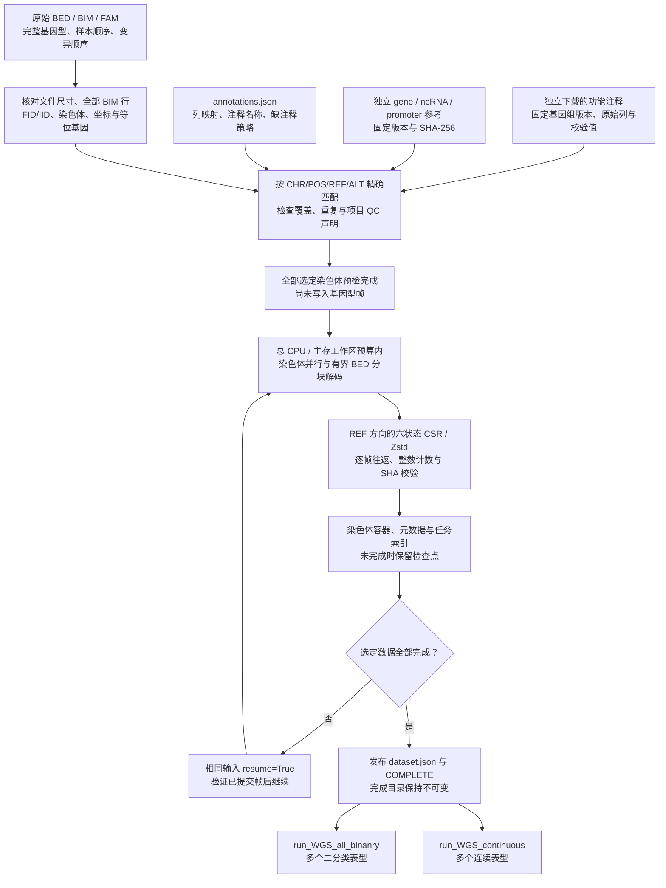

# WGS 遗传数据准备

## 1. 功能与流程

`prepare_WGS_data` 把原始 PLINK BED/BIM/FAM 和独立功能注释转换为可重复读取的压缩遗传目录。它保留样本顺序、变异顺序、REF/ALT 方向、完整基因型调用与缺失状态，同时生成 coding、noncoding、ncRNA 和 promoter 的参考任务索引。准备只运行一次；[二分类分析](wgs_binary.md)与[连续表型分析](wgs_continuous.md)直接复用完成目录，不重新转换遗传数据。

本阶段使用 CPU，不初始化 CUDA，不拟合零模型，也不计算关联 P 值。表型、协变量和 GRM 在关联阶段输入；准备阶段的 FAM phenotype 列不作为分析表型。



## 2. 安装

```bash
git clone https://github.com/weikanggong1/Fudan-WGS-Toolkit.git
cd Fudan-WGS-Toolkit
conda env create -f environment.yml
conda activate fudan-wgs-toolkit

# 只在读取原始参考资源归档时需要；CSV/TSV 注释不需要这个额外依赖。
python -m pip install -e '.[annotations]'

# 只在功能注释输入采用 Parquet 时需要。
python -m pip install -e '.[parquet]'
```

发行环境固定 Python 3.10、PyTorch 2.5.1、NumPy 1.26；准备使用 Python、NumPy、pandas 和 Zstandard。`annotations` 安装 `rdata==0.11.2`，仅用 Python 读取外部序列化参考数据，不安装或调用 R 解释器。默认 `cpu_threads=8` 是整个准备调用的 CPU worker 总预算，不是每条染色体各占八核。准备的 `memory_limit_gib` 是主机工作区估算，含义与关联入口的 GPU 显存上限不同。

## 3. 输入及格式

### 3.1 原始 BED/BIM/FAM

每条常染色体提供同一前缀的三个文件，例如 `chromosome21.bed`、`chromosome21.bim`、`chromosome21.fam`。文件必须来自同一份 PLINK 数据；不能仅凭 BIM 准备遗传数据。

| 文件 | 格式与列 | 本阶段使用方式 |
| --- | --- | --- |
| BED | PLINK 1 二进制、variant-major；前三字节为 `6c 1b 01` | 唯一基因型来源；BIM 第一个变异对应第一个 BED 块，FAM 第一行对应块内第一个样本 |
| BIM | 无表头、空白分隔六列：CHR、变异 ID、遗传距离、BP、A1、A2 | 保留原始变异顺序；BP 是 1-based 位置，必须正整数、非降序；A1/A2 必须明确且不同 |
| FAM | 无表头、空白分隔六列：FID、IID、父本 ID、母本 ID、sex、phenotype | 以完整 FID/IID 字符串双列保留身份及行序；后四列不是本包的关联输入 |

BED 的二位编码为 `00=A1/A1`、`10=A1/A2`、`11=A2/A2`、`01=完整缺失`；样本不足四的尾部填充位必须为零。转换核对 BED 字节长度与 FAM 样本数、BIM 变异数。格式见 [PLINK 官方文件说明](https://www.cog-genomics.org/plink/1.9/formats#bed)。

A1/A2 不自动等于 REF/ALT。默认 `reference_allele_source="annotation"`，由独立注释中的 REF/ALT 与两个 BIM 等位基因精确匹配，确定方向。若 BIM ID 本来就是 `CHR:POS:REF:ALT`，可显式声明 `"bim_variant_id"`；转换检查全部 BIM 行的 ID、染色体、位置和等位基因，不按文件名或少量位点推断。不会自动做链翻转、参考基因组转换或 indel 重新规范化，原始遗传文件和注释必须使用同一基因组版本与表示方法。

FID/IID 以字符串读取，前导零保留；完整双列不可重复。多个染色体的最终样本双列及顺序必须相同。`sample_pairs=None` 保留完整 FAM；显式选择时可传 `[n,2]` 字符串数组或有 `FID,IID` 表头的 CSV，选择必须存在于每份 FAM，并按选择给定的顺序输出。例如以下仅演示格式：

```csv
FID,IID
family_a,person_001
family_b,person_002
```

`variant_indices` 是递增、唯一的 **零基 BIM 行号**，不是基因组坐标或变异 ID；可给所有染色体一个数组，或用字典逐染色体指定。设置它会明确标记局部数据，正式全量准备保留 `None`。

### 3.2 功能注释与 QC

`annotation_directory` 接受含 `annotations.json` 的目录、清单路径或同结构 Python 字典。清单格式为 `raw-wgs-annotations-v1`，输入必须来自独立原始注释文件，不接受从已准备遗传缓存提取的注释。

每条染色体的功能表可为带表头的 CSV、TSV、gzip CSV/TSV、含 CSV/TSV 的 `tar.gz`/`tgz`，或 Parquet。多个分片及压缩包内成员按位置顺序排列；读入按块流式合并，不先解压成整条染色体文件。原始 BIM 位点必须有唯一的 CHR/POS/REF/ALT 对应行；公共库额外位点不加入遗传轴。同位置不同等位基因仍分别精确匹配。缺少所需列、缺失匹配或重复匹配默认报错。

本版清单生成工具对应 [FAVOR Essential GRCh38 原始数据](https://doi.org/10.7910/DVN/1VGTJI)，按固定官方教程 `5340326e0506945e35bc9d4d3cb85d5e8d65cd92` 的[列选择](https://github.com/li-lab-genetics/STAARpipeline-Tutorial/blob/5340326e0506945e35bc9d4d3cb85d5e8d65cd92/FAVORannotator_csv/Annotate.R)和[列重命名](https://github.com/li-lab-genetics/STAARpipeline-Tutorial/blob/5340326e0506945e35bc9d4d3cb85d5e8d65cd92/FAVORannotator_csv/gds2agds.R)使用下表。包内 `annotation/...` 路径是语义键名，不是要求运行时存在的 GDS 节点。

| 语义名称 | 原始 FAVOR 列 | 意义 |
| --- | --- | --- |
| chromosome / position | `chromosome` / `position` | GRCh38 常染色体与 1-based 位置 |
| reference / alternate | `ref_vcf` / `alt_vcf` | 原始 REF 和单个 ALT，indel 保留锚定碱基 |
| GENCODE.Category | `genecode_comprehensive_category` | exonic、splicing、UTR、upstream、ncRNA 等区域分类 |
| GENCODE.Info | `genecode_comprehensive_info` | 原始基因归属字符串，保留原语法 |
| GENCODE.EXONIC.Category | `genecode_comprehensive_exonic_category` | missense、synonymous、stopgain、frameshift 等编码影响 |
| MetaSVM | `metasvm_pred` | disruptive missense 分类依据 |
| GeneHancer | `genehancer` | enhancer 与目标基因的关联 |
| CAGE / DHS | `cage_tc` / `rdhs` | promoter/enhancer 的调控区域标记 |
| CADD / LINSIGHT / FATHMM.XF | `cadd_phred` / `linsight` / `fathmm_xf` | 三类功能权重 |
| aPC.EpigeneticActive / Repressed / Transcription | `apc_epigenetics_active` / `apc_epigenetics_repressed` / `apc_epigenetics_transcription` | 三类表观遗传注释主成分 |
| aPC.Conservation | `apc_conservation_v2` | 固定版本的保守性注释主成分 |
| aPC.LocalDiversity | `apc_local_nucleotide_diversity_v3` | 固定版本的局部多样性注释主成分 |
| aPC.Mappability / TF / Protein | `apc_mappability` / `apc_transcription_factor` / `apc_protein_function_v3` | 可比对性、转录因子及蛋白功能注释主成分 |

`column_mapping` 把上述语义路径映射到原始列，`annotation_catalog` 把分析名称映射到语义路径，`annotation_names` 指定数值权重列。列版本是科学输入，不能用不同代的 aPC 替换后仍声称同输入精度一致。

QC 来自项目自己的遗传质量控制，公共功能注释不能代替它。优先把原始 QC 列映射到 `qc_path`，例如 `column_mapping["annotation/filter"]="project_qc"`。只有原始 BED 确已通过项目 QC 时才设置 `default_qc="PASS"`；这个声明不会替用户执行 QC。

默认要求全部选定变异有完整对应注释。仅当显式声明 `reference_allele_source="bim_variant_id"` 和 `default_qc` 后，才允许另设 `allow_missing_non_snv=True`：未覆盖 non-SNV 的基因型仍保留，`annotation_available=False`、分类为空、数值权重为 NaN；SNV 缺注释仍报错，不把未知权重改成零。这类目录可做全部变异的 Single 和已覆盖 SNV 的 gene-based；Indel 或全部变异的 gene-based 需要完整独立注释。默认 `False`。

### 3.3 gene、ncRNA 与 promoter 参考

| 输入 | 格式与所需字段 | 意义及坐标 |
| --- | --- | --- |
| gene_reference | 带表头 CSV：`hgnc_symbol,chromosome_name,start_position,end_position` | 编码基因名称、染色体、起点、终点；1-based 闭区间，正整数且 start≤end；生成 coding 和 noncoding 任务 |
| ncrna_reference | 带表头 CSV：`chr,ncRNA` | 染色体与非空 ncRNA 名称；基因归属和变异范围由对应功能注释决定 |
| promoter_intervals | 带表头 TSV；准备读取 `chromosome,start,end`，标准导出另含 `strand,gene_id` | 已按链方向生成的 promoter 闭区间；准备直接消费区间，不重新猜测转录本和 promoter 长度 |

为运行三类 gene-based 分析，应提供三份参考；不提供的参考不会从基因型或旧缓存自动补建。参考里的所有名称必须与功能注释中的归属语法相容。

本版参考导出锁定 [STAARpipeline 官方提交 `ed3e26f7`](https://github.com/li-lab-genetics/STAARpipeline/tree/ed3e26f7fb4c5d70a765840d089e5863896ec081) 的 gene/ncRNA 表，以及 [TxDb.Hsapiens.UCSC.hg38.knownGene 3.22.0](https://bioconductor.org/packages/release/data/annotation/html/TxDb.Hsapiens.UCSC.hg38.knownGene.html) 的独立 SQLite。导出合并同一基因、同染色体且同链的转录本范围，排除多染色体或多链基因；正链取 `gene_start−3000 ... gene_start+2999`，负链取 `gene_end−2999 ... gene_end+3000`，宽度 6,000 bp。

导出器按原规则保留越界坐标，不裁剪到 1。当前准备入口要求选定染色体中的 start/end 为正整数；若原始导出含非正坐标，该行会导致准备报错，需先核对参考定义，不能静默改坐标后仍称原规则一致。

## 4. 从独立下载文件生成注释清单

### 4.1 固定资源、版本与许可

原始资源下载到项目外目录，保留来源、版本及校验值，不放进公共仓库。包的 GPL-3.0 许可不替代各外部数据库的使用条件；FAVOR 含多个上游注释来源，应核对所下载版本的条款。TxDb 3.22.0 官方包许可为 Artistic-2.0；基因参考遵循固定 STAARpipeline 资源的许可与署名。工具读取本地文件，不下载或重新发布原始资源。

| 参考输入 | 固定来源 / 版本 | 默认预期 SHA-256 |
| --- | --- | --- |
| gene_reference.archive | [官方 sysdata.rda](https://raw.githubusercontent.com/li-lab-genetics/STAARpipeline/ed3e26f7fb4c5d70a765840d089e5863896ec081/R/sysdata.rda)，本地文件名可自行指定 | `4bfa7ab5fe2c25f8aaf6e4319e683c3e29b97f62e687b01036501cffd32b484f` |
| promoter_reference.tar.gz | [TxDb 3.22.0 源包](https://bioconductor.org/packages/3.23/data/annotation/src/contrib/TxDb.Hsapiens.UCSC.hg38.knownGene_3.22.0.tar.gz) | `feb61126a6d874949423703c90e92e6073d22fecf2db18c44aa9859a43d53f4e` |
| 同一源包的独立 SQLite | 直接提供其数据库，而不是遗传缓存 | `7fab4f12a779f3917f84f19e6fe10b66fd5564ad015da55163d5c17e6c86f573` |

### 4.2 导出参考表

从仓库根目录运行：

```bash
python examples/export_annotation_references.py \
  --gene-reference-archive /data/downloads/gene_reference.archive \
  --promoter-database /data/downloads/promoter_reference.tar.gz \
  --output-directory /data/raw_annotation_references
```

| 参数 | 默认值 | 含义 |
| --- | --- | --- |
| --gene-reference-archive | 必填 | 独立下载的原始 gene/ncRNA 资源归档 |
| --promoter-database | 必填 | TxDb 原始 tar.gz 或其独立 SQLite |
| --output-directory | 必填 | 不存在的新目录，生成三份参考表及 `reference_export.private.json` |
| --gene-source-sha256 | 上表 gene SHA | 预期原始文件 SHA；实读字节不匹配时报错 |
| --promoter-source-sha256 | None | 自动按 tar 或 SQLite 使用上表固定 SHA |
| --promoter-package-version | `3.22.0` | tar 的 DESCRIPTION 必须匹配；换版本须显式绑定新版本及新 SHA |

输出证明记录输入与输出 SHA、条数、读取器版本和 promoter 规则。它属于本地溯源证据。

### 4.3 写入功能注释清单

下面示例中的 `PASS` 仅适用于已经通过项目 QC 的原始 BED。项目有逐位点 QC 时，改用原始 QC 列映射。

```bash
python examples/write_annotation_manifest.py \
  --output-directory /data/original_annotations \
  --chromosome 21 \
  --variant-archive /data/downloads/chromosome21.tar.gz \
  --gene-csv /data/raw_annotation_references/genes.csv \
  --ncrna-csv /data/raw_annotation_references/ncrna.csv \
  --promoter-tsv /data/raw_annotation_references/promoter_intervals.tsv \
  --default-qc PASS
```

| 参数 | 默认值 | 含义 |
| --- | --- | --- |
| --output-directory | 必填 | 写入 `annotations.json` 的目录 |
| --chromosome | 必填 | 此清单项对应的常染色体 |
| --variant-archive | 必填 | 独立原始功能表或含功能表的归档 |
| --gene-csv / --ncrna-csv / --promoter-tsv | 必填 | 第 3.3 节三份独立参考文件 |
| --default-qc | None | 显式固定 QC 声明；None 时须给清单添加真实 QC 列映射 |
| --reference-allele-source | `annotation` | 可选 `bim_variant_id`；对应第 3.1 节方向核验 |
| --allow-missing-non-snv | False | 显式启用第 3.2 节不完整 non-SNV 注释策略 |

此脚本一次写一条染色体，**再次运行会覆写同名清单**。多染色体应在一次准备前，把各染色体项合并进同一个 `chromosomes` 列表，保留共同的列映射与注释名称；也可在 Python 中生成完整清单：

```python
import json
from pathlib import Path
from examples.write_annotation_manifest import write_manifest

original_annotation_directory = Path("/data/original_annotations_all")
original_annotation_manifest_path = write_manifest(
    output_directory=original_annotation_directory,
    chromosome=21,
    variant_archive=Path("/data/downloads/chromosome21.tar.gz"),
    gene_csv=Path("/data/raw_annotation_references/genes.csv"),
    ncrna_csv=Path("/data/raw_annotation_references/ncrna.csv"),
    promoter_tsv=Path("/data/raw_annotation_references/promoter_intervals.tsv"),
    default_qc="PASS",  # 仅在原始遗传文件已经通过项目 QC 时声明。
)
original_annotation_manifest = json.loads(original_annotation_manifest_path.read_text())
common_reference_entry = original_annotation_manifest["chromosomes"][0]
original_annotation_manifest["chromosomes"] = [
    dict(common_reference_entry, name=str(chromosome_number),
         variants=str(Path(f"/data/downloads/chromosome{chromosome_number}.tar.gz")))
    for chromosome_number in range(1, 23)
]
original_annotation_manifest_path.write_text(
    json.dumps(original_annotation_manifest, ensure_ascii=False, indent=2) + "\n"
)
```

这个清单包含 `schema_version=1`、`format="raw-wgs-annotations-v1"`、`column_mapping`、`annotation_catalog`、`annotation_names`、`qc_path`、REF 来源策略和 `chromosomes`。每项给 `name`、`variants`、`gene_reference`、`ncrna_reference`、`promoter_intervals`；`variants` 可为按位置排序的文件列表。路径相对清单所在目录解析，Python 字典中的相对路径则相对当前目录。需要时可指定 `delimiter`、`field_types` 和 `source_provenance`；逐染色体 `column_mapping`、QC 或方向策略覆盖共同值。完整原始列映射由上述工具生成，无需从已准备目录反推。

## 5. Python 调用与全部参数

```python
from pathlib import Path
from fudan_wgs_toolkit import prepare_WGS_data

original_genetic_directory = Path("/data/original_plink")
original_annotation_directory = Path("/data/original_annotations_all")
prepared_genetic_directory = Path("/data/prepared_genetics")

if __name__ == "__main__":
    preparation_report = prepare_WGS_data(
        source_directory=original_genetic_directory,
        output_directory=prepared_genetic_directory,
        annotation_directory=original_annotation_directory,
        chromosomes=list(range(1, 23)),  # 已提供的全部 22 条常染色体。
        sample_pairs=None,               # 保留完整 FAM 样本，不建表型子集缓存。
        variant_indices=None,            # 保留所有原始变异。
        cpu_threads=8,                   # 整个准备调用的 CPU 总预算。
        memory_limit_gib=8,              # 主存工作区估算，不是 GPU 显存上限。
        chunk_size=256,                  # 每个遗传帧 256 个变异。
        resume=False,                    # 首次准备必须使用新目录。
    )
    print(preparation_report["completed"])
    print(preparation_report["seconds"])
    # 文件逻辑长度与文件系统实际分配块分别记录；单位均为字节。
    print(preparation_report["storage"]["prepared"]["unique_allocated_bytes"])
```

多染色体准备使用 `spawn`，独立脚本应保留 `if __name__ == "__main__"`。只准备一条染色体时把 `chromosomes` 改为 `[21]`；`None` 表示自动发现的全部常染色体。准备入口不使用关联入口的 `chromosomes="all"` 写法。

| 参数 | 真实默认值 | 意义与要求 |
| --- | --- | --- |
| source_directory | None | 原始三文件目录，自动发现 `.bed`；与 `prefixes` 至少提供其一 |
| output_directory | None，必填 | 新准备目录；不能覆盖完成数据 |
| prefixes | None | Python 字典 `{染色体: BED/BIM/FAM 前缀}`；多个同染色体文件组时明确选组；相对前缀要求 source_directory |
| chromosomes | None | 发现的全部常染色体，或所需的唯一列表；允许整数、规范字符串及 `chr` 前缀，仅支持 1–22 |
| annotation_directory | None，必填 | 原始注释清单目录、JSON 路径或同结构字典 |
| sample_pairs | None | 完整 FAM；可显式用 FID/IID CSV 或 `[n,2]` 字符串数组选择和排序 |
| variant_indices | None | 全部变异；可用递增唯一零基 BIM 行号或逐染色体字典选择局部验证范围 |
| memory_limit_gib | 8 | GiB 主机工作区估算，用于整个任务的并发准入；正有限数，不是总 RAM/RSS 硬限制 |
| cpu_threads | 8 | 总 CPU worker 预算，正整数；多染色体分配给各进程，单染色体用于分块解码；1 为串行 |
| hardlink_annotations | True | 同文件系统尽量硬链接内部已准备注释，失败则复制；不硬链接原始基因型 |
| resume | False | 仅恢复输入、样本、变异与参数绑定完全一致的未完成准备 |
| max_frames | None | 此次调用最多新提交的遗传帧数；到达后返回未完成、不给整体完成清单；转换阶段串行以守住全局限额 |
| chunk_size | 256 | 每个压缩遗传帧的变异数，整数 1–1024；减少它可降低临时解码与 CSR 校验内存 |

主存调度同时估算原始轴、注释合并和遗传解码工作区，减少染色体并发数与注释读入块。字符串、CSR 校验暂存和解释器开销可能超出估算；`parallel_execution.budget_is_estimate=True` 明确记录这一口径。最小估计工作集仍过大时报错，应减小 `chunk_size`，不能把工作区预算当作实测峰值 RSS。

## 6. 命令行

```bash
prepare-WGS-data \
  --source-directory /data/original_plink \
  --annotation-directory /data/original_annotations_all \
  --output-directory /data/prepared_genetics \
  --chromosomes 1 2 3 4 5 6 7 8 9 10 11 12 13 14 15 16 17 18 19 20 21 22 \
  --cpu-threads 8 \
  --memory-limit-gib 8 \
  --chunk-size 256
```

CLI 也可用 `python -m fudan_wgs_toolkit.prepare`，接收同一组参数，完成后打印 JSON 报告。

| CLI 参数 | 默认值 | 对应作用 |
| --- | --- | --- |
| --source-directory / --output-directory / --annotation-directory | 必填 | 原始遗传目录、准备输出目录、独立注释清单 |
| --chromosomes | 未指定 | 全部发现的常染色体；指定时用空格分隔列表 |
| --sample-pairs | None | FID/IID CSV 选择，保留其给定顺序 |
| --cpu-threads | 8 | 总 CPU 预算 |
| --memory-limit-gib | 8 | 主存工作区估算，GiB |
| --chunk-size | 256 | 每帧变异数，1–1024 |
| --max-frames | None | 新提交帧限制，用于受限检查点运行 |
| --resume | False | 恢复一致输入的未完成准备 |
| --copy-annotations | False | 改为复制内部注释，等价于 Python hardlink_annotations=False |

CLI 没有 `prefixes` 或 `variant_indices` 参数，需精确指定它们时使用 Python。首次执行必须使用新目录；恢复以相同参数加 `--resume`。

## 7. 输出、完成与恢复

### 7.1 目录结构

```text
prepared_genetics/
  dataset.json                         # 选择的全部染色体完成后发布
  COMPLETE                             # dataset.json 原始字节的 SHA-256
  preparation.pending.json             # 原始输入、样本、变异与 chunk_size 绑定
  storage.report.json                  # 实测源文件、缓存、元数据与临时空间分项
  sample_pairs.npy                     # [n,2] 完整 FID/IID 字符串
  sample_ids.npy                       # 身份双列生成的无歧义内部键
  catalogs/
    chr21.genes.json                    # coding/noncoding/ncRNA 的有序任务与源 SHA
    chr21.promoters.json                # 对应常染色体的 promoter 闭区间
  chr21/
    samples.npy                        # 原始 FAM 行号，确定遗传帧样本轴
    data.bin / headers.bin / counts.bin # 压缩 CSR、帧说明与整数计数
    index.npy                          # 每帧起点、变异数、偏移、尺寸和 SHA
    journal.jsonl                      # 新目录逐帧追加 ACK；旧检查点仍用 journal.json
    manifest.pending.json              # 未完成容器的固定绑定
    manifest.json / COMPLETE           # 完成容器及其 SHA
    metadata/
      manifest.json / COMPLETE         # 元数据文件、轴、来源与覆盖绑定
      annotation.source.json           # 保留注释预检清单原始字节，串联基因型来源 SHA
      sample_pairs.npy / sample_ids.npy
      source_sample_rows.npy           # 输出样本对应的原始 FAM 行号
      source_variant_rows.npy          # 输出变异对应的原始 BIM 行号
      field_*                          # 数值列或原始字符串的独立数组
```

未完成时保留 `.preflight/` 中的轴文件，以及 `.raw_annotations/` 中经过验证的注释与进度记录，供同输入恢复使用。全部选定染色体完成、根目录 `dataset.json` 与 `COMPLETE` 原始字节再次核对后，才清理这两处内部临时目录。最终 metadata 的硬链接继续保有数据；复制模式或跨文件系统回退产生的临时副本也在此时释放。原始 BED/BIM/FAM、下载注释和参考表不删除。完成的遗传容器、元数据和整体清单各有独立完成标记，不能用某一条染色体的 `COMPLETE` 代替整体完成。

### 7.2 字段含义与精确保存

`dataset.json` 保存 `schema_version=2`、`sample_identifier_format="fid_iid_json"`、样本数组位置、染色体容器/metadata/参考索引、`annotation_catalog`、`annotation_names`、`qc_path` 和准备统计。每条染色体统计含原始/输出样本数、变异数、是否子集、方向与注释覆盖检查、预检/转换时间及工作区估算。`parallel_execution` 给出实际预检和转换 worker 数、每 worker CPU 份额、块大小及限流原因。

遗传帧按 REF 方向保存六状态编码：`0=REF/REF`、`1=REF/ALT`、`2=ALT/ALT`、`3=完全缺失`、`4=单个已知REF`、`5=单个已知ALT`。原始 BED 只有前三种完整调用与完全缺失，不能恢复半调用；该来源的 `half_missing_samples` 为零。准备不把基因型 NaN 填成剂量，也不执行表型填补；关联入口再按每个表型的样本与既有规则计算 AF/MAF/MAC、填补及资格过滤。

每帧保存 REF 等位基因数、已调用等位基因数、半缺失样本数的整数摘要，CSR 编码后解码与原状态及摘要精确比对。新目录采用无损行内样本序号差分编码，读出时恢复完全相同的绝对序号和六状态；旧 v1 帧仍可读取。新目录逐帧追加 `journal.jsonl`，最终通过映射数组生成 `index.npy`，避免每新增一帧重写整个日志及在内存中保存整条染色体的日志列表。旧 `journal.json` 检查点按原格式恢复，不转换已提交帧。

`index.npy` 和完成清单保存帧、数据流与文件校验值。容器存储准入仍以实际保留的原始 **BED 字节数** 的 10% 为上限，小型验证有每条染色体 1 MiB 的最小容器额度。该限制覆盖基因型容器文件，不包括独立 annotation metadata、临时注释目录或原始输入；也不把已压缩 GDS 当作等尺寸的 BED。`prepare_WGS_data` 本身的原始遗传输入为 PLINK，已有 GDS 来源的完成目录由关联入口直接复用。

### 7.3 磁盘统计口径

返回值 `storage` 与 `storage.report.json` 保存同一份统计；`dataset.json` 的 `preparation.storage_report` 指向该诊断文件。统计不含报告自身，不跟随内部目录符号链接，读取或权限错误不会计作零空间。它使用文件长度和文件系统块数，不是配额或可保证的压缩率。

| `storage` 字段 | 意义 |
| --- | --- |
| `source` | 仍保留在外部的原始三文件、注释和参考表；共享路径及硬链接只计一次 |
| `prepared` | 本次调用结束时输出目录的实测大小，排除 `storage.report.json` 自身 |
| `components` | 基因型容器、最终 metadata、任务参考索引、注释暂存和样本轴暂存分别统计 |
| `logical_bytes` / `allocated_bytes` | 文件名对应的逻辑长度总和与文件系统分配块总和；硬链接的多个目录项会重复计入 |
| `unique_logical_bytes` / `unique_allocated_bytes` | 按设备号和 inode 去重后的长度与分配块；文件系统未提供块数时后者为 `null` |
| `hardlink_duplicate_bytes` | 重复目录项对应的逻辑长度，不代表重复占用的数据块 |
| `genotype_cache_admission` | 每条染色体保留 BED 的大小、10% 缓存准入及最小额度；不与最终整目录大小混算 |
| `phase_boundary_before_cleanup` | 提交完整数据、清理内部暂存之前的实测快照；未完成时为 `null` |
| `peak` | `actual_bytes=null`；仅给已观测阶段边界的最低规模，不能称为整个准备过程的实测峰值 |
| `cleanup` | 是否成功删除内部暂存、删除的目录名及失败原因；检查点不执行删除 |

最终占用与准备时暂存共存的空间不同。尤其在 `hardlink_annotations=False` 或硬链接回退为复制时，清理前两份注释可能同时存在；完成后只保留供关联入口读取的最终 metadata。查看可用空间时，应同时考虑外部原始输入、准备输出与原子提交时短暂存在的文件，不能只拿基因型缓存额度作为整次运行需求。

### 7.4 报告与断点恢复

| preparation_report 字段 | 含义 |
| --- | --- |
| completed | 只有选定全部数据和整体完成清单发布后才为 True |
| dataset | 完成时为 dataset.json 路径；检查点返回 None |
| n_samples | 完成样本轴的长度，不是后续每个表型的分析样本量 |
| chromosomes | 完成的逐染色体统计、预检和转换证据 |
| seconds | 本次准备调用墙时，含预检、转换与最终发布 |
| committed_frames | 本次新提交帧数，不是历史累计帧总数 |
| cpu_threads / parallel_execution | 请求的总 CPU 预算及实际并发配置 |
| checkpoint_directory | 达到 max_frames 返回未完成时的恢复目录 |
| storage | 与 `storage.report.json` 一致的文件分配、去重、暂存与准入口径 |

`resume=True` 验证原始三文件、原始注释、参考资源、样本双列、选择行和 chunk_size 绑定；已完成染色体重新验证数据流和元数据 SHA，未完成容器验证已提交连续帧后继续。输入或已提交内容不一致时报错，不覆盖完成数据。`max_frames` 只发布可恢复检查点，不能把它当作可做全量关联的完成目录。

已有合法 `dataset.json` 或兼容的 `cache_dataset.json` 完成目录时，直接传给关联入口的 `prepared_directory`，不再调用准备。后者沿用已有数字身份轴，关联 CSV 的身份要求见对应[二分类](wgs_binary.md)或[连续](wgs_continuous.md)说明；这里不会把旧身份格式改写成新的缓存。

## 8. 原软件对应准备调用

本包准备的对应操作是原始基因型转换、FAVOR 注释匹配和参考索引整理。官方 STAAR 路线先用 SeqArray 转 GDS，再按 FAVORannotator 的 `Varinfo_gds.R → Annotate.R → gds2agds.R` 生成 aGDS；见[官方准备教程](https://github.com/li-lab-genetics/STAARpipeline-Tutorial#pre-step-of-association-analysis-using-staarpipeline)。本包直接输出 Python 压缩遗传目录，不创建 GDS/aGDS，也不在运行时调用这些原软件。

以下为独立官方对照的 BED 转换形式，参数名来自 [SeqArray 官方手册](https://www.bioconductor.org/packages/release/bioc/manuals/SeqArray/man/SeqArray.pdf)：

```r
SeqArray::seqBED2GDS(
    bed.fn = "/data/original_plink/chromosome21.bed",
    fam.fn = "/data/original_plink/chromosome21.fam",
    bim.fn = "/data/original_plink/chromosome21.bim",
    out.gdsfn = "/data/reference/chromosome21.gds",
    compress.geno = "LZMA_RA",
    compress.annotation = "LZMA_RA",
    include.pheno = FALSE,
    optimize = TRUE,
    digest = "sha256",
    parallel = 8
)
```

官方注释教程脚本需先配置自己的输入 GDS、FAVOR 分片表、数据库与输出路径，再分别执行；这些是原软件对照命令，不是本包额外依赖：

```bash
Rscript /data/reference_scripts/FAVORannotator_csv/Varinfo_gds.R
Rscript /data/reference_scripts/FAVORannotator_csv/Annotate.R
Rscript /data/reference_scripts/FAVORannotator_csv/gds2agds.R
```

对照要核对相同样本顺序、REF/ALT、缺失编码、QC、注释列版本与参考区间。PLINK 的 A1/A2 与官方 GDS 的参考方向仍须验证；外部转换命令本身不建立方向等价证明。

## 验证与 benchmark

2026-10-16 的存储标准化版在目标计算节点通过307项CPU测试，并以345,967名人工样本、8,192个位点、11个注释通道实际运行普通准备入口。相同输入、2CPU、chunk_size=64下，旧 / 新基因型payload分别为26,672,608 / 9,573,753字节，完整prepared目录去重后的实际分配为206,970,880 / 183,836,672字节，减少11.18%。2,834,161,664个遗传状态、整数计数、196,608个metadata值及样本顺序精确一致；源PLINK不能表示半缺失，测试输入已明确将其转为完全缺失。

旧 / 新准备墙时为63.622 / 63.400秒，单次共享节点对照且缓存冷热未严格控制，不据此宣称加速。新版完成清单核验后移除内部暂存、保留注释来源清单及原始输入。真实prepared的110帧只读压缩检查另得到26.71%的payload减少；没有转换全部真实缓存。详细存储分项和后续binary / continuous GPU回归见[本轮匿名记录](../validation/storage_standard_20261016.anonymous.json)及[生成器验证](generate_simulated_data.md#7-验证与-benchmark)。

下列是此前 v1 编码与 CPU 调度的真实数据记录，直接读取原始 BED/BIM/FAM 与独立 FAVOR Essential GRCh38 文件；它们不代表新版样本序号差分编码、追加日志与完成后清理的耗时。新版存储路径通过整数状态、计数与注释逐值检查验证，真实数据端到端速度尚未重测。原始样本与位点标识、实际基因表和详细路径均不公开。

| 检查 | 真实范围与结果 |
| --- | --- |
| 样本与完整 BIM 核验 | 341,101 个完整 FID/IID；13,733,596 个 BIM ID 逐一核对 CHR/POS/REF/ALT 与 A1/A2 |
| 初次局部准备 | 341,101 人×2,048 SNV；总墙时 58.44 s，其中 BED 转存与元数据整理 16.44 s |
| 该局部独立原始回读 | 698,574,848 个基因型状态差异为 0；REF/called/half-call 整数计数差异为 0；回读 43.58 s |
| 有 gene-based 分类的局部准备 | 341,101 人×1,536 SNV；准备 105.82 s，其中 BED 解码和元数据整理 16.11 s；使用独立 TxDb 3.22.0 promoter |
| 后一局部独立原始回读 | 523,931,136 个状态及全部整数计数差异为 0；回读 32.05 s |
| 原始注释文件校验 | 对应官方归档为 5,528,780,471 字节，官方 MD5 `dccf132a9ed61f18f08ceac69b5c2cab` 匹配；准备另绑定实际 SHA-256 |
| 独立参考导出 | gene 18,445 行、ncRNA 21,104 行、promoter 35,356 行；原始 tar 与独立 SQLite 导出的三个文件 SHA 均与固定参考一致 |

初次 2,048 SNV 局部仅有 intronic 分类，不用于证明 gene-based 关联有效性。两个局部都不是完整染色体。基因型准备的精度依据原始整数状态与计数逐值一致，不能用关联 P 值相近代替。

真实 1/8 CPU 对照使用同一批 341,101 人、1,536 SNV 和六个遗传帧，每轮重新读原始遗传文件与独立注释，写入新目录：

| CPU 解码预算 | 准备端到端墙时 | 注释预检 | BED 转换与元数据 |
| --- | --- | --- | --- |
| 1 | 116.95 s | 85.34 s | 22.87 s |
| 8（默认） | 96.08 s | 72.94 s | 15.08 s |

两份输出的状态、整数计数、FID/IID 顺序及注释字段与既有同输入数据完全一致。端到端时间降低 17.8%，BED 转换与元数据阶段降低 34.1%。测量顺序先 1 后 8，原始文件页面缓存已热；注释预检差异不能归因于解码线程，阶段时间也不能直接相加当另一项端到端时间。两轮同一进程累计峰 RSS 为 1,339.22 MiB，未测各轮独立峰值。之后增加的恢复与临时轴完整性检查由组件回归覆盖，尚无这些检查后的新版准备耗时重测。

当前没有本版 22 条染色体准备端到端速度、冷缓存峰值或与官方 SeqArray/FAVORannotator 的同输入转换速度实测；上述原始回读证明限于注明的局部范围。关联精度、GPU 峰值和表型缺失策略的真实验证分别见[二分类](wgs_binary.md)与[连续](wgs_continuous.md)页，不混入准备耗时。

## 10. 参考与源码

- [准备入口源码](../fudan_wgs_toolkit/prepare.py)、[压缩容器与逐帧校验](../fudan_wgs_toolkit/cache_runtime/store.py)、[参考表导出](../examples/export_annotation_references.py)、[注释清单生成](../examples/write_annotation_manifest.py)。
- [PLINK 官方 BED/BIM/FAM 格式](https://www.cog-genomics.org/plink/1.9/formats#bed)。Chang et al. *Second-generation PLINK: rising to the challenge of larger and richer datasets*. *GigaScience* (2015), [doi:10.1186/s13742-015-0047-8](https://doi.org/10.1186/s13742-015-0047-8)。
- [SeqArray 官方手册](https://www.bioconductor.org/packages/release/bioc/manuals/SeqArray/man/SeqArray.pdf)。Zheng et al. *SeqArray—a storage-efficient high-performance data format for WGS variant calls*. *Bioinformatics* (2017), [doi:10.1093/bioinformatics/btx145](https://doi.org/10.1093/bioinformatics/btx145)。
- [STAARpipeline 官方代码与准备教程](https://github.com/li-lab-genetics/STAARpipeline-Tutorial)。Li et al. *A framework for detecting noncoding rare-variant associations of large-scale whole-genome sequencing studies*. *Nature Methods* (2022), [doi:10.1038/s41592-022-01640-x](https://doi.org/10.1038/s41592-022-01640-x)。
- Zhou et al. *FAVOR: functional annotation of variants online resource and annotator for variation across the human genome*. *Nucleic Acids Research* (2023), [doi:10.1093/nar/gkac966](https://doi.org/10.1093/nar/gkac966)；[固定 FAVOR Essential 原始数据](https://doi.org/10.7910/DVN/1VGTJI)。
- [TxDb.Hsapiens.UCSC.hg38.knownGene 官方版本与许可](https://bioconductor.org/packages/release/data/annotation/html/TxDb.Hsapiens.UCSC.hg38.knownGene.html)，[doi:10.18129/B9.bioc.TxDb.Hsapiens.UCSC.hg38.knownGene](https://doi.org/10.18129/B9.bioc.TxDb.Hsapiens.UCSC.hg38.knownGene)。
