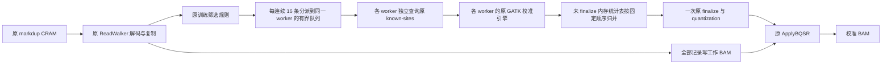

# 原 GATK BQSR 并行训练与解码复用

此候选遍历原 markdup CRAM 一次，将全部解码记录写入临时工作 BAM，同时让多个
worker 调用原 GATK 校准引擎。每个 worker 独立持有参考读取器、已知位点读取器、
header 和校准参数。它们的原生内存统计表按固定顺序合并，随后只运行一次原
finalization、报告舍入和 quantization。原 ApplyBQSR 再读取工作 BAM 应用校准。
连续 16 条通过训练筛选的 reads 分派给同一 worker，然后轮到下一个 worker，
让相邻位置尽量复用各自的读取缓存。这是固定内部调度策略，不增加公开参数。



## Python 调用、输入与输出

```python
from pathlib import Path
from fudan_wgs_toolkit.build_preprocessing_bqsr import (
    build_preprocessing_bqsr, bqsr_training_argv,
)

conda_prefix = Path('/opt/conda/envs/wgs')  # 同一已配置环境内的 Java 与 GATK 4.2
build_directory = Path('/analysis/example/new_bqsr_build')  # 必须是新目录
assets = build_preprocessing_bqsr(
    conda_prefix,
    build_directory,
    cpu_affinity=[0, 1, 2],  # 构建获准使用的 Linux CPU 编号
    host_memory_limit_gib=4,
    host_memory_reserve_gib=4,
)

output_directory = Path('/analysis/example/new_bqsr_run')
temporary_directory = output_directory / 'tmp'
temporary_directory.mkdir(parents=True)
training_command = bqsr_training_argv(
    assets,
    input_cram='/analysis/example/marked.cram',
    reference_fasta='/reference/genome.fa',
    known_sites=[
        '/reference/Homo_sapiens_assembly38.dbsnp138.vcf.gz',
        '/reference/Mills_and_1000G_gold_standard.indels.hg38.vcf.gz',
        '/reference/Homo_sapiens_assembly38.known_indels.vcf.gz',
    ],
    recalibration_table=output_directory / 'recal.table',
    canonical_bam=output_directory / 'canonical.bam',
    audit_json=output_directory / 'training.private.json',
    temporary_directory=temporary_directory,
    cpu_threads=9,  # 执行方还须把整个子进程树绑定到获准的 9 CPU
    training_workers=7,  # 为生产者、writer 及辅助线程预留 CPU 预算
    queue_capacity=32,  # 每 worker 32 条，合计最多 224 条待处理记录
    heap_gib=4,
    replay_compression=0,
)
# training_command 是 shell-free argv。将它交给 pipeline 的资源记录器执行；
# argv 生成函数本身不启动数据处理，也不设置亲和性或科学阶段的 PSS 门禁。
```

| 参数 | 意义和格式 |
|---|---|
| `conda_prefix` | 已有 Conda 环境目录，含 Java 编译/运行工具和原 GATK 4.2.0.0 jar；构建不安装软件或修改环境。 |
| `build_dir` | 新的构建目录，位于 Conda prefix 和源码包之外。 |
| `cpu_affinity` | 构建使用的 1–3 个不同 Linux CPU 编号，不超过真实 cgroup quota。 |
| `host_memory_limit_gib` | 构建进程树采样 PSS 预算，单位 GiB；有限值 1–32，不是 cgroup 硬限额。 |
| `host_memory_reserve_gib` | 构建准入内存余量，有限值且至少 1 GiB。 |
| `input_cram` | 原 markdup CRAM，保留原 HTSJDK 解码的记录、顺序及 typed AUX；需原参考与索引。 |
| `reference_fasta` | 原参考 FASTA，与 CRAM、字典、索引及 known-sites 的参考轴一致。 |
| `known_sites` | 原有序位点资源路径列表，保留原文件、索引及版本。 |
| `recalibration_table` | 新的原格式 GATK 五表报告。 |
| `canonical_bam` | 新的临时 BAM，包含全部解码记录，包括未参与训练的 unmapped、secondary、duplicate 等记录。 |
| `audit_json` | 新的私有数值收据，包含记录数、训练数、worker、队列和资源关闭状态，不含 read ID 或序列。 |
| `temporary_directory` | 已创建的 Java 临时目录。 |
| `cpu_threads` | 子 JVM 可用 CPU 数提示，正整数；执行方负责实际亲和性和资源准入。 |
| `training_workers` | 原校准引擎 worker 数，整数 1–16，且不大于 `cpu_threads`；默认 2。 |
| `queue_capacity` | 每 worker 的待处理记录数量，整数 1–64；所有队列合计不超过 256 条，默认 32。 |
| `heap_gib` | 子 JVM 最大堆，整数 1–24 GiB；对照时与原路线一致。 |
| `replay_compression` | 仅临时 BAM 的压缩级别 0–9，默认 0；最终 ApplyBQSR 压缩设置保持原值。 |

构建输出 `fnit-bqsr-parallel.jar`、源码快照、阶段日志、构建收据和最后原子提交的
`assets.private.json`。返回 JSON 绑定 Java、adapter jar、原 GATK jar 的 SHA-256
与文件身份，以及 classpath、entrypoint、固定 1000bp 预取值、当前 builder/manifest
SHA 和成功收据的路径/SHA。命令生成器重新核验这些绑定、parallel schema 和收据
的完整资产内容；旧串行 assets 不适用于这个入口。

队列限制是记录数量限制。内存中还包括每个 worker 当前处理的记录、生产者副本、
writer 的最多 256 条缓冲及各自参考/位点缓存，实际内存由整个进程树的 PSS 门禁约束。
`cpu_threads=1` 时应显式设 `training_workers=1`；超过 8 个 worker 时需要减小默认队列，
例如 16 worker 配 `queue_capacity=16`。函数不会静默裁剪这些参数。

所有输出目的地必须全新。此入口保持原默认 BQSR 科学参数，BAQ 和 indel BQSR 均为
原默认关闭状态，不提供区间、降采样、筛选规则或 known-sites 版本变更参数。
BQSR 保留原 CPU 数值计算，不对该路径使用 TF32 或其他低精度近似。

## 命令行与原软件调用

只构建适配器：

```bash
python -m fudan_wgs_toolkit.build_preprocessing_bqsr \
  --conda-prefix /opt/conda/envs/wgs \
  --build-dir /analysis/example/new_bqsr_build --cpu-affinity 0,1,2
```

使用相同 CRAM、参考、已知位点和 JVM 设置的原训练对照：

```bash
gatk --java-options '-Xmx4g -XX:ActiveProcessorCount=9 -XX:ParallelGCThreads=1' \
  BaseRecalibrator -R "$REFERENCE_FASTA" -I "$MARKED_CRAM" \
  --known-sites "$DBSNP138_VCF" --known-sites "$MILLS_VCF" \
  --known-sites "$KNOWN_INDELS_VCF" -O "$RECALIBRATION_TABLE"
```

候选训练提交后，仍调用原应用阶段：

```bash
gatk --java-options '-Xmx4g -XX:ActiveProcessorCount=9 -XX:ParallelGCThreads=1' \
  ApplyBQSR -R "$REFERENCE_FASTA" -I "$CANONICAL_BAM" \
  --bqsr-recal-file "$RECALIBRATION_TABLE" -O "$RECALIBRATED_BAM" \
  --create-output-bam-index false
```

上述大写变量分别是原参考、原 CRAM、三个原 known-sites、临时工作 BAM、校准表和
最终 BAM 的完整路径。正式计时应覆盖临时 BAM 写出、原 ApplyBQSR 和最终索引。
外层调用还需完整退出、PSS 与输出提交门禁；项目主 API 负责这些执行约束。

## 验证状态与更新记录

固定 chunk16 Java 源码已通过真实 1M 对完整 reads 前缀的 BQSR 组件验收。两路使用
同一 CRAM、参考、三个原 known-sites、原 GATK 4.2.0.0、9 CPU 预算和 4 GiB JVM 堆；
候选使用 7 worker、每队列 32 条、原 1000bp 位点预取。实际五表全部单元格相同，
canonical 和最终 ApplyBQSR 输出均完整比较了 1,940,468 条记录，差异为 0。

| 真实 1M BQSR 组件 | 原 GATK 路线 | chunk16 候选 |
|---|---:|---:|
| 训练，候选含同遍工作 BAM 写出 | 283.294 秒 | 88.498 秒 |
| 原 ApplyBQSR | 33.493 秒 | 21.231 秒 |
| 上述两步合计，按未舍入实测值计算 | 316.786 秒 | 109.729 秒 |

候选训练和应用的采样 PSS 峰值分别为 4.168 和 1.168 GiB。此为共享节点的一次组件
对照；两步合计不含构建、输入准备、最终索引、上游 mapping 或下游 HC/QC/PLINK，
不能当作完整流程加速。临时工作 BAM 的全部写出已计入训练时间。

随后已通过公开 builder 冷构建资产的真实 **10M 对读段完整 API** 对照，使用同一
9 CPU 预算、44 × 200 kb 调用区间。训练为 **1051.916 → 383.718 秒**，原
ApplyBQSR 为 **203.152 → 183.992 秒**，两步合计 **1255.068 → 567.710 秒**。
完整 API 为 **2534.253 → 1762.059 秒（1.438×）**，包含两个适配器共 **6.506 秒**
冷构建和自身最终回读。训练阶段采样任务 PSS 为 **4.036 → 4.234 GiB**，整任务为
**6.173 → 6.202 GiB**。五表全部单元格及五组各 **19,983,249 条完整记录**均一致，
包括 QUAL、typed AUX、标签与记录顺序；下游 VCF 和 912 个 PLINK 变异也通过完整
回读。单次共享节点对照、外部独立验收耗时和资源观察范围详见
[完整入口 benchmark](../../docs/single_subj_preprocessing.md#99-v012更大真实输入的同配置完整调用)。
这是固定读段前缀与 8.8 Mb 局部调用，不是完整深度 WGS 或多样本长期稳定性验收。

精度门禁比较五张报告的全部单元格、每条记录的 11 个 SAM 核心字段、typed AUX
类型和值、AUX 顺序、记录顺序及 header 的 contig/read-group 语义。仅显式绑定的
命令行路径角色及已核验参考注释允许在 header 中规范化。输入前缀不是完整生物样本。

研发历史：串行同遍复用方案曾在真实 1M 输入上通过完整精度比较，但未证明净加速，
其 Java 源码已从公开候选中移除。主线程查询位点的早期并行方案同样没有净收益；
真实调用栈定位到位点查询后，本候选把原查询器隔离到各 worker，保留原 1000bp 预取。
随后固定连续 16 条的分派策略通过同一真实 1M 的完整组件门禁。早期实现的历史结果
不充当当前实现的 benchmark，公开源码只保留当前 chunk16 实现。

原实现和参考文献见 [SOURCES.md](SOURCES.md)。测序记录处理不适用脑图可视化。
